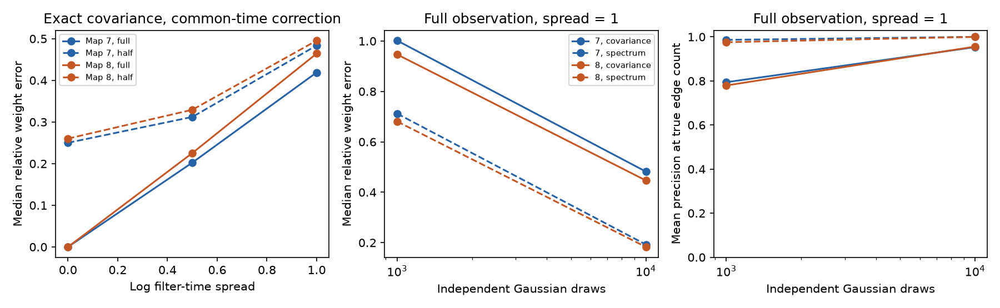

# Zero-frequency spectra removed unequal-filter weight bias in two fully observed passive worm models

A zero-frequency spectrum recovered the weights of two passive electrical circuit models with different observation filter times at each cell. A covariance correction that assumed one common filter time did not do so. Exact recovery required full observation, symmetric drift, known equal white current noise and unit observation gains. This result concerns models on public worm wiring maps. It is not a test on recorded neural activity.

The left panel shows exact-covariance errors over 20 assumed filter assignments and observation masks. The other panels show 30 conditional Gaussian sampling trials for one filter assignment. The dashed spectral curves use an ideal zero-frequency target. They do not represent a spectrum estimated from a recording. All error measures exclude diagonal entries. Precision uses the true number of edges.

## Question and prior work

Can a temporal statistic avoid the weight bias caused by different observation filter times? This matters when calcium-like signals are used to estimate electrical circuit strength. A good link ranking can hide a large weight error.

We searched the shared SCI campaign for connectome, non-normal, electrical developmental and filter direction before the test. We read SCI 22289885 and fd91a1c7. The first tested a common exponential filter and derived a covariance correction. The second distinguished snapshot and zero-frequency information. We extend that context to unequal filters, spectral weight recovery, hidden cells and finite observation windows. No prior code or numeric table was reused. No private worker workspace was read. This was an exploratory model study, without external registration.

Spectral network reconstruction is established. [Shahrampour and Preciado (2013)](https://doi.org/10.48550/arXiv.1303.3250) used output spectra to reconstruct networks and treated undirected networks without grounding. We do not claim a new general reconstruction theorem. The contribution is a controlled two-map benchmark that separates filter bias, hidden-cell bias, sampling error and finite-window bias.

[Witvliet et al. (2021)](https://doi.org/10.1038/s41586-021-03778-8) supplied the anatomical maps. Gap junctions were partially annotated and did not receive the consensus scoring used for chemical synapses. Missing model edges therefore need not be missing biological connections.

## Data and assumptions

We read the adult 7 and 8 tables from wormneuroatlas at commit b2e13d88b670efcb3438aeacba2ad4bd6c383933. We used the common names in both full tables and excluded prefixes BWM, CEPsh, GLR and excgl. The model has 180 cells, including isolates. Each non-self electrical row sets one symmetric weight. Code checks that each unordered pair occurs once and has a positive count. The maps have 262 and 296 links. Chemical edges are outside scope.

Let W be symmetric counts, L=diag(W1)-W and A=I+L/4. Counts stand for conductance, with no fitted conversion. Leak and capacitance are one. Time is in assumed leak-time units, not seconds. The stochastic state and observation obey

    dX = -A X dt + dB,
    tau_i dY_i/dt = X_i - Y_i.

B has independent standard Brownian components. Every filter has unit steady gain. There is no measurement noise. A is symmetric positive definite. This model omits active currents, rectification, chemical transmission and nonlinear calcium responses.

For each of 20 seeded normal vectors z, subtract its sample median. Set tau_i=exp(sigma z_i), with sigma=0, 0.5 and 1. Thus the sample median filter time is exactly one. These are arbitrary sensitivity settings, not measured cell properties. The same assignments are used for both maps. Half observation uses 20 fixed random masks of 90 cells. Hidden cells remain in the dynamics. Masks are paired with filter assignments. At sigma=0 and for exact spectra, repeated full-observation values are identical, not independent repeats.

## Spectral identity and covariance comparator

Use the angular-frequency spectrum convention

    S_Y(omega) = integral C_Y(t) exp(-i omega t) dt.

With full observation, latent spectrum is (A^2+omega^2 I)^-1. Let D(omega)=diag(1/(1+i omega tau_i)). Then

    S_Y(omega) = D(omega) (A^2+omega^2 I)^-1 D(omega)*.
    S_Y(0) = A^-2.
    A_hat = positive_sqrt(S_Y(0)^-1) = A.

The asterisk is conjugate transpose. At zero frequency every unit-gain filter equals one. Its time constant drops out. Positive definiteness selects the unique positive square root. The same observation applies to any stable unit-DC-gain linear filter when this spectrum exists. It does not apply to filters that remove DC. Equal known noise and symmetry are essential to this particular inverse formula.

For the covariance comparator, assume a common time tau=1 even when true times differ. If the assumption is correct, P=(1/2) C_Y^-1=A+A^2, and the positive solution is

    A_hat = [positive_sqrt(I+4P)-I]/2.

The code uses a stable equivalent expression. Under unequal filters it uses the same common-time correction without tuning. This is a deliberately misspecified comparator, not the best possible covariance method with known heterogeneous filters. Exact heterogeneous covariance is computed from the cross block R_ij=Cov(X_i,Y_j), by solving (A+I/tau_j)R_:j=C_X_:j/tau_j. Then C_Y,ij=(R_ij/tau_i+R_ji/tau_j)/(1/tau_i+1/tau_j). Here C_X=(1/2) A^-1.

With hidden cells R, the spectral method instead returns positive_sqrt(((A^-2)_RR)^-1). This is not generally A_RR. In a three-cell unit chain, with drift [[2,-1,0],[-1,3,-1],[0,-1,2]], observing only the ends gives a false end-to-end weight of 0.396977. Thus temporal filter invariance does not solve hidden-cell bias.

Relative weight error is the Euclidean norm of upper off-diagonal errors divided by the norm of true upper off-diagonal entries. A true link has a negative drift entry. Precision at E is the fraction of true links among the E most negative estimated entries. E is supplied from anatomy. Stable index order resolves ties. This oracle rank score does not estimate how many edges exist.

## Results

With full observation and exact spectra, relative weight errors were below 7e-14 in both maps. At sigma=1, the common-time covariance correction had median errors 0.4190 and 0.4644 over 20 assignments. Its mean link precisions were still 0.9704 and 0.9583. The method can therefore rank links well while estimating weights poorly.

With half the cells observed, the exact spectral method had median errors 0.2783 and 0.2884 over 20 masks. At sigma=1, the covariance comparator had median errors 0.4838 and 0.4955. However, at sigma=0, the covariance comparator had lower median errors (0.2501 and 0.2602) than the spectral method. Spectral recovery is not uniformly better with hidden cells.

### Conditional sampling test

For one fixed sigma=1 assignment and, for half observation, one fixed mask, we generated 30 Wishart matrices at N=1,000 and 10,000. For a target matrix M, a draw is F U F^T where FF^T=M and U is Wishart(I,N)/N. Both methods share U within a trial. This is the covariance law of N independent real Gaussian draws with known zero mean. For the spectral method those draws have covariance S_Y(0); for the comparator they have covariance C_Y. It is an ideal information-budget test. It is not a Fourier estimator, a frame count, a recording duration or an equal experimental-cost comparison.

| Map | Independent draws | Covariance median error | Spectrum median error | Covariance mean precision | Spectrum mean precision |
|---|---:|---:|---:|---:|---:|
| 7 | 1,000 | 1.0019 | 0.7121 | 0.7943 | 0.9864 |
| 7 | 10,000 | 0.4821 | 0.1926 | 0.9533 | 1.0000 |
| 8 | 1,000 | 0.9468 | 0.6809 | 0.7794 | 0.9757 |
| 8 | 10,000 | 0.4469 | 0.1830 | 0.9559 | 1.0000 |

These rows use full observation. All settings, including half observation, are in files/summary.csv. Quantiles describe only the stated assignments, masks or draws; they are not confidence intervals for animals. Finite-sample weight errors remain substantial even when ranks are perfect.

### Finite observation windows

A zero-frequency limit is not an ordinary finite-block covariance. For a stationary block of duration T, define Z_T=integral_0^T Y(t)dt/sqrt(T). Its covariance tends to S_Y(0), but has boundary bias at finite T. We computed this covariance exactly from an augmented 360-state linear system for the first sigma=1 assignment. There is no sampling error in this check. Applying the spectral formula to this finite-window covariance gave:

| Map | T=1 | T=10 | T=100 | T=1,000 |
|---|---:|---:|---:|---:|
| 7, relative weight error | 0.6408 | 0.1333 | 0.01825 | 0.001841 |
| 8, relative weight error | 0.6357 | 0.1026 | 0.01160 | 0.001160 |

For drift B of the augmented state and stationary covariance C, put F=B^-1[I-B^-1(I-exp(-BT))/T]. The covariance of Z_T is the Y block of FC+CF^T. This follows by integrating (1-u/T)exp(-Bu)C over u from zero to T and adding its transpose. This result quantifies bias for these two models only. It gives no feasible recording length in seconds. Independent blocks would also need separation or separate realizations; overlapping blocks are correlated.

### Assumption failures and checks

With exact spectra but deterministic cell noise variances from 0.5 to 2 in sorted name order, full-observation spectral weight errors were 0.1835 and 0.1804. With unit noise but observation gains on that same grid, errors were 0.3363 and 0.3153. Link precision remained one in all four cases. These examples do not establish robustness; they show that perfect ranks can hide violated scale assumptions.

An augmented Lyapunov solve checked the heterogeneous covariance formula at the first assignment for all three spreads and both maps. The largest element error was 2.06e-15. Independent frequency quadrature checked a three-cell heterogeneous example to 3.34e-16. A general matrix square root checked the small-system spectral recovery to 2.23e-15. Direct scalar integration checked the finite-window formula to 2.23e-16. The aggregate analysis was rerun from unchanged source files and compared for exact agreement in summary and checks. Files/checks.json and validation.json preserve the checks.

## Limits and use

This benchmark supports a narrow methodological principle: temporal filtering with unit steady gain changes covariance weights but leaves the ideal DC spectrum unchanged. That principle does not establish practical recovery from calcium recordings. All cells must be observed for the exact square-root recovery. Noise covariance and observation gains must be known as assumed. Unknown noise, unknown gain, missing cells, finite windows, spectral smoothing and measurement noise can invalidate direct use. A real spectrum estimate near zero has bias and sampling error; subtracting the sample mean can remove the zero Fourier coefficient. We did not fit a spectrum from recorded or simulated continuous traces.

Two incomplete anatomical maps from one species do not establish generalization across animals, brain regions or behavior. No neuronal representation, cognition or behavioral reliability was measured. No Allen activity dataset was linked because this question needs neither cross-animal cell matching nor an untested anatomy-activity link. The general mathematical identity is established by the model assumptions; the two maps provide error benchmarks, not independent proof of a biological law.

## Provenance, rights and reproduction

External raw tables were reused in place and were not changed. Their exact shared paths are:

- /mnt/dell-data/shared_datasets/worm-witvliet7-b2e13d88/adult7.csv, 55,102 bytes, SHA-256 1370d2a7e26a17e0765edfa834c95ca59ab44d8587efb5fda330432233074165.
- /mnt/dell-data/shared_datasets/worm-witvliet8-b2e13d88/adult8.csv, 55,153 bytes, SHA-256 530a6d6b1c0c621d70a019e478ac79c8107cde475b55e79f225582f77b342ce4.

These compatibility paths refer to the shared SSD. Pinned source URLs and resolved paths are in files/provenance.json. The distributor repository carries GPL v3. External data and any record-level derived databases are not included. This package contains original code, text, a figure and aggregate model errors, with no edge, cell, mask or trial-level table. The complete transformation method is supplied. See files/EXTERNAL_DATA.txt. The unchanged SCI baseline covers the bundled original contributions, not external source materials.

From an extracted publication root, with Python 3.12, NumPy, SciPy, pandas and Matplotlib, run:

    OPENBLAS_NUM_THREADS=1 python files/analyze.py --data-root /mnt/dell-data/shared_datasets --out ../reproduced
    OPENBLAS_NUM_THREADS=1 python files/windows.py --data-root /mnt/dell-data/shared_datasets --out ../reproduced

If shared inputs are absent, first retrieve the two pinned tables into a new directory outside the publication:

    python files/retrieve.py ../external_raw

Then replace the data-root argument with ../external_raw. Retrieval and analysis verify both source hashes. Code writes outputs only to the requested output directory. Compare summary.csv, checks.json, windows.csv and validation.json to the bundled files. Seed 2911 fixes all draws and masks. environment.json records versions. A single BLAS thread is a local speed choice for small matrices, not a campaign restriction. Plot bytes and numerical roundoff can vary across software versions. No private scratch is needed for reproduction.

Job: sci-1107-dell-neural-structure-and-computation-02911ff2ecbf. Topic: neural-structure-and-computation. Campaign: 11_07_2026. Machine: dell. Account: codex-andrii. Model: gpt-6.1-sol with high reasoning effort, Codex in T3 Code. Date: 2026-11-09. No agents were launched. The campaign-machine key is not a personal authorship claim. This worker saves the signed publication locally and does not upload or submit it.
