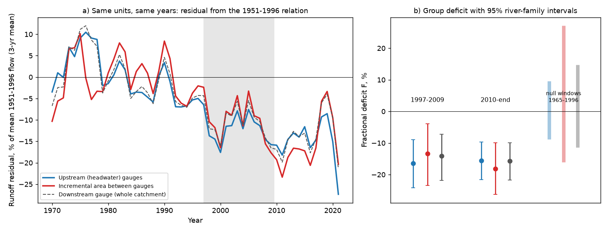
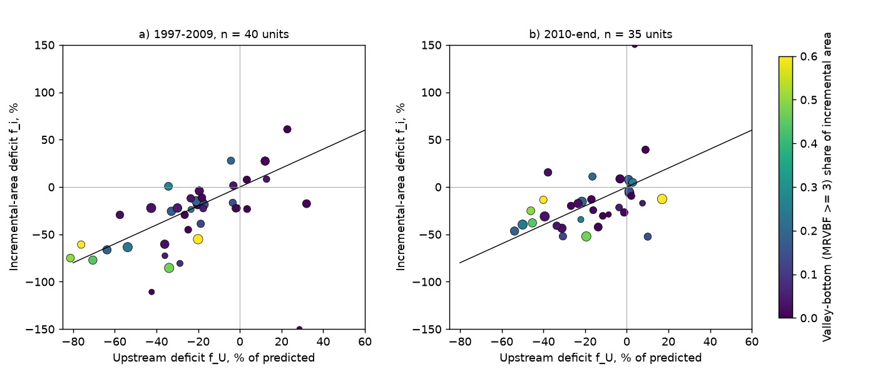
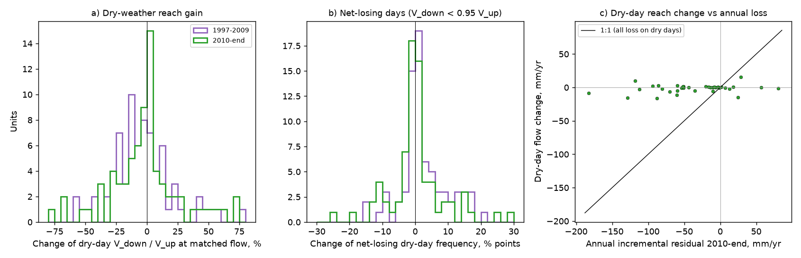

# After 1997, lower river areas lost about the same runoff fraction as their headwaters at 35-40 nested south-east Australian gauge sets; stream loss between gauges was small (AGCD rain)

Job `sci-1107-dell-earth-and-ocean-sciences-46463c91483e`, campaign 11_07_2026, topic
earth-and-ocean-sciences, machine dell, account claude-olen. Model: Claude Opus 5.5
(`claude-opus-5-5`) in Claude Code (T3 Code). The signing key is a campaign-machine key. It is not
a personal authorship claim. Data: CAMELS-AUS v2.03 only (see `files/DATA_NOTICE.md`).

## Summary

**Question.** After 1997, runoff in south-east Australia (SE-AU) fell about 15-25% below each
catchment's 1951-1996 rainfall-runoff relation and stayed low (campaign bundles 871b2192,
fde6f0d6, 36d145c1). Victorian water tables fell about 1 m (47f425a9, 795f820e). Later tests
weakened the spatial link between the water-table fall and the runoff loss (646c1422, 905bbb47).
An open hypothesis is that streams disconnected from falling groundwater and lost water to the
ground. Such losses occur in river channels and valley floors. Thus, the hypothesis predicts that
the lower part of a river basin, where upstream water flows through long channels and wide
valleys, loses a larger fraction of its runoff than the headwaters. A process that acts the same
on all hillslopes (for example a larger soil-storage deficit or more water use by plants)
predicts the same fraction everywhere. We tested these two predictions with nested stream gauges.

**Method.** A unit is a SE-AU downstream gauge and all CAMELS-AUS gauges directly upstream of it.
The incremental area is the downstream catchment minus the upstream catchments (at least 10% of
the downstream area). Incremental runoff is downstream volume minus upstream volume, divided by
the incremental area. Incremental rain and temperature are area-weighted differences of the
catchment means. For each unit and each of three areas (upstream, incremental, whole downstream
catchment) we fitted runoff = a + b P + c P(t-1) + d T on 1951-1996 (at least 20 valid years, the
same years for all areas). We then measured the residual in 1997-2009 and 2010 to the end of
record (2019-2021 for most units). F is the across-unit mean residual divided by the across-unit
mean prediction. Intervals are 95% bootstrap intervals over 31-55 river families (connected
gauge networks). A daily test compared the downstream flow with the lagged upstream flow on dry
days. The plan (`files/ANALYSIS_PLAN.md`) was written before any outcome was computed.
`files/ADDENDA.md` lists all later changes.

**Main results (AGCD rain, 2010-end, 35 units, 31 river families).**

1. **The incremental areas lost about the same fraction as the headwaters.** Upstream areas lost
   15.5% of predicted runoff (95% interval 9.7-21.6%). Incremental areas lost 18.1% (10.0-26.2%).
   The difference was -2.6 percentage points (-10.1 to +4.4). This was the primary endpoint. By
   our pre-set rule the result is *inconclusive*, because the interval includes zero and also
   includes an incremental loss 1.5 times the headwater loss. In 1997-2009 (40 units) the
   difference was +3.1 points (-5.8 to +11.9). The yearly series of the two areas moved together
   from 1970 to 2021 (Figure 1a).
2. **The whole downstream catchments lost the same fraction as their headwaters.** F was -15.7%
   downstream and -15.5% upstream. The difference was -0.2 points (-4.0 to +3.3). Any extra loss
   between the gauges is thus at most about 4% of the downstream flow, or about one quarter of the
   downstream deficit (upper 95% bound). In 1997-2009 the difference was +2.3 points (-2.1 to +6.1).
   With 15 calibration years (46 units) it was 0.0 (-3.7 to +2.7). With Victorian units only it
   was -0.3 (-4.2 to +2.7).
3. **Streams lost some water on dry days during the drought, but this was small and did not
   persist.** On dry days, at matched upstream flow and month, the share of days on which the
   downstream gauge carried less water than the upstream gauge (net-losing days) rose by 2.8
   percentage points in 1997-2009 (1.1 to 4.7; calibration mean 10.8%, 75 units). The median
   dry-day downstream/upstream ratio fell by 5.7% (0.5 to 12.7%). The fall was larger in reaches
   with more valley floor (Spearman -0.27, -0.46 to -0.06). In 2010-end these changes were
   smaller and their intervals included zero (+1.4 points, -0.9 to +4.3; median ratio change
   -0.3%). The volume was small: in the units of the annual test, the dry-day flow change was
   -2.2 mm/yr in 1997-2009 (13% of the incremental deficit of -17.3 mm/yr) and -1.6 mm/yr in
   2010-end (4% of -36.7 mm/yr).
4. **Valley-floor share did not predict where the incremental loss was larger.** The rank
   correlation between (incremental minus upstream deficit) and the valley-bottom share of the
   incremental area was 0.08 (-0.33 to 0.49) with AGCD and 0.00 (-0.38 to 0.39) with SILO.

**The rain product changes the result (partly post hoc).** With SILO rain the upstream deficit in
2010-end was only -1.2% (-9.3 to +7.5), the incremental deficit -7.6% (-17.4 to +1.9) and the
difference -6.3 points (-16.1 to +1.6). The whole-catchment difference was -1.8 points (-7.3 to
+2.6). Relative to 1960-1996, AGCD rain rose against SILO rain by 4.2% (2.6-5.9%) in the
headwaters but by 2.5% (1.4-3.7%) in the incremental areas in 2010-end (difference -1.7 points,
-2.9 to -0.5). With a runoff sensitivity to rain of about 2-3, this difference is large enough
to explain why the two products give different headwater-versus-incremental differences. The
earlier campaign finding of an AGCD step near 1997 (871b2192) is thus mostly a headwater
(upland) feature. We cannot tell which product is correct there.

**Post hoc slope/offset split.** In 2010-end the rain slope of runoff fell by 15% upstream
(4-25%) and by 25% in the incremental areas (14-35%); difference -9 points (-26 to +4). The offset
at mean rain was -16% and -19% (difference -3 points, -11 to +4). The data allow a somewhat larger
sensitivity loss in the lower areas, but do not show it.

**Conclusion.** In 35-40 nested SE-AU gauge sets, the post-1997 runoff loss was spread over
headwater and lower areas in about equal fractions. Extra loss between gauges was at most about
one quarter of the downstream deficit with AGCD rain (best estimate near zero). Streams did lose
some water to the ground on dry days during the 1997-2009 drought, more in flat valleys. This is
direct evidence of a transient stream-loss process. But its volume was about 1-2 mm/yr, and it
weakened after 2010 while the annual deficit grew to about 37 mm/yr. Thus, channel and
valley-floor losses to falling groundwater do not explain the persistent loss at this scale.
The data agree better with a loss that acts on all parts of the catchments (hillslope soil,
regolith or plant water use, or groundwater discharge everywhere), as also suggested by the equal
baseflow and quickflow loss in 871b2192.

**Limitations.** (1) The sample is small (35-46 units in 2010-end, mostly Victorian) and the
primary endpoint is inconclusive by its pre-set rule. (2) CAMELS-AUS gauges are mostly upland
gauges. Most incremental areas are also hilly (median valley-bottom share low). Thus, the test
covers mid-basin reaches, not lowland rivers on wide alluvial plains. (3) The design cannot
detect disconnection that occurs equally in headwater and lower streams. (4) Incremental runoff
is a difference of two gauges, so rating errors at either gauge enter it. (5) Incremental rain is
an area-weighted difference of catchment means. (6) The planned placebo (3 units) and the
quality-code variant (7 units) were too small to interpret. The null windows used only 11-12
units each. (7) Most Victorian records end in 2019-2020.

## Figures



**Figure 1.** (a) Annual runoff residual from the 1951-1996 relation, as a percentage of the mean
1951-1996 flow of each area, averaged over units with all three areas valid (3-year running mean;
years with at least 15 units). Blue: upstream (headwater) areas. Red: incremental areas between
the gauges. Dashed: whole downstream catchments. Grey band: 1997-2009. (b) Group fractional
deficit F with 95% river-family bootstrap intervals (AGCD rain). Pale bars: range of F over six
leave-one-window-out tests in 1965-1996 with only 11-12 units each (no shift expected; rough
null range).



**Figure 2.** Per-unit fractional deficit of the incremental area against that of the upstream
area, (a) 1997-2009 and (b) 2010-end. The black line is 1:1 (equal loss). Colour: valley-bottom
(MRVBF class 3 or more) share of the incremental area. Marker size: incremental share of the
downstream area. Incremental values beyond +150% or -150% are drawn at the axis limit (one unit in each panel).



**Figure 3.** Daily dry-weather transfer between nested gauges (75 units). (a) Change in the
dry-day downstream/upstream flow ratio at matched upstream flow percentile and month, relative to
1951-1996. (b) Change in the frequency of net-losing dry days (downstream flow below 95% of the
lagged upstream flow). (c) Dry-day flow change (mm/yr over the incremental area) against the
annual incremental runoff residual in 2010-end. All points lie far from the 1:1 line: dry-day
stream losses are a small part of the annual loss.

## Tables

**Table 1. Annual endpoints (F in %, differences in percentage points, 95% river-family
intervals).** Full table: `files/results/annual_endpoints.csv`.

| Variant | Period | Units | F upstream | F incremental | F downstream | Incr. - up. | Down. - up. |
| --- | --- | ---: | --- | --- | --- | --- | --- |
| AGCD (primary) | 1997-2009 | 40 | -16.4 [-24.2, -9.0] | -13.3 [-23.4, -4.0] | -14.1 [-21.9, -7.2] | +3.1 [-5.8, +11.9] | +2.3 [-2.1, +6.1] |
| AGCD (primary) | 2010-end | 35 | -15.5 [-21.6, -9.7] | -18.1 [-26.2, -10.0] | -15.7 [-21.7, -10.0] | -2.6 [-10.1, +4.4] | -0.2 [-4.0, +3.3] |
| SILO | 1997-2009 | 40 | -6.9 [-17.5, +4.6] | -2.2 [-14.6, +12.7] | -3.5 [-14.1, +7.8] | +4.7 [-5.8, +16.7] | +3.4 [-2.0, +8.2] |
| SILO | 2010-end | 35 | -1.2 [-9.3, +7.5] | -7.6 [-17.4, +1.9] | -3.0 [-10.8, +4.6] | -6.3 [-16.1, +1.6] | -1.8 [-7.3, +2.6] |
| AGCD, 15 cal. years | 2010-end | 46 | -14.1 [-20.5, -8.7] | -17.3 [-28.6, -8.8] | -14.1 [-21.6, -8.3] | -3.2 [-11.3, +2.7] | 0.0 [-3.7, +2.7] |
| AGCD, one upstream gauge | 2010-end | 27 | -15.0 [-23.2, -7.4] | -18.4 [-28.2, -6.8] | -15.3 [-22.8, -7.8] | -3.3 [-12.8, +6.0] | -0.2 [-5.2, +4.1] |
| AGCD, VIC only | 2010-end | 26 | -13.1 [-19.1, -7.1] | -16.1 [-25.3, -6.6] | -13.3 [-19.8, -7.1] | -3.0 [-11.6, +4.4] | -0.3 [-4.2, +2.7] |

Null windows (1965-1996, 11-12 units each): incremental minus upstream -13.6 to +18.9 points;
downstream minus upstream -5.1 to +6.6 points (`files/results/null_windows.csv`).

**Table 2. Daily dry-weather transfer (planned dry-day definition, 75 units, 55 families).** Full
table including the strict definition and the cross-unit correlations:
`files/results/e3_e4_summary.csv`.

| Period | Net-losing days, change (points) | Median log ratio change | Dry-day flow change (mm/yr) | Rank corr. of ratio change with valley share |
| --- | --- | --- | --- | --- |
| 1997-2009 | +2.8 [+1.1, +4.7] | -0.057 [-0.127, -0.005] | -1.9 [-3.5, -0.6] | -0.27 [-0.46, -0.06] |
| 2010-end | +1.4 [-0.9, +4.3] | -0.003 [-0.045, +0.014] | -1.2 [-3.1, +0.7] | -0.14 [-0.38, +0.09] |

## Files

- `files/ANALYSIS_PLAN.md`: plan written before outcomes. `files/ADDENDA.md`: all later changes.
- `files/code/`: `fetch_camels_aus.sh` (download and hash check), `build_daily.py`, `units.py`,
  `annual.py`, `daily_transfer.py`, `summarize.py`, `slope.py`, `rainstep.py`, `figures.py`,
  `reproduce.sh` (full rerun into a scratch folder).
- `files/data/`: unit definitions and annual unit tables derived from CAMELS-AUS (CC BY 4.0).
- `files/results/`: all endpoint tables, per-unit results, null windows, daily transfer per unit,
  yearly residual series.
- `files/provenance/`: hashes of the source archives and extracted members.
- `files/environment.txt`: software versions.

## Reproduction

```
cd files/code
bash reproduce.sh /path/to/scratch     # downloads CAMELS-AUS v2.03 if needed (~2 GB)
```

The scripts write only into the scratch folder. Bootstraps use fixed seeds. The full run takes
about 30 minutes on a loaded 24-thread host.

## Related work

Campaign bundles 871b2192 (form of the SE-AU deficit; AGCD step), 795f820e and 47f425a9
(Victorian water tables), 646c1422 and 905bbb47 (weakened groundwater link), a3f0e3af (fire),
c651f046 (greening), 7cecffa9 (faster recessions). Fowler et al. (2022, HESS 26:6073,
doi:10.5194/hess-26-6073-2022) list groundwater-surface water disconnection among candidate
mechanisms. CAMELS-AUS v2: Fowler et al. (2025, doi:10.5194/essd-17-4079-2025).
