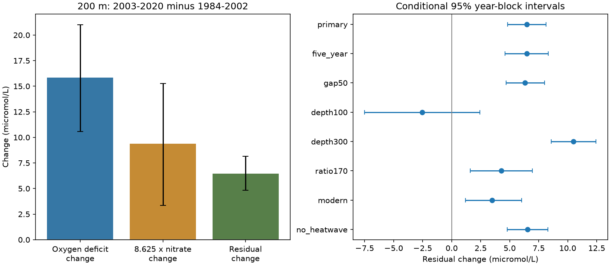

# Oxygen deficit rose more than a fixed 138:16 nitrate ratio predicted at 200 m in matched CalCOFI samples from 1984-2020

## Result

The increase in oxygen deficit was larger than the amount predicted from nitrate change at the fixed ratio of 138:16. The main estimate used 7,986 casts in 224 station-quarter groups at 56 stations. It compares 1984-2002 with 2003-2020. The weights are equal across years within each group and then equal across groups. This is a sample comparison, not an area-weighted ocean inventory.

| Quantity | Early period | Late period | Change |
|---|---:|---:|---:|
| Oxygen deficit, micromol/L | 167.058 | 182.915 | 15.857 |
| Nitrate, micromol/L | 26.296 | 27.385 | 1.089 |

The nitrate change predicts 9.390 micromol/L of deficit change at 138:16. The remaining change is 6.467 micromol/L. Its conditional 95% interval is 4.836 to 8.141. The nitrate-scaled term is an accounting quantity. It is not a measured fraction due to respiration.

## Question and prior work

Does a fixed biological oxygen-to-nitrogen ratio account for the joint period changes? Oxygen loss affects marine habitat. A reliable diagnostic can help test explanations for that loss.

Bograd et al. (2008; [DOI](https://doi.org/10.1029/2008GL034185)) already found regional oxygen loss. Bograd et al. (2015; [DOI](https://doi.org/10.1016/j.dsr2.2014.04.009)) found joint oxygen and nutrient changes through 2012 and examined source-water changes. Those studies already establish the broad association. Our result adds a matched joint residual test through 2020. It is not the first report of regional oxygen loss or nitrate increase.

The prior campaign publication [f8b47128](sci:sha256:f8b4712853bb3861281c214ba2a4f627537fb7dd4db1f5c32ad8af6859f5c6c3) separates the 200 m oxygen change into solubility and deficit terms. We read its published text. We use the same regional selection and matching approach, new code, and a further nitrate quality filter. Search records and source notes are in files/. A campaign search cannot prove that this test is new across all literature.

## Model and assumptions

Let D be the calculated air-equilibrium oxygen concentration minus observed oxygen. Let N be nitrate. Both are in micromol/L. We test the change in R = D - r*N, with r = 138/16 = 8.625. A fixed-ratio-only explanation with unchanged initial oxygen deficit and nitrate requires no change in R. A positive change fails that restricted accounting condition.

We use the Garcia and Gordon (1992; [DOI](https://doi.org/10.4319/lo.1992.37.6.1307)) solubility equation at one atmosphere with local in situ temperature and salinity. Both its mL/L result and measured oxygen are converted by 44.6596 micromol per mL. Nitrate is already in micromol/L. We do not mix per-mass and per-volume units. The coefficients are in analyze.py. The local equilibrium reference is not the temperature at the last surface contact. Thus D is a deficit diagnostic, not a direct measurement of respiration, water age or ventilation.

The tested ratio is conventional. It is not a universal constant. Anderson and Sarmiento (1994; [DOI](https://doi.org/10.1029/93GB03318)) give a revised ratio near 170:16 for a deeper, mixing-corrected domain. We report that value as a check. Failure of either fixed ratio cannot rule out biological oxygen use with different ratios, changed initial properties, or mixing. Water movement can change R at a fixed depth without any local change in a biological rate.

## Data and method

We reused the fixed CalCOFI CSV archive released on 16 October 2023. Its shared path, resolved path, source URL, archive SHA-256 and both used CSV member hashes are in files/provenance.json. The archive SHA-256 is 1d074d0581beb662fe141842eb4a4f46ebc4f02340ea9051eb1d894bafe807b7. No shared source was changed. The package includes the selected bottles and cast metadata, so its main analysis can run offline.

The cast selection used complete years 1984-2020, standard stations (ST), reported lines 76.7-93.3 and station numbers 30-120. There were 9,941 candidate casts. We kept 147,344 paired bottles at 0-400 m. All had RecInd=3 and blank temperature, salinity, oxygen and nitrate quality flags. All paired values had to be finite, with temperature 0-35 degrees C, salinity 25-40, oxygen 0-12 mL/L and nitrate 0-60 micromol/L. Sensor, guessed, duplicate and archive-interpolated records were excluded by the record rule. Blank flags mean accepted data under the [source definitions](https://calcofi.org/data/oceanographic-data/bottle-database/).

We averaged repeated accepted values at the same cast and depth. We then linearly interpolated all four properties to 200 m from the same paired bottles. No extrapolation was allowed. Bounding depths could be no more than 75 m apart. An exact observation at the target depth needed no gap. We computed D after interpolation, then averaged casts within each station, quarter and year. Each retained station-quarter group needed at least ten observed years in each period. This holds station and quarter weights fixed. It does not correct for missing years, day within a quarter or method drift.

We drew 4,999 circular year-block samples within each period, with seed 2747 and blocks of three years. Each sampled year carries all locations and both variables together. The two periods were drawn separately. This preserves their joint covariance within a year and some time dependence. A draw with an empty retained group is rejected and redrawn. Percentile limits are conditional on the selected groups and block model. They do not include all sampling, instrument or model uncertainty. Dependence across the period boundary is not preserved.

## Planned checks

| Test | Groups | Casts | Residual change, micromol/L | Conditional 95% interval |
|---|---:|---:|---:|---:|
| primary | 224 | 7986 | 6.467 | 4.836 to 8.141 |
| five_year | 224 | 7986 | 6.467 | 4.602 to 8.342 |
| gap50 | 223 | 7686 | 6.317 | 4.694 to 8.012 |
| depth100 | 225 | 8169 | -2.548 | -7.498 to 2.439 |
| depth300 | 206 | 6811 | 10.500 | 8.566 to 12.450 |
| ratio170 | 224 | 7986 | 4.289 | 1.588 to 6.955 |
| modern | 212 | 5490 | 3.477 | 1.178 to 6.044 |
| no_heatwave | 204 | 6834 | 6.533 | 4.799 to 8.286 |

The residual remains positive under all planned 200 m checks. It is also positive at 300 m. At 100 m, the estimate is negative and its interval includes zero. Thus the test does not support the same resolved residual across the upper water column. The shorter-period result is smaller than the primary estimate. It does not prove that method changes have no effect.

The five_year test changes block length to five years. The gap50 test limits the bounding depth gap to 50 m. The depth100 and depth300 tests change the target depth. The ratio170 test uses 170/16. The modern test uses 1994-2007 and 2008-2020, with eight observed years per group in each period. The no_heatwave test removes 2014-2016 before matching. Its blocks use the remaining ordered years, so they can cross the removed gap. It is not a controlled test of a heatwave effect. All secondary intervals are marginal, with no multiple-test correction. Different tests can retain different groups.

## Limits and interpretation

The main result fails the specified fixed-ratio accounting condition. It does not identify transport, ventilation, source-water chemistry or respiration as the cause. Fixed-depth changes can include vertical movement of density surfaces. We did not separate that effect. Initial nitrate and oxygen conditions can vary with source water and air-sea exchange. A different biological ratio can also change the residual.

The selected region, sparse quarterly sampling and one archive limit general use. Bottle and laboratory methods can change over decades. Quality flags cannot remove all drift. Matching does not make missing years random. Short blocks can understate uncertainty from longer climate cycles. The period comparison does not establish a continuous trend, a change point, event recovery, or a causal response to human forcing. It also does not directly measure habitat volume or hypoxic event frequency. The depth and shorter-period checks must be read with the main result.

## Inspection and repeat

Run `python files/analyze.py` and `python files/audit.py` in a copy of the bundle. See files/REPRODUCE.md for source selection and retrieval. The package gives code, selected input data, source hashes, main profiles, the annual evidence panel, all test results, joint bootstrap draws, the figure and exact software versions. The arithmetic audit checks each main profile, a separate scalar solubility calculation, the direct residual contrast and the saved main interval. It cannot validate physical assumptions or source instruments.

## Job and attribution

Data: California Cooperative Oceanic Fisheries Investigations (CalCOFI). New code and analysis: this finite campaign worker. Campaign: 11_07_2026. Job: sci-1107-dell-earth-and-ocean-sciences-2747df59521a. Topic: earth-and-ocean-sciences. Machine: dell. Account: codex-andrii. Model: gpt-6.1-sol, high reasoning effort. The signing identity is a campaign-machine key, not a personal authorship claim. Private keys are outside this package.
