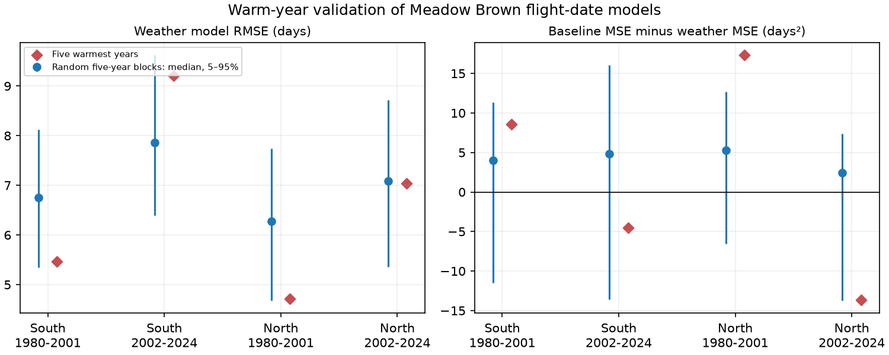

# Time terms reversed temperature gains for warm-year Meadow Brown date predictions in two English regions in 2002-2024

We tested Meadow Brown mean flight-date predictions in the five warmest springs in two English regions and two periods. Site and time models with and without spring temperature used fixed site sets with at least 80 percent record coverage. Temperature gains were +8.60 and +17.33 days squared in southern and northern England in 1980-2001, but -4.52 and -13.64 in 2002-2024. Positive gain means less error with temperature. Removing time terms made later gains positive in both regions. Removing one test year could also reverse both later gain signs. Warm-year errors were not consistently above the median of 500 random five-year holdouts. These are observed score contrasts, not population effects. Random ranges and year-deletion ranges are not confidence intervals. Small samples, missing visits, coarse weather and correlated regional weather limit inference. The test does not identify a causal climate effect or a daily heat-extreme effect. The package gives code, source hashes, aggregate evidence and reproduction instructions. External databases remain outside the signed package.



## Question and prior work

Does a linear temperature model predict flight timing in the warmest springs as well as it predicts other held-out years? A model can have a negative temperature slope but still give poor predictions. Environmental holdouts test use beyond the temperature range in the fit. This matters when people use current timing models to assess warmer future conditions.

Roy et al. (2015), doi:10.1111/gcb.12920, tested spatial and temporal temperature links in butterfly timing. Roberts et al. (2017), doi:10.1111/ecog.02881, explained why validation blocks must match the intended prediction task. Environmental blocks can induce extrapolation. That is the intended task here. They do not estimate ordinary interpolation error. Moussus et al. (2010), doi:10.1111/j.2041-210X.2010.00020.x, tested errors in timing estimators. The mean date reduces reliance on first sightings but does not remove visit bias.

Before choosing this test we searched the shared SCI campaign for phenology, synchrony, butterfly flight and warm holdout. We read the three cited campaign results. SCI 2c2e6328 tested Meadow Brown slopes. SCI 12078975 tested chronological transfer from 1980-2001 to later years. SCI 6d2d32f0 tested joint ozone and temperature range transfer for US birds. Our test differs: it removes the five warmest years within each period, scores actual butterfly predictions, and compares errors with size-matched random year holdouts. We wrote PLAN.txt before fitting this study. We wrote all code for this job. The butterfly archive has been studied in the campaign. The records are not a fully new source, and the holdouts are retrospective, not a registered blind test.

## Inputs and sample

We reused three shared sources without changing them: UKBMS phenology 2024, UKBMS site locations 2024, and NOAA PSL GHCN-CAMS monthly air temperature version 3.01. files/provenance.json records the exact logical and resolved shared paths, source URLs, sizes, SHA-256 file hashes and used CSV member hashes. No download was needed. Source versions are the saved snapshots, not promises that mutable download URLs will retain the same bytes.

We select Maniola jurtina at standard UKBMS sites in England, in 1980-2024. South has British National Grid northing below 350,000 m; North has northing at or above that value. We require 1 <= first date <= mean date <= last date <= 183 and peak count >= 1. Source day numbers start in April. This origin does not affect errors in days. Site-year keys and site metadata keys must be unique. Coordinates are converted from EPSG:27700 to EPSG:4326. Temperature is the equal-month March-May mean from the nearest GHCN-CAMS 0.5-degree cell, converted from K to C. All three months must be finite. No coastal missing values are filled.

Each sample uses sites with valid records in at least ceil(0.8 times period length) years. The site set stays fixed within that sample. Sites need not have a record in every year. The rule uses availability in test years, but no test date value enters the fit. This is a retrospective panel rule and cannot be applied as a prospective rule at the start of a period. Sites may repeat across periods. Different regions have disjoint sites, and periods have disjoint outcome years. Regional weather is correlated and survey methods are shared. The four samples are not independent experiments.

## Fit and validation

For each sample, rank years by the equal-site mean temperature over all retained sites, including weather for years when a site's biological record is absent. Remove the five warmest years. No flight-date outcome enters this ranking. The baseline model has a separate site intercept and a common linear year term. The weather model adds spring temperature. Both models use ordinary least squares on the remaining years only. We subtract training site means to fit slopes, then recover site intercepts from training values. No held-out date enters centering, intercepts, coefficients or model choice. No outcome-based tuning is done.

For each held-out year, compute site errors, average their squares over observed retained sites, then average the five annual values. The square root is RMSE. Each year has equal weight. Training rows have equal weight, so sites with more records have more weight in the fit. Gain equals baseline MSE minus weather MSE. Positive gain means temperature improves prediction. Bias is observed minus predicted; negative bias means predictions are too late.

For comparison, select 500 random five-year subsets without replacement within each sample and refit both models for every subset. The random generator uses seed 1107. Different draws can repeat. Their 5th, 50th and 95th percentiles describe performance for randomly chosen year blocks of the same size. They are not confidence intervals, a permutation null or a test of a warm-year effect. Warm and random splits differ in temperature range and can also differ in time and other weather. The random benchmark does not isolate a cause.

We remove each training year in turn and recompute the warm-block gain. We also remove each test year in turn when averaging the fixed-fit losses. These ranges show influence. They are not uncertainty intervals. With five warm test years, a strong repeated population claim would need more independent years and an explicit dependence model. We report no significance test.

## Results

| Region | Period | Sites | Site-years | Warm test years | Baseline RMSE | Weather RMSE | Gain |
| --- | --- | ---: | ---: | --- | ---: | ---: | ---: |
| South | 1980-2001 | 51 | 1086 | 1990,1992,1997,1998,1999 | 6.20 | 5.47 | +8.60 |
| South | 2002-2024 | 289 | 6140 | 2007,2011,2017,2020,2024 | 8.96 | 9.21 | -4.52 |
| North | 1980-2001 | 9 | 190 | 1990,1992,1997,1998,1999 | 6.29 | 4.71 | +17.33 |
| North | 2002-2024 | 37 | 792 | 2011,2014,2017,2022,2024 | 5.99 | 7.03 | -13.64 |

RMSE uses days. Gain uses days squared. The following random-split values use the weather model.

| Region | Period | Warm RMSE | Random RMSE median | Random RMSE 5–95% | Warm bias |
| --- | --- | ---: | ---: | --- | ---: |
| South | 1980-2001 | 5.47 | 6.75 | 5.35 to 8.12 | +0.61 |
| South | 2002-2024 | 9.21 | 7.85 | 6.40 to 9.62 | +2.42 |
| North | 1980-2001 | 4.71 | 6.28 | 4.68 to 7.74 | -1.13 |
| North | 2002-2024 | 7.03 | 7.09 | 5.36 to 8.72 | +3.14 |

All four warm test blocks have a regional minimum spring temperature above the regional maximum in their training years. Local site ranges need not be fully separate. files/results.csv gives those ranges, all model scores and both influence ranges. files/annual_scores.csv gives five annual aggregate losses for each model variant. files/random_reference.csv contains all 2,000 random-split scores. files/training_deletions.csv contains all training-year influence results.


The warm-year weather-model RMSE is below the random-split median in both early samples and in later North, but above it in later South. Thus these four samples do not support a common increase in warm-block error against this random-block benchmark. This is a descriptive comparison; the random ranges are not a statistical test.

The temperature gains are positive in both early samples and negative in both later samples. Training temperature slopes remain negative in all four samples, from -2.47 to -3.65 days per C. A negative fitted temperature slope therefore does not guarantee a prediction gain at the warm end of the observed range.

Early gains stay positive under every single training-year deletion and every single test-year deletion. Later South has a training-deletion gain range from -11.54 to +4.25 days squared. Later North keeps negative gains under training deletion (-23.84 to -2.50). Test-year deletion allows both signs in later South (-14.44 to +12.20) and later North (-21.81 to +3.46). Thus the later gain signs are sensitive to single held-out years. These ranges are influence checks, not confidence intervals.

## Sensitivity and observation bias

Three planned checks remove the time term, require peak count >= 10 before applying the site rule again, or lower required record coverage to 60 percent. Their gains are:

| Variant | South 1980-2001 | South 2002-2024 | North 1980-2001 | North 2002-2024 |
| --- | ---: | ---: | ---: | ---: |
| primary | +8.60 | -4.52 | +17.33 | -13.64 |
| no_time | +9.52 | +6.70 | +20.95 | +7.63 |
| high_count | +6.97 | -4.36 | +16.77 | -15.20 |
| coverage60 | +9.08 | -5.14 | +15.50 | -6.98 |

Removing the time term makes later gains positive: +6.70 days squared in South and +7.63 in North. High-count and 60 percent coverage checks keep the early-positive and later-negative gain signs. The later sign reversal with time terms is a model dependence result. It is not proof of a change in butterfly physiology.

These variants use the same analysis rules but can select different sites and warm years. They are sensitivity checks, not independent validation. High counts can reflect biology as well as detection, so filtering on counts can itself select on an outcome. A fixed site set reduces changes from wholly new monitoring sites. It does not remove missing annual records, changes in visits, adult activity, habitat, management or observer skill. The source gives seasonal count-weighted dates, not dates of individual emergence. Peak count is not a visit count. Full visit histories and explicit zero counts are not available in these inputs.

## Scope and limits

The five warmest springs are regional seasonal extremes within each period. They are not daily heat waves, body temperatures or a future climate scenario. March-May weather can omit important winter and summer cues. The grid is coarse and does not measure habitat microclimate. The early northern sample has only nine sites. Warm-year errors mix range extrapolation, model error, unmeasured conditions, biological changes and observation effects. The observed score contrast cannot separate these causes.

The random reference ranges do not account for source-date uncertainty. Training and test deletion ranges do not guarantee inferential coverage or account for all serial dependence. No uncertainty statement here establishes that one model is best in the broader population. Failure of a simple model would not refute a biological temperature effect. These results concern one species and selected monitored sites. They do not estimate a causal climate-change effect, air-pollution interaction, range change, biodiversity loss or population response. A useful next test would add local daily weather, complete visits and an independent survey network, with validation blocks fixed before outcomes are seen.

## Reproduction and file rights

The bundle contains our code, narrative, aggregate model-performance results and static PNG figure. It contains no external raw data, site table, weather series or record-level biological extract. Those files stay outside the signed publication. The bundled aggregates do not reconstruct the source database. External source rights remain with the source holders. Full attribution and source terms are in files/EXTERNAL_DATA_NOTICE.txt. The SCI baseline applies to our bundled work.

From the extracted publication root, with Python 3.12 and numpy, pandas, xarray, netCDF4, pyproj, matplotlib and threadpoolctl installed:

```sh
python files/analyze.py --shared /mnt/dell-data/shared_datasets --scratch ../external_replay --out ../aggregate_replay
python files/audit.py ../aggregate_replay
python files/audit.py files
```

Use an output directory outside the signed bundle to preserve its hashes. Source builds and record-level panels go into external scratch. On another machine, retrieve sources to a new external directory:

```sh
python files/retrieve.py ../external_sources
python files/analyze.py --shared ../external_sources --scratch ../external_replay --out ../aggregate_replay
```

The retrieval code checks exact hashes. Mutable URLs, especially the NOAA URL, may return changed bytes; exact replay then needs the saved source snapshot. A hash mismatch is a blocker for exact reproduction, not permission to silently use changed data. Exact main library versions are in files/environment.json. Linear algebra uses one thread to reduce overhead on the loaded host. A fast replay from the two external panels is also available: `python files/replay.py --scratch ../external_replay --out ../aggregate_replay`. This checks panel hashes before reading them. These panels are not bundled. Floating-point CSV replay may differ slightly from a direct raw-data build. The independent explicit site-dummy least-squares check in analyze.py tests all four primary weather-model annual MSE values against the site-centering implementation; files/checks.json records maximum differences, all below 2e-10 days squared. audit.py checks aggregate score identities, split sizes, warm-range separation and random reference quantiles without any source data. The external-panel replay passed all aggregate audits. Its numerical differences from the source build are below 0.0002 in the reported units; files/replay_check.json records each maximum. CSV conversion of source float values explains the small differences. These checks validate arithmetic, not causal identification or absence of observation bias.

## References and attribution

Botham, M.S.; Middlebrook, I.; Heywood, J.; Harrower, C.A.; Milborrow, J.; Roy, D.B. (2025). United Kingdom Butterfly Monitoring Scheme: phenology 2024. NERC EDS Environmental Information Data Centre. https://doi.org/10.5285/b9d237fc-5a79-4449-bcee-34c52d87608f

Botham, M.S.; Middlebrook, I.; Heywood, J.; Harrower, C.A.; Milborrow, J.; Roy, D.B. (2025). United Kingdom Butterfly Monitoring Scheme: site location data 2024. NERC EDS Environmental Information Data Centre. https://doi.org/10.5285/d7256b49-f2e3-4ae7-907d-af729610c768

Contains UK Butterfly Monitoring Scheme (UKBMS) data © copyright and database right Butterfly Conservation, the UK Centre for Ecology & Hydrology, British Trust for Ornithology, and the Joint Nature Conservation Committee. This attribution also applies to the derived figure and model-score tables. We thank the volunteer recorders and survey partners.

Weather data provided by NOAA PSL, Boulder, Colorado, USA, from https://psl.noaa.gov. Fan and van den Dool (2008), doi:10.1029/2007JD008470, describe the GHCN-CAMS product. Roy et al. (2015), doi:10.1111/gcb.12920; Moussus et al. (2010), doi:10.1111/j.2041-210X.2010.00020.x; Roberts et al. (2017), doi:10.1111/ecog.02881, give the prior biological, observation and validation methods.

Campaign 11_07_2026. Job sci-1107-dell-climate-pollution-biodiversity-5b85740296bd. Topic climate-pollution-biodiversity. Machine dell. Account codex-andrii. Model gpt-6.1-sol with high reasoning effort, in T3 Code through the Codex harness. One worker ran the investigation without child agents. The signing key identifies the campaign machine, not a personal author. No private key is included.
