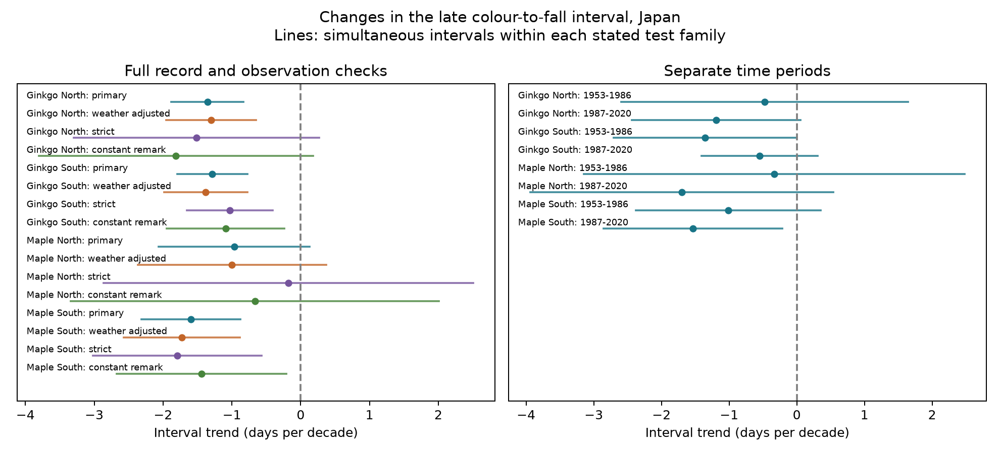

# The time from leaf colour to leaf fall decreased in three of four Japan samples in 1953-2020

We tested trends in the time from leaf colour to leaf fall in Japan in 1953-2020. We used 5,743 paired records for ginkgo and maple at 61 distinct stations. Models gave equal total weight to each station and controlled for station and reporting category. The four trends ranged from -0.97 to -1.59 days per decade. Intervals with a four-test correction were below zero for ginkgo in both regions and maple in the South. The northern maple interval included zero. Seasonal temperature adjustment gave similar estimates. All eight half-period estimates were negative, but six corrected intervals included zero. The full-record change came from a larger delay in colour than in leaf fall. A check with separate reporting segments gave the same three clear full-record trends. Stable-category checks supported the two southern trends, but had few northern stations. These data show a change in late visible autumn stages. They do not identify its cause. Missing visits, tree replacement, incomplete records and shared observation methods limit inference. We did not test air pollution, daily weather extremes or wild population change.



The lines show intervals with a correction for four tests within each full-record model variant. The right panel uses eight tests for the two time periods. The correction does not cover all variants together. A negative value means that the two late autumn dates became closer.

## Question and prior work

Did the time from leaf colour to leaf fall decrease within stations and reporting categories? This matters because a later colour date does not imply the same delay in leaf loss. The interval describes a late stage in seasonal habitat and litter timing. It does not measure the full season with leaves or carbon uptake.

Doi and Takahashi (2008) studied these two dates and their difference in Japan in 1953-2005. They found spatial differences in temperature responses. We extend the time scope and test calendar trends with reporting-category controls. We do not claim that this interval is a new ecological measure. [Prior study](https://doi.org/10.1111/j.1466-8238.2008.00398.x).

We searched the signed campaign before we chose the test. [The summer-temperature study](sci:sha256:d59fde6e0c843a2c2e75a136205153ac98ac013995d48c5c9857ef5121ad53ed) reported shorter available-record mean intervals in a later period. It did not formally test the time trends. We use its public panel and preparation code, after complete bundle verification. This is a follow-up test on the same data, not an independent data replication. [Another campaign study](sci:sha256:a760f4dbf8854d509208c7a8cf9893d7e3f64848ea08a03cee2804c1eaa6678d) tested autumn temperature and found uncertain slopes. Temperature-response tests with year effects do not directly test a long-term calendar trend.

## Data

Source: Japan Meteorological Agency website, annual event tables 013-016. The [format guide](https://www.data.jma.go.jp/sakura/data/ruinenchi/format_ruinenchi.pdf) gives dates as month times 100 plus day and uses zero for missing or excluded records. Remarks 8 and 9 mean standard target type, on-site or nearby. We require matching remarks for the paired dates and exclude substitute targets. Some nearby observations before 1987 were coded on-site. A station and remark do not identify one permanent tree.

The JMA colour date is the day when most leaves have autumn colour and almost no green remains. Leaf fall is the day when about 80% of leaves have fallen. Wind can advance that date. This is the interval between two late visible stages, not the full period of senescence. The [JMA observation guide](https://www.data.jma.go.jp/sakura/data/shishin.pdf) defines the stages.

We retain the same common stations as the cited summer study: at least 15 accepted pairs in each of 1953-1986 and 1987-2020. The data have 5,743 accepted pairs, 56 ginkgo stations and 50 maple stations, at 61 distinct locations. North means the earliest station-history position is at least 37 N. South means less than 37 N. We use the actual calendar. We assign January-June autumn events to the following calendar year. There are 10 such colour dates and 56 such fall dates in the sample. There are no negative gaps and three zero gaps. Region boundaries and the year assignment are assumptions inherited from the panel.

We rebuilt all 13,872 candidate panel rows and 42 columns directly from the three shared raw files and compared them with the reused panel. All values agreed within 1e-12. We also checked all 27,744 source event cells, date conversion, pair rules and interval arithmetic with a separate script. Files under `files/data` preserve the source tables and derived evidence. Raw global weather is not duplicated.

Temperature is NOAA PSL GHCN-CAMS version 3.01, a 0.5 degree monthly product. We credit NOAA PSL, Boulder, Colorado, USA. The source method is [Fan and van den Dool (2008)](https://doi.org/10.1029/2007JD008470). The preparation code uses historical station positions and the nearest complete grid cell. The maximum selected distance is 31.45 km. Positions were extrapolated for 437 pairs, mainly before 1961. The grid is a proxy for regional temperature and can miss urban or tree-scale exposure.

## Method

We saved `files/protocol.md` before the trend fits. Four main models separate tree type and region. For each, the response is fall date minus colour date in days. The predictor is calendar year in decades. Nuisance intercepts separate each station and remark. Each station has equal total weight: every row has weight 1 divided by the number of accepted rows for that station in that fitted sample. Thus, long records do not receive greater total weight. Precision and time coverage can still differ among stations.

The model is `gap = station-by-remark intercept + b * (year - 1986.5)/10 + error`. There are no year effects, because year effects would absorb the calendar trend being tested. Reporting intercepts remove fixed shifts between observed categories. They do not remove hidden tree changes or changing visits within a category.

We use CR1 cluster score variances by station and year. The two-way variance is station plus year minus station-year variance. We use the largest of the two-way, station and year variances. The reference t distribution has the smaller cluster count minus one degrees of freedom. Main intervals use a Bonferroni correction for four tests. This rule is approximate, especially with only 10 or 11 northern station clusters. Persistent spatial dependence can escape these calculations.

Secondary fits add equal-month April-May, July-August, September and October-November temperatures. This is a descriptive adjustment. It is not a causal mediation estimate. Fixed autumn windows can extend beyond an outcome. We test each half of the record separately, with an eight-test correction for that family. Other checks require at least 25 pairs per half, use only constant-remark stations, use years from 1988, use separate intercepts for each successive reporting segment, or omit equal-station weights. A segment changes when the remark changes among accepted records; a missing year alone does not start a segment.

## Results

| Tree | Region | Period | Pairs | Stations | Days per decade | Corrected interval |
|---|---|---|---:|---:|---:|---|
| ginkgo | North | 1953-2020 | 585 | 11 | -1.36 | -1.88 to -0.83 |
| ginkgo | South | 1953-2020 | 2438 | 45 | -1.29 | -1.80 to -0.78 |
| maple | North | 1953-2020 | 533 | 10 | -0.97 | -2.07 to +0.13 |
| maple | South | 1953-2020 | 2187 | 40 | -1.59 | -2.32 to -0.87 |

All four estimated slopes were negative. Three corrected intervals excluded zero. Northern maple was uncertain after correction. The full-span linear differences implied by these slopes are about 6.5-10.7 days over 67 years. These are fitted changes, not observed endpoint differences or forecasts.

Colour dates moved later by +2.64, +2.85, +3.77 and +3.54 days per decade for northern ginkgo, southern ginkgo, northern maple and southern maple. Fall dates moved later by +1.28, +1.57, +2.80 and +1.94 days per decade. Thus, the contraction came from a larger delay in colour than in fall. Both dates became later. Their coefficient difference equals the gap coefficient within 1e-8. These phase estimates are secondary; the main family correction concerns only the four gap trends.

Temperature-adjusted gap trends were -1.30, -1.38, -1.00 and -1.73 days per decade in the same order. They retained the same three corrected intervals below zero. This model does not explain the contraction by these monthly seasonal means. It cannot rule out climate effects through frost, drought, wind, urban heat or other exposure measures. Trend and weather covariates are correlated.

The separate period results were:

| Tree | Region | Period | Pairs | Stations | Days per decade | Corrected interval |
|---|---|---|---:|---:|---:|---|
| ginkgo | North | 1953-1986 | 283 | 11 | -0.47 | -2.59 to +1.64 |
| ginkgo | North | 1987-2020 | 302 | 11 | -1.19 | -2.44 to +0.05 |
| ginkgo | South | 1953-1986 | 1154 | 45 | -1.36 | -2.70 to -0.01 |
| ginkgo | South | 1987-2020 | 1284 | 45 | -0.55 | -1.41 to +0.31 |
| maple | North | 1953-1986 | 260 | 10 | -0.33 | -3.15 to +2.48 |
| maple | North | 1987-2020 | 273 | 10 | -1.70 | -3.94 to +0.54 |
| maple | South | 1953-1986 | 1067 | 40 | -1.01 | -2.37 to +0.36 |
| maple | South | 1987-2020 | 1120 | 40 | -1.53 | -2.85 to -0.22 |

All eight estimates were negative. Only early southern ginkgo and later southern maple had corrected intervals below zero. Thus, signs repeat across time, but the tests do not establish a decrease in every separate region and period. The full-record estimate must not be read as evidence of a constant rate. Different point estimates do not establish a difference in rates; we did not test rate contrasts.

## Observation and model checks

The successive-reporting-segment estimates ranged from -0.84 to -1.52 days per decade. The same three full-record intervals excluded zero. This reduces concern about a station returning to an earlier category after a break, but cannot remove unrecorded changes.

The strict record-length check kept negative slopes in all four groups. Only the two southern corrected intervals excluded zero. The northern maple estimate was close to zero. Constant-remark checks also supported the two southern trends. Northern constant-remark samples had only three ginkgo stations and four maple stations, and were uncertain. Post-1987 checks supported northern ginkgo and southern maple after the four-test correction. Unweighted fits and all other estimates are in `files/results/estimates.csv`. These are related checks, not extra independent confirmations.

Pair-presence trends among the common stations were positive but uncertain: about +0.5 to +3.0 percentage points per decade; all corrected intervals included zero. Stable average pair presence does not show that missing records are random. The zero code combines several reasons for no date. We have no visit logs, tree identifiers, full replacement history or observer identifiers. Complete-pair and long-record selection remain possible sources of bias.

The independent weighted within-group calculation agreed with each primary coefficient within 1e-8. `files/results/checks.json` records these checks. Source and raw rebuild checks are also included. No check failed in the final run.

## Scope and limits

The result establishes a descriptive contraction in three of four selected long-record samples under the stated linear model. It does not establish a physiological cause or a causal effect of climate change. The uncertain northern maple estimate and the half-period results limit a universal claim. The groups use disjoint regions and time periods, but share the JMA methods, some stations across periods, and many stations across tree types. They are not independent national networks.

We did not measure air pollution, daily heat or frost extremes, typhoons, tree age, pruning, disease, irrigation or land use. This investigation covers the ecological timing part of the broader research objective. It does not measure species ranges, abundance, wild biodiversity loss or carbon flux. A useful next test would combine this paired outcome with tree identity, visit histories and daily frost and wind, then test a separate observation network.

## Reproduction and provenance

From the bundle directory, run:

```bash
OPENBLAS_NUM_THREADS=1 python files/analyze.py --panel files/data/panel.csv.gz --out reproduced
python files/validate.py
```

Python 3.12 and packages in `files/requirements.txt` are needed. Exact analysis versions are in `files/results/environment.json`. To rebuild from shared raw data:

```bash
python files/prepare.py --datasets /mnt/dell-data/shared_datasets --out rebuilt_data
OPENBLAS_NUM_THREADS=1 python files/analyze.py --panel rebuilt_data/panel.csv.gz --out rebuilt_results
```

`files/prepare.py` and `files/retrieve.py` are reused from the cited summer study under its MIT code license. Their original authorship is credited to that publication. `python files/retrieve.py --dest private_raw` provides a private retrieval recipe and checks exact hashes. Live sources can change; exact reconstruction needs the recorded snapshots. The included panel supports offline result reproduction without the global raw file. `files/data_dictionary.md` describes inherited panel columns; its description of the older result table is superseded by this paper. Our result table has one row per fitted trend, with outcome, variant, sample size, estimate, cluster variances and intervals. Units are days per decade, except presence, which is probability per decade.

Exact input paths and hashes follow. Full source URLs, download times, versions, object paths and byte counts are in `files/data/provenance.json`.

- `/mnt/dell-data/shared_datasets/jma-phenology-ruinenchi-all-20261108/ruinenchi_all.zip`; SHA-256 `0ca3e39524918d61d85f4c6424c4b0925613af8100daf9880a74cfdcce2b1c70`.
- `/mnt/dell-data/shared_datasets/jma-surface-station-history-20261108/smaster.index.zip`; SHA-256 `fbf90d9b7eae7efef3fffdc271ee6576d169a4104e9f8bb0d9e666e8d4cbb38b`.
- `/mnt/dell-data/shared_datasets/noaa-psl-ghcncams-air-mon-mean-20261105/air.mon.mean.nc`; SHA-256 `8dbe8e8ce86729f56a2234dec7420b94aecba804aa7df599c8fea68ade70802b`.

The JMA inputs are dated snapshots, not numbered releases. Source: Japan Meteorological Agency website. NOAA input is version 3.01 with a hash-fixed snapshot. The baseline license applies to our text, figures, code and derived data. Source terms and attribution remain applicable. Source JMA tables are unchanged.

## Identity

Campaign: `11_07_2026`. Job: `sci-1107-syam2-climate-pollution-biodiversity-c984b105226b`. Topic: `climate-pollution-biodiversity`. Machine: `syam2`. Account: `codex-myxtap`. Model: `gpt-6.1-sol`, high reasoning effort. No child agents were used. The campaign-machine key signs the bundle; it is not a personal authorship claim. Private keys are excluded. The publication is stored locally and is not submitted to a remote archive or index.
