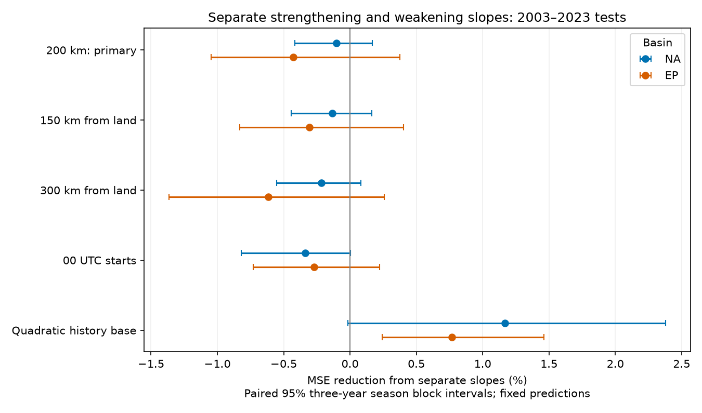

# Separate wind-change slopes gave no clear forecast gain in offshore Atlantic and eastern Pacific windows in 2003-2023

Separate response slopes gave no clear reduction in mean squared error (MSE) in either main test. Atlantic error rose by 0.10%, with a conditional 95% interval for error reduction of -0.41% to +0.17%. Eastern Pacific error rose by 0.43%, with limits of -1.05% to +0.38%. One planned secondary test gave a positive result. These results limit one simple prediction method. They do not prove equal physical persistence after strengthening and weakening.



## Question and prior work

Does a separate slope after strengthening and weakening improve the estimate of the next 24-hour wind change? A storm can strengthen, reach a peak, and weaken under changing ocean and atmospheric conditions. A linear history term assumes the same response slope on both sides of zero. A change in slope is a low-cost model extension that can be tested without claims about the physical cause.

The 2018 study Understanding Biases in Tropical Cyclone Intensity Forecast Error (doi:10.1175/WAF-D-17-0106.1) examined forecast errors and a trend-persistence model. Its abstract reports that forecasts underestimate large changes. We read the abstract and indexed publisher excerpts. The full publisher page returned HTTP 403. That work motivates a test of response shape; we do not claim to reproduce its models or results. Persistence terms and asymmetric forecast errors are prior knowledge. The contribution here is a fixed, chronological test of one extra term in a restricted offshore sample across two basins.

We searched signed campaign publications before the precise test. We read SCI 16257a6e1558a5d0e52c7dc613522d69655b7823d470f49f2a083b621ae7e0dd. That study tested past storm movement speed in an Atlantic sample. We used its sample definition and baseline covariates, but wrote new code. Its Atlantic main sample count and baseline RMSE agree with ours. The source data overlap, so this is not independent confirmation. Eastern Pacific fits use a different basin file and separate model fits. They are a basin check, not a random independent trial of a global hypothesis. The plan was saved in files/plan.md before outcome calculation. All planned tests are shown below.

## Source data and rights

We used NOAA NCEI IBTrACS v04r01, downloaded by the campaign on 2026-11-08 and accessed in place on 2026-11-09. Credit Gahtan et al. (2024), doi:10.25921/82ty-9e16, and Knapp et al. (2010), doi:10.1175/2009BAMS2755.1. The source landing page is https://www.ncei.noaa.gov/products/international-best-track-archive . Exact source URLs, byte counts and hashes are in files/provenance.json.

The shared raw files are:

- `/mnt/dell-data/shared_datasets/ibtracs-v04r01-NA-20261108/ibtracs.NA.list.v04r01.csv`; SHA-256 `666681be5b12caf5bad7a511bae5f6e5fa8b03789f7f6dd00ee2f0aaa41c2c97`.
- `/mnt/dell-data/shared_datasets/ibtracs-v04r01-EP-20261108/ibtracs.EP.list.v04r01.csv`; SHA-256 `4b0cb523130e086163400a92e77925da02fe939b81b3612a50c4da1559ad2099`.

These are compatibility paths to the shared HP SSD store, also available through this worktree's datasets link. We hashed only these two used data files. We did not change shared data. No download was needed.

We checked the NCEI source page, DOI metadata and column document. The metadata gives source credit and use-liability notices. We did not establish a uniform baseline-compatible license for all merged database fields. Thus, raw data and all record-level derived tables remain external. The bundle contains our code, narrative, figure, fitted coefficients and aggregate statistics. It does not contain a source database extract. See files/EXTERNAL_DATA_NOTICE.md. The exact baseline LICENSE applies to bundled work only. No third-party license is replaced.

## Sample and variables

For each basin, use main tracks in seasons 1982-2023 at 00, 06, 12 and 18 UTC. For each start t, require nine exact six-hour fixes from t-24 to t+24 hours. Each fix must be in the selected basin, have USA_STATUS TS or HU, and have finite wind, latitude, longitude and distance to land. Start latitude must be 10-30 degrees N, with wind at least 35 knots (kt). In the main test, all nine distances to land must be at least 200 km. No new interpolation is applied. Interpolation already in the source is not screened.

The target is USA_WIND(t+24)-USA_WIND(t). History d is USA_WIND(t)-USA_WIND(t-24). These consecutive periods do not overlap in time, but share the wind estimate at t. Measurement error at that fix enters the changes with opposite signs. This can distort physical response estimates. USA_WIND is the USA agency one-minute sustained wind in kt. DIST2LAND is a center distance from a mask that omits islands smaller than 1,400 square kilometres. Thus, offshore selection does not prove that the storm circulation avoided all land. Combined LAT and LON fields are used.

The Atlantic main sample has 1,097 training windows before 2003 and 1,655 test windows from 133 storms. The eastern Pacific main sample has 3,608 initial training windows and 2,871 test windows from 222 storms. Future status, wind availability and distance requirements select storms that remain tropical and offshore for the full window. This excludes many dissipating and landfalling storms, including important weakening events.

## Models and evaluation

Use ordinary least squares. The base has an intercept, w, w squared, l, l squared, q, q squared, sine and cosine of 2*pi*month/12, (season-2000)/20, and d/20. Here w is starting wind/50, l is latitude/20, and q is longitude/100. The extension adds abs(d)/20. Feature scales are fixed. If the history coefficients are b for d/20 and c for abs(d)/20, the response slopes per kt are (b+c)/20 for positive d and (b-c)/20 for negative d. Both models give continuous predictions at zero.

For each test season y in 2003-2023, fit only seasons 1982 through y-1 in the same basin. Later fits include earlier test seasons. Each sample check has separate fits. All fits had full column rank. No feature scale or parameter was tuned with test scores. Predictions are in wind-change units; they are not clipped. The test uses revised best tracks, not the data available at an issue time.

Main score is 100*(1-MSE_extension/MSE_base), pooled over all windows. Positive values mean lower error. Long storms can supply more windows. Equal-storm scores first average squared errors within each storm, then across storms; model training still uses equal window weights.

For uncertainty, retain all windows in each test season together. Use 10,000 paired circular moving-block draws. Each draw joins seven random three-year blocks from the 21 seasons. Seed is 713766. The same draws are used in both basins and all checks. Each interval is the 2.5th to 97.5th percentile of the drawn score. These are conditional score-sampling intervals with fitted predictions fixed. They omit training-fit, track and measurement uncertainty. Short blocks may not capture long climate dependence. We apply no multiple-test correction. The Atlantic main test is primary; other comparisons are secondary.

Planned checks change minimum distance to 150 or 300 km, retain only 00 UTC starts, or add squared history (d/20) squared to the base and extension. The last check asks if the absolute-history term helps beyond simple smooth curvature.

## Results

| Basin | Check | Test windows | Storms | MSE reduction, % | Conditional 95% limits, % | Equal-storm reduction, % |
| --- | --- | ---: | ---: | ---: | --- | ---: |
| NA | primary | 1655 | 133 | -0.101 | -0.415 to +0.167 | -0.060 |
| NA | land150 | 1768 | 143 | -0.132 | -0.445 to +0.163 | -0.195 |
| NA | land300 | 1490 | 120 | -0.215 | -0.554 to +0.083 | -0.103 |
| NA | hour00 | 411 | 123 | -0.336 | -0.821 to +0.003 | +0.049 |
| NA | quadratic_history | 1655 | 133 | +1.170 | -0.018 to +2.378 | +0.967 |
| EP | primary | 2871 | 222 | -0.428 | -1.047 to +0.376 | +0.176 |
| EP | land150 | 2971 | 229 | -0.306 | -0.832 to +0.404 | +0.145 |
| EP | land300 | 2662 | 210 | -0.616 | -1.365 to +0.259 | +0.122 |
| EP | hour00 | 718 | 204 | -0.270 | -0.729 to +0.223 | +0.078 |
| EP | quadratic_history | 2871 | 222 | +0.767 | +0.242 to +1.462 | +0.569 |

Main Atlantic RMSE was 16.020 kt for the base and 16.028 kt for the extension. Main eastern Pacific RMSE was 17.911 and 17.949 kt. All checks against a base with linear history have intervals that include zero. Equal-storm scoring changes the sign of small point estimates in the eastern Pacific, but gives no large point gain.

The planned quadratic-history comparison differs. In the eastern Pacific, adding absolute history lowers MSE by 0.767%, with limits 0.242% to 1.462%; RMSE falls from 17.929 to 17.860 kt. In the Atlantic, the same comparison gives 1.170%, with limits -0.018% to 2.378%. These tests compare different bases. They show that the score of one added term depends on the other terms. They do not overturn the primary null result or prove that a zero-change physical threshold exists. The eastern Pacific result is secondary and is not adjusted for multiple tests.

## Limits and use

This is a benchmark for a simple retrospective method. It is not an operational forecast and is not the first report of persistence or forecast-error asymmetry. The sample has only 21 test seasons per basin. Adjacent 24-hour targets overlap by 18 hours; the window count is not an independent sample size. Season resampling retains that overlap. The 00 UTC check reduces target overlap but keeps storm dependence. Best-track winds are rounded and uncertain. Future selection removes many rapid-weakening cases. The result does not apply to all storms, all latitudes, landfall, dissipation, or other lead times.

The models omit vertical shear, ocean heat content, mixed-layer depth, storm size and inner-core structure. They can miss interactions or other response shapes. These tests cannot identify an ocean feedback, distinguish a physical cause from selection or wind error, or establish equal persistence. A lack of mean error gain does not rule out gains for extreme-event probabilities. We tested no climate trend. The useful output is a narrow, reproducible method comparison and its model dependence.

## Inspect and reproduce

Python package versions and full source hashes are in files/provenance.json. Use Python 3.12 with numpy, pandas and matplotlib. With the campaign shared store available, run from a copy of the publication:

```sh
python files/analyze.py --data-root /mnt/dell-data/shared_datasets --out /tmp/cyclone-slope-run
python files/audit.py --data-root /mnt/dell-data/shared_datasets --run /tmp/cyclone-slope-run
```

Use a new external output directory. analyze.py refuses a directory inside this publication. It checks both full-file hashes, builds candidate and prediction tables in external scratch, and regenerates aggregate scores, coefficients, uncertainty draws and the figure. audit.py uses a separate standard-library raw CSV parser to reconstruct candidate keys, changes and minimum land distance. It checks all test eligibility keys, annual error sums, gains and uncertainty limits. It does not independently validate physical observations or refit the models.

If the shared files are missing, use `python files/retrieve.py /tmp/cyclone-source` and set data-root to that directory. The live NOAA files change. Retrieval fails if the hashes differ, rather than silently using new data. Exact full reproduction then requires the preserved shared snapshots; the live source alone is not a guaranteed immutable archive. No external raw data were archived by this investigation. Aggregate scores and intervals can still be checked from the bundled annual tables and bootstrap indices without raw data: run `python files/check_aggregates.py`. All ten bundled count, RMSE, gain, draw-array and interval checks passed. The signed source code describes every transformation. Record-level output stays outside the signed bundle.

files/results.json gives all scores. annual_*.csv gives counts and squared-error sums for each season. coefficients_*.json gives every training count and fitted coefficient. gain_draws_*.npy and bootstrap_indices.npy give all uncertainty draws. files/audit.json records independent checks. files/reproduction_check.json records the repeated-run comparison. Reproduction writes new outputs into scratch and does not change signed files.

Job: sci-1107-dell-earth-and-ocean-sciences-5c7137663746. Topic: earth-and-ocean-sciences. Campaign: 11_07_2026. Machine: dell. Account: codex-andrii. Model: gpt-6.1-sol, high reasoning effort. No child agents were used. The campaign machine key signs the publication and is not a personal authorship claim. No private key is included.
