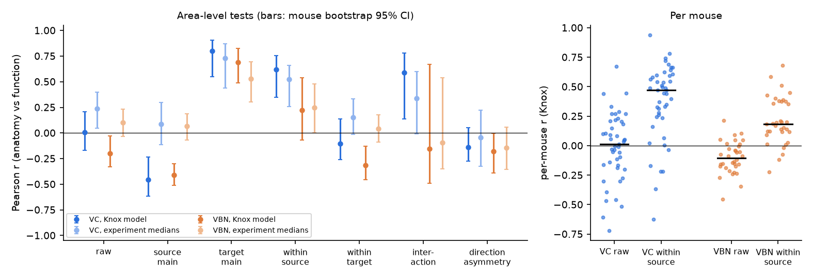
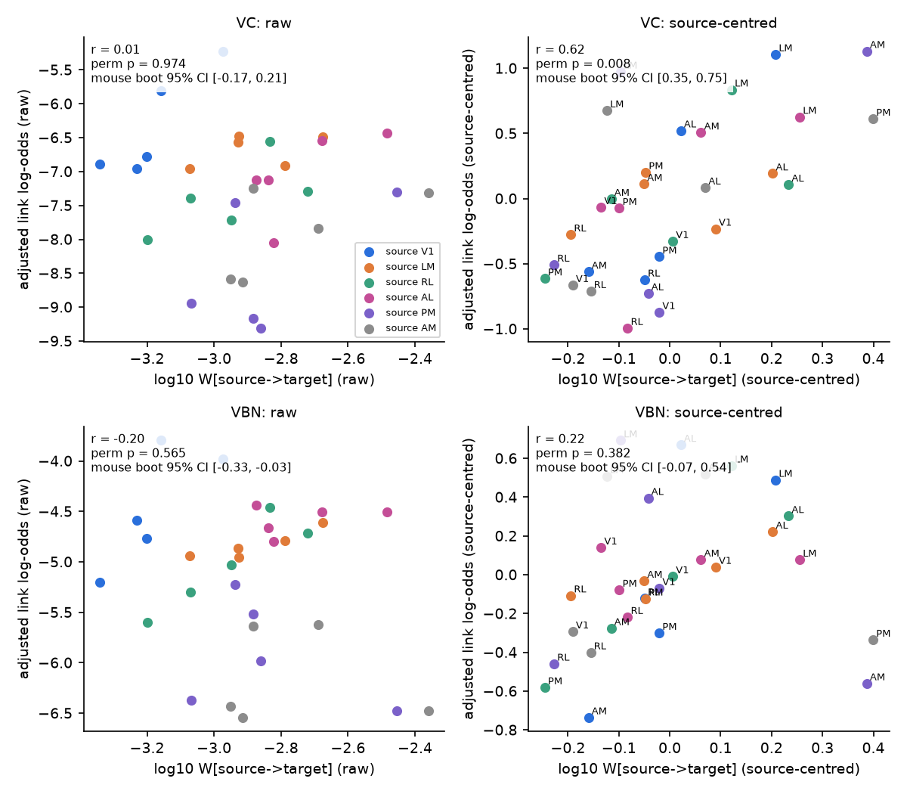
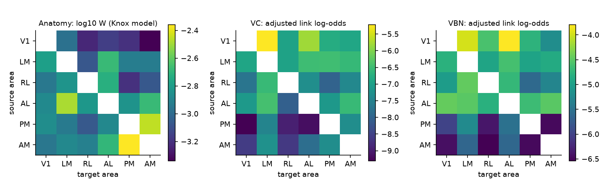

# Axon projection density did not predict rate or direction of fast spike coupling between six mouse visual areas in two Allen Neuropixels data sets; target preference matched in one data set

## Main result

We tested whether the mesoscale axon projection strength from one mouse visual area to another predicts fast directed spike coupling between single units in those areas. The answer was no for the three tests that we specified before we compared anatomy with function. The result was the same in both Allen Neuropixels data sets and with both anatomical estimates.

1. Directed projection density did not predict the adjusted rate of directed links (Pearson r = -0.20 to 0.24 over 30 directed area pairs; exact area-label permutation p >= 0.44).
2. The anatomical asymmetry between two areas, log W[s->t] - log W[t->s], did not predict the direction of the links (r = -0.18 to -0.04; p >= 0.69).
3. The mean of the two directions did not predict the mean link rate (r = -0.07 to 0.38; p >= 0.31).

The functional data were reliable. The 30 adjusted directed link rates agreed between the two data sets (r = 0.75). Links went mostly from the area that is lower in the cortical hierarchy to the area that is higher. The mean difference was +1.03 log-odds in VC (mouse bootstrap 95% CI 0.76 to 1.28) and +0.59 in VBN (0.49 to 0.71). A large source-area effect dominated the functional matrix. Functional out-coupling fell with the hierarchy rank of the source area (Spearman rho = -0.89 in VC and -0.83 in VBN). V1 had the highest out-coupling. In the Knox model, V1 had the lowest mean output density. Thus, the main structure of the functional matrix did not follow the anatomical matrix.

After the first results, we did exploratory decomposition tests. Within each source area, we removed the source mean from both matrices. This asks which targets of a source area get more links. In VC, targets with more axon density had more links (Knox r = 0.62, permutation p = 0.008; tracer-experiment medians r = 0.52, p = 0.043). In VBN, the same relation was weaker and not significant (r = 0.22 and 0.25; p = 0.38 and 0.40). It became significant only when we also controlled for area-pair distance and feedforward direction (partial r = 0.62 and 0.60; p = 0.004 and 0.003). We did not specify this control in advance. The control acts as a suppressor, so we treat this VBN result as weak evidence. The target main effect was positive in all four combinations (r = 0.53 to 0.80), but the permutation p values were 0.06 to 0.25 because there are only six areas.



## Question and value

Mesoscale tracer data give a directed weight for each pair of areas. Neuropixels recordings in many areas give millisecond spike coupling between single units. Do the weights predict the coupling? If they do, the mesoscale connectome can predict where fast inter-area interactions occur. If they do not, other factors control the coupling. Examples are the source cell types, the laminar target, the synapse strength per axon, and the brain state.

Siegle et al. (2021) showed that response latency and the direction of functional interactions follow the anatomical hierarchy of Harris et al. (2019). Here we test the strength of the projection, not the hierarchy rank. We know of no published test of projection strength against the rate of unit-pair CCG links for these area pairs. We did not do a complete literature search, so related work can exist. The campaign folder had no earlier publication on this topic when we started.

## Data

All inputs are public Allen Institute data. Exact paths and SHA-256 values are in `files/provenance.json` and `files/results/input_sha256.txt`.

- Functional data: pair tables of a shared campaign cache (`allen_v1_hva_cross_area_ccg/v1_2026-11-02`, with link calls for two more rules from `allen_v1_hva_pairs_layers_links/v1_2026-11-02`). They come from the Allen Visual Coding Neuropixels data set (VC; passive viewing) and the Allen Visual Behavior Neuropixels data set (VBN; change detection task, Sst-Cre and Vip-Cre mice). Each row is a pair of units on different probes in two different areas among V1 (VISp), LM (VISl), RL (VISrl), AL (VISal), PM (VISpm) and AM (VISam). The CCG uses all spikes from the session start to 1 s before the first optotagging pulse (epoch E).
- A link (rule s10_w17) is an excess in the 1-7 ms lag window above a partially hollow Gaussian baseline (sigma 10 ms), with Bonferroni Poisson p < 1e-4 over window bins, and more counts than the mirror window (p < 0.01). A link from a to b means that spikes of a lead spikes of b. Each unit pair gives two directed tests. The cache code defines the rule.
- We removed pairs without CCF coordinates (8 VC sessions and parts of 4 VC sessions had no CCF registration). This left 50 VC mice (1,689,763 unit pairs; 3,379,526 directed tests; 3,400 links) and 34 VBN mice in 62 sessions (2,418,829 pairs; 4,837,658 tests; 23,158 links).
- Anatomy, estimate 1: the Knox et al. (2019) voxel-model normalized connection density, ipsilateral cortex (`normalized_connection_density_ipsi_ctx.csv`). Rows are sources and columns are targets.
- Anatomy, estimate 2: for each Allen connectivity experiment (products 5, 35 and 36; any transgenic line) with its primary injection in one of the six areas, normalized projection density = normalized_projection_volume / target volume in the injected hemisphere. We used the median over experiments (17 to 254 experiments for each source). Over the 30 directed pairs, the two estimates agreed (Spearman rho = 0.80). Wild-type experiments alone were too few (no RL source), so we did not use them.

## Method

1. `code/02_links.py` makes two directed tests from each unit pair. It aggregates them by session, mouse, directed area pair, source-rate bin, target-rate bin, unit-distance bin and RF-offset bin (10, 10, 10 and 6 fixed bins).
2. `code/03_model.py` fits a binomial GLM of link presence. The model has one fixed effect for each of the 30 directed area pairs and categorical terms for source rate, target rate and unit-to-unit cortical distance. The area-pair effect alpha[s->t] is the adjusted link log-odds at the reference rate and distance bins. A second model adds RF offset (pairs with RF data).
3. The same script compares alpha with log10 W. Pre-specified statistics: r over 30 directed pairs, r of the asymmetry over 15 unordered pairs (also for the 10 pairs of higher visual areas), and r of the symmetric mean. Exploratory statistics: an additive source + target decomposition of both matrices (source main effects, target main effects, interaction), source-centred r and target-centred r.
4. Inference: (a) exact permutation of the six area labels of the anatomical matrix (720 permutations). This test keeps the structure of the anatomical matrix and asks if the specific area assignment matters. (b) Mouse-cluster bootstrap: resample mice, refit the GLM and recompute each statistic (300 refits, seed 20261107). The bootstrap shows functional sampling error only. It does not include anatomical error or the small number of areas, so we use the permutation p for inference.
5. `code/04_mice.py` computes per-mouse values. Expected link counts come from the pooled control terms. f = log((O + 0.5) / (E + 0.5)) for each directed pair with E >= 1. Per mouse, r is computed for raw values and for source-centred values.
6. `code/06_controls.py` adds area-pair mean distance and a feedforward indicator to the source-centred test (exploratory).
7. Sensitivity: two other link rules (s5_w17: sigma 5 ms; s10_w14: 1-4 ms window) and the RF-offset model.

## Results

Pre-specified tests (main rule s10_w17; rate and distance controls). p is the two-sided area-label permutation p. CI is the mouse bootstrap 95% interval.

| Data | Anatomy | Directed r (p) [CI] | Asymmetry r (p) | Symmetric r (p) |
| --- | --- | --- | --- | --- |
| VC | Knox | 0.01 (0.97) [-0.17, 0.21] | -0.14 (0.83) | 0.32 (0.33) |
| VC | Tracer medians | 0.24 (0.44) [0.05, 0.40] | -0.04 (0.93) | 0.38 (0.31) |
| VBN | Knox | -0.20 (0.57) [-0.33, -0.03] | -0.18 (0.79) | -0.07 (0.85) |
| VBN | Tracer medians | 0.10 (0.77) [-0.03, 0.23] | -0.14 (0.69) | 0.17 (0.68) |

Exploratory decomposition (same models):

| Data | Anatomy | Source main r (p) | Target main r (p) | Source-centred r (p) | Interaction r (p) |
| --- | --- | --- | --- | --- | --- |
| VC | Knox | -0.45 (0.38) | 0.80 (0.057) | 0.62 (0.008) | 0.59 (0.038) |
| VC | Tracer medians | 0.09 (0.88) | 0.73 (0.089) | 0.52 (0.043) | 0.34 (0.25) |
| VBN | Knox | -0.41 (0.43) | 0.69 (0.14) | 0.22 (0.38) | -0.15 (0.59) |
| VBN | Tracer medians | 0.07 (0.88) | 0.53 (0.25) | 0.25 (0.40) | -0.09 (0.79) |

Per mouse (Knox), the source-centred r was positive in 39 of 45 VC mice (median 0.47) and in 30 of 34 VBN mice (median 0.18). The raw r was centred near zero (VC median 0.01; VBN median -0.10). The per-mouse values share one anatomical matrix. Thus they show that the pattern is present in most animals, but they are not independent tests of the anatomical hypothesis.

The results did not change much with the RF-offset control or with the other two link rules (`files/results/summary_tests.csv`, `files/results/03_model_log.txt`). In VC with rule s5_w17, the symmetric r reached 0.56 (p = 0.05). In VBN, the PM-AM pair had the highest anatomical weights but a low adjusted link rate in both directions (figure 2).





## Interpretation

The mesoscale projection density did not explain the large differences in fast spike coupling between visual areas. The direction of coupling followed the hierarchy order, as Siegle et al. (2021) showed for timing. It did not follow the asymmetry of projection density. One possible cause is that the main functional factor is a property of the source area. Examples are the number of output neurons that project with strong synapses, their firing patterns, or their layers. Another possible cause is that tracer density per injected volume is not proportional to the number of functional synapses per recorded neuron. When we removed the source effect, axon density gave some information about which targets of a source area receive more links. This was clear in VC and weak in VBN. These data do not identify the cause.

## Limitations

- Only six areas. Area-level tests have 30 directed (15 unordered) values and an exact permutation null with 720 states. The power to find moderate relations is low. The decomposition tests have even fewer free values.
- The decomposition tests and the distance control were added after we saw the first results. They are exploratory. We did not correct p values for the number of tests. About 12 statistics were tested for each combination of data set and anatomy.
- Tracer weights come from other mice and depend on normalization by injection volume and on spillover outside the injected area. The two anatomical estimates are not independent (both use Allen tracer experiments).
- Link detection depends on spike counts, distance and the CCG rule. We controlled for rates and distance with categorical bins. Residual confounds can remain. A link is a statistical CCG feature. It is not proof of a monosynaptic connection.
- VC sessions without CCF registration were removed. VBN mice are Sst-Cre and Vip-Cre mice in a behavioral task. The two data sets also differ in probe placement, so the area pairs have different sampling.
- Area labels come from CCF registration. Units near area borders can have wrong labels.

## Reproduce

Requirements: Python 3.12 and the packages in `files/code/requirements.txt`. Keep library threads at one.

```
# 1. anatomical matrices (download the Knox file first; check its SHA-256 in files/provenance.json)
curl -O https://download.alleninstitute.org/publications/A_high_resolution_data-driven_model_of_the_mouse_connectome/normalized_connection_density_ipsi_ctx.csv
python code/01_anatomy.py normalized_connection_density_ipsi_ctx.csv <allen_projection_unionize_visual_layers/v1_2026-10-30> results
# 2. directed tests aggregated to cells (reads about 1.3 GB of pair tables)
python code/02_links.py <allen_v1_hva_cross_area_ccg/v1_2026-11-02> <allen_v1_hva_pairs_layers_links/v1_2026-11-02> results
# 3. GLM, area-level tests, permutations and mouse bootstrap (about 10 min on one core)
python code/03_model.py results 300 20261107
# 4-6. per-mouse tests, figures, distance and feedforward controls
python code/04_mice.py results
mkdir figs; python code/05_figures.py results figs
python code/06_controls.py results
```

The pair tables are derived campaign caches. Their READMEs and code describe how to make them again from the Allen NWB files. The bundle holds the code and the area-level derived results: `area_pair_effects.csv` (alpha, SE, tests, links and mean distance for each directed pair), `area_tests.json` (all statistics, permutation p values and bootstrap intervals), `summary_tests.csv`, `per_mouse.csv`, `within_source_controls.csv`, and the anatomical matrices `W_*.csv`.

## Provenance

Job sci-1107-dell-neural-structure-and-computation-be9e389df2e4, campaign 11_07_2026, topic neural-structure-and-computation, machine dell. The analysis and text were made by the AI model Claude Opus 5.5 (claude-opus-5-5) in Claude Code. The signing key is a campaign-machine key. It is not a personal authorship claim. Data terms: Allen Institute Terms of Use. Text, figures and derived data: CC BY 4.0. Code: MIT (see LICENSE).
