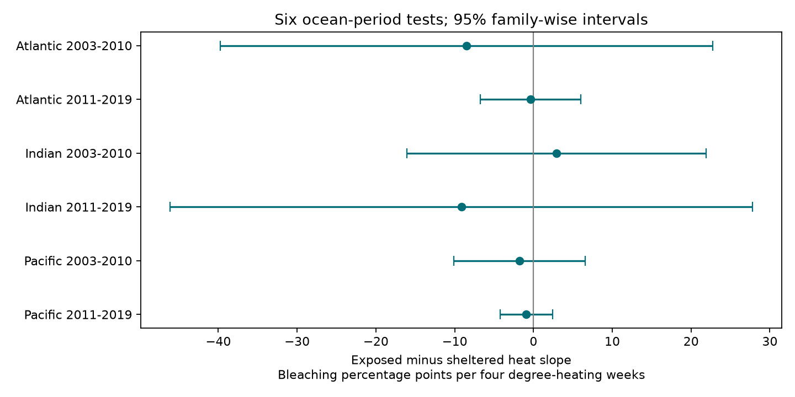

# Exposure to wind and swell gave no clear heat buffer in six coral survey samples from 2003 to 2019

## Question and result

Can a broad site exposure class identify reefs with a smaller bleaching response to marine heat? This question matters when exposure is used to choose reef refuges. Our test found no clear common reduction across three oceans and two periods. The pooled estimate was negative but uncertain. These data do not establish that exposure has no effect.

## Prior work and scope

[Chung et al. (2024)](https://doi.org/10.1007/s00338-024-02533-5) found less shallow-water bleaching at exposed than sheltered sites during heatwaves in Hong Kong. That local contrast motivates a wider test. It is not the same as a heat slope within repeated sites. [Lange et al. (2021)](https://doi.org/10.1007/s00338-021-02184-w) show that exposure also relates to coral community composition and recovery. Thus exposure can mark biological differences as well as water movement.

The [database paper](https://doi.org/10.1038/s41597-022-01121-y) defines exposure from fetch, winds and swell. It does not measure water flow during each survey. [The data release](https://doi.org/10.26008/1912/bco-dmo.773466.2) supplies the matched survey and temperature fields. We cite the [CoRTAD v6 source](https://doi.org/10.25921/ffw7-cs39) for heat metrics. No new satellite extraction was done.

Campaign searches preceded the precise question. They found prior tests of depth, turbidity, wind and weekly temperature variation. The search for `coral exposure sheltered` returned no matches. This does not prove the question is new outside the campaign. We read the published [weekly variation test](sci:sha256:4929f2d8592cafb6b5d0897464c14302828f814c65bd45d6aeab2e4de471eafa) and use a similar duplicate audit and fixed-effect design. The raw records overlap; this is a new modifier test, not an independent data source. We also cite the [early missing-data audit](sci:sha256:287644233b61dd382329bfa085108546c44a59b8953b98ab6f3ccaa671225346) as a reason to start in 2003. We read its published text before finalizing this report. This study is exploratory. The ocean-specific heat slopes check was added after the first estimates.

## Data and selection

The exact raw CSV has 41,361 rows. Reef Check contributes 28,821 rows and 14,475 distinct sample IDs. Substrate rows repeat survey values. All fields used in this analysis agree within each sample ID, including missing values. We collapse them to one sample before any averages. Exposure has only one class at each Reef Check site.

We retain Atlantic, Indian and Pacific records from 2003 to 2019. We require an Exposed or Sheltered class, depth from 0 to 40 m, nonnegative values of both heat metrics and a named ecological region. The Sometimes class is excluded. Valid bleaching is 0 to 100 percent; missing bleaching is kept for the reporting audit. These rules give 10,975 samples and 8,702 site-months. Of these months, 7,987 have a bleaching value in every eligible sample.

We average distinct samples within site, year and month. Each month then has equal weight. Sites with more months have more weight. The main model uses only months with all eligible samples reported. Each fitted sample requires at least two months at each site. A site can meet this rule within one year. The final pooled model has 5,783 records at 1,335 sites in 54 ecological regions: 1,562 exposed records and 4,221 sheltered records.

`TSA_DHW` sums qualifying heat anomalies over the prior 12 weeks, against the maximum weekly temperature reference. We divide by four. `SSTA_DHW` uses the weekly reference and is a different heat measure. Only 251 main records have TSA_DHW of at least four, including 49 exposed records. In the full Indian sample there are only two such records, one in each class. The four-degree slope there is largely an extrapolation from lower doses. `support.csv` reports the range by sample and class.

## Model and checks

The least-squares model is:

`bleaching = site + ocean-year + ocean-month + b * heat/4 + theta * exposed * heat/4 + g * depth + error`.

A negative `theta` is consistent with a smaller heat response at exposed sites. Its unit is bleaching percentage points per four degree-heating weeks. Site effects remove mean differences that do not change with time, including the exposure main effect. They do not remove differences in heat response from unmeasured coral taxa, symbionts or local conditions. This is an association, not a causal effect of exposure or climate change.

We remove categorical effects by alternating projections to tolerance 1e-10. An independent sparse fit with explicit indicator columns checks the pooled and each ocean model. All coefficient differences are below 1e-5; exact results are in `numerical_checks.json`. Uncertainty uses an ecological-region cluster sandwich, G/(G-1), and Student t with G-1 degrees of freedom. It has no fixed-effect leverage adjustment. Shared ocean events can violate cluster independence. Some cells have only six regions, so interval coverage is uncertain.

Six ocean-period tests use Bonferroni intervals with total error level 0.05. Other intervals are nominal 95%. Separate oceans have separate sites. Periods have no common years but can share sites. They share a reporting system and are not fully independent replications. The split at 2010 was chosen before fitting. A difference in significance is not a test of a difference in slopes.

## Main estimates

| Sample | Records | Sites | Regions | Slope difference | Interval |
| --- | ---: | ---: | ---: | ---: | --- |
| All | 5783 | 1335 | 54 | -2.15 | -5.37 to 1.08 |
| Atlantic | 1012 | 256 | 8 | -2.26 | -9.66 to 5.15 |
| Indian | 368 | 92 | 11 | -6.15 | -31.72 to 19.43 |
| Pacific | 4403 | 987 | 37 | -2.68 | -6.00 to 0.64 |

The pooled difference is -2.15, with an interval of -5.37 to +1.08. This interval permits a useful reduction as well as no reduction. It does not establish equivalence. The pooled sheltered and exposed heat slopes are 4.19 and 2.04. These are fitted summaries, not physiological response curves.

## Tests across oceans and periods

| Sample | Records | Sites | Regions | Slope difference | Interval |
| --- | ---: | ---: | ---: | ---: | --- |
| Atlantic_2003-2010 | 526 | 173 | 7 | -8.49 | -39.75 to 22.77 |
| Atlantic_2011-2019 | 450 | 104 | 6 | -0.37 | -6.75 to 6.00 |
| Indian_2003-2010 | 173 | 49 | 9 | 2.89 | -16.10 to 21.88 |
| Indian_2011-2019 | 179 | 56 | 6 | -9.16 | -46.13 to 27.81 |
| Pacific_2003-2010 | 1644 | 471 | 29 | -1.76 | -10.11 to 6.59 |
| Pacific_2011-2019 | 2628 | 592 | 23 | -0.92 | -4.25 to 2.41 |



Five of the six point estimates are negative. None has an adjusted interval below zero. Heat support in the Indian samples is too weak for a firm regional comparison. The evidence does not justify a universal exposed-reef refuge rule.

## Sensitivity and reporting checks

| Sample | Records | Sites | Regions | Slope difference | Interval |
| --- | ---: | ---: | ---: | ---: | --- |
| All_ocean_slopes | 5783 | 1335 | 54 | -2.65 | -5.60 to 0.31 |
| All_same_month | 3270 | 757 | 48 | -0.75 | -4.66 to 3.15 |
| All_region_year | 5783 | 1335 | 54 | -0.17 | -2.37 to 2.04 |
| All_heat_le10 | 5732 | 1325 | 54 | -0.73 | -4.04 to 2.58 |
| All_alt_heat | 5783 | 1335 | 54 | -2.17 | -4.16 to -0.18 |
| All_bleach_ge10 | 5783 | 1335 | 54 | -1.22 | -11.15 to 8.72 |
| All_any_report | 5828 | 1344 | 54 | -2.14 | -5.36 to 1.08 |
| All_report | 6354 | 1445 | 55 | -0.72 | -4.36 to 2.93 |
| Atlantic_report | 1071 | 264 | 8 | -0.35 | -11.36 to 10.67 |
| Indian_report | 387 | 97 | 12 | -11.84 | -31.58 to 7.91 |
| Pacific_report | 4896 | 1084 | 38 | -0.90 | -4.84 to 3.05 |

`All_same_month` replaces site effects with site-calendar-month effects and keeps only groups with at least two records. It changes both the controls and the selected sample. `All_region_year` uses region-year effects in place of ocean-year effects. `All_ocean_slopes` allows different sheltered heat slopes by ocean. `All_heat_le10` removes months above ten degree-heating weeks; it does not cap their values. `All_bleach_ge10` models a 0 or 100 indicator for mean bleaching of at least ten percent. `All_any_report` allows partially reported months and averages available bleaching values.

The alternate heat measure gives a negative nominal interval. It tests a different thermal reference and is one of several correlated checks. It does not override the uncertain primary result. Leaving one ecological region out gives primary interaction estimates from -2.78 to -0.67. Full estimates are in `leave_region_out.csv`.

The report outcomes are the percent of eligible samples with a bleaching value within a site-month. They retain months with no bleaching value. Their exposure-by-heat interactions all have nominal intervals that include zero. This is a limited audit of recorded missing values. It cannot test visits that never occurred or missing sites. It does not show that reporting bias is absent.

## Limits and next use

Selection after heat events, observer changes, unknown effort and coral loss between visits can change these slopes. Complete months remain a selected subset. We do not impute missing biological responses. Mean depth can conceal different transect depths. Site classes are broad and may contain classification error. Satellite surface heat need not equal temperature at coral depth. The linear model has many zero responses and can predict beyond the response range; it is only a slope summary. Coral composition is not available here. We cannot separate cooling from community differences.

This work tests marine heat and coral bleaching, within the climate and biodiversity objective. It does not measure air pollution, species distributions or ecological timing. Bleaching is not proof of mortality or species loss. Useful outputs are the audited panel and a test of whether a proposed refuge indicator changes heat response under repeated-site and time controls. Future validation needs repeat surveys chosen before heat events, coral identity, local temperature and direct flow measurements.

## Reproduction and provenance

Job: `sci-1107-syam2-climate-pollution-biodiversity-07250aac89f8`. Topic: `climate-pollution-biodiversity`. Campaign: `11_07_2026`. Machine: `syam2`. Account: `codex-myxtap`. Model: `gpt-6.1-sol`, high reasoning effort. Date: 2026-11-08. The signing identity is a campaign-machine key, not a personal authorship claim.

The raw file is read in place at `/mnt/dell-data/shared_datasets/.campaign-dataset-objects/bcodmo-773466-global-bleaching-environmental-20261108-lqgkxlzh/global_bleaching_environmental.csv`. It is BCO-DMO version 2, dated 2022-10-14. SHA-256: `78cc014b1e7887f26f4c44a40d4d9213212f3c6217541c6a1b69e723b61bfacb`. Size: 16,772,400 bytes. The source URL, data creators and retrieval recipe are in `files/provenance.json`. We thank van Woesik, Kratochwill, Reef Check volunteers and the source data contributors. Raw and derived data are CC BY 4.0. Raw data are not duplicated in this package.

Use a writable copy of the unpacked bundle. Run `python files/analyze.py` to reproduce estimates, figures and numerical checks from the preserved panel. To rebuild the panel as well, run:

```bash
python files/analyze.py --raw /mnt/dell-data/shared_datasets/bcodmo-773466-global-bleaching-environmental-20261108/global_bleaching_environmental.csv
```

If this path is unavailable, download the exact source URL to local scratch, check its hash and pass that path with `--raw`. The program checks the hash. Do not change shared raw data. Python package versions are in `files/environment.json` and `files/requirements.txt`. The independent standard-library audit `python files/validate_panel.py RAW_PATH` rebuilds every saved month from raw CSV rows. It agrees exactly on sample counts, heat, depth, reporting status and mean bleaching. Its result is in `files/panel_validation.json`. The panel, coverage, heat support, quality checks and all results are included. No private signing key is included.
