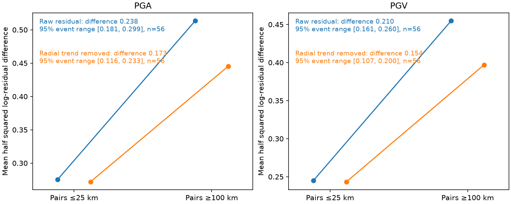

# Distant station pairs had larger first-ShakeMap PGA residual differences than near pairs in 56 events with no early shaking data, 2019-2026

Job `sci-1107-dell-earth-and-ocean-sciences-a3f3ca5a55f5`. Topic: earth-and-ocean-sciences. Campaign: 11_07_2026. Machine: dell. Account: codex-myxtap. Model: gpt-6.1-sol, high reasoning effort, through the Codex harness in T3 Code. Date: 2026-11-10. The signing key is a campaign-machine key. It is not a personal authorship claim.

## Result

Later station residuals of first USGS ShakeMaps have measured spatial structure. Distant station pairs have larger residual differences than nearby pairs in a selected sample with no first-map seismic or felt-intensity observations. A common earthquake-wide error cancels in this test. A simple trend with distance from the earthquake does not remove the result.

This is a new station-pair test of the operational residuals studied in the parent SCI publication. It is not independent confirmation with new earthquakes. It does not show that ShakeMap omits spatial correlation. That correlation is already part of the method. It does not establish which part of the prior marginal uncertainty shortfall is a source error, a path error, a site error or an observation error.

## Question and prior evidence

The parent study, [SCI 4251e6dc](sci:sha256:4251e6dcdeaca196d64bf2f00bb3dbdba1ab73f0320a92a37a426b4e34abce52), found that first-map PGA and PGV uncertainty was too small on later station data. Its event-average analysis assigned much of the excess error to a between-event term. A later [SCI audit](sci:sha256:8e893d8e58eb54ec968bf974c4bc4e32baa0b092f5e2e5e5351432816bcab1ec) proved that the estimator mixes source variance with shared station covariance. That audit did not use station locations. Thus, the published moment result did not measure the spatial structure that could affect the attribution.

We ask whether residual differences increase with station separation in this archived sample. We restrict the test to maps with no early observations. This removes the need to reconstruct covariance after conditioning on early stations. It does not remove model assumptions or station selection.

Spatial ground-motion correlation and semivariograms are established methods. [Jayaram and Baker (2009)](https://doi.org/10.1002/eqe.922) give relevant methods and empirical examples. [Engler et al. (2022)](https://doi.org/10.1785/0120210177) describe conditioned ShakeMap uncertainty. Our contribution is the new spatial test on these first-map operational errors, exact archive recovery, and reusable aggregate pair evidence. We do not introduce a new covariance estimator.

## Selection and data recovery

We read published campaign results and searched the campaign for ShakeMap work before choosing this test. We wrote `files/PLAN.md` before downloading new station data. This follow-up was chosen after reading the parent findings. It is exploratory, not a prospective registration.

The parent PGA sample has 371 events. We selected its 96 events with at least five later PGA records, a first map within six hours, zero first-map seismic stations, and zero first-map macroseismic cells. This sample spans 2019-2026. All 96 downloads completed. The main contrast requires at least five pairs at separation at most 25 km and at least five pairs at separation at least 100 km. It retains 56 PGA events and 56 PGV events. The PGA comparison uses 4,957 station records, 11,811 near pairs and 473,389 far pairs. PGV uses 5,112 records, 12,533 near pairs and 485,930 far pairs. These pairs are not independent observations.

We reused the parent's fetch code under its baseline MIT terms. We recovered the preferred product series, its first archived grid and uncertainty grid, and the final station list. We used only seismic stations absent from the first list, with positive observed and predicted amplitudes, positive stated uncertainty and at least one clean amplitude channel of the relevant type. These are the parent's rules. PGA is in percent g and PGV in cm/s. We used the same top-level station amplitude and bilinear grid interpolation as the parent.

For all 96 events, the later PGA record count exactly matches the published count. The largest difference from a published event mean log residual is 4.45e-16. Thus this recovery matches the parent residual construction, not just its broad conclusions. See `files/results/parent_repeat_check.csv`.

## Method

Let r_ei = ln(observed amplitude / first-map amplitude) at station i for earthquake e. For each pair, calculate

    g_eij = (r_ei - r_ej)^2 / 2.

Calculate the mean g separately for near pairs and far pairs in each event. Their difference is D_e. The primary statistic is the mean D_e over eligible events, with equal event weight. We use all available pairs, not a random pair subsample. Pair distances use a spherical Earth with radius 6,371 km.

If r_ei = B_e + W_ei, then r_ei - r_ej = W_ei - W_ej. Any common B_e cancels exactly, without a normal distribution assumption. Under equal within-event variance and stationary covariance C(h), E(g(h)) = phi^2 - C(h). Then the contrast measures average near covariance minus average far covariance. Without those assumptions, it measures a mixture of spatial mean differences, variance differences and covariance. We therefore call the result spatial error structure, not a direct estimate of a physical covariance parameter.

We use 4,000 whole-event bootstrap resamples for conditional 95% percentile ranges. We also resample the eight whole calendar years, keeping all events in each sampled year. With only eight years, these latter ranges are sensitivity checks. Neither procedure ensures independence between earthquake sequences across year boundaries.

For the raw 25/100 km contrast, we make 999 independent within-event random permutations of residual labels over the fixed station locations. Each replicate combines one permutation per event and computes the mean contrast. The two-sided randomization p-value includes the observed statistic with a plus-one correction. This tests conditional exchangeability of residuals over locations. It does not test the entire ShakeMap covariance model or distinguish covariance from spatial variance changes. It is not based on treating pairs as independent.

The planned secondary check fits an intercept and a slope on ln(1 + epicentral distance / 10 km) within each event and removes this trend before repeating the contrast. Distances are from the first-map epicentre. This is a retrospective diagnostic, not a forecast repair. A 50/150 km contrast, the subset with absolute first-to-final magnitude change at most 0.05, and PGV are additional planned checks. The year bootstrap and leave-one-event-out checks were added after the plan. Multiple checks do not constitute separate independent confirmations.

## Numerical results

Units are squared natural-log units. Brackets are 95% whole-event bootstrap ranges for the contrast.

| Quantity and test | Events | Near mean g | Far mean g | Far minus near |
| --- | ---: | ---: | ---: | ---: |
| PGA, raw, 25/100 km | 56 | 0.2753 | 0.5134 | 0.2381 [0.1813, 0.2987] |
| PGA, radial trend removed | 56 | 0.2721 | 0.4452 | 0.1732 [0.1162, 0.2329] |
| PGV, raw, 25/100 km | 56 | 0.2451 | 0.4548 | 0.2097 [0.1608, 0.2604] |
| PGV, radial trend removed | 56 | 0.2434 | 0.3971 | 0.1536 [0.1071, 0.1999] |

For raw PGA, 50 of 56 event contrasts are positive. The year-block range is 0.1616-0.3102. The smallest mean after removal of any one event is 0.2276. The shuffle p-value is 0.001, the smallest possible reported value with 999 permutations. The raw PGV result is also positive in 50 of 56 events, with year-block range 0.1463-0.2720 and shuffle p-value 0.001.

Removing the radial trend reduces the PGA contrast by 27.3% and PGV by 26.7%. This is a descriptive change, not a causal variance partition. The residual contrast is still positive under the event and year bootstrap checks. The 31 magnitude-unchanged PGA events give 0.2665 [0.1835, 0.3548]. The 50/150 km raw PGA test gives 0.3025 [0.1847, 0.4767] in 62 events. All 16 listed quantity, trend, distance and magnitude-subset combinations have positive event-bootstrap limits. See `files/results/summary.csv` for every result, including PGV.

## Interpretation and limits

A common source offset cannot explain the measured separation contrast because it cancels exactly. The contrast supplies spatial information absent from event means alone. A radial attenuation trend accounts for part of the measured contrast, but this simple trend does not remove it. This supports further spatial testing before attributing all excess event-mean variance to source uncertainty.

It does not establish the full explanation of the original uncertainty shortfall. A correctly specified spatial covariance model would also produce a separation contrast. We did not compare with a reconstructed first-version model covariance, estimate a correlation length, or assume that covariance is zero at 100 km. We cannot turn this contrast into a corrected between-event standard deviation. In particular, it cannot be directly compared with the audit's correlation thresholds, which use different samples and an exchangeable model.

Only a constant additive log offset cancels. Source errors that vary across stations, such as rupture geometry errors or a source factor with station-dependent loading, can remain. Station geometry, site conditions, varying station noise and spatial mean-model error can all contribute. Nearby and distant pairs need not have the same marginal variance or source-distance distribution. Removing one radial term is an incomplete control. No waveform or sensor audit was done. The top-level station amplitude and clean-channel rule inherit the parent's component and flag limitations. Final amplitudes can be revised. Stations that never report and offshore events with no later data are absent. Selection of events with both near and far pairs favours broad, dense later networks. Results cannot be transferred without testing to maps conditioned on early observations or to all global earthquakes.

## Inspection and reproduction

The numerical evidence can be inspected without network access. `files/results/event_pair_moments.csv` gives per-event near and far means and counts. `summary.csv` gives all contrasts and ranges. `distance_bins.csv` gives further per-event distance-bin aggregates; each bin has its own available-event set, so these bins must not be read as a balanced spatial curve. `algebra_checks.json` verifies common-offset cancellation and the identity that the all-pair mean g equals the station sample variance for three synthetic sizes. These tests check algebra, not data quality. A separate two-event exact-URL retrieval check recovers the same station amplitudes, predicted values and uncertainty values with zero numeric difference. See `retrieval_smoke_check.json`. This checks the retrieval script on two events; all 96 grids are checked separately during the source-hash pass.

For full regeneration, run from the publication root:

    sh files/code/reproduce.sh /absolute/path/outside-this-publication

Python 3.12 with numpy, pandas, scipy, matplotlib and requests is required. Versions and seeds are in `files/results/run.json`. The script downloads the exact archived source URLs in `files/pinned_sources.json`. It checks canonical station JSON hashes and exact grid byte hashes, then rebuilds station residuals in external scratch and reruns the analysis. It fails if those pinned sources change. It does not silently substitute current products. Source retirement can prevent future retrieval. The small included aggregates remain inspectable offline.

`files/code/pin_grids.py` was used to re-fetch and hash the first grid and uncertainty responses and confirm that interpolation agrees with the residual tables. `grid_sources.json` records each exact URL, byte hash, size and interpolation check. `raw_hashes.json` records hashes of local files used in this run; its absolute scratch paths describe this run and are not needed to regenerate results. Gzip byte hashes can differ on regeneration because gzip timestamps differ. Station JSON content hashes in `pinned_sources.json` are canonical and stable across object-key order and gzip changes.

## Provenance and rights

The shared parent ZIP path resolves to `/mnt/dell-data/campaigns/11_07_2026/4251e6dcdeaca196d64bf2f00bb3dbdba1ab73f0320a92a37a426b4e34abce52.zip` on HP SSD. No shared raw dataset was used or changed. New external data were retrieved only into this job's local scratch. All code, source URLs, versions, hashes and aggregate evidence needed for regeneration are included; private scratch need not survive. See `files/provenance.json`, `pinned_sources.json` and `files/results/grid_sources.json`.

The exact SCI baseline LICENSE applies to our text, figures, aggregate results and code, with source attribution in `files/NOTICE.md`. Station-level external data are not bundled or relicensed. USGS distinguishes its own public-domain products from third-party material; see its [data licensing policy](https://www.usgs.gov/data-management/data-licensing). The package provides a retrieval method and aggregate evidence rather than a derivative station database. The prior fetch code retains separate attribution under the parent's MIT terms.
