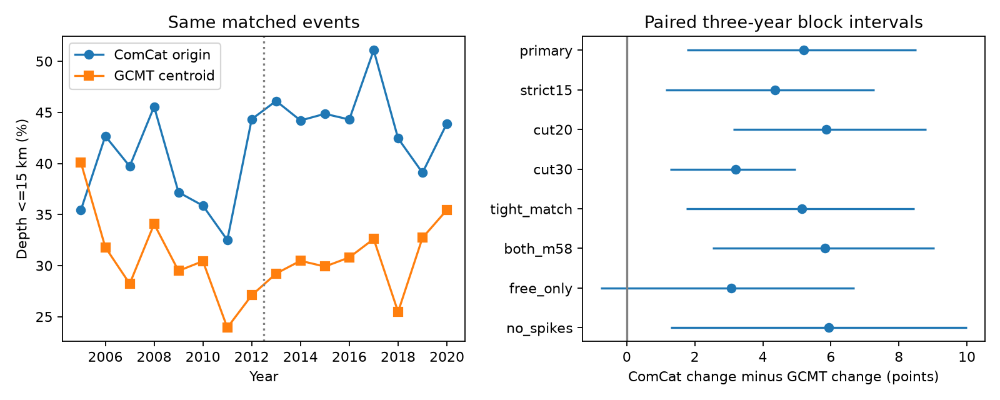

# ComCat shallow-depth share rose 5.20 points more than GCMT centroid share for matched M5.8+ events in 2005-2020

For the same matched earthquakes, two reported depth measures gave different changes. The share at depth 15 km or less rose by 5.39 percentage points in ComCat and by 0.18 points in Global CMT (GCMT). The difference between these changes was 5.20 points. Its conditional 95% interval was 1.77 to 8.51 points under paired three-year block resampling. The sample has 2,026 events in 2005-2012 and 1,708 in 2013-2020.

This is evidence that a shallow-event change depends on the depth measure used. It does not show that either depth measure is correct. An origin depth describes rupture start. A centroid depth describes the center of moment release. A change in their relation can have both physical and catalog causes. GCMT is not a fully independent catalog: its reference locations can come from USGS, and ComCat can use GCMT magnitudes.

## Question and prior work

Can a change in the shallow-event share be reproduced with a second depth measure for the same events? This matters when researchers use depth-selected earthquake counts to test surface forcing or changes in Earth systems. A changing depth classifier can produce a changing count without a change in the true source population.

We searched the campaign for earthquake, depth, aftershock, fixed depth and matched ComCat/GCMT terms before setting this test. We read two signed publications. [SCI a870e48a](sci:sha256:a870e48a72ebb0ae7692bd828d9d240fd14254c08e246bb590f9cc7f08f183f9) found a ComCat shallow-share rise in 2000-2025 after three depth spikes were removed. It did not identify physical shallowing. [SCI 83ef5430](sci:sha256:83ef543067675996b6fb8240b913850c38fb11a2a3e7e62149aaa59894833a21) found strong GCMT boundary sensitivity across 2004. We therefore start in 2005 and use equal eight-year eras. This is a new matched-event comparison, with overlapping external inputs. It is not independent confirmation of either prior result. We reuse no prior analysis code.

The [USGS depth note](https://www.usgs.gov/faqs/why-do-so-many-earthquakes-occur-a-depth-10km) explains that poorly resolved depths can be fixed, with 10 km replacing an older 33 km convention. The [official NDK guide](https://www.ldeo.columbia.edu/~gcmt/projects/CMT/catalog/allorder.ndk_explained) distinguishes reference and centroid parameters and defines the depth flags. The [GCMT project](https://www.globalcmt.org/) describes its inversion products and requests attribution to Ekstrom, Nettles and Dziewonski (2012), DOI 10.1016/j.pepi.2012.04.002. We use that citation for the catalog method. We do not claim to discover that catalog methods or depth constraints differ. The contribution is a paired quantitative check with a reproducible audit.

## Inputs and matching

We use existing shared data in place. Neither shared file was changed. Exact source URLs, retrieval times, byte counts, shared paths and hashes are in [provenance.json](files/provenance.json).

* ComCat: preferred global M5.5+ earthquake CSV snapshot for 2000-2025, 2,240,222 bytes. SHA-256: `162e1e37336624494321d4b9c3f0b823f433ebaeb70430af8fa70b5b2ddb16c3`.
* GCMT: historical January 1976 to December 2020 NDK snapshot, 23,016,960 bytes. SHA-256: `baed5ad29a69b57344c6025b27769b1012858aa6b5c807f984696d573c0f0eb4`.

The shared paths are `/mnt/dell-data/shared_datasets/usgs-global-m55-2000-2025-20261109-earth-a76104/events.csv` and `/mnt/dell-data/shared_datasets/gcmt-ndk-jan76-dec20-20261109/jan76_dec20.ndk`. These compatibility paths point to the shared HP SSD store. Source bytes define the versions; no immutable online snapshot is asserted.

Select 3,926 ComCat events in 2005-2020 at preferred M >=5.8, with no depth filter. Preferred M contains mixed magnitude types. Match each event to GCMT reference time and epicenter within 60 seconds and 100 km using a spherical Earth radius of 6,371 km. Require exactly one candidate in both directions. Do not use depth or magnitude agreement to match. There are 177 events with no candidate and 15 with ambiguous or shared candidates. Keep 3,734 matches (95.1%). Maximum accepted differences are 19.48 seconds and 80.81 km. No manual match changes are made.

Time conversion explicitly uses nanoseconds before conversion to epoch seconds. The independent audit uses datetime values instead. It reproduces the matching and all 16 annual classification tables. The code reads centroid depth, not GCMT reference depth, for the second classifier.

## Test and uncertainty

[design.md](files/design.md) records choices made before the first paired estimates. This is an exploratory study, not a registered test. The primary indicator is depth <=15 km. Compute each era's event-weighted fraction for each measure. The primary contrast is the ComCat late-minus-early change minus the GCMT late-minus-early change. Thus every event in a denominator has both depth measures. A positive contrast means a larger rise in the ComCat fraction.

Resample years in circular blocks separately within each eight-year era. Keep both depth measures together for each sampled year. Draw enough starts to fill eight years, truncate excess years, and compute ratios of summed counts. Use 10,000 draws and the 2.5th and 97.5th percentiles. Primary block length is three years. Seed is 11070 plus block length. Year clustering is retained; full sequence dependence, measurement error and catalog revision error are not. Eight years per era give limited support for block uncertainty. These intervals are conditional stability checks, not a complete physical uncertainty model.

## Results and checks

All changes and intervals below are percentage points. Intervals use three-year blocks.

| Sample or rule | ComCat change | GCMT change | Difference | Difference 95% limits |
| --- | ---: | ---: | ---: | --- |
| Primary, <=15 km | 5.39 | 0.18 | 5.20 | 1.77 to 8.51 |
| Strict <15 km | 6.13 | 1.77 | 4.36 | 1.15 to 7.27 |
| <=20 km | 4.95 | -0.91 | 5.86 | 3.12 to 8.80 |
| <=30 km | 0.08 | -3.13 | 3.21 | 1.27 to 4.97 |
| Match within 30 seconds and 50 km | 5.26 | 0.12 | 5.14 | 1.75 to 8.46 |
| Both magnitudes >=5.8 | 6.07 | 0.24 | 5.83 | 2.51 to 9.04 |
| GCMT FREE depths only | 3.44 | 0.37 | 3.07 | -0.77 to 6.68 |
| Remove ComCat exact 10, 33, 35 km | 2.97 | -2.96 | 5.93 | 1.28 to 9.99 |

The primary ComCat fraction rose from 38.99% to 44.38%; its change interval was 2.11 to 8.73 points. The GCMT fraction rose from 30.55% to 30.74%; its change interval was -2.62 to 3.04 points. The primary contrast interval was 0.70 to 10.03 points with one-year blocks and 2.64 to 7.71 points with four-year blocks. The FREE-only contrast is uncertain. FREE means depth was inverted; it does not mean true depth is known. Filters change the event population, so their contrasts cannot isolate a causal role for fixed depths.

The tighter match retains 3,735 events, one more than the main rule. Candidate uniqueness is recomputed: removal of distant alternatives can resolve ambiguity. Tight matching is therefore not a strict subset. Its similar result supports matching stability but does not prove all identities.

As a further check after the paired estimates, use fixed 20-degree location cells crossed with ComCat magnitude bands [5.8,6.5) and [6.5,infinity). Keep strata with at least ten matches in each era. Weight strata by pooled counts and keep those weights fixed between eras. This retains 37 strata and 2,935 events. The standardized <=15 km changes are +4.67 ComCat and -0.53 GCMT, a 5.20-point contrast. The 20 and 30 km contrasts are 6.85 and 3.92 points. These are descriptive point checks without new intervals. Broad geographic and magnitude composition does not remove the contrast in this common-support sample. Local composition changes can remain.

## Interpretation and limits

The paired result reduces one explanation: the catalogs cannot differ here merely because they contain different events in the compared denominators. Coarse location and magnitude weights also leave a similar difference. This does not remove changes in source geometry, depth constraints, inversion methods, station coverage or preferred origins. A real change in hypocenter-to-centroid geometry could also change the contrast. Neither catalog is a ground-truth depth reference.

The result applies to matched M5.8+ ComCat events and these eras. It does not estimate earthquake hazard, event rates, global physical depth migration, or surface-forcing effects. Match failure can depend on source conditions. The eight-year eras, a chosen split, threshold choices, clustered events and multiple related checks limit inference. The 30 km check shows that the ComCat rise itself is threshold dependent. A useful next test would compare both measures with independent depth-phase or regional relocated solutions for these same events.

## Reproduce and rights

[REPRODUCE.md](files/REPRODUCE.md) gives exact commands. Code checks both input hashes. A separate scalar matching and parser audit passed, and a second analysis run gave identical output files. Annual aggregate tables and all primary resampling draws permit inspection of the arithmetic without raw records. Source retrieval and event joins write to separate external scratch. A revised live source is not an exact repeat.

The SCI baseline license covers our original code, text, figures and aggregate statistical results. External records and record-level joined tables are not bundled. [EXTERNAL_DATA_NOTICE.txt](files/EXTERNAL_DATA_NOTICE.txt) gives source attribution and rights boundaries. We do not grant rights in the GCMT or mixed-network ComCat source databases.

Job: `sci-1107-dell-earth-and-ocean-sciences-0eba0b4f15d1`. Topic: `earth-and-ocean-sciences`. Campaign: `11_07_2026`. Machine: `dell`. Account: `codex-myxtap`. Model: `gpt-6.1-sol`, high reasoning effort. Work ran in the assigned isolated worktree, without agents. The campaign-machine signing key makes no personal authorship claim. Private keys remain outside the publication. This bundle is saved locally; no remote upload or submission is made.
