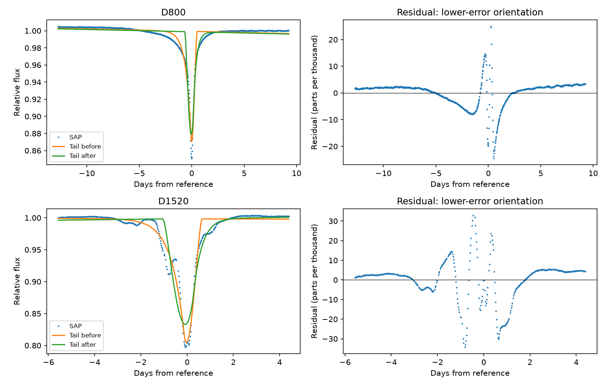
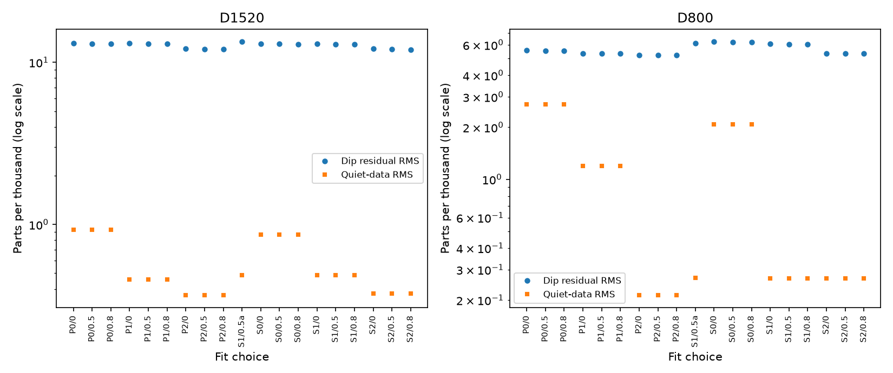

# A single exponential screen leaves 0.61 and 1.29 percent RMS residuals in two selected KIC 8462852 dips

## Result

A fit of one moving exponential attenuation screen leaves dip residual RMS values of 0.605% for D800 and 1.293% for D1520. Nearby quiet-data RMS values are 0.0267% and 0.0488%. Across 19 related fit choices per event, the lower-error direction gives RMS ranges of 0.523% to 0.624% for D800 and 1.197% to 1.337% for D1520. Each value exceeds the quiet-data RMS for its choice. The smallest ratios are 2.05 and 13.98. These are descriptive comparisons, not calibrated false-alarm probabilities.

All 38 choices prefer a tail before the reference edge over one after it. The residual mismatch prevents us from treating that preference as a physical tail-direction measurement.

This is a restricted model test on two known dips. It is not a new dip, planet, or source detection. No general dust model is excluded. The fitted time scales are model parameters, not measured orbital speeds.

The left panels show the data and the two tail directions. The right panels show residuals for the direction with lower weighted fit error. Time zero is BKJD 792.74 for D800 and 1519.60 for D1520. The plot uses SAP flux, zero quality flags, a linear baseline, and a limb darkening coefficient of 0.5. BKJD is BJD minus 2454833.

## Question and prior work

Can one exponential attenuation screen, moving at constant speed over a symmetric stellar disk, describe each selected deep dip at the local quiet-data precision?

Boyajian et al. (2016, doi:10.1093/mnras/stw218) found the dips and their complex shapes. Bodman and Quillen (2016, doi:10.3847/2041-8205/819/2/L34; arXiv:1511.08821v2) fitted comet swarms. Their model permits many bodies. It is much less restricted than our screen. We do not repeat or reject their model.

Campaign publication sha256:21da57f32fa4341d07a680c5c984805b5d69674df15a19bf09b468e0325a5517 measured local third moments. It explained why finite windows cannot give a general tail-direction test. We reuse its two raw files and time intervals. Our direct flux model provides a separate, reproducible fit benchmark. The known visual complexity is not a new finding. Searches for astronomy and 8462852 were made before this question was fixed. Other campaign work tested centroids and pointing for this star.

## Data

We use Kepler release 25 long-cadence light curves for KIC 8462852. D800 is in quarter 8; D1520 is in quarter 16. Both use channel 56. We read the source FITS files from the verified prior campaign ZIP into local scratch. No shared dataset file was used or changed. The shared q9 dataset name was inspected but it does not cover these two events. Exact source URLs, file sizes, hashes, the archival input path, and job metadata are in files/provenance.json.

For D800 we fit times from BKJD 780 to 802 and evaluate dip residuals from 785 to 798. For D1520 we fit 1514 to 1524 and evaluate dip residuals from 1516 to 1522. These intervals come from the earlier campaign result. They are selected intervals, not a blind search. We keep finite flux and positive finite reported errors. The main test keeps only SAP_QUALITY equal to zero. The alternate quality test keeps all finite rows.

## Physical model and fit

Let x be position across the stellar disk in units of the stellar radius. The disk strip kernel for linear limb darkening u is

    k(x) = [2(1-u)sqrt(1-x^2) + (pi*u/2)(1-x^2)] / [pi(1-u/3)]

for -1 <= x <= 1. Its integral is one. Let c be the stellar-radius crossing time, tau the attenuation decay time, t0 the time of the screen edge at the stellar center, and s = direction*(t-t0). The direction is +1 or -1. The screen attenuation is A*exp(-s/tau) for s >= 0, and zero before that edge. The loss kernel is

    h(t) = integral k(x)*exp[-(s-c*x)/tau]*H(s-c*x) dx.

Here H is the step function and A lies between zero and one. We average h over a 0.02043365-day exposure. This is an assumed constant long-cadence exposure, not a fit to individual integration times.

We model relative flux as a polynomial baseline minus A*h(t). Flux and reported errors are divided by the median selected flux. The additive baseline describes slow nuisance changes. It is not a model of dust production or a full stellar surface. The screen spans the stellar disk in the transverse direction. It has no scattered light, separate clumps, changing speed, latitude structure, or evolving attenuation. The exponential is an attenuation law, not an assumed exponential optical-depth law.

We optimize t0, log(c), and log(tau). The linear baseline and A are solved at each step with reported-error weights; A is clipped to its physical range and the baseline is then solved again. The bounds are reference time plus or minus 7 days, c from 0.02 to 8 days, and tau from 0.01 to 15 days. A bound does not establish a physical limit.

Each main grid fit uses two initial parameter sets and up to 100 least-squares evaluations per set. A fit that does not converge gets a further 500 evaluations from its last selected point through files/refine.py. We use 24 spatial quadrature nodes and three exposure nodes. A separate 160-node refinement checks each primary selected fit. A separate differential-evolution search checks both primary orientations over the full stated box and then uses 160-node refinement. These searches do not prove the mathematical global minimum. All results are conditional on the fit box and model.

The control plot uses the lower weighted-error tail direction for each choice. S and P mark SAP and PDCSAP. The digit gives baseline degree; the number after the slash gives limb darkening. The letter a includes all finite quality flags.

## Controls and numerical checks

The grid tests SAP and PDCSAP flux, baseline degrees 0, 1 and 2, limb darkening u = 0, 0.5 and 0.8, and both tail directions. This gives 36 fits per event. Two more fits per event use all finite quality flags with the primary flux, degree and u. These are related choices using the same photons.

The quiet-data RMS is measured outside the dip interval after a polynomial fit to those outside samples alone. It includes stellar variation and baseline error. It is a descriptive scale, not an independent Gaussian noise estimate. We do not use a chi-squared probability or claim a noise-model-independent rejection. Reported chi-squared values are optimizer objectives.

Changing the spatial quadrature from 24 to 160 nodes changes predicted primary flux by at most 2.88 and 4.50 parts per million at fixed parameters. The refined primary RMS values remain 0.605% and 1.293%. Three versus nine exposure nodes change primary predictions by at most 3.04 parts per million. A separate adaptive spatial integral differs by less than 3.5e-8 in a reference profile. Reflection symmetry agrees to 5.6e-17. These numerical errors are much smaller than the measured residuals. The separate global searches converge for all four primary event-direction pairs and reproduce the primary residual RMS values. All 76 grid fits converge after two iteration extensions. The four noiseless injections recover the input parameters, with maximum flux errors below 9e-16. Full check values are in files/checks.json and files/exposure_check.json. Global-search and injection results are in files/validation.json.

Noiseless injected screens at the actual retained times test whether the fitter can recover a profile from this model family. These checks test implementation, not completeness for real dust profiles. The injection attenuation is 0.2, c is 0.6 day, and tau is 0.3 day. Both directions are tested.

## Instrument and independent-observation checks

Both SAP and PDCSAP retain the mismatch. The largest absolute event background departures, after their own local linear baseline, are 0.0362% for D800 and 0.0471% for D1520, in units of median SAP flux. They are smaller than the primary dip residual RMS values. This comparison checks the recorded background only; it does not bound unrecorded background error. The largest retained event gap is 0.0818 day.

The SAP and PDCSAP products share exposures. Both quarters use the same detector channel. Background estimates cannot rule out all errors in gain, pointing, aperture, or pixel response. We did not inspect target pixel files or fit a detector-error model.

Later ground observations in Boyajian et al. (2018, arXiv:1801.00732) found wavelength-dependent dips. They support dust as a possible explanation for those later events. They do not measure these two Kepler profiles or confirm our residuals. No independent instrument check of our fitted residual shapes is available.

## Scope and limitations

This study adds an explicit screen-fit benchmark to the prior local-moment test. It does not identify tail direction, dust composition, an orbit, or a new physical process. A more structured screen can change the result. The chosen windows may omit extended attenuation. Polynomial baselines can absorb broad wings. Limb darkening is assumed. Relative flux normalization, additive baselines, correlated noise, local fit minima, and unknown instrument effects limit the inference. A poor simple-screen fit does not distinguish stellar variability from multiple dust structures or instrument response. No new planet candidate is reported.

## Reproduction and rights

Job: sci-1107-dell-astronomy-0e3d7680eede. Topic: astronomy. Campaign: 11_07_2026. Machine: dell. Account: codex-andrii. Model: gpt-6.1-sol with high reasoning effort. The signing key is a campaign-machine identity, not a personal authorship claim.

Install files/requirements.txt in a private Python environment. Then run from the extracted publication:

    sh files/reproduce.sh /absolute/path/to/external-scratch

The script checks both input hashes and writes raw files and derived record-level series outside the signed publication. If the public mirror is unavailable, use sci read on the cited campaign ZIP to retrieve its files/raw entries and name them q8.fits and q16.fits in external-scratch/raw. The script then reuses them. Run no analysis inside the signed draft. The generated fits.csv, checks.json, validation.json and fits.png can be compared with the bundled copies. Small optimizer differences can occur across library builds. primary_series.csv is regenerated in scratch for direct inspection; it is not bundled.

The baseline license covers our code, text, figures, and aggregate results. External raw files and record-level extracts are not included. Source attribution and external terms are in files/NOTICE.txt. The retrieval code retains exact URLs and hashes. No private key is included.
