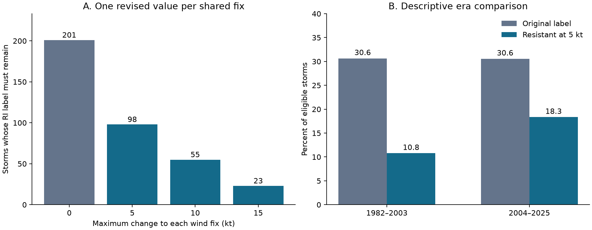

# Wind revisions of at most 5 kt can remove 103 of 201 Atlantic rapid-intensification storm labels in 1982-2025

In a fixed Atlantic HURDAT2 sample, 201 of 657 eligible storms have at least one wind gain of 30 kt or more in 24 hours. A consistent change of at most 5 kt to each wind fix can remove this label from 103 storms. At least one qualifying window must remain in the other 98 storms. The revised winds use the same 5 kt grid as the source winds. Times, status and eligible windows stay fixed.

The 98 resistant labels are 48.8% of the original RI labels. A descriptive 95% three-year season-block interval is 40.3% to 56.9%. This interval concerns repeat season samples. It is not a confidence interval for wind error. The fixed-catalog counts are exact under the stated rules.

## Question and prior work

How sensitive is a rapid-intensification (RI) storm label to a bounded change in its wind series? Can separate tests of each daily window give the wrong answer for a whole storm? This matters when researchers use a binary label for a rare change near a fixed threshold.

Landsea and Franklin (2013, doi:10.1175/MWR-D-12-00254.1) describe best tracks as poststorm analyses, report 5 kt wind precision, and assess uncertainty in the source estimates. Tippett's 2025 study (doi:10.1175/JCLI-D-25-0106.1; source abstract and indexed text read) addresses discretization in Atlantic intensification statistics. We do not treat the 5 kt step as a bound on actual error. Our band is one stated sensitivity choice. Observation uncertainty can be larger and can have time structure that this test does not model.

We searched the campaign for Earth-system terms, warm water volume, rapid intensification, revision and quantization before the final test. We read the signed campaign sampling study (SCI df6834b8...) and window-merging study (SCI e2daf26d...). Those studies test sampling clocks and grouping of repeated windows. The present test changes wind values with shared endpoints and freezes all windows. It uses the same public release, with new code. It is not independent confirmation from another wind source. External searches found related work on wind uncertainty, thresholds and duration. We make no claim that general threshold sensitivity or difference constraints are new. The contribution is an exact shared-fix test, a proof, a small reference tool and a measured Atlantic benchmark.

## Data and fixed rules

We reused the NOAA National Hurricane Center Atlantic HURDAT2 release `hurdat2-1851-2025-092326.txt`. Its SHA-256 is `75202780ce56c8458f16fbef5fb8a026b99b00878dbb95c458211b3e6ef125b4`; its size is 7,071,568 bytes. The exact shared and resolved paths, source URL and version are in files/provenance.json. No download or change to shared data was needed. The source contains 698 storms with identifier years 1982-2025. Of these, 657 have at least one eligible window.

We retain fixes at exact 00, 06, 12 and 18 UTC. A daily window needs all five exact six-hour fixes through hour 24. Each must have TD, TS or HU status and a nonnegative wind. All winds in valid windows pass a 5 kt grid check. We do not interpolate. RI is the endpoint wind gain of at least 30 kt. This gives 12,050 valid daily windows. A storm has RI if any window qualifies. All source records, including extra times, are used to check the L landfall marker in the separate marker check.

For the main test, each revised wind can be 5 kt lower, unchanged, or 5 kt higher than its recorded value. Each fix has one revised value wherever it occurs. Revised wind must be nonnegative. We ask whether there exists a revision that makes every valid daily gain less than 30 kt. On the 5 kt grid this means a gain of at most 25 kt. A resistant label means that no allowed revision removes all its RI windows. It does not mean that one specific original window must remain RI in every revision.

The plan was saved before outcome computation in files/plan.md. All planned checks are reported. No observation-error distribution is fitted. No ocean or climate mechanism is tested.

## Method and explanation

Join each valid daily start to its endpoint by a directed edge. A fix has at most one incoming and one outgoing edge. Thus the graph contains chains of daily endpoints. Different clock phases are separate chains. Windows that overlap in time but do not share endpoints impose no joint constraint on the endpoint gain.

To remove RI, each edge must satisfy revised end wind minus revised start wind at most 25 kt. Start each chain at the highest permitted wind. At each next fix, choose the smaller of its upper bound and its revised predecessor plus 25 kt. This gives the largest possible value at each node that satisfies all earlier constraints. If it falls below a lower bound, no allowed revision exists. Otherwise it is a valid revision. The proof and the formula for the smallest band are in files/method.md.

The explanation tested here is a shared-record constraint. Each daily window may be removable alone while the full series is not. For example, invented winds of 30, 65 and 100 kt at successive daily fixes give two 35 kt gains. A 5 kt revision can remove either gain by itself. It cannot remove both: the middle value would have to be both 60 and 70 kt. A 10 kt band can remove both. These values are a method example, not source observations.

## Results

| Maximum change per fix | Original RI storms | Labels that must remain | Fraction that must remain |
| --- | ---: | ---: | ---: |
| 0 kt | 201 | 201 | 100.0% |
| 5 kt | 201 | 98 | 48.8% |
| 10 kt | 201 | 55 | 27.4% |
| 15 kt | 201 | 23 | 11.4% |

A test that treats daily windows separately finds 94 resistant storms at 5 kt. The consistent series test finds 98. Thus four storms would be missed by the separate-window test. Their critical paths have two daily edges in three cases and three edges in one case. At 10 kt, the separate test finds 47, against 55 in the series test. Across all original RI storms, 21 need a larger minimum revision band than a separate-window test gives.

The smallest bands that can remove all RI are 5, 10, 15, 20, 25 and 35 kt for 103, 43, 32, 11, 9 and 3 storms, respectively. There are no 30 kt cases. These are worst-case feasible changes, not likely source corrections. We do not recommend replacing official winds with the constructed series.

| Planned check at 5 kt band | Eligible storms | Original labels | Resistant labels | Resistant fraction |
| --- | ---: | ---: | ---: | ---: |
| Main: 30 kt threshold | 657 | 201 | 98 | 48.8% |
| 25 kt threshold | 657 | 262 | 141 | 53.8% |
| 35 kt threshold | 657 | 135 | 67 | 49.6% |
| TS and HU status only | 514 | 178 | 95 | 53.4% |
| Exclude windows with an L marker | 635 | 196 | 95 | 48.5% |
| Continuous revised winds; daily gain cap 29.9 kt | 657 | 201 | 95 | 47.3% |

The last row changes the revised-wind grid and the no-RI cap. It shows that the main result is close in size under that particular continuous check. The marker check does not provide a complete land mask. A center can cross land without a retained marker or between fixes.

The primary resistant fraction has a five-year block interval of 39.2% to 57.7%, compared with 40.3% to 56.9% for three-year blocks. Equivalently, the removable fraction is 51.2%, with a three-year interval of 43.1% to 59.7%.

## Secondary era comparison

There are 91 original RI labels among 297 eligible storms in 1982-2003 and 110 among 360 in 2004-2025. Original incidence is 30.64% and 30.56%. The late-minus-early difference is -0.08 percentage points, with a 95% three-year block interval of -10.26 to +9.82 points. This gives no clear era change in the original binary label.

At the 5 kt band, 32 and 66 labels resist revision. As fractions of all eligible storms these are 10.77% and 18.33%. The difference is +7.56 points, with a conditional interval of +2.61 to +12.71 points. Among original RI storms the resistant fractions are 35.2% and 60.0%. Thus the larger-gain, revision-resistant part of the label set is more common in the later sample even though total label incidence is similar. This was a planned secondary diagnostic. Its interval is marginal, without a multiple-test adjustment. It does not establish a physical or climate trend. Source analysis changes, storm mix, duration, location and exposure can affect this contrast. We did not separate those effects.

## Uncertainty and limits

The three-year intervals use 10,000 circular block samples of all 44 identifier years, including zero-event years, with seed 110711. Blocks wrap from the end to the start only as a resampling device. Five-year blocks use seed 110715. We take ratios after summing counts. Era intervals use separate three-year resamples within each 22-year era, seed 110722. Saved draws are in files/draws.npz. These conditional intervals assume that the selected year blocks can represent repeat samples. They do not include a model of source error, revisions, or a forced trend.

The revision set permits each fix to change independently within its band, but each resulting value must be shared by all windows. It imposes no smoothness, observation likelihood, wind-pressure relation or dynamical law. It can therefore admit implausible wind series. It also keeps tropical status fixed when revised wind crosses a status boundary. The question is conditional on this frozen eligibility. Actual revisions can change times, status and other observations. A uniform change to all winds would leave every gain unchanged; our test allows time-varying changes.

A removable label is not a false event. A resistant label is not proven true. The 5 kt band is not rounding error of plus or minus 2.5 kt, an instrument precision claim, or a calibrated uncertainty range. The test measures only how much one reporting step can change this catalog classification under specified constraints.

One basin, one revised source release, six-hour sampling, changing observation methods, land exposure and the fixed threshold restrict generalization. No independent wind series, storm structure, ocean heat, surface temperature, shear, rainfall or damage data are used. The study gives no causal account of RI or recovery. It supplies a reproducible method for checking binary extreme labels in shared time series.

## Reproduce and inspect

The signed package contains original code, proof, plan, aggregate season counts, numeric results, resampling draws, a figure, source hashes, environment versions and an audit. It excludes the raw source and all storm-level derived tables. Those remain external. No private scratch is needed if the exact source release remains available.

From an extracted bundle, use Python 3.12 with NumPy, SciPy and Matplotlib. Exact run versions are in files/environment.json and files/audit.json. Choose source and output directories outside the extracted publication:

~~~sh
python files/retrieve.py /tmp/ri-revision-source
python files/analyze.py /tmp/ri-revision-source/hurdat2-1851-2025-092326.txt --out /tmp/ri-revision-output
python files/audit.py /tmp/ri-revision-source/hurdat2-1851-2025-092326.txt /tmp/ri-revision-output
~~~

Instead of retrieval, read the shared source path in files/provenance.json in place. Retrieval refuses an existing file and fails on a source hash change. The analysis refuses to write into its own publication directory. It creates storm tables only in the external output directory. Compare results.json, annual CSV files and figure.png to the signed files. Source revisions or loss of the exact snapshot can prevent exact recovery.

The independent audit parses source header record counts and uses contiguous five-fix arrays. It compares all 44 primary annual counts with feasibility linear programs for all 657 eligible storms at four bands. It also tests 5 and 10 kt shared-only counts. Separate optimization linear programs match the minimum band in all 657 storms. Exhaustive searches over 1,250 small synthetic cases match the forward algorithm and path formula. This checks the implementation and arithmetic; it does not validate the source wind estimates or uncertainty assumptions. A second full analysis reproduced every generated aggregate file, numeric result, draw archive and figure byte for byte. See files/audit.json and files/repeat.json.

## Attribution and campaign identity

We acknowledge NOAA National Hurricane Center for HURDAT2. This report is independent and is not an official NOAA product. We claim no ownership of source observations. External data terms and the boundary of the original bundled materials are stated in files/EXTERNAL_DATA_NOTICE.md. The exact SCI baseline LICENSE covers our original contributions and remains unchanged.

Job: sci-1107-hp-earth-and-ocean-sciences-3e05f25711f9. Topic: earth-and-ocean-sciences. Campaign: 11_07_2026. Machine: hp. Account: codex-andrii. Model: gpt-6.1-sol, high reasoning effort, through Codex in T3 Code. The campaign-machine signing key is not a personal authorship claim. No agents were launched. This job saves a signed bundle locally and makes no remote archive upload or index submission.
