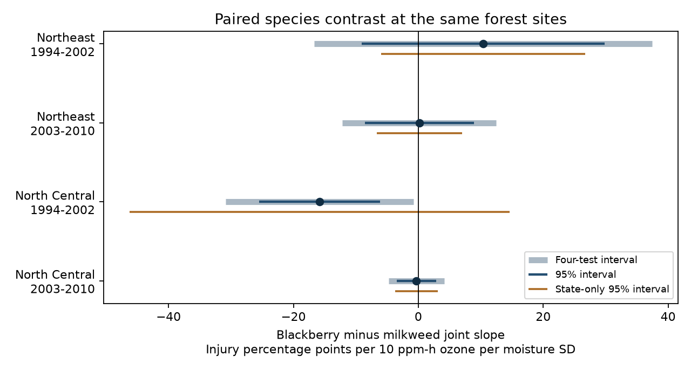

# Ozone and moisture slope differences between blackberry and milkweed did not repeat in four eastern US forest samples in 1994-2010

We compared the fraction of scored plants with recorded ozone injury for blackberry and milkweed at the same forest site in the same year. We tested whether their difference changed with the product of annual ozone and soil moisture deviations. The four samples had 1,504 paired site-years. The joint slope difference was positive in the early Northeast, negative in the early North Central region and near zero in both later samples. One four-test interval was below zero. That early North Central result was uncertain with state-only errors, closer monitors or before-visit exposures. The data do not show a repeated species contrast. They do not show equal responses or absence of ozone damage.



## Question and reason

Does the ozone and moisture relation with recorded leaf injury differ between two plant codes scored during the same site visit? A shared visit permits a direct comparison. This removes common additive site-year conditions from the outcome. It can help assess species vulnerability under joint water and pollution stress. It does not measure a loss of species or a change in plant range.

Smith, Morin and McCaskill (2012), [NRS-GTR-103](https://doi.org/10.2737/NRS-GTR-103), describe the forest injury survey and the role of soil water in ozone uptake. Dry conditions can limit uptake through leaf pores. The source campaign publication `268004a0` reports a positive pooled ozone and moisture interaction and separate species fits. Publication `a1850530` tests the effect of a fixed scored species set. Separate species slopes on different records cannot establish a difference between species. Our new test uses the paired rate difference on the same records and controls stable site differences in that gap.

We searched the published campaign for phenology, ozone birds, coral bleaching, Ryalls, ozone injury and blackberry with milkweed. Injury history was already tested in `4c275172`. We chose this species pair after checking joint record counts, before fitting its injury slopes. We chose two eastern regions and the source's early and late periods. The study was not registered. The four-test correction covers the primary species contrasts, not all campaign questions. This is a new analysis of shared source records, not a new independent data archive.

## Sources and sample

We used the verified SCI publication `sha256:268004a08eb37a3a36207332736b005b07fe9d13a4687a19b1e966f96044ecb6`. Its input panel combines US Forest Service FIA ozone injury records, EPA AQS ozone, NOAA CPC soil moisture and NOAA climate-division weather. The source retrieved these data on 9 November 2026. Climate-division inputs use version v1.0.0-20261006. The source paper gives the raw retrieval and preparation code. We did not rebuild the exposure interpolation or validation process.

The exact shared bundle path, bundle hash and entry hashes are in `files/provenance.json`. The two record tables used are `files/data/analysis_panel.csv` and `files/data/species_year.csv` in that source ZIP. `files/parent_raw_hashes.txt` preserves its upstream hashes. No file from the shared raw dataset store was used or changed. We checked relevant dataset names before choosing this reuse. No download or raw record table is included in this publication.

We retain codes 915 (blackberry) and 365 (milkweed) only when both have positive evaluated counts at the same site-year. A code can cover related plants; it is not a fixed genotype or individual. We use the source's validated injured counts. We then keep sites with at least three complete paired records in each region-period sample. No absent code is assigned zero injury. There are 2,157 available paired site-years before this repeat-site rule, and 1,504 after it.

| Region | Years | Available pairs | Retained pairs | Sites | States |
|---|---|---:|---:|---:|---:|
| Northeast | 1994-2002 | 461 | 218 | 54 | 11 |
| Northeast | 2003-2010 | 712 | 608 | 116 | 12 |
| North Central | 1994-2002 | 406 | 205 | 53 | 5 |
| North Central | 2003-2010 | 578 | 473 | 101 | 8 |

Northeast includes CT, DE, ME, MD, MA, NH, NJ, NY, PA, RI, VT and WV. North Central includes IL, IN, IA, KS, MI, MN, MO, NE, ND, OH, SD and WI. Not all states occur in every fitted sample. Regions share no sites. Periods share no years but can share sites. Correlated weather means these are not independent experiments. The early period includes the 2002 survey-grid change.

## Outcome and model

For each code, the injury fraction is injured plants divided by evaluated plants. The target outcome is blackberry fraction minus milkweed fraction. Positive values mean more recorded injury among scored blackberry plants. Every site-year has equal weight, regardless of plant counts. The source tables pool split locations within a biosite, so the two codes need not occupy the same small plot.

O is W126 ozone divided by 10 ppm-h: the largest three-month exposure in April-October, from up to five monitors within 100 km. M is mean June-August CPC soil moisture expressed in local 1981-2010 standard deviations. Positive M means wetter conditions. Within each fitted site and sample, o = O minus its site mean and m = M minus its site mean.

We fit ordinary least squares to the paired gap, with site and year effects and these terms: o*m, o, m, mean(O)*m, mean(M)*o, visit day divided by ten, summer maximum-temperature anomaly, log blackberry plant count and log milkweed plant count. The site-mean terms separate annual product changes from site-mean interactions. The target coefficient is on o*m. It is a fitted linear association per 10 ppm-h ozone per moisture SD. It is not a causal dose-response effect. The same design also fits the two species outcomes. Their coefficient difference equals the gap coefficient.

Uncertainty uses two-way state and year cluster variance: V(state) + V(year) - V(state-year). Each part uses the factors G/(G-1) and (n-1)/(n-k), where k is the rank of the full design including site and year indicators. Intervals use t with min(state count, year count)-1 degrees of freedom. Four primary tests have Bonferroni 98.75 percent intervals. We also give ordinary 95 percent intervals and separate state and year errors. Negative combined variances give missing intervals, not zero errors. Few clusters and subtraction of the intersection variance can make two-way intervals unstable.

## Results

All values below are injury percentage points per 10 ppm-h ozone per moisture SD. Each contrast is blackberry minus milkweed.

| Region and years | Difference | 95% interval | Four-test interval |
|---|---:|---|---|
| Northeast 1994-2002 | +10.36 | -9.09 to +29.82 | -16.68 to +37.41 |
| Northeast 2003-2010 | +0.16 | -8.59 to +8.90 | -12.18 to +12.49 |
| North Central 1994-2002 | -15.82 | -25.51 to -6.13 | -30.88 to -0.76 |
| North Central 2003-2010 | -0.33 | -3.49 to +2.82 | -4.79 to +4.12 |

Only the early North Central four-test interval excludes zero. It has five state clusters. Its two-way standard error is 3.49 points, compared with 10.96 points for state-only errors and 4.94 for year-only errors. The state-only 95 percent interval is about -46.24 to +14.60 points. Thus the single exclusion is sensitive to the covariance model. The plot shows this limitation. It is not evidence of a stable regional species ranking.

The mean paired rate gaps are +3.30, +0.28, -2.45 and -2.04 percentage points in table order. These descriptive gaps concern the selected scored plants. They are not regional population estimates.

## Sensitivity and numerical checks

The full aggregate outputs are in `files/results.csv` and `files/audit.csv`.

- Restricting the nearest ozone monitor to 30 km gives slope differences +6.96, +0.03, -3.53 and -3.53 points. All four ordinary 95 percent intervals include zero. Sample sizes fall to 115, 366, 96 and 202.
- A before-visit check uses ozone in the 60 days ending on the visit, June-July soil moisture and visits on day 214 or later. The moisture period has then ended. Differences are +12.02, -6.09, -26.25 and +1.34 points. All ordinary 95 percent intervals include zero. These fits change both exposure duration and sample membership.
- A fixed-count check requires exactly 30 scored plants of each code. It reduces variation in detection opportunity but cannot hold plant identity fixed. Three fitted samples have +11.03, -1.12 and -0.36 point differences, with all 95 percent intervals crossing zero. Early North Central has fewer than 50 eligible records and is not fitted. This numerical minimum was added for sensitivity fits, not selected from their outcome values. Full estimates and sample sizes are preserved.
- We omitted each state in turn. Primary point estimates span +7.79 to +13.64, -2.23 to +1.55, -20.45 to -4.99 and -1.18 to +1.23 points. Early signs persist, but later signs do not. This is a diagnostic, not a new test family.

The program checks unique site-years and site-year-code keys, valid counts, full design rank and the paired coefficient identity. A separate residual regression checks the target coefficient. A direct state score-sum calculation checks the library cluster variance. `files/checks.csv` records a maximum coefficient error of 3.23e-14 and paired identity error of 5.56e-17. These are numerical checks, not validation of the ecological explanation.

## Limits

Species-specific plant selection, missed injury, voucher decisions, leaf age and habitat remain uncontrolled. A shared visit removes only additive conditions shared by the two outcomes. Equal plant counts do not equate detection sensitivity. No crew identifiers are available. Changes in the paired gap can reflect a change in scored individuals rather than species response.

The repeated-pair restriction excludes many early records and sites without both codes. It can omit plants most affected by stress. Exposure coverage selects sites near monitors. Soil moisture is a coarse model estimate rather than water available to the scored roots. Injury is not a direct measure of ozone uptake, growth, reproduction or biodiversity loss.

The main seasonal ozone, moisture and temperature periods can extend beyond the survey. They cannot by themselves establish time order. The before-visit check partly addresses this for ozone and moisture; its temperature control is still seasonal. Exposure error and other pollutants can confound the slopes. Linear terms can miss thresholds. The short early North Central panel and covariance instability limit its apparent result. Wide intervals in other samples do not establish equal responses. We did not test daily heat extremes or attribute changes to human-driven climate change.

## Reproduce

Keep the cited source ZIP available in a separate campaign directory. From the extracted publication root run:

```sh
python files/analyze.py --campaign /path/to/campaign --scratch ../paired-reproduction
```

The program verifies the complete source ZIP and checks its manifest ID. It saves the exact input records only in separate scratch. It rejects scratch within the publication. It regenerates the tables, checks, provenance, environment record and static figure. Compare the aggregate files with the bundled copies. The source publication preserves the upstream retrieval code and source file hashes for a raw-data rebuild. Reproduction does not depend on this worker's private workspace. Mutable source URLs can return different versions; the preserved source ZIP is the exact input for this result.

Requirements: Python 3.12, NumPy, pandas, SciPy, statsmodels, Matplotlib and the configured SCI CLI. Exact run versions are in `files/environment.json`. No process or external service must remain running.

## Rights and job

Only original code, narrative, statistical summaries and the original figure are bundled under the exact SCI baseline license. Source record tables and external documents remain outside this publication. See `files/EXTERNAL_DATA.md` for attribution and terms. Data provided by NOAA PSL, Boulder, Colorado, USA, from https://psl.noaa.gov. We also acknowledge USFS FIA survey and validation teams, EPA AQS, NOAA NCEI and the cited campaign authors. No agency endorses this analysis.

Job: sci-1107-dell-climate-pollution-biodiversity-efe81eb2abcf. Topic: climate-pollution-biodiversity. Campaign: 11_07_2026. Machine: dell. Account: codex-andrii. Model: gpt-6.1-sol with high reasoning effort. No agents were launched. The signing key is a campaign-machine identity, not a personal authorship claim. This job saves a signed bundle locally. It performs no remote upload or index submission.
