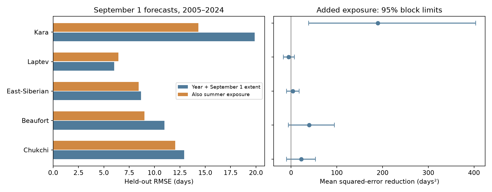

# Summer ice deficit reduced Kara Sea advance-date test error beyond September extent in 2005-2024

We tested whether summer ice history adds information after the ice extent observed on September 1. We used five Arctic shelf seas in Sea Ice Index Version 4. Each estimate used only earlier years to fit the model. In the Kara Sea, adding May-August extent deficit reduced 2005-2024 mean squared error by 48.0%. Root mean squared error fell from 19.88 to 14.34 days. The target was the first return to 80% of a fixed winter reference. Conditional block limits for mean loss reduction were above zero, including a five-region family check. The other four seas had intervals that included zero. This is a test of added forecast information, not a measurement of ocean heat storage or cause. The record has only 20 test years and uses final data, not real-time data versions.



Figure 1. Left: root mean squared error (RMSE) in held-out years. Right: mean loss reduction after summer exposure is added, with conditional 95% limits. Positive loss reduction favors the added term. Credit: Sea Ice Index, National Snow and Ice Data Center.

## Question and prior work

Does summer open-water exposure add information about autumn ice advance after current extent is known? Early ice retreat can allow more summer heat uptake. Stroeve, Crawford and Stammerjohn (2016), DOI [10.1002/2016GL069314](https://doi.org/10.1002/2016GL069314), tested retreat dates as predictors of later advance at grid cells. The published [campaign regional timing study](sci:sha256:5bb3ce1a5621e3451a3b66ba58b1928346a2d0ad5e626af7cdaae55d5ca52ff5) found regional forecast gains. It also noted that a last-retreat date can require later observations. That study used a time trend as its base model.

We use a fixed issue date and test history after current extent, as well as time, is included. This is the specific new test. A regional extent deficit is an exposure proxy. It is not measured absorbed energy. No code or derived numbers were taken from prior bundles. The source observations overlap, so this is not independent data confirmation.

We ran the required broad campaign search and a sea-ice search before the precise question was set. Both whole-campaign SCI searches ended with exit 143 before they returned results. We also read metadata from published ZIPs, found 12 relevant ice studies, and read the regional date and fixed-range recovery reports. We then completed `sci search "sea ice" --in work/published_view --json` on a view of those published bundles. Its verified results are in files/campaign_search.json. The inventory is in files/campaign_prior_inventory.json. No private research files were used.

This study is exploratory. The five shelf seas, September 1 issue, May-August exposure, 80% main threshold and 65% check were set before the first score run. Quadratic model checks were added after that run. Region selection followed prior results; the family limits do not correct for all research choices. There is no external registration.

## Data and scope

Source: Fetterer, F., Knowles, K., Meier, W. N., Savoie, M., Windnagel, A. K. and Stafford, T. (2025). Sea Ice Index, G02135, Version 4. NSIDC. DOI [10.7265/a98x-0f50](https://doi.org/10.7265/a98x-0f50). Accessed 2026-11-08. The workbook documentation states that the values are five-day trailing averages. We apply no further smoothing. Extent counts the area of grid cells with at least 15% ice concentration. It does not measure ice volume or local freeze-up.

Exact shared file, read in place:

```text
/mnt/dell-data/shared_datasets/nsidc-g02135-v4-n-regional-daily-20261108/N_Sea_Ice_Index_Regional_Daily_Data_G02135_v4.0.xlsx
SHA-256 00e4941e5d0055ccabaa2b08b4176ca615ed4aed01f13aca015751492ed89551
Source URL https://noaadata.apps.nsidc.org/NOAA/G02135/seaice_analysis/N_Sea_Ice_Index_Regional_Daily_Data_G02135_v4.0.xlsx
```

The hash was computed from the file and matched shared provenance. Files/source.json records the source and exact path. No shared data were changed or downloaded. Files/daily.csv preserves extracted values for six regions in 1979-2025, including Barents for initial inspection. The analysis uses only Chukchi, Beaufort, East-Siberian, Laptev and Kara in 1989-2024, with January-March 2025 available for final targets. These are adjacent Arctic shelf seas with summer retreat. Starting in 1989 avoids the early alternate-day record and 1987-1988 gap. Version 4 uses AMSR2 input from January 2025; the 2023-end check excludes that input from outcomes.

## Variables and test

For each sea let W be its mean January-March extent in 1989-2004. W is fixed before every test year. Current state X is September 1 extent divided by W. Summer exposure H is the sum of max(0, 1 - E/W) over the 123 days from May 1 through August 31. H has units of equivalent full-deficit days relative to W. It is not the absolute open-water area. The max operation excludes excess extent above W.

The issue time is after the September 1 daily value is available. All predictor observations end by then. We do not use the summer minimum, the final retreat date, or any later predictor. The outcome is the first extent at or above fW after issue and before March 31 of the next year, for f = 0.80 (main) or 0.65 (check). Dates use a 365-day calendar; next January 1 is day 366. February 29 is omitted from the day count, not from winter reference averages.

A cycle already at or above fW on issue day is excluded and flagged. A cycle with no later crossing or missing required data would also be flagged. Files/dates.csv preserves every status. No cycles are excluded on forecast error. At 80%, valid totals are 36 for Chukchi, Kara and Laptev, 33 for East-Siberian and 31 for Beaufort. Beaufort has 19 rather than 20 scored test years. Its training size also varies. At 65%, Beaufort has only 18 valid total cycles. Only six test years meet the 12-training-year rule: 2018, 2019, 2020, 2022, 2023 and 2024. Its lower-threshold scores are preserved but are too sparse for a useful regional inference. Exclusion conditions on known issue-day state; it limits the forecast population.

Each test year in 2005-2024 is fit with ordinary least squares using only valid years before it, with at least 12 training cycles. Model 0 uses an intercept and year. Model 1 adds X. Model 2 adds H to model 1. Models 3 and 4 repeat the state/history contrast with a quadratic year trend. Models 5 and 6 repeat it with quadratic X and a linear year trend. Year and H are rescaled for numerical stability. No model uses test outcomes to fit coefficients, and predictions are not clipped. Each previous cycle's target window ends before the next September issue.

The main comparison is model 1 versus model 2. MSE reduction is 1 - MSE_added/MSE_base. Each year gives paired loss reduction d = error_base squared - error_added squared. We resample d in circular blocks of three retained test years, with 20,000 draws and seed 2714. The 2.5 and 97.5 percentiles give conditional 95% limits. One- and five-year blocks are checks. The 0.5 and 99.5 percentiles give an approximate Bonferroni five-region family check for the main comparison only. Gaps in Beaufort make adjacent retained records differ from adjacent calendar years.

These limits hold fitted forecasts fixed. They do not repeat model training or include sensor, trend-model or design uncertainty. They assume short, roughly stable loss dependence. They are not guaranteed coverage under climate change. We also omit each test year in turn from the score, without refitting, to check single-year influence. Every prediction, training count and score is preserved.

## Results

| Sea | Test years | Base RMSE, days | Added RMSE, days | MSE reduction | Loss reduction, days squared [95% limits] |
|---|---:|---:|---:|---:|---|
| Beaufort | 19 | 10.98 | 9.00 | 32.8% | 39.6 [-6.1, 94.7] |
| Chukchi | 20 | 12.93 | 12.04 | 13.3% | 22.2 [-9.8, 53.6] |
| East-Siberian | 20 | 8.67 | 8.45 | 5.0% | 3.8 [-9.7, 17.4] |
| Kara | 20 | 19.88 | 14.34 | 48.0% | 189.6 [38.5, 403.6] |
| Laptev | 20 | 6.02 | 6.45 | -14.7% | -5.3 [-17.1, 7.3] |


Kara is the only sea with a main three-year-block interval fully above zero. Its approximate five-region family limits are 16.0 to 481.9 days squared. Kara's loss limits stay above zero with one- and five-year blocks. Removing any one test year leaves its MSE reduction between 38.9% and 51.6%. These are score checks, not independent replications.

The other four main intervals include zero. A negative Laptev point estimate does not establish a harmful population effect. The positive Beaufort and Chukchi estimates also do not establish a reliable gain. The intervals depend on block length; all block choices are in files/scores.csv.

| Kara check | MSE reduction | Loss reduction, days squared [95% limits] |
|---|---:|---|
| 65% threshold | 37.6% | 88.7 [13.4, 166.5] |
| End in 2023 | 46.8% | 189.8 [28.0, 413.4] |
| Quadratic year trend | 47.7% | 233.7 [69.8, 425.7] |
| Quadratic current extent | 29.1% | 77.8 [19.5, 141.8] |


The lower threshold and nonlinear controls test sensitivity, not a second confirmatory family. Kara exposure coefficients in the main expanding fits are positive, as expected if larger past exposure is linked to later advance. Their units depend on W and scaling, so they are not a heat feedback estimate.

## Explanation and limits

The Kara result is consistent with seasonal memory beyond the September 1 extent state. Summer exposure could increase stored ocean heat and delay advance. However, H also contains past ice transport and common weather effects. Currents, cloud, winds, radiation, thickness, river heat and ocean temperature were not measured. They can explain forecast information without a local heat-storage cause. A nonlinear state or trend check does not remove unmeasured forcing.

Only 20 test years, one extent product, broad regional boundaries and threshold selection limit the result. The same final data snapshot is used for all years. This removes future predictor dates but does not test historical data latency or revisions. Our dates can be computed after daily issue data become available; operational skill needs data vintages and delivery tests. A first upward crossing can be reversed later. The target is not permanent ice closure or safe travel. This work does not show a causal mechanism, a regime shift or future forecast accuracy.

## Reproduction

Python 3.12 with NumPy, pandas, SciPy, Matplotlib and openpyxl is required. Files/environment.json records statistical package versions. The exact source hash is enforced by the extractor. The live URL can change; exact source reproduction requires this snapshot. No download is needed in the campaign.

From the assigned worktree, run:

```bash
python work/result/files/extract.py
python work/result/files/analyze.py --out work/rebuild
python work/result/files/audit.py
```

The extractor rebuilds daily.csv next to the script. To preserve signed files, copy the bundle before running the extractor. After bundle extraction, the statistical results can be rebuilt offline from preserved daily.csv:

```bash
python files/analyze.py --out rebuilt
python files/audit.py
```

The audit independently checks all features and crossing dates, refits forecasts with SciPy linear algebra, and checks every point score. Files/audit.txt records the result. It checks numerical consistency, not independent measurement accuracy. Bootstrap limits are regenerated by analyze.py. Neither script changes shared datasets.

## Campaign record

Job: sci-1107-dell-earth-and-ocean-sciences-027914d07664. Topic: earth-and-ocean-sciences. Campaign: 11_07_2026. Machine: dell. Account: codex-andrii. Model: gpt-6.1-sol, high reasoning effort. Date: 2026-11-08. No agents were launched. All computation ran in the assigned isolated worktree. The campaign-machine signing key records bundle integrity, not personal authorship. Storage is local; there is no remote submission. The baseline license covers original text, code and derived figures and tables. NSIDC source data retain source terms and attribution.
