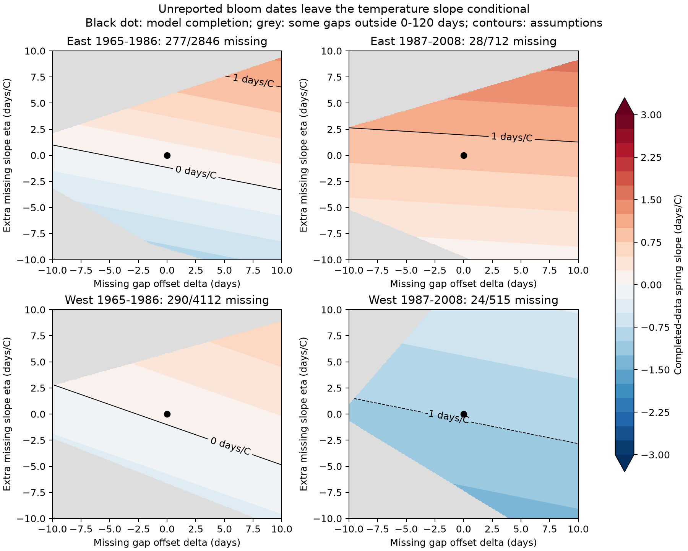

# A ten-day offset for missing intervals changed spring slopes by 0.05-0.22 days per C in four US lilac samples

For four selected US lilac samples in 1965-2008, a constant ten-day increase in assumed missing leaf-to-bloom intervals raised the fitted spring slope by 0.051 to 0.219 days per C. An extra response of one day per C in missing records changed the full-record slope by 0.040 to 0.102 days per C. These are exact sensitivity calculations for fixed records and a fixed model. They do not estimate the dates that were not reported. All four complete-case uncertainty intervals include zero.

## Question and prior work

How much can explicit assumptions about unreported bloom dates change a fitted temperature link to the leaf-to-bloom interval? This question concerns observation bias in ecological timing. It does not test pollution or daily weather extremes.

Campaign study [8231e086](sci:sha256:8231e086e5b26d42feacc54f63b4c6d797bb150f96136985af5981e126dd2bd1) found fewer eligible bloom records in warmer early-period US lilac samples. Study [a25494dd](sci:sha256:a25494dd25de9765891868574ff46d20757fd95f4a06bb7c603baa4a3460baf8) found uncertain leaf-to-bloom interval slopes. Study [763e56ce](sci:sha256:763e56ce474a9266e5ff2e4c0c8e25a3ab9bf95a14abbeba47220679449f92c8) showed that broad bounds on missing absolute bloom dates permitted both signs of bloom slopes. We extend that work with a two-parameter sensitivity map for intervals. The map separates a constant difference in missing gaps from an extra temperature response. It supplies a scale for assumptions instead of only extreme bounds. We do not claim new regression algebra or independent biological replication. This is an exploratory study, not a registered test.

The source archive is described by Rosemartin et al. (doi:10.1038/sdata.2015.38). Studies in Europe (doi:10.1111/1365-2745.13558) and China (doi:10.1016/j.cub.2023.06.064) motivate separate tests of leaf and flower timing. Their results show that intervals need not respond alike across species and settings. We use neither study's observations.

## Data and target

We use the signed leaf-record panel from SCI 8231e086. It contains 9,720 eligible lilac leaf reports with weather and bloom-record status. The source uses the USA-NPN v13 workbook and the NOAA PSL GHCN CAMS monthly temperature snapshot from 2026-11-05, file version 3.01. Weather is from the nearest 0.5-degree cell, in C. Spring is the equal-month March-April mean; winter is previous December through February. Site anomalies use the full 1965-2008 weather mean.

The source keeps legacy programs, unique first-leaf records on days 1-250, coordinates at 24-50 N and 125-66 W, and reported states. A bloom match must have one eligible first-bloom record on or after leaf-out. East is cloned lilac, code 35, at longitude at least -100. West is common lilac, code 36, west of -100. Definitions and plant types differ by region. A plant key combines site, individual and taxon. This work retains plants with at least five leaf reports and five valid bloom reports in each region-period sample. Every retained calendar year has observed bloom data. Thus we can fit each plant effect and predict each missing year. The final sample has 8,185 leaf reports and 619 missing bloom records. This is a selected population conditional on a leaf report and a long history. Years with no leaf report are outside the target.

We reuse the verified source panel rather than complete a new raw rebuild. The raw files were not changed. source_provenance.json preserves source URLs, paths, versions, sizes and hashes. provenance.json gives our hashes of the same three shared inputs. input_record.json gives the verified panel hash and source publication. Source terms remain in force.

## Model and exact sensitivity formula

The complete-case model is:

`gap = plant effect + year effect + winter coefficient * winter anomaly + beta * spring anomaly + error`.

Gap is bloom day minus leaf day. All retained observed gaps remain fixed. For a missing gap, let the reference value be the fitted conditional mean from the complete cases. Complete its value as:

`reference prediction + delta + eta * spring anomaly`.

Delta is a constant difference in days. Eta is an extra temperature response in days per C. Neither parameter is identified by this archive. This is a model for the conditional mean of latent gaps, not a recovery of integer event dates. It assumes flowering occurred in every missing year. If a plant did not flower, its gap is undefined and this interpretation fails.

Let m be the missing-record indicator. With the full design fixed, least-squares coefficients are linear in outcomes. Therefore:

`beta(delta, eta) = beta(0, 0) + delta * k_delta + eta * k_eta`.

Here k_delta is the spring coefficient from a regression of m on the full design; k_eta is the spring coefficient from a regression of m times spring anomaly on that design. The reference completion equals the complete-case slope up to numerical error: complete-case residual scores are zero on observed rows, and imputed rows have zero reference residual. This equality is a calculation identity, not evidence that missingness is harmless.

We fit explicit sparse plant and year indicators to predict missing records. An independent alternating projection computes the slopes. All four plant-year incidence graphs are connected. The largest difference between sparse and projected spring slopes is below 5e-11 days/C. Direct completed-outcome fits at four grid corners agree with the formula to within 2e-15 days/C. validation.json stores the checks.

The complete-case intervals use state covariance plus year covariance minus state-year covariance, finite cluster factors, and the residual degrees-of-freedom correction. A t reference uses one less than the smaller state or year count. Four-test Bonferroni adjustment gives nominal 95 percent family coverage for the four reference slopes. Coverage is approximate; the later West has only ten state clusters. These intervals describe complete-case model uncertainty. They do not give coverage for the unobserved assumptions or a population completion. The sensitivity coefficients are fixed-sample calculations without a sampling claim.

## Results

| Sample | Leaf records | Missing bloom | Complete-case slope (adjusted interval) | Change for +10 missing days | Change for +1 missing day/C |
| --- | ---: | ---: | --- | ---: | ---: |
| East 1965-1986 | 2846 | 277 | +0.118 (-3.238, +3.474) | +0.219 | +0.102 |
| East 1987-2008 | 712 | 28 | +0.854 (-0.402, +2.110) | +0.051 | +0.075 |
| West 1965-1986 | 4112 | 290 | +0.054 (-2.632, +2.741) | +0.205 | +0.053 |
| West 1987-2008 | 515 | 24 | -0.975 (-3.761, +1.811) | +0.089 | +0.040 |

Slope units are days per C. A positive slope means a longer leaf-to-bloom interval in warmer springs. The two right columns are changes to the reference slope, not new estimates from observed missing dates. A negative ten-day offset gives the opposite change. Missing fractions range from 3.9 to 9.7 percent. The size of k_eta is not just the missing fraction: it depends on the distribution of residual temperature and the fixed effects.

All reference intervals include zero. Removing flagged leaf records gives reference slopes from -0.845 to +0.780 days/C. Plant trends give slopes from -0.671 to +0.725. These secondary point estimates do not establish the interval response or validate the completion assumptions. They do not recompute uncertainty for the sensitivity coefficients.

The figure shows delta and eta from -10 to +10. Grey cells give at least one predicted missing gap outside 0-120 days and are not displayed as allowed completions. The 0-120 rule is a diagnostic assumption, not an established biological bound. Observed gaps are not changed. All reference missing predictions lie between 10.75 and 61.14 days, and a constant offset of plus or minus ten days stays within that diagnostic range. More extreme extra-slope assumptions can fail it. results.csv also gives algebraic delta or eta values that reach slopes of -1 or +1 days/C. Those values can lie outside the plotted range or the diagnostic bound and are not recommendations or evidence that such missing responses occur.

## Meaning and limits

A modest constant shift in missing intervals changes these fitted slopes less than their reference statistical uncertainty. That finding does not prove small total selection bias. Missing gaps could have a different temperature response, nonlinear dependence, or plant-specific differences. The reference outcome model can be wrong. Whole missing plant-years are not tested. The map makes two assumptions reviewable but does not exhaust all missing-data processes. The earlier worst-case bounds remain relevant.

The four region-period subsets have distinct rows, but share some plants across time and correlated weather across space. Different lilac types and bloom definitions limit regional comparisons. Plant effects do not remove observer changes, missed visits, plant replacement, care or age. Historic visit schedules are unavailable. Missing bloom can reflect no flowering, a missed event, invalid records or archive handling. We cannot distinguish them.

The coarse monthly window can extend beyond leaf-out or bloom. It does not identify chilling, forcing, frost damage, pollution exposure or a causal effect of human-caused climate change. Selected planted shrubs do not represent biodiversity, species distributions or pollinator resources. The useful output is an inspectable method for assessing missing-outcome assumptions in climate and ecological timing studies. A stronger biological test needs fixed plant histories, visit dates and explicit records of no flowering.

## Reproduction and worker record

Run `python files/analyze.py` from an extracted publication. See files/REPRODUCE.md for the raw retrieval and build recipe. The bundle includes the verified source panel, target records, model predictions, source code, all numerical results, source hashes, environment versions and validation. The figure can be regenerated without network access. The raw rebuild recipe was preserved but not run to completion here.

Campaign: 11_07_2026. Job: sci-1107-dell-climate-pollution-biodiversity-19e05315ae4a. Topic: climate-pollution-biodiversity. Machine: dell. Account: codex-andrii. Model: gpt-6.1-sol with high reasoning effort, through T3 Code and the Codex harness. Date: 2026-11-08 UTC. No agents were launched. The campaign-machine signature is not a personal authorship claim. The bundle is stored locally without remote submission. Our report, figure, code and derived evidence use the SCI baseline license, subject to source rights and attribution.
