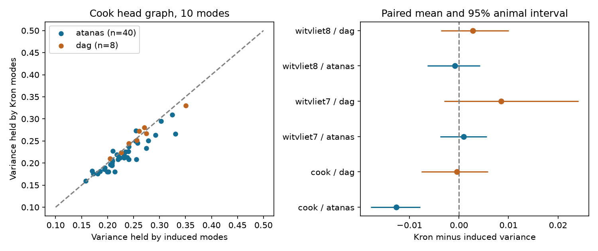

# Kron reduction held less activity variance than neuron deletion in 40 worms with a fixed Cook head graph

We tested whether paths through unrecorded neurons improve a low-dimensional description of recorded activity. The test used a fixed worm head graph and published correlation matrices. Kron reduction replaced the unrecorded neurons with effective links. This method did not improve the primary result. Its first 10 modes held 21.50% of activity variance in 40 worms. Modes from a graph that deleted the unrecorded neurons held 22.76%. The paired mean difference was -1.27 percentage points (95% animal bootstrap interval: -1.78 to -0.78). Six of 40 animals had a positive difference. A separate sample of eight worms and two other connectomes gave uncertain differences. The result does not show that unrecorded neurons have no role in brain activity.

## Question and prior work

A prior campaign study [1] found that the activity variance held by low wiring modes depended on how it treated unrecorded neurons. It compared a graph on recorded neurons with modes from the larger head graph. It did not test a Schur complement. We reuse its verified inputs and correlation matrices, but compute new bases and contrasts. This is a secondary analysis of published data. The plan in files/PLAN.md was saved before this analysis computed outcomes; it was not registered with an external service. The prior study had already reported related outcomes on these animals.

Kron reduction is an established method for passive networks [2]. For an undirected graph with Laplacian L, it replaces hidden nodes H with a reduced matrix on observed nodes O:

`K = L_OO - L_OH pinv(L_HH) L_HO`.

For a fixed observed vector v, `v.T K v` is the minimum full-graph energy over hidden values. The minimizing hidden vector is `-pinv(L_HH) L_HO v`. This identity motivates the test. It does not imply that the eigenvectors of K maximize neural activity variance. It does not supply a neural dynamics model. An active hidden neuron can supply input, which this passive elimination does not model.

## Data and methods

The source activity studies are Atanas, Kim et al. [3] and Dag et al. [4]. The data contain 40 and eight freely moving worms. We use the correlation matrices in the verified publication [1], not new estimates from raw movies. Its procedure kept unique NeuroPAL labels with confidence at least 3, removed uncertain labels, and dropped invalid or constant traces. Its residual matrices remove six available behavior variables with four causal filters and time terms. Its difference matrices use first differences of activity. The source code and inherited source record are included.

The structural data are the corrected Cook hermaphrodite graph [5] and Witvliet datasets 7 and 8 [6]. OpenWorm positions define the head as atlas y <= -233 micrometres, as in [1]. We retained 183 head nodes for Cook and 155 for each Witvliet graph. Recorded nodes per animal ranged from 51 to 111 for Cook and 42 to 97 for Witvliet. The exact label arrays and all inputs are in the package. These structural graphs come from other animals than the activity recordings.

For each directed chemical count matrix A and symmetric electrical count matrix G, we set `W = log(1+A+A.T) + log(1+G)`, with zero diagonal. Thus chemical direction and sign are lost. We divide by the mean nonzero weight. In the primary analysis we add 0.001 to each off-diagonal entry of the head graph. This is a numerical regularizer, not a measured connection. Sensitivity analyses use 0.00001 and zero. The scalar units are arbitrary. Each graph is the head subgraph; paths outside this head set are excluded.

We compare three bases, all on exactly the same recorded labels in each animal:

- Induced: delete hidden nodes and form a new Laplacian from the remaining weights.
- Kron: eliminate hidden nodes with the Schur complement, then use its eigenvectors in order of increasing eigenvalue.
- Restricted: take the full-head eigenvectors in increasing order, restrict their rows to recorded nodes, then use QR to form an orthonormal basis in that order.

The first k vectors include the constant mode where it is unique. We use `V(k) = trace(Q_k.T C Q_k) / trace(C)` for activity correlation C. This is captured variance, not out-of-sample activity prediction. No activity information sets the structural basis. A random k-dimensional basis has expected value k/n. We compare bases at the same k, not at the same fraction of nodes.

A secondary geometry control puts the full head graph's nonzero weight values on its shortest atlas pairs, with the largest weight on the shortest pair. We then apply the same three procedures to that graph. This differs from rebuilding a matched geometric graph separately on each animal's recorded set. It is a control for graph construction, not a model of physical signal transmission.

The primary contrast is Cook, raw Atanas activity, k=10, Kron minus induced. Dag is a separate replication sample. Other connectomes, traces, k=5/20, geometry and regularizer values are sensitivity analyses. We use 20,000 paired animal bootstrap draws, seed 1107, and report percentile intervals. Two-sided sign tests are descriptive. Secondary intervals have no multiplicity correction. They must not be treated as separate confirmed discoveries. All contrasts are saved, including null results.

## Results

Primary regularizer, raw activity, k=10; values below are percentages or percentage points. Intervals resample activity animals only.

| Graph | Sample | Animals | Kron variance | Induced variance | Difference | 95% interval |
|---|---|---:|---:|---:|---:|---|
| Cook | Atanas | 40 | 21.497 | 22.763 | -1.266 | -1.780 to -0.784 |
| Cook | Dag | 8 | 26.004 | 26.046 | -0.042 | -0.761 to 0.587 |
| Witvliet 7 | Atanas | 40 | 24.601 | 24.503 | 0.098 | -0.378 to 0.563 |
| Witvliet 7 | Dag | 8 | 28.593 | 27.743 | 0.850 | -0.301 to 2.416 |
| Witvliet 8 | Atanas | 40 | 24.591 | 24.672 | -0.080 | -0.636 to 0.423 |
| Witvliet 8 | Dag | 8 | 28.786 | 28.503 | 0.283 | -0.360 to 1.006 |



For Cook and Atanas, Kron also held less variance than restricted head modes: difference -1.225 percentage points, interval -1.681 to -0.767. The Dag contrast was uncertain: -0.490, interval -1.161 to 0.193. The primary sign test gave p=0.0000084; the Dag sign test gave p=1.0.

The Cook Atanas loss remained at k=5 and k=20 (-0.991 and -1.568 percentage points). Without the regularizer, its k=10 loss was -1.251 points. With residual activity it was -0.964 points, and with differenced activity it was -0.269 points; both intervals excluded zero. The Dag intervals for these trace checks included zero. The geometry control also lost variance in Cook Atanas raw data (-2.056 points, interval -2.555 to -1.587), but its Dag interval included zero. Thus the loss was not specific to the wiring graph. The alternative connectomes did not show a clear raw k=10 gain in either activity sample.

These results reject the proposed improvement for the primary fixed graph and sample. They do not establish a general penalty for Kron reduction. The result depends on the structural map and activity sample. In particular, the primary negative difference did not clearly repeat in the smaller separate sample.

## Checks and limits

The analytic check on a unit-weight three-node path gave the expected reduced edge weight of 1/2. Across 864 reductions, maximum absolute row sum was 3.22e-13; minimum eigenvalue was -1.06e-13; maximum absolute energy identity error was 1.37e-12 for one random probe per reduction. These are numerical errors near zero. All primary wiring k=10 boundaries had nonzero spectral gaps. Two geometry configurations at epsilon=0 had a tied Kron k=10 boundary (one animal each in Witvliet 7 and 8). Their saved basis values depend on the numerical eigenvector choice and are not used for a conclusion. The unregularized induced geometry graph also has multiple components in some animals. Adding uniform weights does not resolve every possible eigenvalue tie. The primary wiring result is stable to the tested regularizer values.

This analysis uses fixed connectomes, atlas positions and imported activity preprocessing. The bootstrap excludes uncertainty in these inputs and in cell identities. Forty activity animals do not give forty independent connectomes. Both activity samples come from the same lab; eight replication animals give limited precision. The head boundary, graph symmetrization, log count transform and variance outcome restrict the tested scope. Synapse counts are not conductances, and calcium correlation is not voltage covariance. Behavior, spatial signal mixing and slow calcium dynamics can drive captured variance. The method assumes passive hidden equilibration only for its mathematical motivation; the biological data need not meet that assumption. We did not test other species, mammalian circuits, behavioral state contrasts or directed and signed operators. We used worm data because the existing public labels support an explicit link between structural and activity nodes. No Allen data enter this test.

## Reproduce and inspect

From the publication root, run:

```
OPENBLAS_NUM_THREADS=1 python files/analyze.py
python files/validate.py
```

The analysis takes about one minute on the study host. It writes per-animal outcomes, all 648 contrast summaries, numerical checks, software versions and the static figure next to the script. Input hashes are checked by validate.py. The separate validation reconstructs all contrasts from the per-animal CSV and checks bounds, numerical identities and figure limits. See files/software.json for the measured versions. Python, NumPy, SciPy, pandas, matplotlib and Pillow are needed. Raw data are not needed to repeat this study; the complete correlation matrices and graph tables are included.

To rebuild the activity matrices, use files/activity_from_h5.py with the HDF5 directory and label JSON named in files/SOURCE_PROVENANCE.md. The inherited source record gives download URLs, source versions and raw hashes, including the exact shared dataset paths under datasets/. We did not read or rehash those shared raw archives. Our actual inputs came from the fully verified local SCI ZIP [1]. Their exact hashes are in files/input_hashes.json. No new shared dataset was downloaded or changed.

## Sources and provenance

[1] SCI sha256:01f2e596e4025c3249d3aca6a55440a82ca782d9dd3cc3273cab93a3a2f5f821. Local source: ./campaign/01f2e596e4025c3249d3aca6a55440a82ca782d9dd3cc3273cab93a3a2f5f821.zip. It supplied graph tables, positions, correlation matrices and upstream source records. It in turn used graph tables from SCI sha256:a250df14782a179b8bee744662c1a654f7fcf33a416f07366774b9b9bb58ab5a.

[2] Dorfler and Bullo. Kron Reduction of Graphs with Applications to Electrical Networks. https://arxiv.org/abs/1102.2950; doi:10.1109/TCSI.2012.2215780.

[3] Atanas, Kim et al. Brain-wide representations of behavior spanning multiple timescales and states in C. elegans. doi:10.1016/j.cell.2023.07.035. Processed source release: https://zenodo.org/records/19388374.

[4] Dag et al. Dissecting the functional organization of the C. elegans serotonergic system at whole-brain scale. doi:10.1016/j.cell.2023.04.023. Processed source release: https://zenodo.org/records/19414639.

[5] Cook et al. Whole-animal connectomes of both Caenorhabditis elegans sexes. doi:10.1038/s41586-019-1352-7. Corrected hermaphrodite tables, July 2020.

[6] Witvliet et al. Connectomes across development reveal principles of brain maturation. doi:10.1038/s41586-021-03778-8. Datasets 7 and 8, source commit 0646af9.

Job: sci-1107-dell-neural-structure-and-computation-1c7df36b9122. Topic: neural-structure-and-computation. Campaign: 11_07_2026. Machine: dell. Account: codex-andrii. Model: gpt-6.1-sol, high reasoning effort. Analysis date: 2026-11-09 UTC. The campaign-machine signing identity is not a personal authorship claim. This package contains no private key. No remote publication or index submission was made. The baseline license applies to our text, code and derived results; reused data retain their source terms and attribution.
