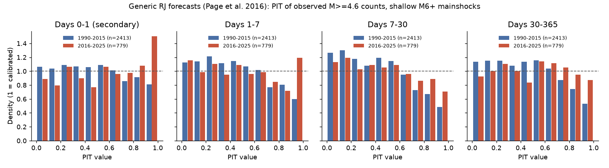
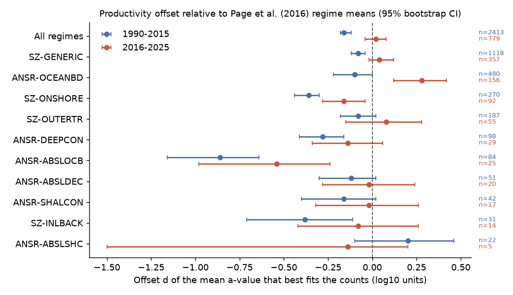
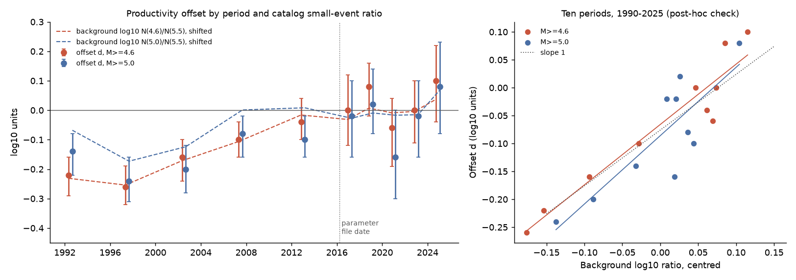

# Generic USGS aftershock forecasts were calibrated for 779 shallow M6+ mainshocks in 2016-2025 and too high for 1990-2015; catalog small-event ratios follow the change

Job `sci-1107-hp-earth-and-ocean-sciences-0143d0ec7587`, campaign 11_07_2026, topic earth-and-ocean-sciences, machine hp, model Claude Opus 5.5 (`claude-opus-5-5`).
The signing key is a campaign-machine key. It is not a personal authorship claim.

## Summary

**Question.** Outside California, USGS operational aftershock forecasts start from a generic Reasenberg-Jones (RJ) model. Its parameters come from Page et al. (2016), one set for each of 15 tectonic regimes of Garcia et al. (2012). The parameter file in the public USGS OpenSHA OAF code is dated 21 March 2016. We asked three questions. (1) Are the generic forecasts calibrated for global mainshocks after that date? (2) Are they calibrated for 1990-2015 mainshocks? (3) Does the regional parameter set give better out-of-sample scores than one global parameter set?

**Method.** We used the USGS ComCat catalog (M 4.5 or more, 1985 to 7 November 2026). Mainshocks are M 6.0 or more, depth 70 km or less, and not inside the zone of an earlier larger event. We counted M 4.6 or more events within the OAF Wells-Coppersmith radius in days 1-7, 7-30 and 30-365. We copied the forecast model from the OAF Java code: a Poisson count mixed over a Gaussian a-value, with the magnitude-dependent sigma. We wrote the analysis plan (`files/ANALYSIS_PLAN.md`) before we scored a forecast.

**Main results.**

- **2016-2025 (779 mainshocks, 2,337 window forecasts).** 2.9% of observed counts were below the 2.5% forecast quantile and 2.8% were above the 97.5% quantile. The 95% coverage was 94.4%. The PIT histogram did not differ clearly from uniform (chi-square p = 0.18). The best-fit shift of the regime mean a-value was +0.02 (95% CI -0.04 to +0.08). By the planned rule, the generic forecasts were calibrated.
- **1990-2015 (2,413 mainshocks).** The forecasts were too high. Observed counts were 75% of the forecast mean. The best-fit shift was -0.16 (-0.18 to -0.12). The PIT histogram had too few high values (chi-square p = 5e-69), although 95% coverage was 95.9%.
- **The shift changed with time.** The 2016-2025 minus 1990-2015 difference was +0.18 (0.12 to 0.24). By period, the shift rose from -0.22 and -0.26 in 1990-1999 to near zero after 2010.
- **Catalog change follows the shift (post-hoc check).** In ComCat, the yearly number of M 4.6 or more events rose from about 3,700 in the 1990s to about 5,600 after 2010, while the number of M 5.5 or more events did not change. Outside all aftershock zones, the log ratio N(M >= 4.6)/N(M >= 5.5) correlated with the period shift (r = 0.95, slope 1.08, 10 periods). A slope of 1 is expected if the shift is a catalog effect. At M 5.0 the correlation was r = 0.84.
- **Regions.** A regional parameter set fitted to 1990-2015 with our rules scored no better than the published Page set in 2016-2025 (-0.013 log units per mainshock, -0.111 to +0.084). A global set fitted to 1990-2015 scored -0.057 (-0.135 to +0.023) relative to the Page set; it was too low for 2016-2025 (observed/forecast 1.84). Regional minus global was +0.043 (-0.032 to +0.112) at M 4.6 and +0.041 (+0.011 to +0.070) at M 5.0.
- **Sensitivity.** The time difference remained for M 5.0 or more (+0.12, 0.06 to 0.20), for a double radius (+0.14, 0.08 to 0.20), and without mainshocks that a larger event followed (+0.16, 0.10 to 0.22). Calibration in 2016-2025 depended on the rules: at M 5.0 the PIT test failed (p = 0.0003; too few counts in days 7-30). With a double radius, the forecasts were too low (shift +0.34, coverage 91.8%).
- **Deep mainshocks (secondary group).** For mainshocks deeper than 70 km, the regime grid gives the same parameters as for shallow events at the epicenter. These forecasts were about 4 times too high in both periods (shift -0.60 and -0.58; observed/forecast 0.22 and 0.26). The change with time was +0.02 (-0.08 to +0.14). The background ratio of deep events rose by about 0.07 between the periods, which is inside this interval. Thus the deep group does not test the catalog explanation well. We do not know if USGS uses other parameters for deep events.

**Conclusion.** With the OAF counting radius and M 4.6, the 2016 generic parameters gave calibrated count forecasts for 2016-2025. They were too high for 1990-2015. The change agrees in size and timing with a change in the relative number of small events in ComCat. This agreement makes a catalog explanation more probable than a change in aftershock productivity. Thus the generic parameters are tied to the catalog period that they come from. If the catalog changes again, their calibration can change.

## Figures



**Figure 1.** Randomized probability integral transform (PIT) values of observed M 4.6 or more counts under the published generic forecasts, for 1990-2015 (blue) and 2016-2025 (red) shallow M 6+ mainshocks. A calibrated forecast gives a flat histogram at 1 (dashed). The 1990-2015 histograms fall at high PIT values: the observed counts are lower than the forecasts. The 2016-2025 histograms are near flat in days 7-30 and 30-365. Days 0-1 are secondary because catalogs miss events early in a sequence.



**Figure 2.** Best-fit shift d of the mean a-value relative to Page et al. (2016) for each tectonic regime (sigma held at the published value, 95% bootstrap intervals by mainshock). Regimes with 15 or more mainshocks in a period are shown. In most regimes, d is lower in 1990-2015 than in 2016-2025. ANSR-ABSLOCB (oceanic boundary above a slab) is too high in both periods. ANSR-OCEANBD (oceanic boundaries) is too low in 2016-2025.



**Figure 3.** Post-hoc check. Left: d by period at M 4.6 (red) and M 5.0 (blue), and the background catalog log ratio N(M >= Mmin)/N(M >= 5.5) (dashed, shifted to the 2016-2025 mean). Background events are all shallow events outside 2 radii and 365 days of every M 6+ event. Right: d against the centred ratio for the 10 periods, with least-squares lines and the 1:1 slope (dotted).

## Data

| Input | Source and version | License | In bundle |
| --- | --- | --- | --- |
| Earthquake catalog | USGS ComCat FDSN event service, `query.csv`, M >= 4.5, event type earthquake, 1985-01-01 to 2026-11-08, 84 half-year queries, retrieved 2026-11-09 17:26 UTC | US public domain (USGS) | Yes: `files/data/comcat_m45_1985_2026.csv.gz` (252,513 events; 8 columns). Query URLs, row counts and SHA-256 of each raw chunk: `files/provenance/comcat_download_log.json` |
| Generic RJ parameters | `PageEtAlGenericParams_032116.csv` and `GenericRJ_ParametersFetch.json`, OpenSHA OAF, https://github.com/opensha/opensha-oaf, master commit `fdfbaef163f3355201a8df5a56b8bbffaaaf24a5` (2026-10-22) | CC0 1.0 | Yes: `files/oaf_inputs/` with SHA-256 in `SHA256SUMS` |
| Tectonic regime grid | `TectonicRegimeTable.dat` (0.05 degree grid of the 15 Garcia et al. 2012 regimes), same commit | CC0 1.0 | Yes: `files/oaf_inputs/` |

The ComCat catalog can change after retrieval (relocations and magnitude revisions). The bundled snapshot has SHA-256 `files/provenance/derived_catalog_sha256.txt`. We did not use shared campaign datasets for this study; the shared store had no ComCat file with M below 5.5.

## Methods

**Mainshocks.** ComCat preferred magnitude M >= 6.0, depth <= 70 km (primary), origin 1990-01-01 to 2015-12-31 (control) or 2016-04-01 to 2025-10-31 (test). An event is not a mainshock if an earlier event with equal or larger magnitude occurred within 365 days and within the search radius of that earlier event. Primary sets keep mainshocks that a larger event followed, because a real forecast is made before this is known.

**Regime.** The OAF 0.05-degree regime grid at the epicenter, read with a Python port of `TectonicRegimeTable.java` (`files/code/oaf_regime.py`).

**Counts.** Events after the mainshock with M >= 4.6 (primary) and epicentral distance <= R, where R = 10^(-2.44 + 0.59 M) km clipped to 10-2,000 km (OAF `SearchRadiusFnWCClip` with multiplier 1). There is no depth limit. Windows are days 1-7, 7-30 and 30-365 (primary) and days 0-1 (secondary). A window is used only if it ends before the catalog end.

**Forecast.** The OAF generic model: rate k (t + c)^-p with k = 10^(a + b (M - Mmin)), b = 1, c = 0.018 day, regime p. The a-value is Gaussian with the regime mean and sigma(M) = sqrt(sigma0^2 + sigma1^2 / 10^max(M, 6)), on the OAF grid -4.5 to -0.5 in steps of 0.01. The count is a Poisson mixture over a (the OAF "with aleatory variability" distribution). We omit the OAF tail cut of 0.0001 of the weight; its effect is negligible.

**Scores.** (1) Randomized PIT for each window forecast; share below 2.5% and above 97.5%; chi-square test on 10 PIT bins. (2) Sum of counts against a Monte Carlo of the summed forecast. (3) Shift d of the regime mean a, and a scale s on sigma, by maximum mixture likelihood over the three primary windows (one a for each sequence); 95% intervals from 2,000 bootstrap samples of mainshocks. (4) Per-mainshock log scores of the published Page model, a global model (one mean a, p and s fitted to 1990-2015) and a regional model (mean a and p for each regime with 15 or more control mainshocks, one s), all fitted with our rules. For fits we round sigma to 0.01 and use a wider a grid (-7 to +1).

**Post-hoc check (not in the plan).** For each of 10 periods we computed log10 of N(M >= Mmin)/N(M >= 6.0) for all shallow events, and log10 N(M >= Mmin)/N(M >= 5.5) for background events only (outside 2 radii and 365 days of every M 6+ event). We compared these ratios with the period shift d.

## Results

### Calibration of the published generic forecasts (primary rules)

| Set | Window | Forecasts | Observed / forecast mean | Below 2.5% | Above 97.5% | 95% coverage | PIT chi-square p |
| --- | --- | --- | --- | --- | --- | --- | --- |
| 1990-2015 | days 0-1 | 2,413 | 0.88 | 3.1% | 1.2% | 95.6% | 0.007 |
| 1990-2015 | days 1-7 | 2,413 | 0.90 | 2.8% | 1.4% | 95.8% | 1e-15 |
| 1990-2015 | days 7-30 | 2,413 | 0.68 | 2.9% | 1.5% | 95.5% | 5e-32 |
| 1990-2015 | days 30-365 | 2,413 | 0.71 | 2.5% | 1.1% | 96.4% | 1e-17 |
| 2016-2025 | days 0-1 | 779 | 1.33 | 3.0% | 2.6% | 94.5% | 0.0004 |
| 2016-2025 | days 1-7 | 779 | 1.26 | 3.2% | 3.6% | 93.2% | 0.10 |
| 2016-2025 | days 7-30 | 779 | 0.96 | 3.5% | 2.6% | 94.0% | 0.086 |
| 2016-2025 | days 30-365 | 779 | 1.02 | 1.9% | 2.2% | 95.9% | 0.56 |

The observed/forecast ratio of summed counts is controlled by a few large sequences (for example the 2025 M 8.8 Kamchatka earthquake). The Monte Carlo sum tests put every 2016-2025 total inside the central 95% of the forecast sum. For 1990-2015 the totals in days 7-30 and 30-365 were below the 2.5% quantile of the forecast sum (one-sided p = 0.002 and 0.010).

### Sensitivity

| Run | Set | Mainshocks | Obs./forecast | Below 2.5% | Above 97.5% | 95% coverage (binomial range) | PIT p | Shift d (95% CI) | Sigma scale | Change in d (95% CI) | Log score: regional refit - Page | Log score: regional - global refit |
| --- | --- | --- | --- | --- | --- | --- | --- | --- | --- | --- | --- | --- |
| Primary: shallow, M>=4.6, radius x1 | 1990-2015 | 2,413 | 0.75 | 2.7% | 1.3% | 95.9% (0.945-0.955) | 5.2e-69 | -0.16 (-0.18 to -0.12) | 0.90 |  |  |  |
| Primary: shallow, M>=4.6, radius x1 | 2016-2025 | 779 | 1.07 | 2.9% | 2.8% | 94.4% (0.941-0.958) | 0.18 | +0.02 (-0.04 to 0.08) | 0.95 | +0.18 (0.12 to 0.24) | -0.013 (-0.111 to 0.084) | 0.043 (-0.032 to 0.112) |
| M>=5.0 | 1990-2015 | 2,413 | 0.64 | 2.7% | 1.4% | 95.9% (0.945-0.955) | 4.9e-40 | -0.14 (-0.18 to -0.12) | 0.85 |  |  |  |
| M>=5.0 | 2016-2025 | 779 | 0.91 | 2.9% | 2.6% | 94.4% (0.941-0.958) | 0.00034 | -0.02 (-0.08 to 0.04) | 0.95 | +0.12 (0.06 to 0.20) | 0.019 (-0.018 to 0.050) | 0.041 (0.011 to 0.070) |
| Radius x2 | 1990-2015 | 2,413 | 1.20 | 2.2% | 3.6% | 94.2% (0.945-0.955) | 1.7e-08 | +0.20 (0.16 to 0.22) | 0.90 |  |  |  |
| Radius x2 | 2016-2025 | 779 | 1.71 | 2.1% | 6.1% | 91.8% (0.941-0.958) | 2.8e-29 | +0.34 (0.28 to 0.38) | 0.95 | +0.14 (0.08 to 0.20) | 0.154 (0.036 to 0.264) | 0.060 (-0.010 to 0.126) |
| No larger event in next 365 d | 1990-2015 | 2,238 | 0.70 | 3.1% | 0.9% | 96.0% (0.945-0.955) | 5.3e-94 | -0.20 (-0.24 to -0.18) | 0.85 |  |  |  |
| No larger event in next 365 d | 2016-2025 | 715 | 0.92 | 2.7% | 1.9% | 95.4% (0.941-0.959) | 0.00037 | -0.04 (-0.10 to 0.00) | 0.90 | +0.16 (0.10 to 0.22) | 0.038 (-0.049 to 0.128) | 0.058 (-0.018 to 0.135) |
| Depth > 70 km | 1990-2015 | 751 | 0.22 | 4.9% | 0.0% | 95.1% (0.941-0.959) | 2.5e-167 | -0.60 (-0.66 to -0.56) | 0.90 |  |  |  |
| Depth > 70 km | 2016-2025 | 285 | 0.26 | 5.5% | 0.0% | 94.5% (0.935-0.964) | 9.4e-60 | -0.58 (-0.68 to -0.50) | 0.80 | +0.02 (-0.08 to 0.14) | 0.624 (0.476 to 0.780) | 0.027 (-0.026 to 0.074) |
| M>=5.0 and radius x2 (post hoc) | 1990-2015 | 2,413 | 1.04 | 2.4% | 3.6% | 94.1% (0.945-0.955) | 0.0013 | +0.16 (0.12 to 0.18) | 0.95 |  |  |  |
| M>=5.0 and radius x2 (post hoc) | 2016-2025 | 779 | 1.46 | 2.6% | 5.0% | 92.4% (0.941-0.958) | 3.5e-06 | +0.24 (0.20 to 0.30) | 0.95 | +0.08 (0.02 to 0.14) | 0.090 (0.037 to 0.141) | 0.050 (0.013 to 0.083) |

"Shift d" uses the published sigma (s = 1). "Change" is the 2016-2025 minus 1990-2015 shift. Log scores are mean differences per mainshock in natural-log units, 2016-2025 set. The binomial range for coverage assumes independent forecasts; the three windows of one sequence are not independent, so the true range is wider.

### Regimes

In 2016-2025 the regime shifts (95% CI) were: SZ-GENERIC +0.04 (-0.02 to +0.12, 357 mainshocks), ANSR-OCEANBD +0.28 (+0.12 to +0.42, 156), SZ-ONSHORE -0.16 (-0.28 to -0.04, 92), SZ-OUTERTR +0.08 (-0.15 to +0.28, 55), ANSR-DEEPCON -0.14 (-0.34 to +0.06, 29), ANSR-ABSLOCB -0.54 (-0.98 to -0.24, 25), ANSR-ABSLDEC -0.02 (-0.28 to +0.24, 20). Other regimes had fewer than 20 test mainshocks. All values are in `files/results/summary_primary.json` (`offset_page`).

## Limitations

- **Our rules are not the rules of Page et al. (2016).** We did not have their sequence list. They used time-dependent completeness and may have used other mainshock rules. Thus a shift of -0.16 in 1990-2015 does not show an error in their fit. It shows that, with one fixed set of rules, the same parameters fit the two periods differently.
- **Counting radius.** The OAF radius is small for M 6 events (12.6 km), smaller than many ComCat location errors. With a double radius the forecasts were too low in both periods. Calibration is a property of the forecast and the counting rule together.
- **Catalog explanation is post hoc.** We did not plan the catalog-ratio check. It uses 10 periods and global ratios. A change in magnitude practice (for example, the share of mb, Mww and other types) or in detection can change the ratio. We did not separate these causes. A real change in aftershock productivity is not excluded, but it is not necessary to explain the shift.
- **Mixed magnitude types.** ComCat preferred magnitudes are mostly mb for M 4.6-5.0 events (85-98% each year in 1985-2025) and moment magnitudes for M 6+ events (97% of the 5,529 M 6+ events: Mww, Mwc, Mwb, Mw). Our results apply to the ComCat preferred magnitude as served.
- **Dependence.** Windows of one sequence, and sequences near each other in time and space, are not independent. Bootstrap intervals by mainshock include the first effect but not the second.
- **Operational forecasts update.** USGS forecasts use sequence data after the first hours (Bayesian and ETAS updates). We tested only the generic (first) forecast, at fixed windows, not the forecasts that USGS issued.
- **Deep events.** The primary test uses depth 70 km or less. For deeper mainshocks, the counts in days 30-365 are mostly background events (52-57% of windows have no event, and few early aftershocks occur). We report this group but do not use it for the main conclusion.

## Reproduction

All code is in `files/code`. Python 3.12 with numpy, scipy, pandas and matplotlib.

```
cd files/code
bash run_all.sh              # reuse the bundled ComCat snapshot (about 2-3 h on 8 cores)
bash run_all.sh --download   # first download ComCat again into ../../../scratch/comcat
```

Steps: `01_download_comcat.py` (raw chunks to a scratch folder outside the publication), `02_build_catalog.py` (merged snapshot), `03_sequences.py` (mainshocks and counts, `results/sequences.csv`), `04_score.py` (scores; one run per sensitivity tag), `06_catalog_check.py`, `07_offset_vs_catalog.py` (post hoc), `08_sensitivity_table.py`, `05_figures.py`. Random seed 20261109. A new download can differ because ComCat changes.

## Files

- `files/ANALYSIS_PLAN.md`: plan written before scoring (one amendment before scoring added the radius sensitivity and the refit details).
- `files/results/sequences.csv`: all 5,529 M 6+ events from 1990 with flags, regime, radius and counts for every window, magnitude floor and radius.
- `files/results/pit_<tag>.csv`, `logscores_<tag>.csv`, `summary_<tag>.json`: per-forecast PIT values, per-mainshock log scores and all summary statistics for each run.
- `files/results/sensitivity_table.csv`, `catalog_annual_counts.csv`, `offset_vs_catalog.*`, `offset_vs_background_ratio.csv`.
- `files/DATA_NOTICE.md`: sources and terms of the external data.

## References

- Page, M. T., van der Elst, N., Hardebeck, J., Felzer, K., and Michael, A. J. (2016). Three ingredients for improved global aftershock forecasts: Tectonic region, time-dependent catalog incompleteness, and intersequence variability. BSSA 106(5), 2290-2301. doi:10.1785/0120160073
- Garcia, D., Wald, D. J., and Hearne, M. G. (2012). A global earthquake discrimination scheme to optimize ground-motion prediction equation selection. BSSA 102(1), 185-203. doi:10.1785/0120110124
- Reasenberg, P. A., and Jones, L. M. (1989). Earthquake hazard after a mainshock in California. Science 243, 1173-1176. doi:10.1126/science.243.4895.1173
- Wells, D. L., and Coppersmith, K. J. (1994). New empirical relationships among magnitude, rupture length, rupture width, rupture area, and surface displacement. BSSA 84(4), 974-1002.
- Campaign work: 10-day aftershock count forecasts with earlier regional counts (sci:sha256:2182948ccf9d3297ee3ca28cdd0204ea9bf8162558495eb3b423983ebea9368c) and aftershock duration against strain rate (sci:sha256:a665789acaf5d7bbf3474ccaef5953a1b93b29b95a936d481dd627f408d121a9). These studies fit their own models; they did not test the USGS generic parameters.
