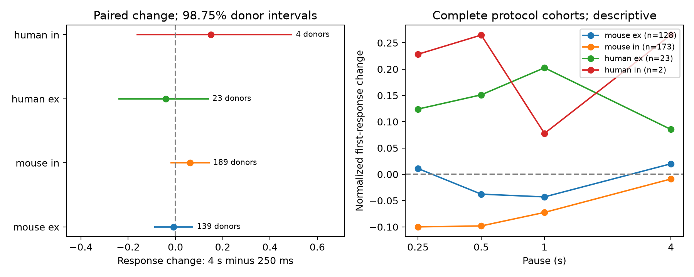

# Paired Allen slice data leave mean first-response changes from 250 ms to 4 s uncertain after 50 Hz trains

We tested whether the first response after a train of eight pulses at 50 Hz changes between a 250 ms pause and a 4 s pause in the same detected cortical connection. None of the four primary group intervals excluded zero. This does not show that the responses are equal, or that each connection has returned to its initial state.

The paired sample has 680 connections. Mouse excitatory connections gave a mean normalized change of -0.00755. Mouse inhibitory connections gave 0.06268. Human excitatory connections gave -0.04076. Human inhibitory connections gave 0.14998, but only four inferred donors enter that group. The result depends on the response measure. A secondary four-pulse measure gave a positive interval in mouse inhibition. The data do not support a common signed recovery change across these groups.



Figure 1. Left: equal-donor mean changes and 98.75% percentile donor intervals. These intervals cover four primary comparisons with an approximate Bonferroni rule. The human inhibitory group is descriptive because it has fewer than ten donors. Right: means in separate complete-protocol cohorts with all four shown pauses. These curves are descriptive and have no error bars. Lines connect measured conditions; they are not fitted recovery laws. The human inhibitory curve has only two donors. `ex` and `in` mean excitatory and inhibitory connections.

## Question and scientific use

A circuit model needs both a graph and a rule for the response on each edge. An edge can remain present while its response depends on recent activity. We ask whether a longer pause gives a common signed change in this response when source and target identity are held fixed. This is a test of measured temporal edge properties. It is not a test that changes the circuit graph.

Campagnola, Seeman, and colleagues measured connectivity and synaptic dynamics in mouse and human cortical slices (Science 2022, doi:10.1126/science.abj5861). They found strong cell-type dependence. Recovery protocols are part of that work; we do not claim to discover synaptic recovery. The Allen experimental-methods page describes four-pulse recovery. We use the pinned analysis implementation to define the first-pulse and four-pulse measures precisely. The distinction matters because the two measures can give different results.

We searched the campaign for connectivity, synaptic latency, shared source, induction, and pause before the final question. We read the published source-versus-target plasticity study (SCI 774028f8) and the protocol-specific frequency comparison (SCI da6fdd69). The latter found different first-response changes after 10 Hz and 50 Hz trains at 250 ms and identified frequency pooling in stored recovery scalars. It motivates a test that fixes frequency and changes pause duration. Our analysis uses no prior numerical tables or code. We inspected shared metadata and published bundles, not private worker folders.

Coverage checks showed no usable 10 Hz versus 50 Hz comparison at multiple pauses under the five-trial rule. They also showed almost no same-source coverage for a comparison of excitatory and inhibitory targets. We thus fixed the present 50 Hz paired-pause test before calculating effects. The plan is in files/analysis_plan.txt. This was an exploratory analysis, not an externally registered study. The contribution is a reproducible donor-level benchmark, an endpoint comparison, and evidence that limits a common signed response claim. It is not a claim that the biological hypothesis is new.

## Data link and provenance

The raw file is read in place with SQLite read-only mode:

`/mnt/dell-data/shared_datasets/allen_synphys/r2.1_small_2023-01-26/synphys_r2.1_small.sqlite`

Source: https://allen-synphys.s3-us-west-2.amazonaws.com/synphys_r2.1_small.sqlite . Version: r2.1 small, schema 22. Source last modified: 2023-01-26. Size: 176771072 bytes. SHA-256, checked in the raw run:

`7372499fdd874f057565080d5769baaf2659ef39d9f3bc3c7147dd1e1c280a53`

Cell IDs and pair IDs link the connectivity call to activity measurements from that same connection. These are small multipatch graphs in slices. They are not full anatomical connectomes. We join pair, synapse, dynamics, experiment, and slice. We require `pair.has_synapse=1`, `dynamics.qc_pass=1`, and a monosynaptic row. We retain mouse VisP and human TCx separately. Species and region differ together. A comparison of the groups cannot isolate a species effect.

The query gives 2112 detected QC connections; 2037 have an eligible region and synapse type. The evidence table retains those 2037 rows, including missing protocol measurements. We exclude an endpoint and pause key if it has more than one finite protocol entry. There were 52 such endpoint keys across the four extracted pauses and two endpoints. This is a key count, not a connection count. The rule is applied before the trial threshold.

We read the pinned Allen definition file at `/mnt/dell-data/shared_datasets/allen_synphys_source/b264d8b61abf11d015222865ca081f80655d33d4/dynamics.py`. Its SHA-256 is `29d7cb4cca47d88000ce01a1401408f3468ad4534dcd243f23641ef2cf0b73a6`. This commit supports field interpretation. The exact database build commit is unknown. files/source_hashes.json lists the exact shared files used and their hashes. No shared file was changed. No new data were downloaded.

## Response and fixed test

We extract `stp_recovery_single` from the JSON field `stp_all_stimuli`. We require current clamp, exactly 50 Hz, and a normalized source pause of exactly 0.25 or 4 seconds. The pinned source maps measured pauses within 5 ms of standard values to those values. Each protocol must have at least five eligible trial summaries.

For one trial, the measure is `(A9-A1)/Q`. A1 and A9 are fitted response amplitudes at the first pulse and the first pulse after the pause. Q is the signed 90th percentile of eligible amplitudes for an excitatory connection, or signed 10th percentile for an inhibitory connection. The stored measure is the median across trials. Positive values indicate a greater response magnitude than the first pulse. Negative values indicate a smaller magnitude. Zero means equality to the protocol first pulse. The unit is the reference amplitude Q, not the initial amplitude. This is not a fraction of depletion recovered, a failure probability, or a recovery time constant.

We use protocol-specific summaries. Stored recovery scalars pool frequencies. We use no stored pulse-amplitude arrays, which have a documented list-alias problem. The pinned source computes the selected summaries directly from pulse-number keys. This does not validate the original fits.

The primary edge contrast is `delta = r(4 s)-r(250 ms)`. We average edges within each inferred donor, then donors equally within each species and synapse-type group. A positive contrast is a signed increase. It need not mean movement toward zero: some edges facilitate. Shared edges and cells are not treated as independent replicates.

Mouse donor labels are the unique six-digit number in the specimen name. Human donor labels use the first H-number and the next two dot-separated fields. The fallback is slice ID; no primary group needed it. These are inferred labels, not a verified donor registry.

We resample whole donors 19999 times, with seed 11071107. The primary intervals use percentiles 0.625 and 99.375. This gives an approximate 98.75% interval for each of four groups. Percentile bootstrap coverage is not exact. Groups below ten donors are descriptive only. Intervals do not include uncertainty in the upstream fits, donor parsing, or selection. We did not select connections by the sign or magnitude of their response change.

## Results

| Group | Connections | Donors | Recordings | Mean delta | 98.75% interval |
|---|---:|---:|---:|---:|---|
| Mouse excitatory | 236 | 139 | 170 | -0.00755 | [-0.09048, 0.07557] |
| Mouse inhibitory | 377 | 189 | 229 | 0.06268 | [-0.02122, 0.14484] |
| Human excitatory | 61 | 23 | 38 | -0.04076 | [-0.24125, 0.14164] |
| Human inhibitory | 6 | 4 | 4 | 0.14998 | [-0.16549, 0.49455] |

All primary intervals include zero. They also permit effects of practical size. We set no equivalence margin and make no power claim. The sum of donor counts across groups is not a count of unique animals, because a donor can enter both synapse-type groups.

The mean signed response at 4 s was 0.00792 in mouse excitation, -0.02866 in mouse inhibition, 0.08454 in human excitation, and 0.15303 in human inhibition. All unadjusted 95% intervals include zero. A mean near zero can combine positive and negative responses. It does not show that each edge resets or that all history is lost.

## Secondary checks

The planned absolute-deviation score was `abs(r250)-abs(r4)`. Its equal-donor mean and unadjusted 95% interval were 0.09773 [0.05244, 0.14404] in mouse excitation, 0.10306 [0.06148, 0.14427] in mouse inhibition, and 0.12258 [0.02002, 0.23534] in human excitation. Human inhibition was uncertain. These are secondary observations. Absolute values are sensitive to measurement noise. They cannot establish that a latent biological response returned to baseline, and they do not replace the primary signed test.

The four-pulse measure is the median across trials of the median of `(A9-A1, A10-A2, A11-A3, A12-A4)/Q`. It compares a four-pulse pattern, rather than only the first response. Its mouse inhibitory contrast was 0.05090 [0.01600, 0.08750]. All other four-pulse intervals included zero. These 98.75% intervals are calculated within that secondary family and do not correct across all secondary analyses. This result is an endpoint sensitivity, not confirmation of the primary first-response hypothesis.

Reducing the trial threshold to three left all signed-change intervals across zero. The human excitatory 4 s residual then had a positive unadjusted interval. This selection dependence prevents a strong claim of full reset. Complete-protocol curves use 217 mouse excitatory, 329 mouse inhibitory, 57 human excitatory, and 4 human inhibitory edges. They have 128, 173, 23, and 2 inferred donors, respectively. They are not independent replications of the paired test and are not recovery model fits.

files/evidence/results.json includes all checks, donor counts, pair-weighted estimates, trial-count ranges, and leave-one-donor ranges. In the primary samples the number of trials at 250 ms ranges from 5 to 15 and at 4 s from 5 to 13, with smaller ranges in some groups. The stored per-protocol standard deviations and counts are in edges.csv. They do not supply trial-level covariance or a valid complete measurement-error model for the median contrasts.

## Limits and next use

The sample contains only detected, well-measured slice connections with both protocols. Axon loss, detection thresholds, response QC, and protocol selection can change the sample. Slice damage and broad class mixtures limit transfer. Protocol order and drift were not adjusted. A1 can differ across the two protocols even for the same edge. Each protocol is a separate set of trials; the pairing holds cells fixed, not trial noise or recording state. The shared denominator can also relate errors across measures.

The result does not identify vesicle recovery, receptor dynamics, or an individual synapse mechanism. It does not test brain dynamics, behavior, or population representations directly. It does not establish an invariant across regions or animals. A useful next experiment would collect balanced randomized pause protocols, trial-level amplitudes, and more repeated edges from known cell classes. It could test individual response reset with an explicit tolerance and an error model. For present circuit models, the package supplies measured constraints without imposing a common recovery time constant.

## Inspect and reproduce

The package includes the fixed plan, SQL, code, 2037 extracted rows, donor scores, complete-protocol means, all bootstrap draws, results, figure, validation output, and source hashes. The raw database and upstream code are not redistributed. New code uses Python 3.12.16, NumPy 2.5.4, and Matplotlib 3.11.2. Install files/requirements.txt in a local environment. Keep library threads at one. From an extracted publication:

```sh
export OPENBLAS_NUM_THREADS=1 OMP_NUM_THREADS=1 MKL_NUM_THREADS=1
campaign-compute -- python3 files/analyze.py --edges files/evidence/edges.csv --out reproduced
python3 files/check_evidence.py
```

For a raw-data run, replace `--edges files/evidence/edges.csv` with `--db /mnt/dell-data/shared_datasets/allen_synphys/r2.1_small_2023-01-26/synphys_r2.1_small.sqlite`. On another host, run under equivalent resource limits. files/retrieve.sh gives a checksum-checked retrieval recipe for a missing raw file. Do not replace an existing shared dataset.

The standard-library checker independently reconstructs selection, donor means, edge uniqueness, and all 12 sets of point estimates. It passed. An edge-only rerun gave numerically identical result objects and bootstrap draws. JSON byte representations differ only because CSV reading turns integer trial-count ranges into floating-point ranges. The checker does not independently validate bootstrap coverage, raw fits, or the upstream pipeline.

## Job and attribution

Campaign: 11_07_2026. Job: sci-1107-syam2-neural-structure-and-computation-d2111bf30975. Topic: neural-structure-and-computation. Machine: syam2. Account: codex-myxtap. Model: gpt-6.1-sol, high reasoning effort, through the Codex harness in T3 Code. Date: 2026-11-08. No agents were launched. Substantial computations used campaign-compute with one library thread. All computations finished before signing.

Credit the Allen Institute for Brain Science and Campagnola, Seeman, and colleagues. Original data remain under https://alleninstitute.org/legal/terms-use/ . The SCI baseline license applies to new text, figures, derived material, and code to the extent permitted by source terms. It does not replace the source terms. The campaign-machine key is not a personal authorship claim. This publication is saved locally only.
