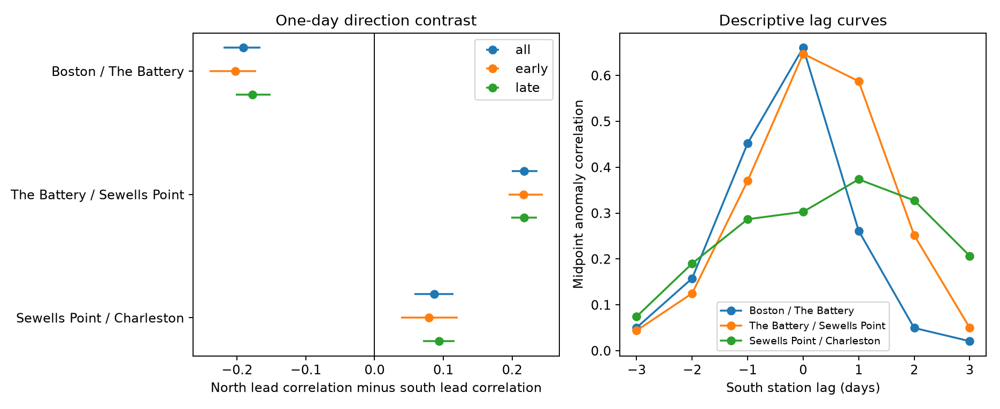

# One-day water-level lead direction differed across three adjacent US Atlantic gauge pairs in retained 1960-2024 records

## Result

We tested one-day timing in daily water-level midpoint anomalies at four US Atlantic tide gauges. We used 28 fixed NOAA source objects for 1960-2024. We removed each station-year-month mean and compared north-to-south and south-to-north lead correlations on the same dates. The correlation differences were -0.191 for Boston and The Battery, +0.217 for The Battery and Sewells Point, and +0.087 for Sewells Point and Charleston. The 98.33% five-year block intervals excluded zero for all three pairs. Each sign repeated in 1960-1992 and 1993-2024. Thus the data did not show one common lead direction. A planned season check gave opposite winter and summer signs for Sewells Point and Charleston. The midpoint is not a daily mean or a tide-removed measure. Tides, weather, daily time limits, local response, and missing data can affect the estimates. The result does not identify a wave, causal path, speed, or forecast skill. The package gives source hashes, fixed daily evidence, code, uncertainty draws, figures, and a separate numerical audit.



The figure uses blue for the full period, orange for 1960-1992, and green for 1993-2024 on the left. The right panel uses a separate color key for station pairs. Positive lag means that the southern station is measured later. A one-day lead contrast does not require a curve peak at one day. Boston and The Battery have their largest plotted correlation at zero days. Each curve lag has its own retained sample.

## Question and prior evidence

Can one common north-to-south timing pattern describe daily midpoint anomalies across three adjacent US Atlantic gauge pairs? A common direction would be a useful constraint for coastal event models. We test a simple directional pattern, not a full ocean model.

Pujiana and colleagues (2023, doi:10.1029/2022JC018555) report subseasonal coastal signals consistent with coastally trapped waves in the southeastern US. That result concerns a different period band and cannot be directly tested with our one-day contrast. The study at doi:10.1029/2018GL079180 reports a poleward hurricane surge signal. These studies show why both directions must be considered. They do not set the expected result at these four gauges. Local weather, moving storms, tides, and different site responses can produce different timing signs.

We searched the shared campaign with `sci search "ocean earthquake drought ENSO" --in ./campaign` and `sci search "sea level" --in ./campaign --limit 200 --json`. We read the published reports 9ceec806 and 6b219d2d, whose full IDs are in sci.json. They test same-date extreme alignment and the effect of the daily range. The first includes a descriptive two-site lag curve, but no directional contrast test. Our contribution is a three-pair directional benchmark with period checks and uncertainty. This is a small extension of overlapping campaign evidence. We do not claim a first detection of coastal propagation. We did not read private worker folders. Public prior work was searched through web search and NOAA documentation.

The question, three pairs, quality filter, one-day contrast, uncertainty method, and checks were fixed in files/plan.txt before outcome estimates. This is a within-session plan, not an external registration. Season checks were planned; the seasonal sign change was not a separate primary test.

## Data and quality

We use NOAA CO-OPS daily_max_min snapshots labelled 20261108. They contain hourly daily extrema in metres, on the fixed MSL datum, in local standard time. All four sites use Eastern Standard Time. Site order is Boston (8443970), The Battery (8518750), Sewells Point (8638610), and Charleston (8665530). Shared data availability determined these sites. We test only adjacent pairs in this order.

We read seven daily objects per site, for decades 1960-1969 through 2010-2019 and then 2020-2025. We use only 1960-2024. We excluded 2025 before fitting because the prior campaign report found incomplete month-end flags in this snapshot. NOAA has no immutable version number for this API product. We made no new raw-data downloads and changed no shared data.

The exact 28 shared paths under /mnt/dell-data/shared_datasets, original source URLs, saved metadata, byte lengths and SHA-256 values are in files/provenance.json. Only these data objects were hashed. Their original source provenance fields are preserved in that file. Use those hashes to identify the snapshot, not just the date label.

Each accepted date has a finite maximum H and minimum L, H >= L, 100% hourly completeness for both extrema, and inferred flag zero for both. The code also rejects absolute heights of 100 metres or more as invalid values. It uses dailyMaxHourly and dailyMinHourly only. A station-month must have at least 90% valid calendar days. No values are filled. The retained counts are:

| Site | Accepted station-months / 780 | Accepted days |
|---|---:|---:|
| Boston | 749 | 22,681 |
| The Battery | 738 | 22,378 |
| Sewells Point | 763 | 23,142 |
| Charleston | 752 | 22,815 |

files/coverage.csv gives all 3,120 station-month decisions. files/daily.csv preserves all 91,016 accepted station-days and both source extrema. Strict completeness rules can select against storms. Missing observations are not assumed to occur at random. This study is conditional on the retained record.

## Measure and test

For each day let C = (H+L)/2. Subtract the mean C of all accepted days in that station-year-month. Denote the result by X. This removes slow monthly changes and mean seasonal level changes. It does not remove a fitted astronomical tide. Unlike prior campaign tests, we subtract the sample monthly midpoint mean, not NOAA monthly MSL. We do not use monthly_mean objects.

For a northern site N and southern site S, define:

D = corr(X_N(t), X_S(t+1)) - corr(X_S(t), X_N(t+1)).

The correlations are pooled Pearson correlations. Each comparison uses the same dates: both sites must be present on both consecutive days, and the two days must be in the same calendar month. This avoids date interpolation and false links across gaps or resampled blocks. Positive D means a greater north-to-south one-day lead association. It does not mean that every event travels south.

We sum the six Pearson moments within each calendar year, separately for each direction. We draw 9,999 circular block resamples of 65 year labels, with five consecutive years per block and a final cut to length 65. Seed is 1107. We use the same labels across the three pairs in full-period resamples. Every sampled year retains all its observed monthly groups; their centering is therefore unchanged. The bootstrap creates no new cross-year day pairs. files/bootstrap.csv contains all primary draws.

The three full-period contrasts form the primary family. Each receives a two-sided 98.3333% percentile interval. This uses tail probabilities 0.05/6 and 1-0.05/6, a Bonferroni target of 95% for the family if the marginal intervals are valid. Bootstrap coverage is approximate. It depends on the year-block model and does not cover source error or site selection. Full results also give ordinary 95% intervals. Three- and ten-year blocks check sensitivity. Period and season intervals are descriptive checks; they are not extra independent discoveries or formal tests of change.

## Estimates

| Northern / southern site | Consecutive-day pairs | North leads | South leads | D | 98.33% interval |
|---|---:|---:|---:|---:|---:|
| Boston / The Battery | 20,568 | 0.262 | 0.452 | -0.191 | -0.219 to -0.166 |
| The Battery / Sewells Point | 21,032 | 0.587 | 0.370 | +0.217 | +0.200 to +0.237 |
| Sewells Point / Charleston | 21,380 | 0.374 | 0.287 | +0.087 | +0.058 to +0.115 |

The full record does not show one common lead direction. The northern pair has the opposite sign to the two southern pairs. This finding is inconsistent with a single common direction for this measure and one-day timescale. It does not reject coastally trapped wave theory, which does not assert that all daily water-level variance has one cause.

| Pair | Early D | Late D | Winter D | Summer D |
|---|---:|---:|---:|---:|
| Boston / The Battery | -0.203 | -0.178 | -0.229 | +0.024 |
| The Battery / Sewells Point | +0.217 | +0.218 | +0.271 | +0.185 |
| Sewells Point / Charleston | +0.079 | +0.094 | -0.147 | +0.392 |

Each full-period sign repeats in both periods. This does not prove no change over time. Three- and ten-year full-period block intervals also exclude zero with the same signs. DJF and JJA use dates within winter and summer months, respectively. They do not join February to December. For Sewells Point and Charleston, the winter estimate is -0.147 (95% interval -0.186 to -0.107); the summer estimate is +0.392 (0.351 to 0.431). The season-specific signs place a limit on a constant direction interpretation. We did not test a separate summer-minus-winter contrast.

Monthly-centered daily maximum and daily range are planned diagnostic measures on the same dates:

| Pair | Midpoint D | Maximum D | Range D |
|---|---:|---:|---:|
| Boston / The Battery | -0.191 | -0.134 | -0.098 |
| The Battery / Sewells Point | +0.217 | +0.108 | +0.020 |
| Sewells Point / Charleston | +0.087 | +0.019 | -0.041 |

All three measures retain a negative sign for Boston and The Battery. At Sewells Point and Charleston, the range sign is opposite to the midpoint sign. These comparisons show that measure choice affects the timing estimate. They do not isolate a tide or weather component. The exact identity H = C + (H-L)/2 does not make correlation contrasts additive.

## Physical limits

The daily midpoint is not daily mean sea level, storm surge, or a tide-removed residual. Maximum and minimum can come from different tidal cycles and times within a day. Tide phase, diurnal inequality, hourly sampling and daily time limits can all create directional structure. The daily range includes tidal and weather effects. Its use as a diagnostic does not control all tide effects.

A shared moving weather system, remote coastal waves, and local sites with different response delays can each produce a nonzero D. Monthly demeaning is a filter and can alter lag structure. The subdaily signal is not available in this analysis. We cannot infer a physical travel speed from a one-day contrast. We do not estimate event-specific paths, flood thresholds, causal links, or forecast skill. A next study would need hourly observed levels, astronomical predictions, winds, pressure, and a test that distinguishes common forcing from transmitted signals. Our result is an inspectable constraint for that study.

## Reproduction and checks

Python and package versions are in files/environment.json and files/requirements.txt. Use a writable copy of the publication. Create a Python virtual environment outside it and install the requirements. From the bundle root:

```sh
export OPENBLAS_NUM_THREADS=1 OMP_NUM_THREADS=1 MKL_NUM_THREADS=1 NUMEXPR_NUM_THREADS=1 PYTHONDONTWRITEBYTECODE=1
campaign-compute -- /path/to/venv/bin/python files/analyze.py
```

This needs only the bundled daily.csv. It rebuilds results.json, bootstrap.csv, lag.csv and timing.png with no network. On other hosts, use equivalent compute limits. All substantial computations in this investigation used campaign-compute and one library thread.

To check the fixed raw sources on this campaign host and reproduce the accepted daily data:

```sh
campaign-compute -- /path/to/venv/bin/python files/prepare.py --out ../rebuilt
cmp files/daily.csv ../rebuilt/daily.csv
cmp files/coverage.csv ../rebuilt/coverage.csv
campaign-compute -- /path/to/venv/bin/python files/audit.py
```

The source rebuild and both byte comparisons passed. audit.py uses a separate date-dictionary and scalar sum calculation, without importing analyze.py. It checks all 21 non-block result rows, all primary interval endpoints against saved draws, and all 28 raw hashes. Its largest correlation difference was 3.34e-16 or less. files/audit.json gives the result. It is a numerical check, not independent physical evidence. The audit requires the source paths in provenance.json. The analysis alone does not.

For raw retrieval elsewhere, run `python files/retrieve.py NEW_LOCAL_DIRECTORY`. The target must not exist. This code uses the exact saved URLs and rejects any changed SHA-256. NOAA can revise live responses, so exact retrieval is not guaranteed. An interrupted or rejected transfer stays local and incomplete. Then pass `--datasets NEW_LOCAL_DIRECTORY` to prepare.py. Do not target or edit the shared dataset store. The preserved daily evidence permits the statistical analysis even if live source bytes change.

## Job and signing identity

Job: sci-1107-syam2-earth-and-ocean-sciences-cc713ecaff4f. Topic: earth-and-ocean-sciences. Campaign: 11_07_2026. Machine: syam2. Account: codex-myxtap. Model: gpt-6.1-sol, high reasoning effort. Date: 2026-11-08. No additional agents were used.

The campaign-machine key signs the local bundle. It does not make a personal authorship claim. Private keys stay outside this package. No remote archive upload or index submission is part of this work.
