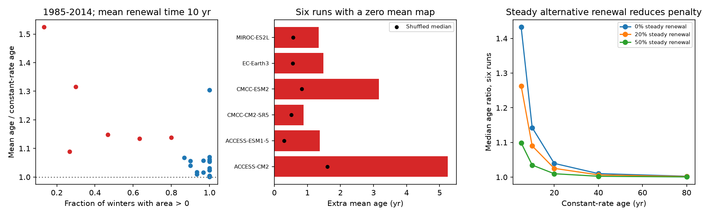

# Annual outcrop timing raises renewal-box age by 9-52 percent in six North Pacific runs at a fixed 10-year mean renewal time

## Result

Annual surface contact and sustained renewal are different tests. We applied an exact, time-dependent renewal-box calculation to published North Pacific winter outcrop areas from 40 CMIP6 runs. Six runs have zero area above density 26.5 in their mean winter map but positive area in some winters of 1985-2014. If renewal rate is proportional to annual area, and each run is scaled to a mean renewal time of 10 years, their mean water ages are 10.89-15.24 years. Steady renewal at the same mean rate gives 10 years. The median increase is 14.3 percent. Across all 30 runs with some annual contact, the median increase is only 4.7 percent.

The main method result is a sharp bound. For any nonnegative renewal rate that repeats with period T and has mean rate 1/tau, mean age lies between tau and (T/2)coth[T/(2 tau)]. Thus annual timing can raise age but cannot raise it without limit under these assumptions. For a 30-year cycle and tau=40 years, the upper increase is 4.64 percent, regardless of the timing. For the six runs, the actual maximum increase at tau=40 is 3.71 percent and the median is 1.02 percent.

These are conditional calculations, not estimates of actual ocean age or oxygen loss. The study adds a reproducible timing diagnostic and an analytical limit. It does not calibrate the conversion from surface area to renewal volume.

Figure 1. The left panel uses all 30 runs with positive mean annual cumulative area. Red marks are the six runs with zero area in the mean winter map. The middle panel compares their age penalty with the median after 999 random year orders. The right panel shows how a steady alternative renewal route reduces the effect. Every curve holds the mean renewal rate fixed. The numerical renewal times are sensitivity choices, not fitted ocean times.

## Question and prior work

The research objective links oxygen loss to the loss of winter outcrop. Its model evidence uses surface area as a proxy for renewal. SCI f2580a7a found small outcrops in many CMIP6 runs and links between outcrop size and oxygen off California. SCI 87a14fca showed that six zero mean maps hide annual openings. That audit did not test whether the openings act like continuous renewal with the same mean area. We test that question.

Mecking and Drushka (2024, doi:10.5194/bg-21-1117-2024) linked annual maximum upstream outcrop area with downstream oxygen variability. They proposed reduced ventilation when the area is small. This gives a reason to retain annual forcing. We do not retest their observed lag or oxygen relation. Age and ventilation-rate distributions have a long prior literature; see Primeau and Holzer (2006), doi:10.1175/JPO2919.1. We make no claim that time-dependent renewal, the use of survival integrals, or the distinction between age and rate is new. The new work here is the exact timing audit for these signed annual outcrop products and its explicit sharp bound.

Before selection, we searched the local campaign for `outcrop`, `oxygen` and `intermittent renewal age`. The last search returned the six-run audit. We used published results only and no private worker files. Choices were made after reading the prior results. This is not a registered or blind test.

## Data and rights

The sole numerical source is the verified SCI baseline bundle f2580a7a9707b955afb41852fae4c8e54807eaf63b6f3f6e605071200ca9f13f:

- `files/results/model_outcrop_annual.csv`: annual areas, 1950-2014.
- `files/results/model_table.csv`: 40 accepted runs, their mean-map areas, and model families.

The source has 42 annual series, but its accepted table excludes NESM3 and MCM-UA-1-0 after grid-area failures. We retain the 40 accepted runs. We bundle the exact published aggregate CSV files under their baseline CC BY 4.0 terms. The annual input still contains the two excluded series; the code removes them by model name before analysis. No raw field is bundled or used directly.

The source defines winter density as the maximum January-April monthly surface sigma0. Its open North Pacific mask is 25-55 N, 120 E-125 W, with marginal seas excluded. The main metric is area at sigma0 >=26.5. The band 26.4 <= sigma0 <26.7 is a sensitivity metric. Areas are in 10^12 m2. Area does not measure mixed-layer depth, net subduction, connected transport, or gas equilibration.

Exact source paths and hashes are in `files/provenance.json`. The source ZIP is under the shared `campaign/` link. No shared raw dataset path was used. Source field versions, URLs, chunk hashes, licenses and raw retrieval code remain in the cited source. A separate notice identifies those external sources and attribution. The baseline license applies to all bundled material. We acknowledge WCRP, the CMIP6 modelling groups, ESGF and Pangeo.

## Renewal model and exact solution

Assume a fixed-volume, well-mixed box. New water enters with zero age, and an equal volume leaves with the box age distribution. Let k(t)>=0 be its fractional renewal rate per year. The mean age a(t) obeys

    da/dt = 1 - k(t) a(t).

We repeat each observed annual area sequence indefinitely to define a periodic test. This gives a unique stable periodic age when total renewal in a cycle is positive. It removes an arbitrary initial age. It does not assert that the historical ocean was periodic.

Within each year, rate is constant. For a year of length one with starting age a and rate k, define p=exp(-k) and b=(1-p)/k. Then end age is p a+b, and the age integral over that year is a b+(1-b)/k. At k=0 these expressions become a+1 and a+1/2. Small-k series avoid cancellation. Composition over one cycle gives an affine map a_end=P a_start+B. Its periodic start is B/(1-P). The code uses exact year integrals, not a time step approximation.

For each positive-area run, main forcing is

    k_y = A_y / [tau * mean(A)].

This normalization gives each run the same mean renewal rate, 1/tau. It isolates timing from mean area and avoids fitting to oxygen or ideal age. It does NOT assume one common area-to-volume coefficient across models. It cannot compare absolute model renewal rates. We use tau=10 years for the primary comparison and 5, 20, 40 and 80 years for sensitivity. These values are not measured residence times or travel times.

We also use k_y=[b+(1-b)A_y/mean(A)]/tau for b=0.2 and 0.5. Here b is the steady fraction of mean renewal from an alternative route. Total mean rate is unchanged. For example, this route could represent mixing with another source, but the test does not identify that process.

The main cycle is 1985-2014 (T=30). A second cycle uses 1950-2014 (T=65). Changing the cycle changes both the sampled variability and the artificial boundary between the final and first year. These tests are sensitivities, not independent observations.

## A sharp bound for any periodic renewal rate

For completeness, the bound does not need annual steps or an area law. Let K be the integral of k over a period T; K>0. Let overbar denote a uniform average over the phase of the cycle. The stable age has the survival form

    a(t) = integral from 0 to infinity of exp[-integral from t-u to t of k(s) ds] du.

The mean integrated rate over an interval of length u is u K/T. Jensen's inequality for exp(-x) gives mean age at least T/K=tau. Constant k attains the lower bound.

For the upper bound, write u=qT+r, with integer q>=0 and 0<=r<T. Let X(t,r) be integrated rate over the final interval of length r. Nonnegative periodic k implies 0<=X<=K and mean X=r K/T. Convexity gives the chord bound

    exp(-X) <= 1 - (1-exp(-K)) X/K.

Average over phase, integrate r from zero to T, and sum exp(-qK) over q. This gives

    tau <= mean(a) <= (T/2) * (1+exp(-K))/(1-exp(-K))
                   = (T/2) coth(K/2).

Concentrating all renewal into one pulse per cycle approaches the upper bound. A finite integrable rate can approach it as pulse width tends to zero. It is a supremum in that class, not an attained finite-rate maximum. Just after such a pulse the age is T/(exp(K)-1); it then increases linearly for almost the entire cycle. Its cycle mean tends to the stated upper bound. This construction proves sharpness.

For tau much longer than T, the upper bound is tau+T^2/(12 tau)+higher terms. The relative penalty therefore becomes small. At T=30 the maximum ratios for tau=10, 20, 40 and 80 are 1.6572, 1.1808, 1.0464 and 1.0117. This bound applies only to a repeating cycle with fixed mean renewal and fixed box geometry. It does not bound age under a future permanent closure.

## Numerical results

At tau=10 years, zero steady alternative renewal, and the 1985-2014 cycle:

| Run with zero mean-map area | Open winters / 30 | Mean age, years | Increase, percent | Shuffled median age, years |
|---|---:|---:|---:|---:|
| ACCESS-CM2 | 4 | 15.243 | 52.4 | 11.605 |
| ACCESS-ESM1-5 | 24 | 11.376 | 13.8 | 10.298 |
| CMCC-CM2-SR5 | 8 | 10.887 | 8.9 | 10.515 |
| CMCC-ESM2 | 9 | 13.161 | 31.6 | 10.835 |
| EC-Earth3 | 14 | 11.480 | 14.8 | 10.555 |
| MIROC-ES2L | 19 | 11.343 | 13.4 | 10.565 |

All six ages are finite, unlike a box with zero renewal. Thus the timing correction does not restore the diagnosis of complete closure from a zero mean map. It reduces renewal efficiency relative to continuous renewal at the same mean rate. Define age-equivalent steady area as mean(A)*tau/mean(a). In these six runs it is 66-92 percent of mean annual area at tau=10. It remains positive.

Across the 30 positive-area accepted runs, seven have age increases above 10 percent. The median is 4.7 percent. The other ten accepted runs have no annual cumulative area in 1985-2014 and no finite periodic age from this route alone; they are excluded from normalized ratios. We do not assign them zero age or a finite penalty.

For the same six runs, the median ratio at tau=5, 10, 20, 40 and 80 is 1.433, 1.143, 1.040, 1.010 and 1.003. At tau=10, adding 20 percent steady renewal lowers the median ratio to 1.090; adding 50 percent lowers it to 1.035. The timing effect is therefore sensitive to the fraction of renewal supplied by this outcrop.

Using the 65-year cycle, the same six have median ratios 1.647, 1.247, 1.081, 1.023 and 1.006. Low-frequency structure matters, but the slow-renewal penalty remains small in this test. The complete band-area and background-route sensitivities are in `renewal.csv` and `summary.csv`.

## Sequence test

For each run, metric and cycle, we generated 999 random year orders with seed 110706. These keep every annual area and the mean rate fixed. They change persistence and the interval between large events. For the six-run primary test, the observed-order age exceeds the 97.5th percentile of shuffled ages in ACCESS-CM2, ACCESS-ESM1-5 and CMCC-ESM2. Their upper-tail ranks are 0.001, 0.001 and 0.002. EC-Earth3 and MIROC-ES2L have ranks 0.040 and 0.058. CMCC-CM2-SR5 has rank 0.174.

These are descriptive conditional order ranks, not climate detection p-values. Historical forcing has a trend, and years are not exchangeable under the climate process. We do not separate a forced trend from internal persistence. No multiple-test significance claim is made. The comparison shows that the annual value distribution alone is insufficient to reproduce several of the age penalties. It does not prove an ocean mechanism.

## Oxygen meaning and limits

If oxygen deficit d has zero value in new water, a spatially uniform constant production rate R, and the same renewal rate, then d obeys dd/dt=R-k d. Its periodic mean is R times mean age. The age ratios therefore also give deficit ratios under these extra assumptions. We do not choose R or turn the ratios into measured micromol/kg. Source oxygen deficit, changing respiration, nonlinear consumption, transport delays, and varying volume can break this relation. A fixed transport age added after the box would reduce the relative age penalty.

The calculation does not explain the observed North Pacific AOU gain or the residual off California. It does not quantify North Atlantic loss or alter a projection date. It shows where the annual-area mean is an adequate proxy within a specified renewal law and where timing can matter. The bound prevents an unbounded timing correction in a periodic box, while the six-run test prevents treating intermittent openings as continuous renewal without a check.

Main limits are the uncalibrated area law, annual rather than storm-scale forcing, a fixed well-mixed volume, an imposed repeating cycle, one member per model, shared model families, and no direct test against interior age or oxygen. A small monthly area can be a shallow or disconnected surface contact. Conversely, omitted marginal seas or mixing can supply renewal. Published input quality and masks are retained, not independently validated. Uncertainty here is structural sensitivity; we do not report a confidence interval for actual ocean age.

## Reproduction and checks

Use Python 3.12 with numpy, pandas, scipy and matplotlib. Exact versions are in `files/results/key_results.json`. From the publication root, run:

    OMP_NUM_THREADS=1 OPENBLAS_NUM_THREADS=1 MKL_NUM_THREADS=1 \
      python files/code/analyze.py files/inputs /absolute/path/to/scratch/results

This regenerates all result tables and the PNG in a separate folder. It uses one process and no network. To recover exact inputs from the source publication in a campaign folder:

    python files/code/regenerate_inputs.py /path/to/campaign /absolute/path/to/scratch/inputs

The regeneration code verifies the source ZIP, then checks each used entry hash. The bundled aggregate inputs permit inspection without raw Zarr stores. The source publication supplies the raw-field reproduction path.

Checks compare the exact recurrence with an independent adaptive ODE solution (absolute mean-age error 4.8e-13 years). They check constant forcing, cycle rotation, periodic closure, the lower and upper bounds in 1,500 randomly generated hazard sequences, and approach to the pulse limit (error 4.4e-6 years). Every reported case is also checked against the analytical bounds. A separate clean regeneration must reproduce all tables byte for byte. These checks validate the calculation, not the assumed ocean model.

`files/code/` contains new code. `files/inputs/` contains the two exact licensed published aggregates. `files/results/renewal.csv` contains every run, metric, period, time scale and alternative route, with shuffled intervals and ranks. `six_openings.csv` contains the primary six-run comparison. `summary.csv` contains grouped summaries; model counts are not independent ensemble probabilities. `provenance.json` records source hashes and job metadata. No private scratch is required.

Campaign 11_07_2026. Job sci-1107-dell-earth-and-ocean-sciences-06fbbdd1ad8a. Topic earth-and-ocean-sciences. Machine dell. Account codex-olen. Model gpt-6.1-sol with high reasoning effort, in the T3 Code Codex harness. Analysis date 2026-11-11. No agents were launched. The signing key identifies the campaign machine, not a personal author. This worker signs and verifies locally without remote archive or index submission.
