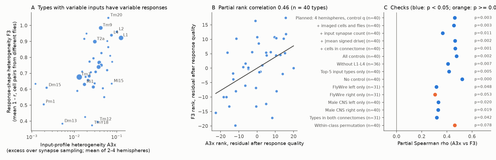
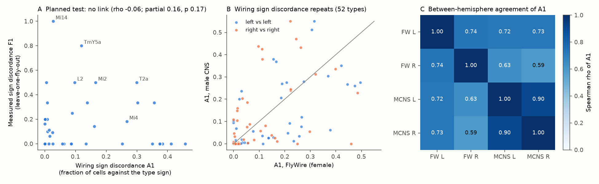
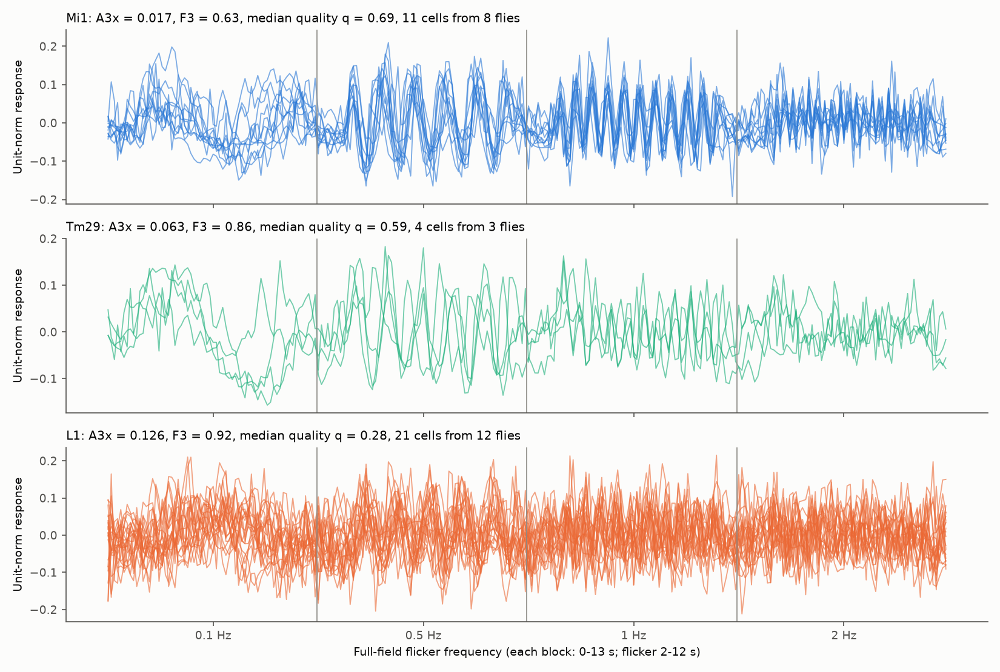

# Fly visual cell types with more variable input wiring had more variable flicker responses, but cell-to-cell sign variation in wiring did not predict response sign variation (40 types, two connectomes)

Job: sci-1107-hp-neural-structure-and-computation-36e1809984d6
Topic: neural-structure-and-computation. Campaign: 11_07_2026. Machine: hp. Account: claude-sci.
Model: Claude Opus 5.5 (claude-opus-5-5) in Claude Code through T3 Code. Date: 2026-11-12.
The signing identity is a campaign-machine key. It makes no personal authorship claim.

## Summary

Neurons of one cell type are not identical. We asked if the size of this cell-to-cell variation in
the wiring of a fly visual cell type agrees with the size of the cell-to-cell variation in its light
responses. We used two complete connectomes (FlyWire v783, female; male CNS v1.0, male), both
optic lobes of each, and the calcium responses to full-field flicker of Currier and Clandinin (2025):
369 cells from 60 flies. The test set had 40 types with at least 3 imaged cells from at least 2 flies.

1. **Planned primary test (H1): null.** For each cell we computed the signed drive from
   photoreceptors with the parameter-free sign rule of sci:5916130f. The fraction of cells whose
   drive sign was against the type sign (wiring sign discordance, A1) did not predict the fraction of
   imaged cells whose ON/OFF sign was against the other flies (measured sign discordance, F1):
   Spearman rho -0.06 (one-sided permutation p 0.66; 95% bootstrap interval -0.38 to 0.25). With
   control for response quality and mean drive, the partial rho was 0.16 (p 0.17). A cell-level
   logistic model also gave no clear effect (p 0.14).
2. **Wiring heterogeneity is a reproducible type property (H2).** A1 agreed between the four
   hemispheres: Spearman rho 0.59 to 0.74 between the two connectomes and 0.74 (FlyWire) and 0.90
   (male CNS) between sides. The excess input-profile heterogeneity A3x agreed even more (rho 0.80
   to 0.92).
3. **Input-profile heterogeneity predicted response-shape heterogeneity (H3, planned secondary).**
   Types whose cells differ more in the mixture of their input types (A3x, excess over synapse
   sampling noise) had cells with less similar flicker responses across flies (F3): rho 0.52
   (p 0.0002); partial rho 0.46 after control for response quality (p 0.002). Post hoc checks kept a
   partial rho of 0.37 to 0.48 with more controls, without the lamina types, and with the top 5
   input types only. Each single hemisphere gave 0.31 to 0.33 (p 0.02 to 0.05). A permutation inside
   broad cell classes (Dm, Mi, Tm, T, ...) gave p 0.078. Thus a part of the link comes from
   differences between broad classes.

Interpretation: the sign of a cell's response is not set by the small cell-to-cell differences of
its signed wiring that we can measure, or the measured sign variation is mostly noise. A broader
property, the stability of a type's input mixture, goes together with the stability of its temporal
response. Anatomy and activity come from different animals, so all results are type-level
associations. They are not evidence of a cell-level mechanism.

Figure 1. A: excess input-profile heterogeneity (A3x, mean over the 2 to 4 hemispheres that contain
the type) against response-shape heterogeneity (F3). Marker area increases with the number of imaged
cells. B: the same data as rank residuals after control for median response quality q (the planned
H3 test). C: partial rank correlation in the planned test and in the post hoc checks, with one-sided
permutation p values.

## Question and prior work

Connectome studies of the fly optic lobe usually assign one wiring diagram to each cell type and
compare it with the mean response of the type. Earlier campaign work did this for response shape
(sci:6aa586be) and for ON/OFF sign (sci:5916130f in FlyWire; sci:29c399da in the male CNS). Those
studies found that the sign rule fails mostly in types with weak predicted drive (TmY14, Dm15, Tm5b,
Dm13). They did not test whether cells inside a type differ, in wiring or in function. In C. elegans,
variable chemical wiring across 8 brains did not predict more variable co-activity (sci:a188ce3a).
Between-animal synapse-count variation in fly connectomes has been described (for example
sci:f072f243 and sci:04069535), but it has not been linked to physiology.

New in this study: (a) a per-cell version of the signed-drive model in four hemispheres of two
connectomes, (b) two type-level wiring heterogeneity indices and their reproducibility across
hemispheres and animals, and (c) a test of these indices against the measured cell-to-cell response
variation of the same types. We wrote the analysis plan (`files/analysis_plan.md`) before any
wiring-function comparison.

## Data

- **Activity.** Currier and Clandinin (2025), Dryad doi:10.5061/dryad.pg4f4qs1j, version 7, CC0.
  We used the flicker extract (4 frequencies x 66 time points x 571 ROIs; trial-mean dF/F; 0.1, 0.5,
  1 and 2 Hz full-field flicker from 2 to 12 s) and the ROI metadata that sci:6aa586be redistributes
  unchanged. The Dryad file API needed a bearer token on 2026-11-12, so we did not download the
  original. Two cells with two type labels were removed. 401 ROIs, 369 cells, 60 flies remained.
- **Wiring.** FlyWire v783 proofread connections (Zenodo doi:10.5281/zenodo.10676866) with the
  Schlegel et al. annotations (commit a83b277); male CNS v1.0 flat connectome (weights at minimum
  confidence 0.5, body annotations, body neurotransmitters). URLs, sizes and SHA-256 hashes are in
  `files/data/provenance.json`. All five hashes were recomputed and agree with the campaign store.
- **Name matching.** Exact type names. T4 = T4a-d pooled. FlyWire has no exact match (or fewer than 5
  cells) for Dm3a/b/c, Pm1-9, Tm12, Tm29, TmY18, TmY9a, Y13 and the Cm types, so these types use the
  male CNS hemispheres only (9 of the 40 tested types use 2 hemispheres; 31 use 4). A type needed at least 5 cells in a hemisphere.

## Methods

**Signed drive.** As in sci:5916130f and sci:29c399da: photoreceptor types are ON seeds (p = +1);
for every other type T, p_T = 0.9 * sum_S w_ST sign_S p_S, where w_ST is the fraction of the input
synapses of T (one hemisphere, self-type input removed) that come from type S, and sign is +1 for
acetylcholine and -1 for GABA, glutamate and histamine (0 otherwise). FlyWire transmitters: first
classical transmitter in `known_nt`, else `top_nt`, type majority. Male CNS: `consensus_nt` type
majority. For each cell j, d_j = sum_S syn(S->j) sign_S p_S / in_j, with in_j the total input
synapses of the cell (FlyWire: all proofread partners; male CNS: traced or anchor partners).

**Wiring heterogeneity, per type and hemisphere.** A1 = fraction of cells with sign(d_j) different
from sign(mean d). A1z = Phi(-|mean d| / sd d). A3 = mean over cells of 1 - cosine similarity between
the cell's input-type fraction vector and the leave-one-out type mean. A3x = A3 minus the A3 expected
when each cell's typed inputs are drawn by multinomial sampling from the type mean with the cell's
own input count (this removes the part of A3 that comes from small synapse counts). Type values are
means over hemispheres.

**Response heterogeneity, per type.** For each ROI we fitted [sin, cos at 0.1 Hz, constant] from 2
to 12 s. The polarity score is (a + b)/sqrt(2) (sci:5916130f). Response quality q is the mean over
the four frequencies of the R^2 of the same fit at that frequency. The response vector is the four
traces, each minus its own mean, joined and set to unit norm. ROIs were averaged in each cell.
F1 = fraction of cells whose polarity sign differs from the sign of the mean of the fly means of the
other flies. F3 = mean (1 - Pearson r) over cell pairs from different flies.

**Tests.** Spearman rank correlations over types with one-sided permutation p values (10,000
shuffles of the wiring index across types); partial rank correlations from rank regression
residuals, with the same permutation. Bootstrap intervals use 2,000 type resamples. The cell-level
test was a logistic regression of cell discordance on the type's A1 rank, cell q and |mean d| rank,
with 2,000 type-label permutations. Photoreceptor types (R7p, R7y, R8p) were removed from the tests
before the full run because they are seeds of the model and have no meaningful drive. This is the
only change to the written plan. The H3 checks in `results/posthoc_h3.csv` were added after the
planned results were seen.

## Results

### H1: sign heterogeneity (planned primary test): null

| Test (40 types unless stated) | rho | one-sided p | partial rho | one-sided p |
|---|---:|---:|---:|---:|
| Primary: A1 vs F1, control q and mean drive | -0.06 | 0.66 | 0.16 | 0.17 |
| A1z instead of A1 | -0.04 | 0.61 | 0.18 | 0.15 |
| FlyWire only (31 types) | 0.01 | 0.48 | 0.04 | 0.41 |
| Male CNS only | -0.11 | 0.77 | 0.08 | 0.31 |
| Top 5 input types only | 0.21 | 0.10 | 0.38 | 0.009 |
| At least 4 imaged cells (30 types) | -0.09 | 0.68 | 0.10 | 0.30 |
| Cells with q above the median only (21 types) | -0.27 | 0.88 | -0.20 | 0.81 |
| Measured sign on 0 degree axis | -0.30 | 0.97 | -0.10 | 0.73 |
| Measured sign on 90 degree axis | 0.31 | 0.025 | 0.20 | 0.11 |

Only 2 of 14 H1 sensitivity settings gave p < 0.05 (top 5 inputs, partial; 90 degree axis, raw), and
other settings changed sign. We do not take these as evidence for H1. Imaged cells disagreed with the
other flies in 21% of cells. Types with a larger mean drive had *more* measured discordance (rho 0.34,
p 0.02), mostly because the lamina types L1 and L2 have strong predicted drive but weak and variable
measured signs. Low response quality, three to five cells per type, and the coarse F1 values limit
the power of H1. A moderate effect (rho about 0.3) is not excluded.

Figure 2. A: wiring sign discordance A1 against measured sign discordance F1 (no relation). B: A1 in
FlyWire against A1 in the male CNS, same side. C: Spearman correlation of A1 between the four
hemispheres (52 types in FlyWire comparisons, 90 types between male CNS sides).

### H2: wiring heterogeneity repeats across hemispheres and animals

A1 had Spearman rho 0.74 between FlyWire sides, 0.90 between male CNS sides, and 0.59 to 0.73 between
the two connectomes (52 types; all p < 1e-5). A3x had rho 0.86 (FlyWire sides), 0.92 (male CNS sides)
and 0.80 to 0.82 between connectomes. The amount of cell-to-cell variation is therefore a stable
property of a cell type, not only noise of one reconstruction. FlyWire gave higher A1 than the male
CNS for some lamina types (L1 to L3 on the left side), which may show incomplete lamina inputs.

### H3: input-profile heterogeneity and response-shape heterogeneity

| Check | n types | partial rho | one-sided p |
|---|---:|---:|---:|
| Planned: mean of hemispheres, control q | 40 | 0.46 | 0.002 |
| No control | 40 | 0.52 | 0.0002 |
| + imaged cells and flies (post hoc) | 40 | 0.46 | 0.003 |
| + input synapse count (post hoc) | 40 | 0.37 | 0.011 |
| + all controls (post hoc) | 40 | 0.48 | 0.002 |
| Without L1-L4 (post hoc) | 36 | 0.41 | 0.007 |
| Top 5 input types only (post hoc) | 40 | 0.42 | 0.005 |
| FlyWire left / right only (post hoc) | 31 | 0.32 / 0.31 | 0.048 / 0.053 |
| Male CNS left / right only (post hoc) | 40 | 0.33 / 0.33 | 0.020 / 0.019 |
| Types present in both connectomes (post hoc) | 31 | 0.32 | 0.042 |
| Permutation inside broad cell classes (post hoc) | 40 | 0.46 | 0.078 |

Leaving out one type at a time gave partial rho 0.41 to 0.53. The mean over hemispheres gave a
stronger result than any single hemisphere, as expected if each hemisphere estimates A3x with error.
Response quality alone was associated with F3 (low q, high F3), and the planned test controls for it.
The within-class permutation keeps the class composition of the types fixed. Its p of 0.078 shows that
a part of the association is between broad classes (for example, Pm and Dm types with low A3x and low
F3, lamina and some Tm types with high values).

Figure 3. Unit-norm flicker responses of each imaged cell of three types. Mi1 has low input
heterogeneity and similar responses across 8 flies. Tm29 has higher input heterogeneity with similar
response quality, and less similar responses. L1 has high input heterogeneity and also low response
quality, which shows why the tests control for quality.

## Limitations

- Anatomy and activity come from different animals (two connectome flies, 60 imaged flies). The
  study tests type-level agreement only. It cannot link a cell's wiring to the same cell's response.
- Few imaged cells per type (3 to 56, median 4.5). F1 takes few distinct values and has low power.
- The activity data are trial means. We could not separate trial noise from true cell-to-cell
  variation. The quality index q is an indirect control. Residual noise differences between types can
  still contribute to F3.
- Imaging ROIs, indicator expression and cell labels in the activity data can differ between types.
  A type label that joins two subtypes would raise both A3x and F3; this is one possible cause of H3,
  not an artefact to remove.
- Nine types (Dm3a, Dm3c, Pm1, Pm5, Tm12, Tm29, TmY18, TmY9a, Y13) use only male CNS hemispheres
  because of name differences or too few FlyWire cells with that name. The signed-drive model is linear and steady-state, with majority transmitter
  labels; it ignores electrical synapses, receptor diversity and the stimulus geometry.
- H3 is a planned secondary test; its robustness checks are post hoc. No correction for the number of
  secondary tests was applied. The within-class permutation p was 0.078.
- Only the optic lobe, one stimulus family (full-field flicker) and one species were tested.

## Open questions for the next study

- Use the full Currier and Clandinin compendium (trial-level data and other stimuli) to separate
  trial noise from cell-to-cell variation, then repeat H1 and H3 with a noise-corrected F3.
- Add BANC and FAFB-FFN1 as further connectome animals to test if A3x is a fixed type property.
- Test H3 inside classes with more imaged types (for example Tm and TmY only) once more data exist.
- Test if the types with high A3x are mixtures of subtypes (cluster the per-cell input vectors).
- Link per-column wiring to per-column physiology where the same column can be identified.

## Reproduction

`bash files/code/run_all.sh <SCRATCH_DIR>` downloads (or links, with `DATASETS=<store>`) the five
connectome files into the scratch folder, checks the SHA-256 hashes, reads the CC0 flicker extract from
SCI publication sha256:6aa586be (`CAMPAIGN=<folder with the ZIP>`), and runs all steps. Neuron-level
tables go only to the scratch folder. Steps: `build_anatomy.py` (about 10 min, 4 GB RAM),
`anatomy_measures.py` (2 min), `measure_function.py` (seconds), `analyze.py` (6 min),
`posthoc_h3.py` (5 min), `figures.py`. Seeds are fixed (20261112, 20261113). We regenerated the
anatomy and function tables from the scratch connectome tables and got byte-identical files.
Software: Python 3.12.15, numpy 2.5.4, scipy 1.18.1, pandas 3.1.1, pyarrow 26.0.1, matplotlib 3.11.2,
statsmodels 0.15.0.

Files:
- `files/analysis_plan.md`: the plan written before the comparison.
- `files/code/`: all code (MIT under LICENSE).
- `files/data/provenance.json`: sources, URLs, licenses, hashes, versions.
- `files/results/type_anatomy_by_hemisphere.csv`: wiring indices per type and hemisphere.
- `files/results/cell_function.csv`, `type_function.csv`: response measures per cell and per type.
- `files/results/type_table.csv`: the merged table of the 40 tested types.
- `files/results/tests.json`, `sensitivity.csv`, `hemisphere_reproducibility.csv`, `posthoc_h3.csv`,
  `posthoc_h3_jackknife.csv`: all test results.
- `files/NOTICE_EXTERNAL_DATA.md`: attribution and terms of the external data.

## References

1. Currier T. A., Clandinin T. R. (2025). Infrequent strong connections constrain connectomic
   predictions of neuronal function. Cell. doi:10.1016/j.cell.2025.05.007. Data: doi:10.5061/dryad.pg4f4qs1j.
2. Dorkenwald S. et al. (2024). Neuronal wiring diagram of an adult brain. Nature.
   doi:10.1038/s41586-024-07558-y. Data: doi:10.5281/zenodo.10676866.
3. Schlegel P. et al. (2024). Whole-brain annotation and multi-connectome cell typing of Drosophila.
   Nature. doi:10.1038/s41586-024-07686-5.
4. Matsliah A. et al. (2024). Neuronal parts list and wiring diagram for a visual system. Nature.
   doi:10.1038/s41586-024-07981-1.
5. Eckstein N. et al. (2024). Neurotransmitter classification from electron microscopy images at
   synaptic sites in Drosophila melanogaster. Cell. doi:10.1016/j.cell.2024.03.016.
6. Male CNS v1.0 connectome, Janelia FlyEM and collaborators. https://male-cns.janelia.org.
7. SCI sha256:6aa586be678042493c483e5611bb22e040349f193d620474ae7a75fa4f00de3b (flicker extract, input-profile similarity).
8. SCI sha256:5916130f235f7a5167ffcb6e8f782ac869da21f1c4931d0f83adeef2ca37aa48 (FlyWire sign rule).
9. SCI sha256:29c399daf22be3d9ce4d4c50c83a2cbe81aec56106129e1698be52a8dd1fd9e0 (male CNS sign rule).
10. SCI sha256:a188ce3adfdf31b7a1045bed3583b1931ea1ec53cfa03f9ab20a14ce90cfb80f (worm wiring and co-activity variability).
11. SCI sha256:f072f2432d85d67865fec00cbd6bf070ea2b51d400a8bbb3a77520aede786bdb and sha256:04069535fb6a14ddd86ee3f27057228fe375cc7feff8dbb4edc41ffed76fccc9 (fly synapse-count variability).
