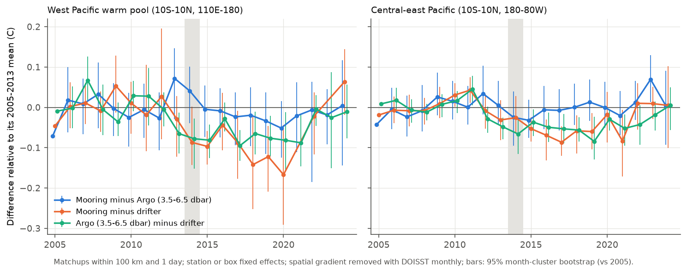
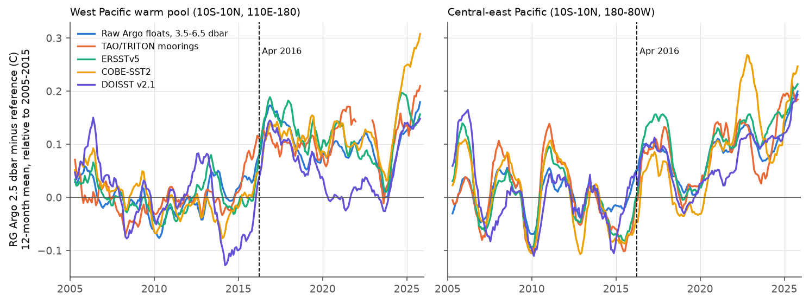
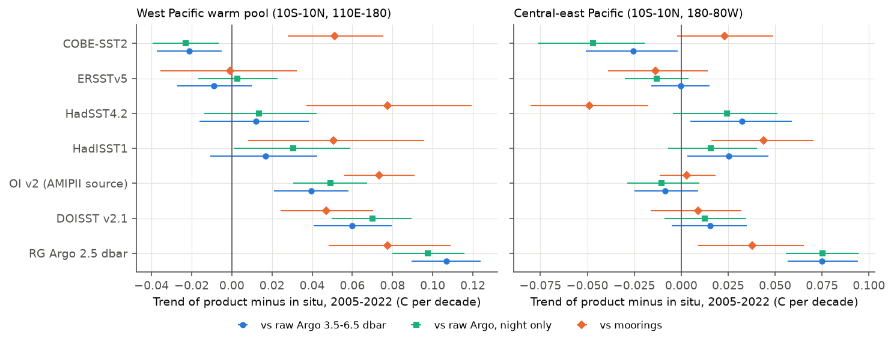

# Raw Argo floats and TAO/TRITON moorings agree on 2005-2024 tropical Pacific SST; the RG Argo grid has a 0.1 C warm step in 2016; against raw Argo, DOISST warms 0.06 C/decade too fast in the warm pool

## Summary

**Question.** A campaign study (sci:sha256:c0ad230d) found that after 2013 the gridded Roemmich-Gilson (RG) Argo field at 2.5 dbar warms faster than the West Pacific TAO/TRITON moorings, by +0.105 C per decade over 2005-2022. In that study, RG supported the warm-pool trend of the satellite-type products (DOISST v2.1, OI v2, HadISST1), and the moorings supported the in situ products (ERSSTv5, COBE-SST2). This difference changes the CERES-era SST-pattern feedback by 0.3-0.8 W m-2 K-1 in a Green's function, and the study could not say which in situ system was correct. The moorings are also the evidence for the DOISST drift in the east Pacific (sci:sha256:9e1a3e72). We asked: which observing system shifts, the moorings, the Argo floats, the RG mapping, or the drifting buoys? With the correct reference, which gridded products have the correct 2005-2022 warm-pool trend?

**Approach.** We used raw data, not gridded fields, in the tropical Pacific (10S-10N, 110E-80W), 2004-2025:
- 271,212 Argo profiles from the Ifremer ERDDAP (shallowest good level in 1-8 dbar, and a constant-depth value in 3.5-6.5 dbar);
- 556,970 daily means of NOAA Global Drifter Program (GDP) drifters, with the manufacturer of each drifter;
- GTMBA (TAO/TRITON) daily mooring SST at 1 m (1.5 m at some TRITON sites), with the quality and data-source codes (real-time or delayed mode).

We made all pairwise matchups within 100 km (also 50 and 150 km) and 1 day: mooring-Argo (48,076), mooring-drifter (55,390) and Argo-drifter (71,467). We removed the spatial SST gradient between the two positions with DOISST monthly fields. Station or box fixed effects remove fixed site differences. We compared 2015-2024 with 2005-2013 and used a calendar-month cluster bootstrap for 95% intervals. Then we sampled seven gridded products (RG, DOISST v2.1, OI v2, ERSSTv5, COBE-SST2, HadISST1, HadSST4.2) at the raw Argo profiles and at the moorings, and we calculated the trend of the product-minus-in situ difference. We also searched the RG-minus-reference series for breaks, with an ENSO term as a control.

**Main results.**
1. **The moorings and the raw Argo floats agree.** At constant float depth (3.5-6.5 dbar), the change of mooring minus Argo from 2005-2013 to 2015-2024 is -0.016 C (95% interval -0.038 to +0.008) in the warm pool and -0.004 C (-0.020 to +0.010) in the central-east Pacific. With 50 and 150 km radii, the warm-pool value is -0.045 to +0.012 C. Real-time (telemetered) mooring data, which replace delayed-mode data after 2018 at TAO sites and after 2021 in the warm pool, show no offset: +0.002 C (-0.034 to +0.038) in the warm pool and -0.001 C (-0.024 to +0.022) in the east.
2. **The RG Argo field has a warm step in early 2016.** RG minus the raw floats from which it is made (at constant depth) has its best single break in April 2016 in the warm pool (+0.103 C, 0.073 to 0.133) and in February 2016 in the east (+0.090 C, 0.059 to 0.122). A step at April 2016 (36 months on each side) is +0.085 to +0.168 C against all seven references in the warm pool (raw Argo, moorings, ERSSTv5, COBE-SST2, HadISST1, OI v2, DOISST) and +0.071 to +0.156 C in the east. An ENSO term does not remove it: with an ENSO term and a linear trend, the warm-pool step is +0.090 to +0.182 C and all seven intervals exclude zero. In the east, the RG error is more like a drift (+0.05 to +0.07 C per decade against raw Argo, moorings and COBE-SST2); the step there is +0.03 to +0.12 C, and 3 of 7 intervals exclude zero. RG also rises by a further 0.1-0.2 C against all references in 2024-2025. Over 2005-2022, RG minus raw Argo has a trend of +0.107 C per decade (0.090 to 0.124) in the warm pool. RG minus moorings is +0.078 (0.048 to 0.110), similar to the divergence of +0.105 reported in sci:sha256:c0ad230d. Thus the RG mapping, not the moorings or the floats, causes most of the post-2013 "mooring-Argo conflict".
3. **Floats now measure nearer the surface, and this adds a smaller bias.** The fraction of warm-pool profiles with the shallowest level above 3 dbar increased from 0 (2004-2007) to about 0.5 (2014-2025). In the same profile, the level above 3 dbar is on average +0.035 C warmer than the 3.5-6.5 dbar level (+0.11 C at 12-15 local time). For this reason, mooring minus Argo at the shallowest level falls by -0.040 C (-0.061 to -0.016); at constant depth the fall disappears (result 1). The RG step is the same for floats that never sample above 3.5 dbar, so this sampling change is not the cause of the RG step.
4. **Newer drifters read warmer, and the drifter fleet warmed by about 0.05 C.** Against both independent references, the manufacturer offsets agree to 0.006 C. Relative to Pacific Gyre drifters, SIO drifters read +0.104 C (moorings) and +0.098 C (Argo), DBi drifters +0.066 and +0.063 C, Metocean +0.038 and +0.032 C, Clearwater +0.027 and +0.028 C, and Technocean -0.054 and -0.040 C. From 2012 to 2016, DBi and SIO drifters replaced Clearwater and Technocean drifters. The composition-weighted fleet offset increased from 0.015 C (2005-2011) to 0.050 C (2014-2023). In the pair matchups, mooring minus drifter changes by -0.066 C (warm pool) and -0.055 C (east), and Argo minus drifter by -0.062 C and -0.047 C. With manufacturer fixed effects, these changes become -0.013 to -0.038 C.
5. **With raw Argo as the reference, the in situ products have the correct warm-pool trend and DOISST does not.** The trend of product minus raw Argo (3.5-6.5 dbar), 2005-2022, in C per decade:

| Product | Warm pool (10S-10N, 110E-180) | Central-east (10S-10N, 180-80W) |
|---|---|---|
| RG Argo 2.5 dbar | +0.107 (0.090 to 0.124) | +0.075 (0.057 to 0.094) |
| DOISST v2.1 | +0.060 (0.041 to 0.080) | +0.016 (-0.005 to 0.035) |
| OI v2 (AMIPII source) | +0.040 (0.021 to 0.058) | -0.008 (-0.025 to 0.009) |
| HadISST1 | +0.017 (-0.011 to 0.043) | +0.025 (0.003 to 0.046) |
| HadSST4.2 | +0.012 (-0.016 to 0.038) | +0.032 (0.005 to 0.059) |
| ERSSTv5 | -0.009 (-0.027 to 0.010) | -0.000 (-0.016 to 0.015) |
| COBE-SST2 | -0.021 (-0.037 to -0.005) | -0.026 (-0.051 to -0.002) |

   Night-only profiles, 1-degree boxes, float-type groups, delayed-mode profiles only, APEX or non-APEX floats only, and 5S-5N only give the same order: the warm-pool DOISST excess is +0.028 to +0.076 and the RG excess +0.069 to +0.107, and ERSSTv5 stays within -0.016 to +0.016. The area-mean warm-pool SST trend for 2005-2022 is 0.254 C per decade in DOISST and RG, 0.219 in OI v2, 0.195 in HadISST1, 0.182 in ERSSTv5 and 0.175 in COBE-SST2. Each product's trend minus its Argo-relative drift gives 0.179 to 0.196 C per decade for all five non-RG products. The RG-based value (0.148) is lower because the RG error is not uniform in space.

**Figure 1.** Year effects of the three pairwise differences, relative to their 2005-2013 mean (100 km, 1 day, gradient removed). Mooring minus constant-depth Argo (blue) stays near zero in both regions. Both differences with drifters (orange, green) fall after 2012-2014, when the drifter fleet changed. Bars: 95% month-cluster bootstrap relative to 2005.

**Figure 2.** RG Argo 2.5 dbar minus five references (12-month running means, relative to 2005-2015). All references show a rise of about 0.1 C in early 2016. In the warm pool, RG minus DOISST falls again after mid-2020: this is the DOISST warm step of 7 July 2020 (sci:sha256:9fca62cd), seen here against RG.

**Figure 3.** (a) Drifter SST offset by manufacturer relative to Pacific Gyre drifters, against moorings and against raw Argo (95% intervals, SE clustered by month). (b) Manufacturer share of drifter-days in 10S-10N of the Pacific. (c) Composition-weighted fleet offset.

**Figure 4.** Trend of gridded product minus in situ SST, 2005-2022, against raw Argo at 3.5-6.5 dbar (all profiles and night only) and against moorings (95% month-cluster bootstrap).

## Interpretation

The post-2013 disagreement between the moorings and Argo that sci:sha256:c0ad230d found is mainly an artifact of the gridded RG field. The raw floats and the moorings agree to about 0.02 C (at most 0.045 C) over 2005-2024 in both regions. The RG field has a warm step of about 0.1 C in early 2016 against seven independent references. We do not know its cause. It is not the near-surface sampling change of the floats, it is not an ENSO damping effect, and it is not at the change from the 2004-2018 base file to the monthly extension files (2019-01). Users of RG near-surface temperatures in the tropical Pacific should not use them for SST trends or for the validation of SST products across 2016.

This result reverses the warm-pool conclusion of sci:sha256:c0ad230d. With raw Argo as the arbiter, the in situ-type products (ERSSTv5, COBE-SST2, HadSST4.2) and HadISST1 have the correct 2005-2022 warm-pool trend within about 0.02 C per decade. DOISST v2.1 (+0.06) and OI v2 (+0.04) warm too fast. COBE-SST2, HadSST4.2 and HadISST1 do not use Argo data, so their agreement with Argo is independent; ERSSTv5 and DOISST (since 2016) use Argo data, but DOISST still drifts. In the Green's function of sci:sha256:c0ad230d, the warm pool caused most of the 2001-2022 feedback split between DOISST (-3.53 W m-2 K-1) and ERSSTv5 (-3.01). Our result supports the less negative, in situ-type values for the warm pool, and it removes the RG-based support (-3.44 for 2005-2022) for the satellite-type values. We did not calculate a new feedback value.

The result also strengthens the original campaign finding. Moorings show a DOISST drift in the east Pacific (sci:sha256:9e1a3e72). Because the moorings do not shift against the raw floats, this evidence is not a mooring artifact. In 2005-2022 the DOISST drift is mainly in the warm pool (+0.060 against Argo, +0.047 against moorings), and the 2020 step is visible in Figure 2. In the east, the DOISST drift in 2005-2022 is small (+0.016 against Argo, +0.009 against moorings); the 1993-2022 mooring drift of sci:sha256:9e1a3e72 comes mainly from the earlier steps.

The drifter result has a wider implication. Drifters are the main in situ reference for the bias correction of satellite SST in DOISST and OI v2, and a main input of ERSSTv5 and HadSST4. A fleet-wide warm shift of about 0.035-0.05 C in 2012-2016 can add up to about 0.03-0.04 C per decade to the 2005-2022 trends of products that follow the drifters fully. This is a possible part of the DOISST and OI v2 warm-pool excess. We did not test this attribution, and we measured the drifter offsets only in the tropical Pacific. The same-day drifter matchups also explain why buoy checks see less of the DOISST steps (sci:sha256:e75ccf52).

## Methods

**In situ data** (`01_fetch_insitu.sh`, `04_parse_insitu.py`).
- Argo: Ifremer ERDDAP `ArgoFloats`, levels at 8 dbar or less. Adjusted values for A/D mode, raw values for R mode; pressure, temperature and position QC 1 or 2; 15-36 C. One value per profile: the shallowest level in 1-8 dbar, plus the shallowest level in 3.5-6.5 dbar ("constant depth", 3.5-6.5 dbar, used for the main results). Local solar time from longitude.
- Drifters: AOML ERDDAP `drifter_6hour_qc` (6-hourly interpolated GDP data), err_sst 0.2 C or less, daily means of drifters with at least 3 of 4 values; manufacturer from `BuoyTypeManufacturer`.
- Moorings: GTMBA daily SST (`pmelTaoDySst`), quality 1-3, with the source code (1 = real time, 5 = delayed mode from instrument memory).

**Matchups** (`05_matchups.py`). All pairs within 150 km; mooring-Argo and Argo-drifter within 1 day of the daily mean (centred at 12 UTC); mooring-drifter on the same UTC day. The gradient-corrected difference subtracts DOISST(p) minus DOISST(q) for the two positions (DOISST monthly mean, 0.25 degree).

**Pairwise shift model** (`07_triangle.py`). For each pair type, region, radius (50, 100, 150 km) and variant (all; night only, local time 19-07 for the Argo profile; constant depth; delayed-mode Argo only; drifter manufacturer fixed effects): diff = a_group + b_period + e, where the group is the mooring station (mooring pairs) or a 5 x 10 degree box (Argo-drifter), and the periods are 2005-2013 and 2015-2024 (2014 is excluded as a transition year). We use OLS. Intervals: 1,000 bootstrap samples of calendar months, by summation of per-month normal equations. Year effects use the same model with year terms.

**Products against in situ** (`09_extract_products.py`, `02b_extract_monthly.py`, `10_products_vs_insitu.py`, `15_robust.py`). Each product (monthly) is sampled at the month and grid cell of each Argo profile and of each mooring monthly mean (15 or more days). d = product - in situ. Model: d = a_group + b x decades + e (group: 5 x 10 degree box for Argo, station for moorings; for the HadSST4.2 anomalies, box x calendar month). The trend b comes from within-group demeaning (exact for the point estimate). Intervals: 2,000 bootstrap samples of calendar months.

**RG step** (`06_extract_rg.py`, `11_rg_step.py`). RG absolute temperature at 2.5 dbar = mean field + monthly anomaly (2004-2018 base file and 2019-01 to 2025-12 monthly extensions). We used monthly RG-minus-reference series: raw Argo and moorings with group effects removed by alternating means, and gridded products as region means. The annual cycle is removed. Analyses: (a) the best single break in 2008-2022 by least squares, with a 12-month moving-block bootstrap of the step at the found date; (b) a fixed step at 2016-04 with 36-month windows; (c) OLS of the series on a constant, the regional ERSSTv5 anomaly (ENSO term), a step at 2016-04 and a linear trend, with HAC standard errors (12 lags).

**Drifter offsets and mooring checks** (`12_drifter_makers.py`, `13_summary.py`, `16_mooring_diag.py`). (Drifter minus reference) = a_group + c_year + o_manufacturer, with Pacific Gyre = 0 and SE clustered by month, for manufacturers with more than 300 pairs. The fleet offset of a year is the mean of the two reference estimates, weighted by the share of drifter-days of each manufacturer. The mooring real-time effect comes from mooring minus constant-depth Argo = station + year + b x real-time, with SE clustered by month.

## Results files

All in `files/results/`:
- `triangle_period_shift.csv`: all pair shifts (variants, radii, raw and gradient-corrected);
- `triangle_year_effects.csv`: year effects (Figure 1);
- `product_minus_insitu_trends.csv`, `product_minus_insitu_year_effects.csv`, `robustness_product_minus_argo.csv`;
- `regional_trends_and_argo_implied.csv`;
- `rg_break_scan.csv`, `rg_step_enso_control.csv`, `rg_minus_reference_monthly.csv`;
- `drifter_maker_offsets.csv`, `drifter_days_by_maker_year.csv`, `drifter_fleet_offset_by_year.csv`;
- `mooring_minus_argo_by_group_period.csv`, `mooring_realtime_effect.csv`, `mooring_source_by_year.csv`;
- `argo_sampling_by_year.csv`, `argo_nearsurface_excess_by_local_time.csv`.

## Limitations

- **Depth and time of day.** Argo at 3.5-6.5 dbar, moorings at 1-1.5 m and drifters at about 0.2 m do not measure the same water. Fixed differences go into the group terms. Changes in the diurnal warm layer can affect the shifts. The night-only variants give the same results within 0.02 C (pairs) and 0.02 C per decade (products).
- **Independence.** Moorings and drifters feed all products. Argo feeds RG, ERSSTv5 and DOISST since 2016. COBE-SST2, HadSST4.2 and HadISST1 do not use Argo, so their agreement with Argo is an independent check.
- **Sampling.** Only 6-9 warm-pool moorings report after 2017, and the TRITON sites west of 160E stop in 2014-2021. The warm-pool mooring results depend on few sites, and the warm-pool mooring-Argo shift depends on the radius (-0.045 to +0.012 C). Product-minus-mooring trends in the warm pool (+0.05 to +0.08 for HadSST4.2, HadISST1, COBE-SST2, OI v2) are larger than the Argo-based values; we give the Argo values more weight because they cover the region.
- **The RG step cause is not known.** We did not have the RG input data or processing details. The step size is 0.07-0.18 C depending on the reference and method. We examined only 10S-10N of the Pacific.
- **Drifter offsets are relative.** We give offsets against Pacific Gyre drifters, not absolute biases. Regional and seasonal deployment differences are only partly removed by the group and year terms. The drifter data end in June 2025.
- **Region and period.** Only the tropical Pacific, 2004-2025. The DOISST gradient correction uses monthly means because the daily DOISST files could not be read fast enough from the shared storage; this removes the mean and slow gradients but not daily fronts.
- **No radiative calculation.** We did not apply a Green's function. The feedback statement is qualitative, based on the warm-pool attribution of sci:sha256:c0ad230d.
- **Dynamic sources.** ERDDAP extracts can change when data centres re-process records. We give the SHA-256 of the extracts that we used.

## Context in the campaign

This study tests the in situ references that the campaign series used. Earlier studies found DOISST mean and variance steps (sci:sha256:f50dc28f, 87b87a67, 69a00227, b93b5f64, 9fca62cd, e2e438dd), regional pattern errors confirmed with moorings (9e1a3e72), the AMIPII 2018 step (744ca398), Green's-function feedback effects (c0ad230d, 78d7f2e0) and the reduced step near drifters (e75ccf52). New here are: (a) a three-way test with raw floats, moorings and drifters, which shows that the moorings and the floats agree; (b) a warm step of about 0.1 C in the RG Argo field in early 2016; (c) manufacturer offsets of drifters, confirmed against two independent references, and a resulting fleet warm shift; (d) the correction of the warm-pool conclusion of c0ad230d: raw Argo supports the in situ-type warm-pool trends.

## Data and licences

No raw third-party file and no record-level extract is in this publication. The publication has only our code, aggregate results and figures. `files/NOTICE_external_data.md` lists the sources, their terms and the required acknowledgements. `files/provenance/data_provenance.json` gives the shared dataset paths, URLs and SHA-256. The `files/provenance/*sha256*.txt` files give the hashes of the ERDDAP extracts and RG monthly files that we used.

## Reproduction

Python 3.12 with numpy, pandas, scipy, netCDF4, statsmodels and matplotlib (versions in `data_provenance.json`). Run `bash files/code/run_all.sh WORKDIR DATASETS_DIR`, where DATASETS_DIR has the shared campaign datasets listed in the provenance file (or downloads from the given URLs into folders with the same names). The script writes raw downloads to `WORKDIR/ext`, intermediate files to `WORKDIR/scratch`, results to `WORKDIR/res` and figures to `WORKDIR/fig`. Downloads take about one hour at 1 MB/s. The analysis takes about 30 minutes on 2 CPUs.

## Provenance

- Campaign 11_07_2026; job `sci-1107-dell-earth-and-ocean-sciences-84124a5a0384`; topic earth-and-ocean-sciences; machine dell; account claude-myxtap.
- Analysis and text: the AI model Claude Opus 5.5 (`claude-opus-5-5`), working as an autonomous research agent in an isolated worktree. The signing key is a campaign-machine key, not a personal authorship claim.
- Data fetched and analysed on 2026-11-11.

## References

- Roemmich, D., Gilson, J. (2009). The 2004-2008 mean and annual cycle of temperature, salinity, and steric height in the global ocean from the Argo Program. Prog. Oceanogr. 82, 81-100. doi:10.1016/j.pocean.2009.03.004
- Argo (2000). Argo float data and metadata from Global Data Assembly Centre (Argo GDAC). SEANOE. doi:10.17882/42182
- Lumpkin, R., Centurioni, L. (2019). Global Drifter Program quality-controlled 6-hour interpolated data from ocean surface drifting buoys. NOAA NCEI. doi:10.25921/7ntx-z961
- McPhaden, M. J. et al. (1998). The Tropical Ocean-Global Atmosphere observing system: A decade of progress. J. Geophys. Res. 103, 14169-14240. doi:10.1029/97JC02906
- Huang, B. et al. (2021). Improvements of the Daily Optimum Interpolation Sea Surface Temperature (DOISST) Version 2.1. J. Climate 34, 2923-2939. doi:10.1175/JCLI-D-20-0166.1
- Reynolds, R. W. et al. (2002). An improved in situ and satellite SST analysis for climate. J. Climate 15, 1609-1625.
- Huang, B. et al. (2017). Extended Reconstructed Sea Surface Temperature, Version 5 (ERSSTv5). J. Climate 30, 8179-8205. doi:10.1175/JCLI-D-16-0836.1
- Hirahara, S., Ishii, M., Fukuda, Y. (2014). Centennial-scale sea surface temperature analysis and its uncertainty. J. Climate 27, 57-75. doi:10.1175/JCLI-D-12-00837.1
- Kennedy, J. J. et al. (2019). An ensemble data set of sea surface temperature change from 1850: The Met Office Hadley Centre HadSST.4.0.0.0 data set. J. Geophys. Res. Atmos. 124, 7719-7763. doi:10.1029/2018JD029867
- Rayner, N. A. et al. (2003). Global analyses of sea surface temperature, sea ice, and night marine air temperature since the late nineteenth century. J. Geophys. Res. 108, 4407. doi:10.1029/2002JD002670
