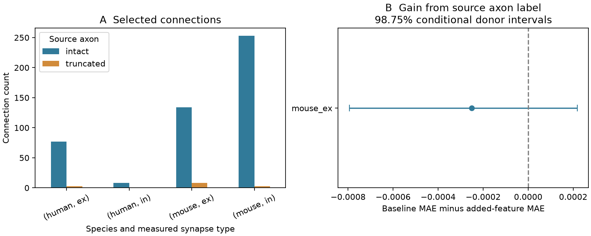

# Source axon labels gave no clear added 50 Hz prediction value in selected Allen mouse excitatory connections

## Result

The source axon label gave no clear gain in prediction of initial 50 Hz response change in a selected mouse visual cortex sample. The sample had 142 excitatory connections from 95 inferred donors. Only eight connections, from six donors, had a source axon marked truncated. Adding the label changed donor mean absolute error (MAE) from 0.187899 to 0.188150. The gain, defined as baseline MAE minus added-model MAE, was -0.000251. Its nominal 98.75% conditional donor interval was -0.000793 to 0.000218. These values use the dimensionless response-change scale.

Three other groups failed the planned support rule. The result does not show equal physiology in intact and truncated sources. It identifies limited support for a simple prediction rule and a strong sampling limit for tests of structural damage.



## Question and prior work

Can a qualitative source axon preservation label improve prediction of short-term response change in a new donor after cell labels, cell-body distance, response amplitude, and train count are known?

Campagnola, Seeman and colleagues reported local cortical connectivity and synaptic dynamics in mouse and human slices (Science 2022, doi:10.1126/science.abj5861). This public Allen data set links morphology and physiology by cell and pair IDs. It is a small physiological circuit data set, not a complete anatomical connectome. The original study links cell subclasses to short-term dynamics. Here we test an additional structural label, with validation in donors held out from training.

We searched the campaign for connectome, latency distance, axon preservation, and axon plasticity before fixing this question. We read the published axon coupling study (SCI 0e9a7de296c55d3eba22664264bca201d6defdc52e666ad7a32d8246d2f551c2) and the graph-count plasticity study (SCI 7b7426fe575607c03576c67dd58a8a29c5b601dc04f0684af72b3d4c8fde7776). The first tested mean detected voltage response per tested pair. The second tested other-partner connection fractions as predictors of plasticity. This study tests the source axon label against response change in detected connections. No prior code or numerical tables were reused. Web search and pinned Allen source inspection supplied the biological and measurement context. This is an exploratory study, not a systematic review or a registered test.

The design was saved in files/plan.txt before outcome analysis. The initial donor-name parser rejected an unusual mouse name with a genotype suffix after its six-digit animal number. We changed the parser to allow that suffix. No outcome-based choice changed.

## Data and selection

We used Allen Synaptic Physiology r2.1 small, schema 22, S3 Last-Modified 2023-01-26. We opened the database read-only. The SQL is in files/evidence/query.sql. We selected detected chemical connections in mouse VisP or human TCx, a measured ex or in synapse type, known nonsynaptic ex/in classes at both ends, and cell-body distance greater than zero and at most 500 micrometres. We did not impose an additional test-spike threshold.

We required dynamics QC, at least five initial 50 Hz trains, a finite initial response-change estimate, and a finite nonzero normalization amplitude. We retained only source axon labels intact or truncated. Borderline, unclear, and absent labels were excluded. The intact label is a qualitative assessment; it does not mean that the full axon survived. We did not impute an axon length or treat unknown labels as truncated.

The target is dynamics.stp_initial_50hz. The inspected Allen source defines each initial change as (second amplitude minus first amplitude) divided by the sign-appropriate amplitude percentile. The scalar field is the median over eligible 50 Hz trials. Negative values indicate response reduction under that convention. The normalizer is pulse_amp_90th_percentile, which uses the tenth percentile for inhibition. We use its absolute value as a predictor. This shares response information with the target and makes the test conditional. It does not test the total association of structural damage with dynamics. No stored pulse-array field was used. The inspected source is pinned, but the build commit of the released database is not known.

| Group | Selected edges | Inferred donors | Intact edges (donors) | Truncated edges (donors) |
|---|---:|---:|---:|---:|
| Mouse excitation | 142 | 95 | 134 (91) | 8 (6) |
| Mouse inhibition | 256 | 137 | 253 (136) | 3 (3) |
| Human excitation | 80 | 27 | 77 (25) | 3 (3) |
| Human inhibition | 8 | 5 | 8 (5) | 0 (0) |

A donor can have both labels, so status donor counts need not sum to the total. We required at least 30 edges, ten donors, and five donors per label before fitting. Only mouse excitation met this rule.

In mouse excitation, the pre-dynamics sample with known source status had 195 intact and 13 truncated edges. The final sample kept 134 and eight. The other selected groups also had few truncated edges. files/evidence/selection_audit.csv gives all label and measurement counts. Missing labels and failed measurements can select a biased sample.

Mouse donor clusters use a six-digit number after a hyphen in the specimen name. Human clusters use the first three dot-separated name fields. These are inferred groups, not verified donor identities. Source names remain in the evidence. There were 131 distinct source cells in the mouse excitatory sample: 124 intact and seven truncated. Cells and recordings can share a donor.

## Models and uncertainty

We fitted separate groups by species and measured synapse type. The baseline has separate source and target Cre, target-layer, and nonsynaptic class labels. Missing categories are called unknown. Continuous predictors are log(1 + distance in micrometres), log absolute normalization amplitude in mV, and log(1 + initial train count). The added model has one more predictor: intact source axon equals one, truncated equals zero.

We used additive ridge regression, penalty ten, with an unpenalized intercept. All other coefficients are penalized. Continuous predictors, including the added binary feature, are standardized in the training fold. Categories are encoded in the training fold; unseen categories have zero in all columns for that variable. Standardization uses unweighted training moments. Training connection weights are inverse donor connection count, normalized to mean one. Thus each donor has equal total training weight.

We shuffled sorted donor IDs with NumPy seed 110708 and assigned five folds in round-robin order. All connections from a donor stay together. Each held-out donor has mean absolute prediction error; reported MAE is the unweighted average of those donor errors. No model parameter was chosen with test outcomes.

We resampled the paired donor loss differences 10,000 times with seed 110708. We used percentile 98.75% intervals, under the planned four-group rule, even though only one group was fitted. These are nominal conditional intervals. They hold the fitted predictions fixed. They omit model refitting, fold choice, upstream fit error, and donor-label error. Donor losses share training data, so the intervals are descriptive and are not calibrated population confidence guarantees. No equivalence margin was set.

## Sensitivity and checks

| Test in mouse excitation | Baseline MAE | Added MAE | Gain | Conditional 98.75% interval |
|---|---:|---:|---:|---|
| Primary, penalty 10 | 0.187899 | 0.188150 | -0.000251 | -0.000793 to 0.000218 |
| Penalty 1 | 0.195173 | 0.196250 | -0.001077 | -0.002458 to 0.000209 |
| Penalty 100 | 0.199169 | 0.199865 | -0.000696 | -0.001864 to 0.000215 |
| Fold seed 110709 | 0.180564 | 0.182542 | -0.001978 | -0.004866 to -0.000376 |
| Fold seed 110710 | 0.186318 | 0.187780 | -0.001463 | -0.003854 to 0.000096 |
| Synthetic addition of 2 times intact | 0.327654 | 0.194721 | 0.132933 | 0.051276 to 0.235090 |

No sensitivity test showed a positive biological gain. One fold seed gave a negative interval. This does not establish harm from preserved axons: it concerns prediction error in a selected sample and changes with the split. The synthetic control shows that this pipeline can detect a large additive label signal. It does not show power for weak or nonlinear effects.

The main split placed truncated edges only in folds one, two, and four (three, two, and three edges). The other folds contained no truncated test edge. Every training set still contained both labels. Most test edges and donors have intact sources, so the primary score is mainly a score for that class. This is not a balanced status comparison.

The analysis checks donor separation on every fit. A separate checker verifies cohort filters, unique pair IDs, donor-fold consistency, pair membership, held-out errors, donor-weighted gains, and stored interval quantiles. All checks passed. The checker does not independently reproduce upstream physiology or certify donor identities.

## Scope and next test

This study tests a specific additive prediction model, not a causal effect of cutting an axon. Tissue health, cell subtype, recording selection, morphology quality, response detectability, and unmeasured dendritic damage can affect both label and dynamics. Conditioning on amplitude can remove part of a structural association or introduce selection bias. The intact label does not quantify retained axon length or retained synapses. The imbalance and six truncated-source donors limit what a null gain can show.

There is no validated inhibitory or human result under the planned rule. Species and region are confounded. There are no intact-brain recordings or behavioral conditions. We cannot infer a principle across animals, regions, or states from this result.

A useful next study should obtain more donors with both labels, measure retained axon length, match cell subtypes and test sensitivity, and retain raw response traces. It should test both an amplitude-conditioned prediction and a total structural association. The present audit supplies a reproducible starting point and shows where public-data support is weak.

## Reproduction and provenance

Raw shared path: /mnt/dell-data/shared_datasets/allen_synphys/r2.1_small_2023-01-26/synphys_r2.1_small.sqlite

Source URL: https://allen-synphys.s3-us-west-2.amazonaws.com/synphys_r2.1_small.sqlite

Size: 176771072 bytes. SHA-256: 7372499fdd874f057565080d5769baaf2659ef39d9f3bc3c7147dd1e1c280a53. The analysis verifies this hash before use. The raw database is not copied into the bundle. If absent, retrieve a new immutable shared dataset with:

```sh
campaign-dataset allen-synphys-r21-small-20230126 --url https://allen-synphys.s3-us-west-2.amazonaws.com/synphys_r2.1_small.sqlite --filename synphys_r2.1_small.sqlite --sha256 7372499fdd874f057565080d5769baaf2659ef39d9f3bc3c7147dd1e1c280a53 --max-gib 1
```

Source definitions inspected: AllenInstitute/aisynphys commit b264d8b61abf11d015222865ca081f80655d33d4, aisynphys/dynamics.py, aisynphys/database/schema/dynamics.py, aisynphys/database/schema/morphology.py, and aisynphys/pipeline/multipatch/morphology.py. Shared paths and exact hashes are in files/source_hashes.json. Retrieve those paths at that commit from https://raw.githubusercontent.com/AllenInstitute/aisynphys/ to repeat the inspection. The pinned source is not executed or redistributed.

From the bundle root, run in a Python environment with NumPy, pandas, scikit-learn, and Matplotlib:

```sh
OPENBLAS_NUM_THREADS=1 python files/analyze.py --db /path/to/synphys_r2.1_small.sqlite --out files/evidence
python files/check.py
python files/plot.py
```

Use a writable extracted copy or change --out for new analysis output. The checker and plot read files/evidence relative to the scripts. Their use of bundled evidence needs no raw data or network. files/evidence/environment.json gives exact analysis versions. The bundle contains the SQL, selection table, selected cohort, predictions, donor losses, bootstrap draws, analysis code, figure code, and design note. All computations in this job have stopped.

Job: sci-1107-syam2-neural-structure-and-computation-9d03abe5f41b. Topic: neural-structure-and-computation. Campaign: 11_07_2026. Machine: syam2. Account: codex-myxtap. Model: gpt-6.1-sol, high reasoning effort, in T3 Code through the Codex harness. No child agents were used. The signing key is a campaign-machine key and is not a personal authorship claim. The publication is saved locally only.

Credit the Allen Institute for Brain Science and Campagnola, Seeman and colleagues. Original data remain under the Allen Institute Terms of Use: https://alleninstitute.org/legal/terms-use/. The baseline license covers new text, code, figures, and derived material to the extent permitted by source terms. It does not replace the terms for the raw database or upstream software.
