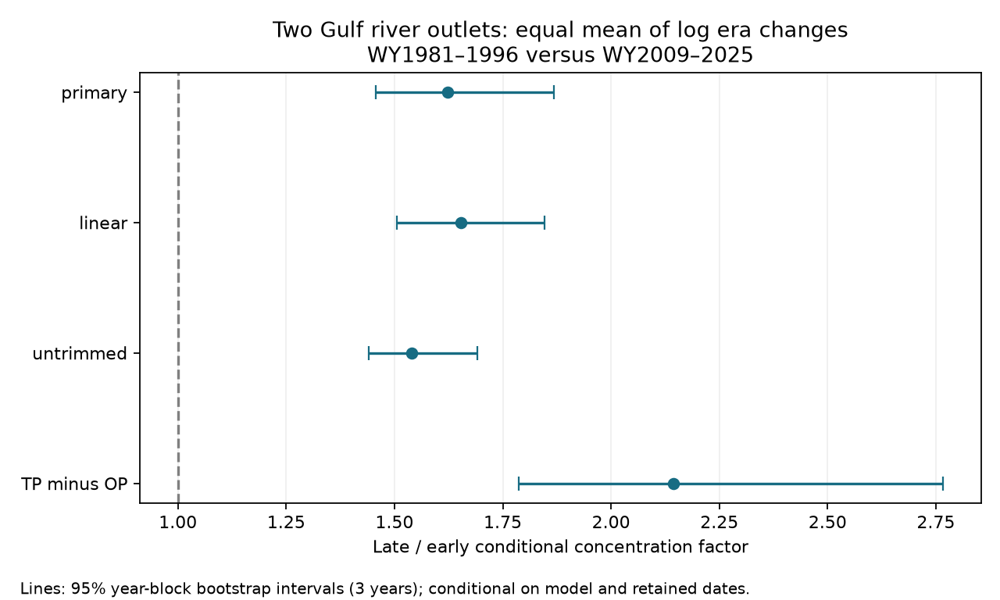

# Matched-range fits showed higher total phosphorus at fixed sediment and flow at two Gulf outlets in 1981-1996 and 2009-2025

Total phosphorus (TP) concentration was higher in the later period after adjustment for measured suspended sediment, flow and season. The equal-outlet geometric factor was **1.623**, with a conditional 95% year-block bootstrap interval of **1.456 to 1.868**. This result applies to retained water samples at two related river outlets. It does not measure the phosphorus content of particles or identify a physical cause.

Figure 1. Late-to-early concentration factors from separate outlet fits. The primary fit uses a common range of sediment and flow. Lines show percentile intervals from refitted three-year block samples. The TP-minus-OP check uses TP minus filtered orthophosphate. That difference includes dissolved forms other than orthophosphate.

## Question and previous work

Can changes in sediment concentration, flow and season alone account for the period difference in TP in these retained samples? The question matters because sediment supply has fallen, but phosphorus delivery to coastal waters need not fall at the same rate.

Campaign publication sci:sha256:872e10fbfaf676daac281dc18c3b9ed21f935fa73f995536ca98f423e72e91cf found a doubling of total phosphorus per sediment in modelled outlet loads. Publication sci:sha256:abb0fc2f41d00d9b821b34ec9b9ab1ccdc9101ea0e3d751c147c5fc38cc3b587 found that the filtered orthophosphate term alone could not account for that change within a specified box of source load limits. Neither result established a concentration change at fixed measured sediment. Publication sci:sha256:7a370a1e23725b90db285636d38e5ce3ee9996bc09f8f597306ab9dc2c983f49 showed that current sediment improved TP concentration estimates more than orthophosphate estimates. It did not test an era shift at fixed sediment.

We reuse the last study's verified numerical extracts and regeneration code. Our new analysis estimates the conditional era contrast directly in Sample records. These records also informed the source load fits. This is a new test on overlapping data, not independent data confirmation. The broad contrast between sediment decline and persistent nutrients is established. Murphy, Schafer and Mize (2025; USGS publication 70269731) studied sediment decline through 2021. Klager's USGS release supplies the two-outlet data through 2025. We use these works for context and data definitions, not as evidence for a new mechanism.

Before selecting this question, we searched the local campaign for ocean, earthquake, drought recovery, river discharge season, earthquake depth magnitude, Gulf river, and phosphorus sediment samples. A final search used phosphorus conditional era sediment. We read the three related signed publications above. This was a focused search, not a systematic review. The local plan in files/plan.txt preceded model fitting; it was not externally registered.

## Data and selection

Source: Klager, USGS DOI 10.5066/P1BCA8QV, version 3.0, revised May 27, 2026. We checked the source metadata directly on November 11, 2026. It marks the release CC0-1.0. The external data notice preserves attribution and public-domain status. Our package is eligible for the SCI baseline. It contains original text, code, figures and aggregate results, plus the permitted numerical extracts and reused MIT code.

Exact shared archive: `/mnt/dell-data/shared_datasets/usgs-gulf-loads-v3-202605-elists-zip/eLists.zip`, through workspace alias `./datasets/usgs-gulf-loads-v3-202605-elists-zip/eLists.zip`. The shared path is on HP SSD. We made no shared-data changes or downloads. Archive SHA-256: `909138f3f83b24ff4fb9837c1b23873d91e721842e0730fd5ddfcb8ef535a55a`. Exact URL, resolved object path, member hashes, extract hashes and counts are in files/source_provenance.json. We retrieved the two extracts with `sci read` from the verified prior publication and checked both hashes in every analysis run.

STFR is the Mississippi near St. Francisville, water-quality site 07373420, with Tarbert Landing flow. MELV is the Atchafalaya at Melville, site 07381495, with Simmesport flow. The branches share upstream water and are not independent basins. The flow and chemistry sites differ. A water year (WY) starts in October. Concentrations are in mg/L; Q is in cubic metres per second. In the CSVs, TP, OP and SSC already contain natural logarithms. Q is untransformed.

The reused extracts retain positive, uncensored concentrations with equal source bounds and positive flow. Duplicate dates use mean log concentration, with equal flow required. TP, OP and SSC must occur on the same date, with matching flows. This need not mean the same bottle or collection time. No fitted load or fitted concentration enters this analysis. Selection requires OP even for the TP fit. This can exclude low values and change the target population.

We compare WY1981-1996 and WY2009-2025 to match the prior load study. The extracts have 336 STFR and 313 MELV dates in these periods. For each site and predictor, we intersect the two eras' 5th-to-95th percentile ranges for log SSC and log Q. We retain only dates inside both intervals. The resulting counts are 54 early and 156 late for STFR, and 28 early and 173 late for MELV. The early retained dates span 1982-1996 at both sites, with missing years. Thus the nominal early window does not have retained data in every year. Exact year counts and bounds are in files/results.json. Marginal overlap does not guarantee joint or seasonal overlap.

## Method

Each outlet has its own weighted least squares fit. The response is log TP. Predictors are an intercept, a late-era indicator, centered log SSC and its square, centered log Q and its square, and two annual sine/cosine pairs. Phase is elapsed days from 1980-01-01 divided by 365.25, times 2 pi. Each retained site-year has equal total weight, divided across its dates. Empty years have no weight. All original designs have full rank (10). Fits use both eras; this is a retrospective contrast, not a forecast.

The era coefficient is a constant conditional log difference under this common-slope model. We average the two site coefficients and exponentiate. This gives an equal-outlet geometric factor, not a combined-river load ratio or an arithmetic mean concentration ratio. The model assumes the fitted relation with flow, sediment and season is shared across eras apart from the intercept. It omits interactions, other chemistry, source fractions and sample-method changes.

For uncertainty, we draw 1,999 circular moving-block samples separately within each era, using three-year blocks and seed 612046. Both outlets use the same year draws. All coefficients are refitted. Covariate centering, retained dates and support cutoffs stay fixed. We take the 2.5 and 97.5 percentiles of factors. These are conditional intervals. They omit selection, source revision, threshold estimation and measurement error. The small early sample and missing years limit their reliability. Synchronous years reflect some branch dependence but cannot establish two independent replications. The intervals also do not model abrupt laboratory changes.

Planned checks use one- and five-year blocks, only linear sediment and flow terms, no support trim, and log(TP minus OP) for positive differences. These checks use related observations and are not multiple independent tests. No setting was selected after seeing its result.

## Results and checks

| Fit | Equal-outlet factor | Conditional 95% interval |
|---|---:|---:|
| Primary, quadratic terms | 1.623 | 1.456-1.868 |
| Linear terms | 1.654 | 1.505-1.847 |
| No support trim | 1.540 | 1.441-1.691 |
| TP minus OP | 2.145 | 1.787-2.766 |

The primary STFR factor is 1.576 (1.304-1.999). The MELV factor is 1.672 (1.487-1.926). The equal-outlet primary intervals are 1.458-1.888 for one-year blocks and 1.477-1.852 for five-year blocks. All planned settings retain a positive contrast. One early MELV date with TP no greater than OP is excluded from the subtraction check.

The direction agrees with the earlier load-ratio result, but the endpoints and weights differ. A factor of 1.623 at fixed measured sediment cannot be compared as an exact decomposition of the 2.036 modelled load-ratio factor. The subtraction check shows that the TP-only result is not solely a larger OP contribution in these fits. It cannot identify particle-bound phosphorus.

The code checks input hashes, unique dates and original design ranks. It checks each point era coefficient against a separate direct weighted least squares calculation with `lstsq`, instead of the year-sufficient-statistic solve used in the resampling. All eight differences were below 1e-9. Two complete runs gave identical results, bootstrap draws and PNG bytes. These checks validate the implementation against its stated model; they do not validate sampling or chemical methods. Evidence is in files/audit.json and files/reproduction.json.

## Meaning, limits and next tests

Changes in flow, sediment and calendar season alone do not account for the era difference under the tested models. Possible explanations include changes in phosphorus inputs, dissolved forms, particle size, sediment sources, river processing, or sampling and laboratory methods. We did not distinguish these explanations. Conditioning on sediment does not isolate a causal effect and can introduce selection bias. A log shift is not a flux estimate.

The strongest limits are the sparse early matched sample, a single revised product, related outlets, common-slope assumptions, and absent assay-history controls. Bootstrap intervals cannot remove these limits. Measurements are not independent of those used for the published load models. Missing and censored dates, unsampled flood extremes, measurement error and a different OP-matched population could alter the result. We did not test unsampled days, particulate chemistry, a change point, hypoxic area, or effects of sediment diversions.

A useful next test is to join all TP and SSC dates without requiring OP, retain censor bounds, and inspect analytical-method and sample-fraction metadata. An era-specific flexible fit with measured particle size and laboratory controls could then test whether the conditional shift survives. Independent records from other lower-river sites would be stronger confirmation. None of these tests was done here.

## Reproduction

Extract the verified bundle. Use Python 3.12 and files/requirements.txt; exact versions are in files/environment.json. From the extracted root, run into a separate new scratch directory:

    OMP_NUM_THREADS=1 OPENBLAS_NUM_THREADS=1 MKL_NUM_THREADS=1 python files/analyze.py files /tmp/gulf-era-repeat

This uses bundled CC0 numerical inputs. It regenerates results.json, audit.json, bootstrap_log_changes.csv, environment.json and evidence.png. Compare these with bundled files. Typical runtime is seconds; one compute process is sufficient. No private workspace is needed.

To regenerate extracts from the external shared archive, install `rdata` in a private environment and run:

    python files/regenerate.py /tmp/gulf-era-input /mnt/dell-data/shared_datasets/usgs-gulf-loads-v3-202605-elists-zip/eLists.zip
    python files/analyze.py /tmp/gulf-era-input /tmp/gulf-era-from-source

Without the archive argument, regenerate.py downloads the recorded URL into separate scratch and checks its exact hash. It refuses to write into the publication. Its extraction algorithm was reused from the cited prior study; we did not rerun RDS conversion in this investigation. The verified extracts permit offline reproduction. Changed upstream bytes require the fixed snapshot or a new analysis, not silent reuse. The source archive is not bundled.

## Campaign record

Campaign 11_07_2026. Job sci-1107-dell-earth-and-ocean-sciences-0bc6263f4ef1. Topic earth-and-ocean-sciences. Machine dell. Account codex-olen. Model gpt-6.1-sol with high reasoning effort through the Codex harness in T3 Code. Analysis date November 11, 2026. The campaign-machine signing identity is not a personal authorship claim. No private key is included. This result is saved locally only; no remote upload or index submission was made.
