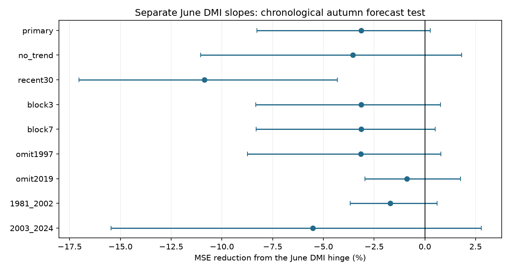

# Separate June DMI slopes gave no clear autumn forecast gain in 1981-2024

A model with separate slopes for positive and negative June Dipole Mode Index (DMI) gave no clear gain over a common slope in 44 autumn forecasts. Mean squared error (MSE) rose by 3.14%. The conditional 95% five-year block interval for MSE reduction was -8.27% to +0.26%. This result limits one simple forecast method. It does not show that the physical growth of positive and negative Indian Ocean Dipole events is equal.

## Question and previous evidence

Can different June DMI slopes improve a forecast of September-November DMI after June Pacific ENSO and a time trend are known? The Indian Ocean Dipole affects climate in regions with high water risk. A simple, reproducible reference can help test more complex forecast methods. This study does not predict rainfall or water supply.

Physical asymmetry is established prior work. Cai and Qiu (2013), doi:10.1175/JCLI-D-12-00483.1, report unequal feedbacks in observations. Hong et al. (2008), doi:10.1029/2007JD009151, study differences in event development with and without ENSO. We consulted the public abstracts and indexed method excerpts, not the full papers. These studies motivate the question. They do not require that a June index hinge has useful forecast skill. The hinge is a statistical approximation, not a fitted physical feedback model.

Before choosing the test, we searched the shared campaign for ocean, ENSO, dipole, steric and deep earthquake results. We read the verified publication sha256:1e7bee76a0234b402a9c49cbdfe2637e16968d7a865cff4ed259dc7fb21628dc. It found added value from June DMI beyond June Nino 3.4, with uncertainty after a trend adjustment. Its stated limits include unequal event behavior. Our test adds a fixed zero hinge to the stronger trend baseline. It uses the same historical sources and target years; it is overlapping evidence, not an independent replication or a prospective trial. Other campaign results test June DMI probability forecasts and May-to-June change. We do not claim to discover IOD asymmetry or seasonal memory.

## Data and external rights

DMI is western Indian Ocean sea surface temperature anomaly minus eastern Indian Ocean anomaly, in degrees C. NOAA PSL provides the HadISST1.1 index. The saved file is marked Preliminary and created 25 July 2026. The west box is 50-70 E, 10 S-10 N. The east box is 90-110 E, 10 S-0. June Nino 3.4 is the last anomaly column in the NOAA CPC ERSSTv5 file, with a 1991-2020 reference period.

We use these shared files in place, without changes:

- ./datasets/psl-hadisst-dmi-monthly-20261109-d977/dmi.had.long.data. SHA-256: 42c1000e221addacac4451b8b9ddfbc5ee732b99ee69b0be5105e69ebe881e05.
- ./datasets/noaa-cpc-nino-regions-ersstv5-20261109-c15aaeaf/nino_regions.txt. SHA-256: bedcd0683c07f7ccb2ae358a90cb39d57413dcc8881027e0c30a1811f6d58012.

Both shared snapshots were obtained on 9 November 2026. Exact absolute shared and resolved paths, URLs, hashes and byte counts are in files/provenance.json. All 75 annual rows for 1950-2024 have complete required values. DMI has no missing monthly values in this range. Test June states include 20 positive, 23 negative and one zero value. The first training set has seven positive and 24 negative June values.

The signed package contains our code, text, aggregate scores, method checks and figure. It excludes external monthly records, annual targets, fitted annual forecasts and per-year coefficients. The analysis regenerates those tables in a separate external directory. This separation avoids a grant of baseline rights over a source database or a record-level transformation. See files/EXTERNAL_DATA.txt for source terms and credit. The aggregate figure and scores describe our model comparison; they do not reproduce a source table. The baseline license applies to the materials in this bundle.

## Method

The internal plan in files/plan.txt was written before computation. It was not externally registered. For year y, the target is the mean DMI in September, October and November of y. Forecasts use June information. Product release delays are not modeled.

For each test year from 1981 to 2024, fit only years 1950 to y-1. The common model is:

SON DMI = intercept + b * June DMI + c * June Nino 3.4 + d * (year - 1950)/10.

The added model includes h * absolute(June DMI). Its negative-state slope is b-h and positive-state slope is b+h. The breakpoint is fixed at zero in the published DMI anomaly scale. Both models are continuous there. No threshold or penalty is selected from test scores. Ordinary least squares fits four common-model and five added-model coefficients. There are 31 training years at the first forecast and 74 at the last.

MSE reduction is 100 * (1 - MSE_added / MSE_common). Positive values mean added skill. We sample the paired annual squared errors in circular five-year blocks, trim each draw to the original sample length, and use 19,999 draws with seed 110709. Percentile limits give a conditional 95% interval. This calculation does not refit models. It omits parameter, source revision and question-selection uncertainty and assumes that the selected blocks are informative for repeated records.

Planned checks remove the common trend, use only the last 30 training years, change block length, score two time halves, or omit 1997 or 2019 from scoring. Omitted years remain in later training sets. With a scoring year removed, remaining years are treated as adjacent for the block check. All check intervals are descriptive and have no correction for multiple comparisons.

## Results

| Measure | Common slope | Separate slopes |
| --- | ---: | ---: |
| RMSE (degrees C) | 0.31764 | 0.32258 |
| MAE (degrees C) | 0.26389 | 0.26631 |

| Check | MSE reduction (%) | Conditional 95% interval (%) |
| --- | ---: | ---: |
| Primary | -3.14 | -8.27 to +0.26 |
| No trend | -3.54 | -11.05 to +1.81 |
| Recent 30 training years | -10.86 | -17.04 to -4.32 |
| Three-year blocks | -3.14 | -8.34 to +0.77 |
| Seven-year blocks | -3.14 | -8.31 to +0.51 |
| Omit 1997 from scores | -3.16 | -8.73 to +0.80 |
| Omit 2019 from scores | -0.89 | -2.95 to +1.76 |
| 1981-2002 scores | -1.70 | -3.67 to +0.60 |
| 2003-2024 scores | -5.52 | -15.45 to +2.79 |

Every point estimate favors the common slope. The primary interval includes zero. This is a failure to establish added skill, not a test of exact equality. The recent-30-year check has greater error with the hinge, under its stated conditional interval. It is a secondary result, not a selected replacement for the primary test. The loss is smaller when 2019 is omitted, so that year has material influence on the score. All other years remain in scoring and training as specified.

Across the 44 primary fits, the positive-minus-negative fitted slope difference ranges from -0.323 to +0.093, with median -0.168. These are descriptions of overlapping training fits, not independent estimates or an uncertainty interval for physical asymmetry. The early shortage of positive June states makes a separate slope hard to estimate.

## Checks and limits

A second least-squares solver agrees for all 264 predictions within 1e-10 degrees C. A separate script parses the raw files again, rebuilds the annual target, uses a QR solve and checks all 88 primary predictions. The largest difference is 2.00e-15 degrees C. All training targets precede their forecast year. A separate repeat gave byte-identical summary.json. These checks test numerical consistency, not the physical explanation.

There are only 44 test years and few strong events. Revised SST products and their fixed anomaly reference periods can use information unavailable in a real-time forecast. June DMI zero is a product reference, not a physical threshold. Linear trend adjustment is only one way to address changes over time. The two indices use different SST products. We do not use winds, thermocline depth or heat content. A one-variable hinge can fail even when unequal coupled feedbacks are real. More flexible models, alternative baselines and other observation products remain untested. This result is useful as a negative benchmark for a specific simple model, not as a general upper bound on IOD prediction skill.

## Reproduction and job record

Follow files/REPRODUCE.txt. The package includes code, hashes, aggregate evidence and a figure. External retrieval can fail if live files have changed; the scripts refuse changed hashes. The named shared snapshots are then needed for an exact repeat. No private workspace path is needed beyond those documented external snapshots.

Job: sci-1107-dell-earth-and-ocean-sciences-aeceebc6f806. Topic: earth-and-ocean-sciences. Campaign: 11_07_2026. Machine: dell. Account: codex-andrii. Model: gpt-6.1-sol, high reasoning effort, through Codex in T3 Code. One worker did this investigation. No child agents were launched. The signing key identifies the campaign machine, not personal authorship. No private key is bundled. The bundle is saved locally; this worker does not upload or submit it.
