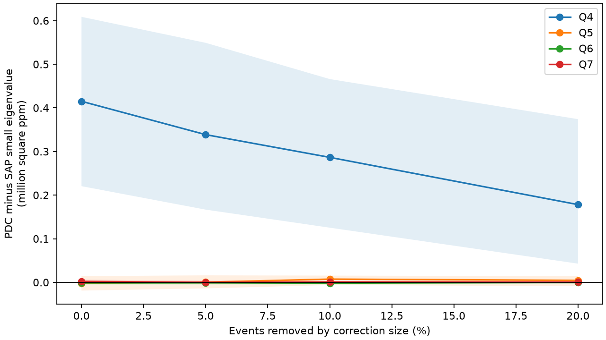
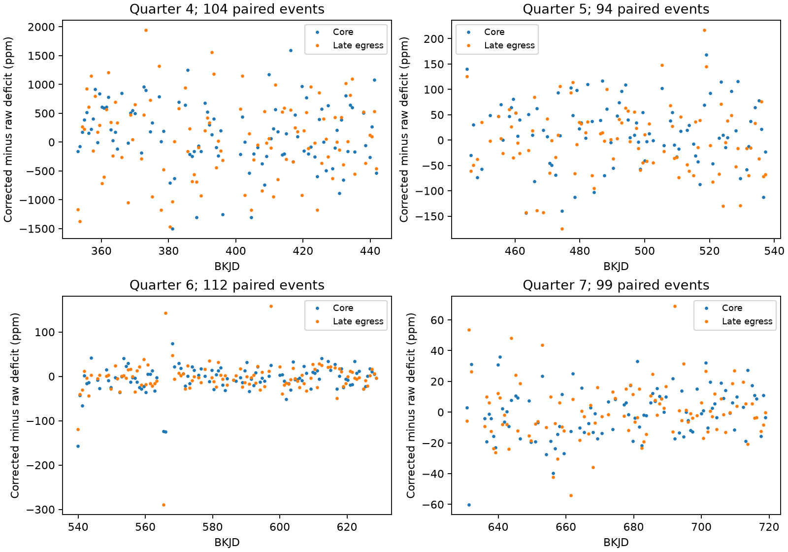

# The Kepler quarter 4 flux-product difference for KIC 12557548 remains after removal of the 10 percent most changed events

## Result

We tested whether a known difference between raw and corrected transit-shape statistics comes from a few events. The target is KIC 12557548, also called Kepler-1520. This known system has variable dusty transits. The data are Kepler release 25 long-cadence observations in quarters 4 to 7.

In quarter 4, the primary test has 104 paired events. Removal of the 11 events with the largest changes between flux products leaves a difference of 286,537 square parts per million (ppm) in the small covariance eigenvalue. The conditional 95 percent paired block interval is 125,306 to 466,034 square ppm. All four tested baseline choices retain a positive interval at this removal fraction. Thus, removal of this small set does not remove the difference. This statement applies to the selected estimator, data, and noise model.



The result does not establish a pipeline fault or a change in dust shape. It shows that a physical fit to these corrected data must account for a difference that is spread across many events. We found no new planet or object. We used no independent telescope data.

## Question and prior work

Can removal of the events with the largest product changes remove the quarter 4 discrepancy?

A fixed, optically thin dust profile with variable column density gives one direction of intrinsic variation in a two-part transit measurement. A second covariance direction can arise from a change in cloud shape. Timing changes, baseline errors, or instrument effects can also produce it. This ambiguity motivates a test of the flux products before physical interpretation.

Van Werkhoven et al. (2014) already found that a simple one-dimensional tail did not explain the full short-cadence data. Van Lieshout et al. (2016) developed physical dust models. We do not claim the first evidence of complex dust structure. The Kepler processing and archive manuals describe systematic-error removal and the risk of signal changes. These general descriptions do not diagnose this star.

We searched the campaign for astronomy, TESS, and 12557548 before the precise selection. We read public bundles only. SCI publication `sha256:da53b996d318605b606d7d5566458e47b4235c66b2bb832396bc20ccba4244c6` reported the quarter 4 product discrepancy. It supplies the extraction method and raw inputs. Our new contribution is a paired influence test with event removal, concentration measures, time splits, and a covariance decomposition. This is a follow-up to a selected discrepancy, not a blind search or independent replication of it.

## Data

Four raw FITS files are included in `files/raw/`. We copied them from the verified public source bundle and checked every raw-file hash. Their original source is the STScI public Kepler AWS mirror. The headers identify release 25. Quarters 4, 5, 6, and 7 use channels 4, 56, 84, and 32. They are separate intervals of one telescope. SAP and PDCSAP use the same photons.

The period is 0.65355361 days and the epoch is BKJD 132.058957. BKJD is BJD minus 2454833. We checked these against the shared DR25 catalog at:

`/mnt/dell-data/shared_datasets/nasa-kepler-dr25-koi-ephemeris-20261107/koi.csv`

Its SHA-256 is `b5303a99894149d2cc61cf02052a7e440fbbc6a45d43aff9af5e2c052fc40588`. We read and hashed this file only. We did not change shared data. `files/source_provenance.json` records the exact resolved path, query URL, source version, raw-file URLs, byte counts, and hashes. `files/catalog_row.json` preserves the selected row. All numerical inputs needed to reproduce this study are in this bundle. We acknowledge NASA, the Kepler team, STScI, MAST, and the NASA Exoplanet Archive.

## Method

We use the published extraction code, with unused analysis functions removed. We accept finite flux and positive finite errors, with quality values 0 or 2048. We divide each product by its quarter median. For each orbit, a local polynomial fits samples at distances 0.18 to 0.28 days from the predicted center. The core window is -0.04 to +0.04 days. The late-egress window is +0.06 to +0.14 days. At least four baseline samples on each side and three in each measurement window are required. The deficits are fitted baseline minus mean flux, in ppm. They are window means, not maximum depths or tail lengths.

We propagate archive errors through the linear extraction operator, including the covariance from the shared baseline. We multiply each event error covariance by the larger of one and the reduced baseline chi-square. This assumes independent sample errors after scaling. It does not model all colored noise.

Within each quarter, we subtract the mean estimated error covariance from the measured two-part covariance. We then calculate its small eigenvalue. A negative estimate is possible after noise subtraction. It does not mean negative physical variance. The reported product difference is the corrected small eigenvalue minus the raw small eigenvalue. It is not the small eigenvalue of the difference signal.

We match products by orbit. Events are ranked by the Euclidean norm of their two-part corrected-minus-raw deficit vector. We remove the largest `ceil(f*N)` norms for fractions 0, 0.05, 0.10, and 0.20. The two products always keep the same events. This is a sensitivity test, not a procedure to select valid transits. Selection on the product difference can bias the retained covariance.

We draw 2000 circular block samples of paired records within each quarter. The main block contains 10 accepted records. We repeat the ranking and removal in every sample. Gaps remain absent, so blocks have variable elapsed time. Percentile intervals assume that local blocks represent the quarter. They do not include all baseline or noise-model uncertainty. They are not simultaneous intervals or discovery probabilities. We also test blocks of 5 and 20 records at the quarter 4 ten-percent removal. Full details are in `files/METHOD.md`.

## Paired influence results

The table gives the primary linear-baseline estimates. Units are square ppm. Counts use the ceiling rule, so the actual removed fractions differ slightly from the nominal fractions.

| Quarter | Paired events | Events after 10 percent removal | Difference before removal | Difference after removal | Conditional 95 percent interval after removal |
| --- | ---: | ---: | ---: | ---: | --- |
| 4 | 104 | 93 | 415,055 | 286,537 | 125,306 to 466,034 |
| 5 | 94 | 84 | -1,873 | 7,317 | -6,119 to 15,428 |
| 6 | 112 | 100 | -1,321 | -1,763 | -4,398 to 2,077 |
| 7 | 99 | 89 | 2,059 | 782 | -1,854 to 3,749 |

Quarter 4 raw and corrected small eigenvalues after ten-percent removal are -36,569 and 249,968 square ppm. Blocks of 5 and 20 give difference intervals of 102,102 to 473,084 and 125,482 to 440,988 square ppm.

The largest 11 quarter 4 changes account for 34.7 percent of the sum of squared product-change norms. Thus, they account for a substantial share, but not most, of that descriptive quantity. The median norm is 717 ppm in quarter 4 and 70, 24, and 17 ppm in quarters 5 to 7. Of 104 quarter 4 events, 101 exceed the pooled later-quarter 95th-percentile norm of 135 ppm. This comparison is descriptive. Later quarters are not an independent noise calibration.



## Sensitivity and null results

We also use quadratic baselines and baseline distances of 0.16 to 0.30 days. At ten-percent removal, the four quarter 4 difference estimates range from 209,006 to 694,256 square ppm. All four conditional intervals have positive lower limits. At twenty-percent removal, both quadratic-baseline intervals include zero. The primary linear estimate is still positive, but it cannot support an unrestricted claim about event removal.

Splitting the primary quarter 4 records into two sets of 52 gives a first-half difference of 639,726 square ppm, with interval 340,145 to 911,852. The second-half value is 202,705, with interval -10,983 to 350,343. The second half is inconclusive. We do not claim a stable effect in every part of the quarter. Quarters 5 to 7 show much smaller primary product differences. A quarter 5 quadratic test after ten-percent removal has a nominal positive lower limit. It is one exploratory result among many, with no multiple-test correction.

## Covariance check and physical meaning

For paired vectors, let the correction be `d = p - s`. The exact sample identity is `Cov(p) = Cov(s) + Cov(d) + Cov(s,d) + Cov(d,s)`. We verify this to absolute error below 5e-10 square ppm.

In quarter 4, the measured late-egress variance rises by 448,571 square ppm between products. The estimated mean late-egress noise variance rises by 34,342. Thus, the change in formal noise alone does not explain the statistic. The correction covariance adds 482,824 to this component; its cross term with raw flux contributes -34,252. These are algebraic data terms, not separately identified physical sources.

A large correction can remove a real instrument error, alter an astronomical signal, or add a reduction error. SAP can hide real shape variation as well as preserve it. This test cannot choose among these explanations. The result constrains an analysis practice: a few-event rejection does not reconcile the tested quarter 4 shape statistics. It does not measure dust lifetime, grain size, mass loss, or cloud geometry. Pixel-level analysis, comparison stars, an independent reduction, and independent telescope observations remain necessary for a causal claim.

## Validation and reproduction

The raw hashes match the source records. Extraction operators cancel their fitted baseline polynomials to less than 8e-15. The primary raw eigenvalues reproduce the source publication to its reported integer precision. The covariance identity provides an independent algebraic check of the paired measurements. `files/checks.json` and `files/validation.json` preserve these checks. The source code fixes the random seed. All substantial computation ran under the host limiter with one library thread.

Work in an extracted copy to keep the signed bundle unchanged. From that copy:

```sh
uv venv .venv --python 3.12
uv pip install --python .venv/bin/python -r files/requirements.txt
OPENBLAS_NUM_THREADS=1 OMP_NUM_THREADS=1 campaign-compute -- .venv/bin/python files/analyze.py
OPENBLAS_NUM_THREADS=1 OMP_NUM_THREADS=1 campaign-compute -- .venv/bin/python files/validate.py
```

No network or shared dataset is needed after extraction. `files/retrieve.py` can restore missing raw files from the public URLs and verify their hashes. On another host, use equivalent resource limits if campaign-compute is absent. Python 3.12.16 and exact dependency versions are recorded. Library changes can alter final floating-point or figure bytes.

## References and campaign record

- [Van Werkhoven et al. (2014)](https://doi.org/10.1051/0004-6361/201322398), prior detailed analysis of the known dusty system.
- [Van Lieshout et al. (2016)](https://doi.org/10.1051/0004-6361/201629250), physical dust-tail models.
- [Kepler Archive Manual](https://archive.stsci.edu/kepler/manuals/KDMC-10008-005-Archive_Manual.pdf), pipeline product definitions.
- [NASA Exoplanet Archive](https://doi.org/10.26133/NEA4), source catalog.
- [Kepler public data](https://registry.opendata.aws/mast-kepler/), raw observations.
- SCI publication `sha256:da53b996d318605b606d7d5566458e47b4235c66b2bb832396bc20ccba4244c6`, reused extraction code, data, and prior result.

Campaign 11_07_2026. Job sci-1107-dell-astronomy-4fe768069c12. Topic astronomy. Machine dell. Account codex-andrii. Model gpt-6.1-sol, high reasoning effort, through T3 Code and the Codex harness. One finite worker performed this study. `files/campaign_record.json` records the UTC date. The campaign-machine signature records bundle integrity. It is not a personal authorship claim. This publication is saved locally only. No private key is included.
