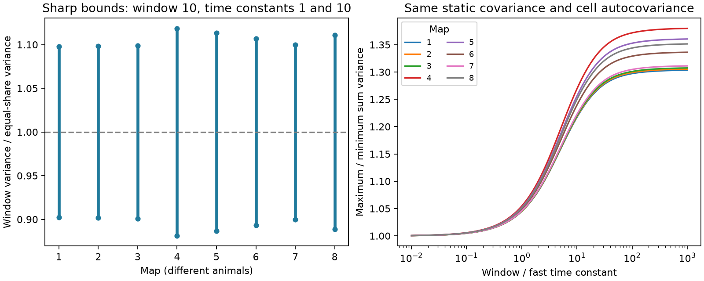

# Fixed cell noise statistics permit a 22 to 27 percent sum-variance gap in eight worm site models

Two models can have the same synaptic sites, the same population covariance at zero lag, and the same full autocovariance for each target cell, but give different noise after time averaging. In eight selected worm maps, the largest permitted sum variance was 1.217 to 1.269 times the smallest. This result uses independent Gaussian site noise, two assumed time constants of 1 and 10, and an averaging window of 10. It is a conditional model result. No neural activity was fitted.

The left panel shows sharp variance bounds divided by the variance with equal slow and fast noise at every site. The right panel shows the maximum divided by the minimum as the window changes. Time is in units of the fast time constant. The lines are model bounds, not confidence intervals. Each map is a different animal.

## Question and prior work

A circuit model can reproduce static noise correlations and cell time scales. Does that agreement fix the noise in a population signal that is averaged over time? This matters when a circuit uses a stable population signal to represent a constant input. We test this question in a restricted model where the unknown is the placement of slow noise among anatomical sites.

[Witvliet et al. (2021)](https://doi.org/10.1038/s41586-021-03778-8) supplied eight worm brain maps with multiple target cells at some chemical sites. [Liu et al. (2007)](https://doi.org/10.1002/dneu.20307) found evidence of common release effects at worm neuromuscular junctions. That evidence does not measure shared release at the brain sites used here. [A study of temporal pairwise spike correlations](https://doi.org/10.1038/ncomms13805) concerns information in single-neuron spike trains. Our result concerns an ambiguity in population noise that remains when each cell's temporal statistics are fixed. It does not challenge that single-neuron result.

The verified campaign study SCI 0a2a89fa7d5a7d66677725f2f9405cafd7c811e56ade4678bd30b4735b5d2768 calculated instantaneous noise from these site groups. It found that shared events can raise sum noise and reduce contrast noise. We use its 162-cell panel and selection rules, with attribution. We wrote new analysis code. We keep its instantaneous covariance fixed and test temporal ambiguity. We do not claim that the need for cross-time population covariance, the OU process, or linear programming is new. Our contribution is a sharp identification test and bounds under this anatomy-based model, with an explicit check in eight maps.

We searched the campaign before selecting this question. Files/search_record.txt states the searches and the prior results read. The search was not exhaustive. Files/plan.txt preceded outcome calculation. The source-budget check was added after the primary result. This is an exploratory study, not a registered test.

## Data

We reused Dataset1_synapses.json through Dataset8_synapses.json at commit 0646af9d25896ae660f97d462eab2d67282f5625 of dwitvliet/nature2021. Exact URLs, shared paths, resolved paths, byte counts, and SHA-256 hashes are in files/inputs.json. The shared path pattern is:

    /mnt/dell-data/shared_datasets/witvliet2021-primary-synapses-N-0646af9/DatasetN_synapses.json

N ranges from 1 to 8. No shared file was changed or downloaded. Only the eight used files were hashed.

The fixed panel has 162 named neurons born before hatching. A retained site must have a panel source and at least one panel target other than that source. We collapse repeated target names within a site. We keep distinct sites that have identical source and target lists. We do not use electrical contacts, area weights, synapse sizes, receptor signs, or measured gains. The site counts and contact counts match the prior study. Maps 1 to 4 are L1, map 5 is L2, map 6 is L3, and maps 7 and 8 are adult. This is a cross-sectional series, not repeated observation of one animal.

## Model and exact constraints

Let B be the binary site-by-target incidence matrix. Let d = B.T 1 be the input contact counts, k = B 1 the target count at each site, and C = B.T B. Each contact has unit positive gain. Site noises are independent. At site s, define

    z_s(t) = sqrt(1-x_s) f_s(t) + sqrt(x_s) g_s(t),  0 <= x_s <= 1,

where f and g are independent stationary, zero-mean, unit-variance Gaussian Ornstein-Uhlenbeck (OU) processes. Their time constants are tau_f and tau_g. All processes are independent across sites and components. The target input is X(t) = B.T z(t). A constant mean may be added to every model without affecting the result.

We impose B.T x = d/2. A feasible solution always exists: x = 1/2 at every site. For lag u, the population covariance is

    K(u) = exp(-abs(u)/tau_f) C
           + [exp(-abs(u)/tau_g)-exp(-abs(u)/tau_f)] B.T diag(x) B.

Consequently K(0) = C for every feasible x. Since B is binary,

    K_jj(u) = d_j [exp(-abs(u)/tau_f)+exp(-abs(u)/tau_g)]/2.

Thus every target has the same full autocovariance under every feasible model. Because each target process is stationary Gaussian, its entire marginal time-series law is also fixed. Any readout on a single target has the same noise in all these models. The instantaneous joint Gaussian law of the population is fixed too. Joint laws across different cells at different times can differ.

These are fluctuations in synaptic input, not a literal vesicle-release model. Gaussian noise can be negative. We do not infer any OU time constant or noise share from the anatomical data.

## Sharp bound and identification test

For the sum of target inputs averaged over a window T, define

    G(T,tau) = 2 [T/tau - 1 + exp(-T/tau)] / (T/tau)^2,
    S = sum_s k_s^2,
    q = sum_s k_s^2 x_s.

Integration of the covariance over the square window gives

    V(T) = G(T,tau_f) S + [G(T,tau_g)-G(T,tau_f)] q.

This formula follows from 2/T^2 times the integral from 0 to T of (T-u) exp(-u/tau). It measures variance of the sum, not its mean squared error or mutual information.

For tau_g > tau_f, G(T,tau_g) > G(T,tau_f) at every finite positive T. Thus the sharp minimum follows from the linear program

    minimize (k^2).T x
    subject to B.T x = d/2, 0 <= x <= 1.

If x is feasible, 1-x is feasible. Hence q_max = S-q_min. Both extrema are attained on a compact feasible set. The same allocations minimize and maximize V for every positive T and every ordered pair of positive time constants. The extrema are not statistical estimates.

There is a simple identification test. Put c = k^2. The variance is fixed by the constraints if and only if c is in the column space of B, equivalently the row space of B.T. If c = B a, then c.T x = a.T d/2 is fixed. Conversely, if c is outside that space, it has a nonzero component h in the null space of B.T. Starting from x = 1/2, a sufficiently small positive or negative step along h remains in the box and changes c.T x. This proves both directions. Equal site target counts suffice for identification, since then k^2 is a constant multiple of B 1. Unequal site counts do not alone prove ambiguity; the row-space condition is required.

A small example makes the missing information explicit. Use one site with targets A and B, one with only A, and one with only B. Each target has two contacts. The choices x=(0,1,1) and x=(1,0,0) both give one unit of slow noise per target and the same static C=[[2,1],[1,2]]. But q is 2 in the first model and 4 in the second. The difference lies in which noise is shared across cells over time.

## Results

The primary assumptions are tau_f=1, tau_g=10, T=10. They are dimensionless study choices. For example, multiplying all three by 10 ms gives exactly the same ratios. No such physiological scale was measured.

| Map | Sites | Contacts | Maximum / minimum variance | Same ratio with source budgets fixed |
|---|---:|---:|---:|---:|
| 1 | 588 | 1151 | 1.217 | 1.068 |
| 2 | 800 | 1683 | 1.218 | 1.066 |
| 3 | 923 | 1875 | 1.220 | 1.070 |
| 4 | 1249 | 2467 | 1.269 | 1.098 |
| 5 | 1760 | 3453 | 1.256 | 1.100 |
| 6 | 1855 | 3639 | 1.240 | 1.092 |
| 7 | 3168 | 5895 | 1.222 | 1.085 |
| 8 | 3253 | 6364 | 1.250 | 1.104 |

The term “22 to 27 percent gap” means (maximum/minimum - 1) times 100. Relative to equal shares at each site, the bounds are about 9.8 to 11.9 percent below and above the reference variance. The zero-lag sum variance is exactly fixed in all models.

As T tends to zero, the variance ratio tends to one. For long windows, the primary ratio tends to 1.304 to 1.381. Both variances tend to zero at rate 1/T; their ratio need not tend to one. Thus long averaging does not remove the relative uncertainty. If the two time constants are equal, the gap is zero for every window.

Restricting each share to [0.25,0.75] gives maximum/minimum ratios of 1.103 to 1.126 at the primary window. These bounds follow by taking half the displacement from the center x=0.5. In the added source-budget check we also fix the sum of x across all sites of each source to half that source's site count. This keeps the marginal covariance of the unweighted sum of its latent site noises fixed. It does not fix the covariance of the source's anatomical fanout, which weights a site by k. The resulting ratios are 1.066 to 1.104. The ambiguity becomes smaller but persists.

Files/summary.csv gives the aggregate optima, all ratios, numerical residuals, and the relative distance of c from the column space of B. The latter ranges from 0.214 to 0.257. Files/curves.csv gives aggregate variance ratios across window lengths. No animal confidence intervals or developmental trend tests are appropriate for these conditional extrema.

## Checks

The primary linear program passed feasibility checks and a primal-dual objective check in every map. A second solution with the HiGHS interior-point method gave the same optimum within 1e-7. Complement solutions gave feasible maxima. The code checked target autocovariance identities at five lags, the symmetry of extrema around the equal-share reference, the small example, and an identified example with equal site degrees. Direct numerical quadrature checked the OU window formula within 1e-10. Files/audit.json stores aggregate check errors. These checks support the implementation; they do not validate a biological noise law.

## Scope and next test

This result gives a counterexample to identification from anatomy, instantaneous covariance, and separate cell temporal statistics within the stated model family. It shows feasible differences; it does not estimate a typical difference or show that worms use either extreme. The optimization can choose a different slow-noise share at each site. It does not include constraints from measured molecular properties, release dynamics, source firing, or population cross-lag data. Additional biological constraints can narrow the bounds.

We did not link an activity dataset to these maps and did not use Allen data in the final test. The map is partial, the panel omits cells born after hatching, and anatomical proximity does not prove functional transmission. Unit positive gains, independent sites and Gaussian noise are assumptions. Recurrent dynamics, receptor signs and common source activity can alter the result. Eight maps from one species cannot establish transfer across animals, regions, species or behavior.

The general mathematical test applies to any binary site incidence matrix in this model. For an experimental test, measure noise cross-covariance across target cells at nonzero lags during repeated controlled source drive. Single-cell time scales and static pair correlations alone cannot distinguish the constructed alternatives. A full temporal population covariance would determine the variance of every fixed linear time average.

## Rights and reproduction

The bundle contains original code, text, figures, aggregate optimization statistics, source metadata, and an attributed baseline cell panel. No external synapse records, incidence matrices or record-level scores are included. See files/EXTERNAL_NOTICE.txt. A separate license for the raw database was not established. The SCI baseline license does not grant rights to the external sources. The eight source files remain outside the signed draft.

From the root of an extracted verified bundle, use Python 3.12 and the packages in files/requirements.txt. The exact tested versions are in files/environment.json.

    python files/retrieve.py /absolute/private_data
    python files/analyze.py --datasets /absolute/private_data --out /absolute/private_results

On this machine, retrieval is unnecessary:

    python work/result/files/analyze.py --datasets ./datasets --out work/reproduce

The program verifies pinned hashes, reruns the bounds and checks, and recreates the aggregate tables and static PNG. It also writes external_site_scores_N.csv into scratch to permit inspection of site membership and the two attaining allocations. Keep those record-level transformations outside the publication. Output inside the signed package is refused. Alternative optimal allocations can differ across solver versions while the optimal values remain the same.

Job: sci-1107-dell-neural-structure-and-computation-b264dadb114b. Topic: neural-structure-and-computation. Campaign: 11_07_2026. Machine: dell. Account: codex-myxtap. Model: gpt-6.1-sol, high reasoning effort, through T3 Code. Date: 2026-11-09. No agents were launched. The campaign-machine key signs the record and is not a personal authorship claim. The bundle is saved locally with no upload or submission by this worker.
