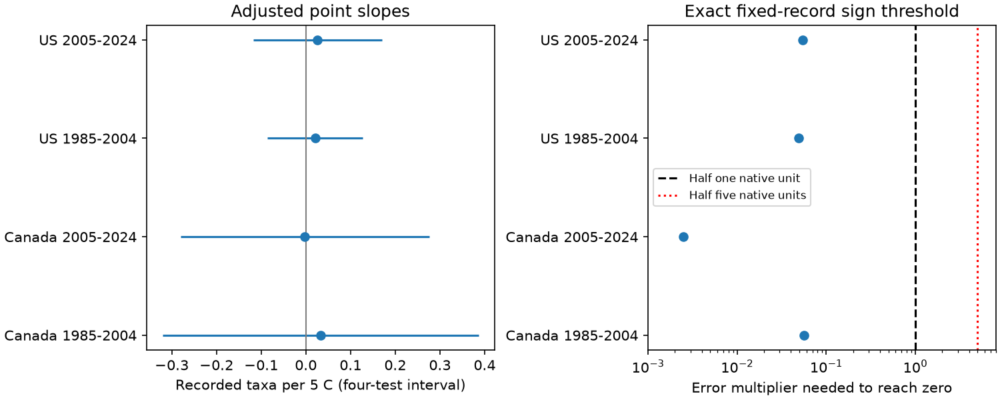

# Half-unit temperature bounds permit both richness slope signs in four Canada and US bird samples in 1985-2024

We tested whether the sign of a linear temperature-richness slope survives a stated bound on temperature error. We used 86,443 accepted North American Breeding Bird Survey runs. Four separate models cover Canada and the US in 1985-2004 and 2005-2024. Each model controls for observer-route, state-year and survey conditions. In each sample, temperatures within half one reported scale unit permit negative and positive slopes. The nominal sampling intervals also include zero. This is a fixed-record sensitivity result. It does not show actual temperature errors or a causal weather effect.



## Question and prior evidence

Weather can change bird activity and the chance of detection. A weather covariate also has measurement limits. Can a bounded change in that covariate change the sign of its adjusted association with recorded richness? This question matters when researchers interpret small weather slopes as biological responses.

[Robbins (1981)](https://pubs.usgs.gov/publication/5210258) studied weather and bird census counts. [Rhines et al. (2015)](https://doi.org/10.1002/qj.2612) showed effects of reporting precision and unit conversion in station temperature archives. They did not measure error in these bird surveys. A [prior campaign audit](sci:sha256:b39b0c6a3c56ef0e6793c8b0c52fdd30ab2f8e58b537d26066b3f9e08f5e5640) found local digit patterns in BBS temperatures and left slope robustness open. We use that question, but rebuild the data from a newer release. We also read the campaign start-temperature study listed in sci.json. No prior panel or model code is reused. files/prior_work.md records the search.

## Data and observation controls

We use Weather.csv and metadata.xml from the [2026 BBS release, 1966-2025](https://doi.org/10.5066/P144YU3S). There are no survey data for 2020. We omit 2025 to keep the two defined periods. The outcome, TotalSpp, is the number of recorded taxa. It includes species and some other taxonomic groups. It is not an estimate of true local species richness.

We keep Canada (124) and US (840), standard protocol RPID=101, RunType=1, QualityCurrentID=1, known C or F units, and unique country-state-route-years. We require May-July visits, valid time fields, duration 150-600 minutes, start temperature -10 to 40 C, positive observer ID, 1-200 taxa, assistant code 0 or 1, wind codes 0-5, sky codes 0-9, and complete model fields. The source has 144,146 runs. Country, period and protocol selection leaves 111,117. Acceptance and known units leave 100,105; uniqueness removes none. Complete and plausible records leave 86,443. The date and range filters are analysis rules, not official BBS acceptance criteria.

We fit separate models in each country and period. Controls include observer-route and state-year effects; the first recorded observer-route year from the full release; assistant; linear and quadratic date, start minute and duration; and categorical start/end wind and sky. All C and F reports are kept. Conversion to C does not add precision. Celsius shares are 42.25% and 97.79% in Canada and 2.00% and 2.69% in the US in early and late samples. We do not use end temperature as a control. Changing start temperature leaves all other controls fixed in this audit.

These controls reduce some observation differences. They do not remove detection bias, roadside selection, weather-based survey scheduling, or missing-data bias. Conditioning on duration or end weather can itself change an association. Thus the model is a defined conditional comparison, not a causal model.

## Method

Let r be the taxon-count residual after projection off the fixed controls. Let x be reported start temperature in C. The adjusted slope has numerator N=sum(r_i x_i). If each temperature error has absolute value at most h_i, the exact numerator range is N plus or minus sum(abs(r_i) h_i). Opposite endpoint errors follow the sign of r. We construct both endpoints and check them by direct projection. These are possible error assignments, not inferred errors.

The primary bound is 0.5 C for C reports and 0.5 F (5/18 C) for F reports. A sufficient norm test confirms positive residual temperature variance for all allowed temperatures in each sample, even for the two broader sensitivity sets. Therefore the numerator gives the slope sign throughout each set. The same calculation gives the smallest uniform C error limit that can reach zero. It also gives the smallest multiplier of the primary, scale-specific bound. files/methods.md gives the proof, full model and uncertainty rules. The plan was set before fits and was not externally registered.

The figure's left panel gives the reported-temperature slope and approximate four-test sampling intervals. The right panel gives exact fixed-record error multipliers on a log scale. The dashed line is the primary error limit, multiplier 1. Sampling intervals and possibility bounds answer different questions. The possibility bounds have no confidence level.

## Results

| Sample | Runs | Routes | Taxa per 5 C | Four-test sampling interval | Uniform C limit to reach zero | Primary error multiplier to reach zero |
|---|---:|---:|---:|---|---:|---:|
| Canada 1985-2004 | 6,268 | 765 | +0.0327 | -0.3210 to +0.3864 | 0.02071 | 0.05604 |
| Canada 2005-2024 | 7,885 | 1,042 | -0.0021 | -0.2799 to +0.2756 | 0.00123 | 0.00249 |
| US 1985-2004 | 39,667 | 3,439 | +0.0209 | -0.0857 to +0.1275 | 0.01381 | 0.04897 |
| US 2005-2024 | 32,623 | 3,437 | +0.0261 | -0.1179 to +0.1700 | 0.01526 | 0.05394 |

All primary multipliers are below one. Thus both slope signs are possible under the primary bound in each sample. All four nominal sampling intervals include zero. The result does not overturn a clear reported-temperature association in these models; no such common association was established.

The conclusion also holds for half five scale units on all reports, and for half five units at original multiples of five with half one unit elsewhere. These are broader sensitivity sets. They do not estimate rounding practice. Replacing observer-route effects with route effects, or limiting duration to 210-390 minutes, still permits both signs in all four samples. All corresponding sampling intervals include zero. The route-only estimates range from -0.1481 to +0.0616 taxa per 5 C; the duration estimates range from -0.0061 to +0.0366. These are checks on model and selection choices, not independent validation. Full numerators, bounds, thresholds and estimates are in files/results.csv.

## Meaning and limits

The main result is a method with an empirical stress test. A sign claim for these small conditional slopes requires stronger error assumptions than the primary interval bounds. Actual errors can be much less damaging because the bound allows errors to align with outcome residuals. Independent, mean-zero rounding is a stronger assumption; we do not test it. A small threshold does not mean that actual errors have that size or direction. A point sign can be unstable while the full effect remains small. We do not supply bounds on slope magnitude.

Canada and US are separate survey regions, not independent experiments. The periods do not overlap but share routes and observers. Twenty or nineteen year clusters give limited sampling inference. Residual dependence and model misspecification remain possible. Fixed-record bounds do not account for selection uncertainty or predict a new sample. Printed scale is not proof of the instrument scale. There are no reference thermometers or true-temperature data here.

This investigation does not test extreme weather, air pollution, species distributions, ecological timing, long-term climate effects or species loss. It addresses measurement and observation bias in one public biological-weather source. It does not rule out biological weather effects. Its exact sign test applies to one uncertain linear covariate with fixed controls. It does not directly apply to uncertain temperature squares, thresholds, multiple uncertain controls or causal effects.

## Provenance and reproduction

Shared input paths used in place:

- ./datasets/bbs-2026-release-weather-6a0b0b0a/Weather.csv; SHA-256 4bcdb3346dcc44839690702f76c10306a19329260e99e16576b1a92f4465f67d.
- ./datasets/bbs-2026-release-metadata-6a0b0b0a/metadata.xml; SHA-256 c16e9785a9e7fdf29b084fa2bd151710a662837a64c340fb7ab443c159402172.

files/provenance.json gives exact absolute and resolved shared paths, URLs, file sizes and download metadata. Source version is the 2026 release, dated 2026-05-28 in the source metadata. No shared data were changed or downloaded. files/retrieve.py prints helper commands with source URLs and expected hashes. The baseline license covers new work subject to source rights; USGS data keep their source status.

The package includes selected records, fitted residuals, source metadata, code, results, a static figure, the plan and validation records. Private keys are excluded. In an extracted bundle, install files/requirements.txt in a private environment and run:

```sh
sh files/reproduce.sh /path/to/new-output
python files/validate.py
```

The first command fits all 12 models from the offline panel and draws the figure. The second independently checks primary slopes, exact bounds, fixed-effect residual sums and positive variance guarantees from saved evidence. Exact library versions are in files/environment.json. To rebuild the selection from the shared raw file:

```sh
OPENBLAS_NUM_THREADS=1 OMP_NUM_THREADS=1 python files/analyze.py --raw /path/to/Weather.csv --out /path/to/new-output
```

The script requires the raw source hash above. The offline panel is sufficient for model reproduction. Selection can only be reproduced with the full raw source. files/reproduction_check.json records the comparison of raw and offline model outputs. Library thread settings are a local efficiency choice, not a campaign compute rule.

Campaign 11_07_2026. Job sci-1107-dell-climate-pollution-biodiversity-1e6e982e20c3. Topic climate-pollution-biodiversity. Machine dell. Account codex-andrii. Model gpt-6.1-sol with high reasoning effort in T3 Code through the Codex harness. No agents were launched. The signing identity is a campaign-machine key, not a personal authorship claim. This bundle is stored locally; no remote archive or index submission is made.
