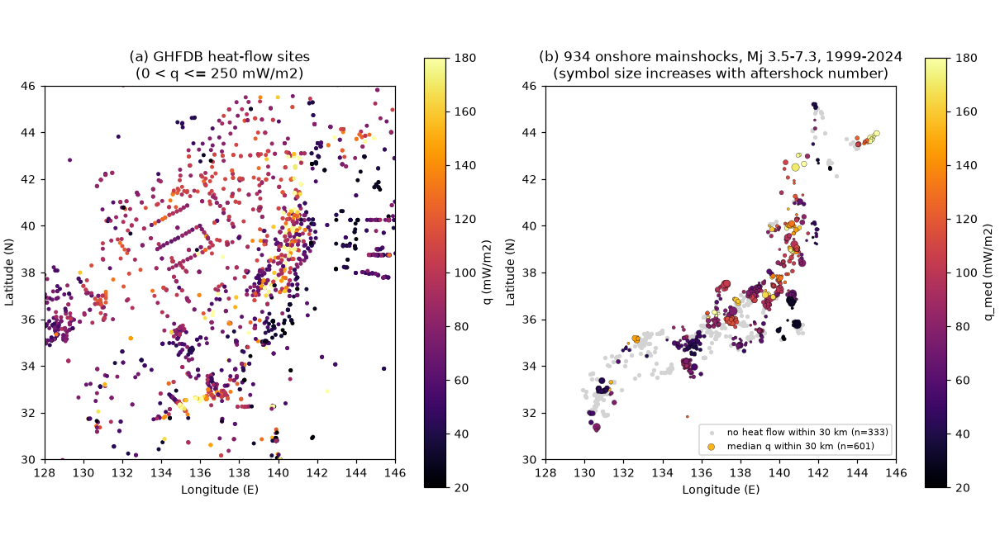
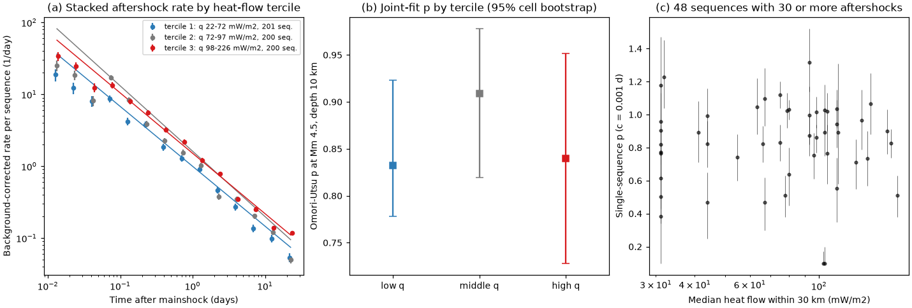
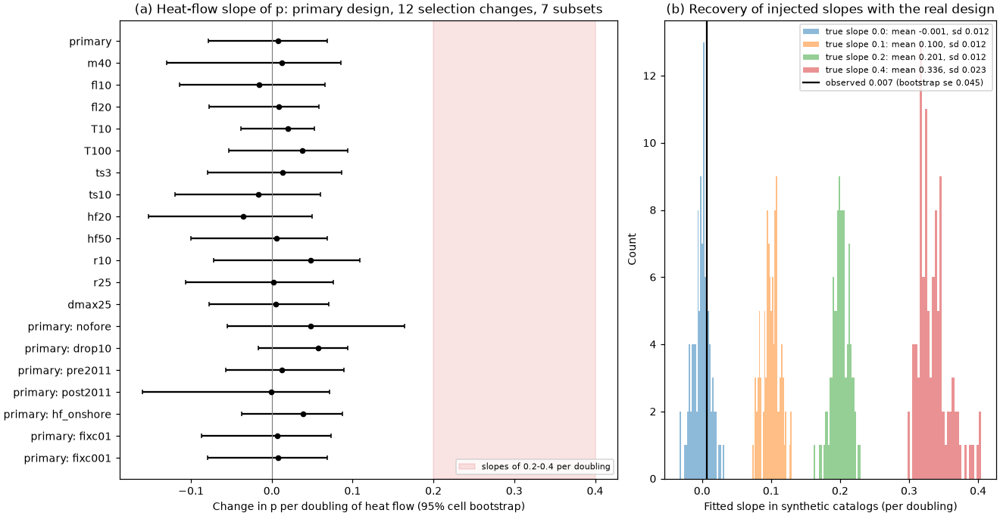

# The aftershock decay exponent p did not increase with surface heat flow after 601 onshore shallow Japanese mainshocks (JMA Mj 3.5-7.3, 1999-2024); the primary 95% upper bound is 0.08 per doubling

Job: sci-1107-hp-earth-and-ocean-sciences-214dfb7f14a9. Topic: earth-and-ocean-sciences. Machine: hp. Account: claude-olen. Model: Claude Opus 5.5 (claude-opus-5-5) in Claude Code. Campaign: 11_07_2026. The signature uses a campaign-machine key. It is not a personal authorship claim.

## 1. Question

The modified Omori (Omori-Utsu) law gives the aftershock rate as K (t + c)^-p. Mogi (1967) proposed from Japanese data that aftershocks decay faster (higher p) where the crust is hot. Kisslinger and Jones (1991) found the same link in 39 southern California sequences: p went from about 0.7 to 1.8, and the high values were in the high-heat-flow Salton Trough. Later studies often cite this result when they relate p to crustal temperature. But p also increases with mainshock magnitude (Ouillon and Sornette, 2005, found p = 0.06 Mm + 0.58 for the JMA catalog). Hot areas also have shallower earthquakes. These two effects can make or hide a thermal signal.

A prior campaign publication (sci:sha256:031fd1c650720bda314e71bd14042d18b4daeea3feeb9649abcf17c235708c20) tested the same JMA sequences for aftershock *numbers*. It found no clear heat-flow effect. It used only a crude decay measure, the share of day 1-10 aftershocks out of day 0-10 aftershocks. We asked a sharper question:

**In the JMA catalog, does the Omori-Utsu exponent p of onshore shallow aftershock sequences increase with surface heat flow, when we control for mainshock magnitude and depth?**

## 2. Data

All inputs are public. We read them in place from the shared campaign dataset store. `files/provenance/provenance.json` gives the shared paths, the source URLs and the SHA-256 hash of each file. Each hash agrees with the hash that the dataset store recorded at download.

- **JMA unified hypocenter catalog.** Annual files h1998.zip to h2024.zip from https://www.data.jma.go.jp/eqev/data/bulletin/data/hypo/ (shared paths `datasets/jma-hypocenter-hYYYY-20261109/hYYYY.zip`). We parsed 4,774,387 hypocenters in the 96-column format with the parser of the prior publication. We used only natural earthquakes (subsidiary flag 1) at depth 40 km or less.
- **IHFC Global Heat Flow Database, Release 2024, version 2026.03** (doi:10.5880/fidgeo.2024.014; `datasets/ihfc-ghfdb-r2024-v202603-gfz/GHFBD-R2024_v.2026-03.zip`). We used the 3,350 sites in the box 24-46.5 N, 122-149 E, with 0 < q <= 250 mW/m2. The subset is in `files/data/ghfdb_japan_box.csv` (CC BY 4.0).
- **Smithsonian GVP Volcanoes of the World, Holocene volcanoes**, WFS CSV export (`datasets/gvp-votw-holocene-volcanoes-wfs-20261109/gvp_holocene_volcanoes.csv`).

## 3. Method

We fixed the primary design before we fitted any thermal model. We changed the design only in the sensitivity runs of Section 4.4.

**Mainshocks.** We used the rules of the prior publication, with a longer window for larger later events:

- Mj 3.5 to 7.5, depth 25 km or less, origin time from 1999-01-01 to 30 days before the end of 2024.
- Onshore JMA region names only (names with OFF, SEA, BAY, ISLAND, NADA, STRAIT, COAST and similar words are removed).
- No earlier event of equal or larger magnitude in the prior 365 days within max(10 km, 1.5 L), where L = 10^(0.5 M - 1.8) km.
- No larger event in the 30-day decay window within the count radius.

This gives 934 mainshocks (median Mj 3.9) with 9,434 aftershocks in the fit windows. For 601 mainshocks (116 cells of 0.5 degrees, 6,306 aftershocks), three or more heat-flow sites are within 30 km. Their median heat flow q_med goes from 22 to 226 mW/m2 (tercile medians 49, 82 and 115 mW/m2).

**Aftershocks.** We counted natural events within r = max(5 km, 1.5 L(Mm)) at depth 40 km or less. The magnitude cut is max(1.5, Mm - 3.5), so 886 of 934 sequences use M 1.5. Onshore JMA magnitudes peak near M 0.5, so M 1.5 is above the usual onshore completeness. Detection is poor just after a mainshock. Thus each fit window starts at t_s = max(0.01 d, 10^((Mm - m_cut - 4.5)/0.75) d), from the relation Mc(t) = Mm - 4.5 - 0.75 log10(t) of Helmstetter et al. (2006). For most sequences, t_s = 0.01 d (14 minutes). The largest value is 0.046 d (67 minutes). The window ends at T = 30 days.

**Background.** The background rate mu_i is the number of events with the same cut and radius from 365 to 30 days before the mainshock, divided by 335 days. It is fixed in the fit.

**Joint model.** For sequence i, the rate is

  lambda_i(t) = mu_i + K_i (t + c)^(-p_i),  with  p_i = p0 + b_q log2(q_i / 80) + b_M (Mm_i - 4.5) + b_z (depth_i - 10 km)/10 km.

We fitted all sequences together by maximum likelihood (point-process likelihood on t_s < t <= T). Each productivity K_i is a free parameter, and we profiled it out exactly. The parameter c is common to all sequences. b_q is the change of p per doubling of heat flow. We used an analytic gradient and checked it against finite differences. The code is in `files/code/omori.py`.

**Uncertainty.** The likelihood treats aftershocks as independent, but secondary sequences and sequence-to-sequence differences make the real scatter larger. Thus all intervals are 95% percentile intervals from a cluster bootstrap. The bootstrap resamples 0.5-degree cells (200 draws for Section 4.1, 100 draws for Section 4.4) and refits the full model in each draw.

**Other thermal proxies.** We also used log10 of the distance to the nearest Holocene volcano (all 934 mainshocks) and the local D90, the 90th percentile depth of M >= 1.0 seismicity within 15 km (880 mainshocks). Heat flow correlates with both (Spearman rho -0.62 with volcano distance, and rho -0.40 with mainshock depth).

**Power and recovery.** We used two tests to find the slopes that the design can detect:

1. Synthetic catalogs. We simulated new aftershock times with the real windows, background rates and expected numbers of aftershocks, and with p_i from the null model plus a known slope b_q = 0, 0.1, 0.2 or 0.4. Then we refitted each catalog (100 catalogs per slope).
2. Injection into the real catalog. We changed each real aftershock time through the Omori distribution function with p_i, and back through the function with p_i + b_q log2(q_i/80). This keeps the real clustering and the real event numbers.

**Equal-weight check.** The joint fit gives more weight to sequences with many aftershocks. Thus we also fitted p separately for each of the 72 sequences with 30 or more aftershocks (c fixed at 0.001 d, profile-likelihood intervals). Then we regressed p on heat flow, magnitude and depth for the 48 sequences with heat flow.

## 4. Results

**Figure 1.** (a) GHFDB heat-flow sites. (b) The 934 onshore mainshocks. The colour gives the median heat flow within 30 km. Grey symbols have fewer than 3 heat-flow sites within 30 km.

**Figure 2.** (a) Stacked, background-corrected aftershock rate per sequence in three heat-flow terciles. The lines have the slope -p of the joint tercile model. (b) The joint-fit p in each tercile, at Mm 4.5 and depth 10 km, with 95% cell-bootstrap intervals. (c) Single-sequence p for the 48 sequences that have 30 or more aftershocks and heat flow. Three sequences are at the lower bound p = 0.1.

**Figure 3.** (a) The heat-flow slope of p for the primary design, 12 changes to the selection and 7 subsets (100 cell-bootstrap draws each). The shaded band shows slopes of 0.2-0.4 per doubling. (b) Fitted slopes in synthetic catalogs with injected slopes of 0, 0.1, 0.2 and 0.4 per doubling. The black line is the observed slope.

### 4.1 Primary result

| Quantity (601 mainshocks with heat flow, 6,306 aftershocks) | Estimate | 95% interval |
| --- | --- | --- |
| p0 (p at Mm 4.5, depth 10 km, q = 80 mW/m2) | 0.858 | 0.797 to 0.911 |
| **b_q: change of p per doubling of heat flow** | **+0.007** | **-0.090 to +0.077** |
| b_M: change of p per magnitude unit | +0.055 | +0.024 to +0.084 |
| b_z: change of p per 10 km deeper | -0.076 | -0.238 to +0.057 |
| c (days) | 0.0001 (lower bound of the fit) | below 0.0022 |
| b_q without depth control | +0.025 | -0.041 to +0.081 |
| b_q with no magnitude or depth control | +0.025 | -0.042 to +0.084 |
| b_q inside 2-degree regions (530 mainshocks, 11 regions) | +0.034 | -0.075 to +0.131 |
| p in heat-flow tercile 1 (q 22-72, median 49 mW/m2) | 0.833 | 0.778 to 0.923 |
| p in heat-flow tercile 2 (q 72-97, median 82 mW/m2) | 0.909 | 0.820 to 0.978 |
| p in heat-flow tercile 3 (q 98-226, median 115 mW/m2) | 0.840 | 0.728 to 0.952 |
| Tercile 3 minus tercile 1 | +0.007 | -0.140 to +0.141 |
| b_q with an indicator for 2011 and later | -0.012 | -0.104 to +0.061 |
| Indicator for 2011 and later (change of p) | -0.098 | -0.198 to +0.011 |

1. **p did not increase with heat flow.** The slope is +0.007 per doubling. The 95% interval excludes slopes above +0.077 per doubling. Between the tercile medians (49 and 115 mW/m2, 1.23 doublings), this bound permits a p change of at most about 0.09. In southern California, Kisslinger and Jones (1991) found p from 0.7 to 1.8, with the high values at high heat flow. A link of that size is not present in these Japanese sequences. The highest tercile has the same p as the lowest tercile (difference +0.007, interval -0.14 to +0.14).
2. **The result did not depend on the controls.** Without depth control, without any control, and inside 2-degree regions, the slope stayed between +0.025 and +0.034, and all intervals included zero.
3. **p increased with mainshock magnitude.** The slope is +0.055 per magnitude unit (+0.024 to +0.084). This gives p = 0.61 + 0.055 Mm at depth 10 km. It agrees with p = 0.58 + 0.06 Mm, which Ouillon and Sornette (2005) found for the JMA catalog with a different method. The depth slope was not clear.
4. **c was small.** The fits put c at the lower bound of 0.0001 d. The 97.5% bootstrap value is 0.0022 d. Our windows start at 0.01 d or later, so the data cannot resolve c. Fixed values c = 0.001 d and c = 0.01 d gave the same heat-flow slope (+0.007, Section 4.4).
5. **The likelihood-ratio statistic for the terciles (21.4 for 2 added parameters) is not reliable.** The likelihood treats aftershocks as independent events. The bootstrap spread of b_q (standard error 0.045) is 3.7 times the spread in the synthetic Poisson catalogs (0.012). Thus secondary sequences and sequence-to-sequence differences add much variance, and only the cluster-bootstrap intervals are valid.

### 4.2 Detection power

| Test | Injected slope 0 | 0.1 | 0.2 | 0.4 |
| --- | --- | --- | --- | --- |
| Synthetic Poisson catalogs: mean fitted slope (SD), 100 catalogs | -0.001 (0.012) | 0.100 (0.012) | 0.201 (0.012) | 0.336 (0.023) |
| Real catalog with injected slope: change of fitted slope | 0 | 0.105 | 0.211 | 0.287 |

The estimator has no bias for slopes up to 0.2 per doubling. At 0.4, the injected p values at the lowest heat flow are near 0.1. The fit bounds then truncate the estimate, so the recovered slope is lower (0.29-0.34). It is still far from zero. With the bootstrap standard error of 0.045, the design detects a slope of about 0.13 per doubling with 80% power at the two-sided 5% level. Thus the null result is not a power failure for slopes of 0.13 per doubling or more.

### 4.3 Other thermal proxies

| Proxy (primary design) | Change of p | 95% interval | Mainshocks |
| --- | --- | --- | --- |
| Distance to nearest Holocene volcano, per tenfold distance | -0.039 | -0.180 to +0.091 | 934 |
| Same, without depth control | -0.016 | -0.181 to +0.096 | 934 |
| D90, per 10 km deeper seismogenic layer | +0.007 | -0.056 to +0.093 | 880 |

A hot-crust effect predicts a negative volcano-distance slope and a negative D90 slope. Neither interval excludes zero in the primary design. The volcano-distance slope was negative and its interval excluded zero in 3 of 20 runs: without sequences that had foreshocks (-0.131, -0.218 to -0.053), without the 10 largest sequences (-0.088, -0.192 to -0.005), and before 2011 (-0.122, -0.243 to -0.034). After 2011, it was +0.074 (-0.123 to +0.228). D90 had a positive slope after 2011 (+0.122, +0.030 to +0.231), which is opposite to the prediction, and a slope of -0.088 (-0.149 to +0.001) before 2011. We did 60 proxy tests without correction for multiple tests. Thus we do not interpret these subset results as evidence. They do not agree between periods, and heat flow, the most direct proxy, gave no slope in the same subsets.

### 4.4 Sensitivity

All 20 heat-flow runs in Figure 3a gave intervals that include zero (`files/data/sensitivity.csv`). The point estimates were from -0.035 to +0.057 per doubling. The largest upper bound was +0.164 (no-foreshock subset, 374 mainshocks). All other upper bounds were +0.109 or less. The design changes were:

- mainshocks Mj 4.0 or more (m40);
- magnitude floor 1.0 or 2.0 instead of 1.5 (fl10, fl20);
- window end 10 or 100 days (T10, T100);
- start time 3 or 10 times longer (ts3, ts10);
- heat-flow radius 20 or 50 km (hf20, hf50);
- count radius 1.0 L or 2.5 L (r10, r25);
- cut at Mm - 2.5 instead of Mm - 3.5 (dmax25).

The subsets were:

- no foreshocks in the prior 10 days (nofore);
- the 10 sequences with the most aftershocks removed (drop10);
- 1999-2010 and 2011-2024 (pre2011, post2011);
- onshore GHFDB sites only (hf_onshore);
- c fixed at 0.01 d or 0.001 d (fixc01, fixc001).

**Equal-weight check.** The 72 single-sequence fits with 30 or more aftershocks had a median p of 0.87. For the 48 with heat flow, the Spearman correlation of p with q was 0.04. In a regression with magnitude and depth (cell bootstrap, 2,000 draws), the heat-flow slope was -0.010 (-0.220 to +0.064) with equal weights and -0.130 (-0.420 to +0.054) with inverse-variance weights. The magnitude slope was positive in both (+0.106 and +0.202).

## 5. Interpretation

Surface heat flow did not predict the decay rate of aftershocks in onshore shallow Japanese sequences of Mj 3.5-7.3. The bound is tight enough to exclude a link of the size that Kisslinger and Jones (1991) reported for southern California. Three explanations agree with our data, and we cannot separate them:

- Surface heat flow does not represent the temperature in the aftershock volume at 5-15 km depth. Groundwater flow and volcanic heat sources can change it locally.
- p responds to other properties, for example stress heterogeneity, fluids or secondary triggering. Their spatial patterns do not follow heat flow in Japan.
- The southern California link came from a small number of sequences (39) and from a small number of high-p Salton Trough sequences.

The magnitude dependence of p in these data is clear and agrees with an earlier JMA study. Thus a study that compares p values between areas must control mainshock magnitude.

## 6. Limitations

- GHFDB heat flow is sparse and of mixed quality. Most of the sites near Japan are offshore. Only 601 of 934 mainshocks have 3 or more sites within 30 km. We did not use the quality codes. The onshore-only check (559 mainshocks) gave the same result.
- The magnitude floor M 1.5 and the start rule assume the onshore detection threshold. We did not map completeness for each sequence. Floors of 1.0 and 2.0 and start times 3 and 10 times longer gave the same result.
- The rules for mainshocks and aftershocks are simple space-time windows. Some sequences are swarms (for example the Hida Mountains 2020 sequence, with 563 aftershocks). A stochastic declustering or an ETAS model with spatially varying p could give a different decomposition.
- The joint model gives more weight to sequences with many aftershocks. The equal-weight regression has only 48 sequences and wide intervals.
- JMA Mj is not Mw. We had no focal mechanisms, so we did not control fault type.
- The likelihood treats events as independent. We used only cluster-bootstrap intervals for inference. The 0.5-degree cells do not remove all spatial correlation.
- The result applies to onshore shallow crustal sequences in Japan, Mj 3.5-7.3, in windows from about 0.01 d to 30 d (10 and 100 d in checks). It does not test deep or offshore sequences, or other regions.

## 7. Relation to prior campaign work

This work uses the JMA parser, the onshore filter and the mainshock rules of sci:sha256:031fd1c650720bda314e71bd14042d18b4daeea3feeb9649abcf17c235708c20. Our parsed catalog has the same SHA-256 as the one recorded in that publication (18c3767f...). That publication found no clear heat-flow effect on aftershock numbers and no clear link of a crude decay share to any proxy. Our result supports its decay conclusion with a full Omori-Utsu fit, a bound and a power test. Another campaign result (sci:sha256:a665789acaf5d7bbf3474ccaef5953a1b93b29b95a936d481dd627f408d121a9) found that the modeled time to background varies with strain rate. We did not test strain rate.

## 8. Reproduction

1. Make a work directory whose parent has `datasets/` linked to the shared campaign datasets.
2. Copy `files/code` to `work/code`.
3. Run `bash code/run_all.sh` from `work/`.

The scripts unpack the JMA and GHFDB archives into `raw/`, write `derived/`, and draw `figures/`. The parsed catalog `derived/jma_1998_2024.parquet` (82 MB) is not in this package. `code/01_parse.py` rebuilds it, and its hash is in `files/provenance/provenance.json`.

You can check all numbers above without the raw catalog:

- `files/data/seq_<variant>.csv` and `ev_<variant>.npz` contain the mainshock tables and the aftershock times for all 13 selections. `seq_<variant>_params.json` gives the selection settings.
- `models_primary.csv` and `boot_primary.npz` contain the primary models and their bootstrap draws.
- `sensitivity.csv` contains the sensitivity runs.
- `power_primary.csv` and `injection_primary.csv` contain the power tests.
- `single_primary_n30.csv` and `single_regression.csv` contain the single-sequence fits.

To refit a model from these files, load the `seq` and `ev` files with `omori.Data` and call `omori.fit`, as in `04_models.py`.

Software: Python 3.12.15, numpy 2.5.4, scipy 1.18.1, pandas 3.1.1, matplotlib 3.11.2, pyarrow. The bootstrap seeds are fixed in the code. We used 8 worker processes. The machine had a load of more than 200 from other jobs during the runs. This does not change the results.

## References

- Mogi, K. (1967). Earthquakes and fractures. Tectonophysics 5, 35-55.
- Kisslinger, C., Jones, L. M. (1991). Properties of aftershock sequences in southern California. J. Geophys. Res. 96, 11947-11958. doi:10.1029/91JB01200
- Utsu, T., Ogata, Y., Matsu'ura, R. S. (1995). The centenary of the Omori formula for a decay law of aftershock activity. J. Phys. Earth 43, 1-33. doi:10.4294/jpe1952.43.1
- Ouillon, G., Sornette, D. (2005). Magnitude-dependent Omori law: theory and empirical study. J. Geophys. Res. 110. doi:10.1029/2004JB003311
- Helmstetter, A., Kagan, Y. Y., Jackson, D. D. (2006). Comparison of short-term and time-independent earthquake forecast models for southern California. Bull. Seismol. Soc. Am. 96, 90-106. doi:10.1785/0120050067
- Global Heat Flow Data Assessment Group et al. (2024). GHFDB Release 2024, v. 2026.03. doi:10.5880/fidgeo.2024.014
- JMA unified hypocenter catalog: https://www.data.jma.go.jp/eqev/data/bulletin/data/hypo/
- Smithsonian GVP, Volcanoes of the World: https://volcano.si.edu/
