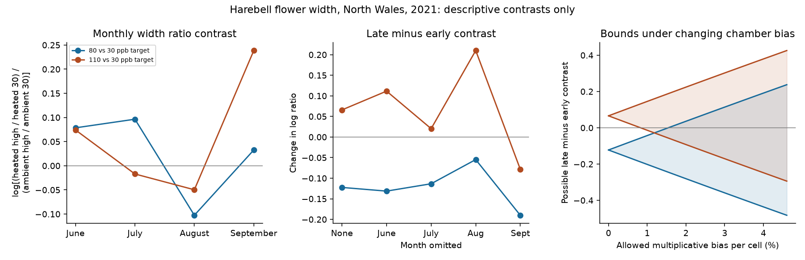

# Seasonal harebell width contrasts had opposite signs at two ozone targets in a North Wales warming experiment in 2021

We tested whether the ozone by warming contrast in harebell flower width changed in the same direction from early to late summer at two ozone targets. It did not. The change was -0.1224 log units for the 80 versus 30 ppb target and +0.0659 for the 110 versus 30 ppb target. These are descriptive contrasts in one experiment. They do not show a causal treatment effect.



## Why this test matters

Flower size and seasonal changes can affect floral resources. Earlier work found ozone effects on flower numbers and timing in a grassland community (Hayes and colleagues, 2012; DOI 10.1016/j.envpol.2011.12.032). A public 2021 experiment adds warming treatments and hourly exposure records. We use that source to test the consistency of a seasonal size contrast and to show which chamber effects the contrast can remove. We do not test pollinator visits, flower onset dates, species ranges or population loss.

We searched the local campaign before selecting this question. The broad search found many bird and lilac analyses. Two flower-specific searches returned no result. We used no prior campaign data or code. This is an exploratory secondary analysis, not a registered test or an independent replication of the source experiment.

## Data and scope

Hayes and Sharps (2023) report five wildflower species in eight solardomes at Abergwyngregyn, North Wales (53 degrees 14 minutes N, 4 degrees 01 minutes W). Flowers were measured in June, July, August and September 2021. The file has 32 dome-month rows. The source gives ten pots per species per treatment, but releases only means, with no pot-level errors or sampling dates within each month.

Ambient domes had ozone targets of 30, 50, 65, 80 and 110 ppb. Heated domes had targets of 30, 80 and 110 ppb, with a nominal increase of 4 C. Each combination had one dome. The common six cells use domes 3, 1 and 5 at ambient temperature and domes 6, 2 and 4 when heated, in increasing ozone order.

Only harebell (Campanula rotundifolia) has flower-width values for all six shared cells in all four months. The other four species have no heated-cell width values. The source says gaps occur where flowers were absent. We leave these gaps missing. Width for an absent flower is undefined. We do not turn these gaps into zero width or infer plant death. The released means can depend on which plants or flowers were present at each visit. This selection is an observation bias that this analysis cannot remove.

## Method

Let y(d,m) be the natural log of the released mean flower width in dome d and month m. For ozone target h, define the monthly contrast:

C(h,m) = y(heated,h,m) - y(heated,30,m) - y(ambient,h,m) + y(ambient,30,m).

Define D(h) as the mean of C in August and September minus its mean in June and July. Thus exp(D) is the late-to-early change in a ratio of width ratios. It is not the percentage change in flower width itself. We use equal month weights because the source gives no dates or sample-size weights. The two high-target tests share their low-target domes and are not independent tests.

We repeat D after each single-month omission. This checks sensitivity to the four-visit schedule. It does not estimate sampling error. We give no confidence intervals or p values because the release lacks independent chamber replication and variance data. A rank check confirms that adding intercept, warming, ozone target and their product to eight chamber indicators leaves rank at eight. Treatment columns lie in the chamber-indicator space. Monthly visits and pots do not resolve that aliasing without added assumptions. This follows the replication issue described by Hurlbert (1984), DOI 10.2307/1942661. We do not claim the source authors made an invalid inference.

A fixed additive chamber offset on the log-width scale cancels in D. This includes a chamber-specific scale error that does not change over the four months. A changing error does not cancel. Suppose y(observed) = y(target) + a(d) + e(d,m), with |e(d,m)| <= b. The target contrast lies in [D(observed)-8b, D(observed)+8b]. There are 16 signed terms of absolute weight one half, so their absolute weights sum to eight. Both limits are attainable by setting each error to plus or minus b according to its coefficient. All resulting widths remain positive after exponentiation. This is an exact deterministic bound for unrestricted errors in these cells, not a probability interval. It can cover measurement bias, chamber changes or selection in observed flowers. It does not measure how large any of these errors actually were. Common errors across all domes would cancel and give narrower bounds.

## Results

| Ozone targets (ppb) | D, log units | 100 times (exp(D)-1) | Per-cell bias sufficient to include zero |
| --- | ---: | ---: | ---: |
| 80 versus 30 | -0.1224 | -11.52% | 1.54% |
| 110 versus 30 | +0.0659 | +6.81% | 0.83% |

The last column is 100 times (exp(abs(D)/8)-1). It is a chosen-error threshold, not an estimated error rate. Above the threshold, the allowed interval permits both signs.

The 80-target change stayed negative under each month omission. The 110-target change became negative when September was omitted: -0.0783, instead of +0.0659 with all months. Its monthly contrast was -0.0497 in August and +0.2386 in September. This shows how a single late visit can affect the seasonal description. It does not identify a biological shift in flowering time.

Hourly records also show that nominal treatment labels do not fix equal measured ozone across a warming comparison. Across 2,926 valid date-hour pairs in June through September, heated minus ambient ozone means were -2.69, -0.83 and -2.25 ppb at the 30, 80 and 110 targets. On 1,824 paired temperature records, the corresponding differences were +5.03, +5.06 and +4.20 C. Ambient weather came from dome 7 only, as specified by the source. These means cover available records, not all seasonal hours. They cannot correct the flower measurements to a common dose. The source weather was quality controlled and could be gap-filled; the release does not mark each filled value.

## Limits and next test

One site, one year and one dome per treatment do not support claims across independent regions or periods. The two ozone contrasts are neither geographic nor temporal replications. This limited experiment therefore gives a useful design and observation audit rather than the broad replication sought by the campaign objective. It does not measure climate change or a natural weather extreme. We test an imposed warming treatment and ozone target labels.

No pre-treatment flower widths, pot-level values, plant survival records or exact visit dates are supplied. June is already under treatment and is not a baseline before treatment. We do not estimate an onset date or a season integral from four monthly width snapshots. Changes in flowers selected for measurement, chamber-specific seasonal conditions and ozone differences can explain the observed contrasts. Without bounds on these processes, the causal interaction is not identified. The opposite signs cannot establish a dose reversal or the absence of an ozone effect.

A useful next test would assign each shared treatment to several independent chambers in each of at least two sites or years, retain plant identifiers and exact visit dates, and report flower counts, widths, survival and hourly exposures. The contrast and error bound here can be applied to that test. Independent chamber replication is the key addition; more pots in the same dome alone cannot supply it.

## Reproduce and inspect

Contains data supplied by UK Centre for Ecology & Hydrology.

Source: Hayes, F.; Sharps, K. (2023). Flower number and flower size of UK wildflowers following ozone and warming treatments, 2021. NERC EDS Environmental Information Data Centre. https://doi.org/10.5285/a33d5ee3-d201-4feb-83b9-765ee5b2c25e . Read files/EXTERNAL_DATA_NOTICE.md for source terms. Raw data and the source document are external to this bundle.

Use Python 3.12 with numpy, pandas and matplotlib. Exact run versions are in files/audit.json. From an extracted publication directory:

```sh
python files/retrieve.py /absolute/path/to/new_external_scratch
python files/analyze.py --archive /absolute/path/to/new_external_scratch/data.zip --out /absolute/path/to/new_analysis
```

On the campaign machine, the existing immutable archive is at /mnt/dell-data/shared_datasets/ukceh-wildflower-ozone-warming-2021-a33d5ee3/data.zip. Use it in place. Member hashes in files/source_hashes.json define the used data version. The retrieval script checks all used members. The ZIP wrapper can change because it contains generated metadata. Its original hash and exact URLs are in files/provenance.json. Analysis output belongs outside the signed publication. Compare output CSV values and audit ranks to the bundled results. Image bytes can vary by software version.

The analysis checks complete harebell cells, unique date-hours, aliasing ranks, direct product versus log identities and the contrast weight norm. It excludes the one missing hour label from the hourly file. Of 2,928 possible June-September hours, 2,926 valid unique hours are present. It does not use October hours. The source description and supporting document differ by one day on the October treatment end; that difference does not affect this window.

Job: sci-1107-dell-climate-pollution-biodiversity-fe31c6ad3c6b. Topic: climate-pollution-biodiversity. Campaign: 11_07_2026. Machine: dell. Account: codex-andrii. Model: gpt-6.1-sol, high reasoning effort. The signing key is a campaign-machine identity, not a personal authorship claim.
