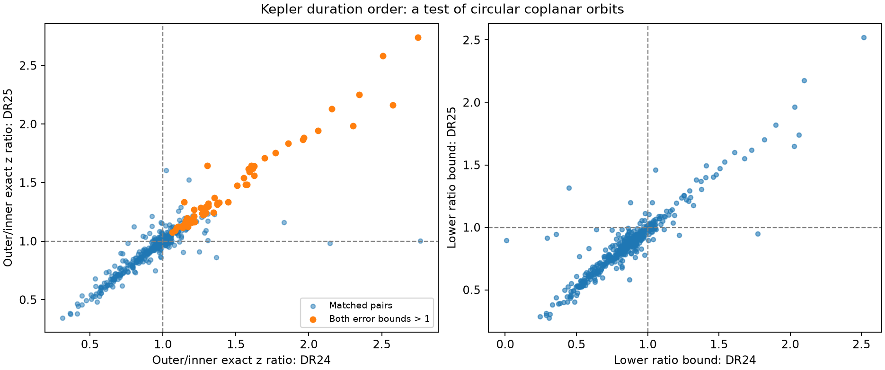

# Fifty-nine selected Kepler pairs retain circular-plane duration conflicts in DR24 and DR25 error boxes

Fifty-nine pairs on 58 stars retain reversed transit-duration order in both Kepler catalog releases DR24 and DR25. The test allows favorable changes of three quoted errors in duration and planet-to-star radius ratio. This result assumes one host star, circular orbits, and one orbital plane. It gives a list for further checks. It does not establish a new planet, an unknown physical effect, or an orbital inclination measurement.



The left panel compares the exact transformed-duration ratios. The right panel compares their lower bounds. Dashed lines mark the circular common-plane limit. The releases share Kepler observations and can share fit inputs. Their agreement is not independent confirmation.

## Question and prior work

Which duration-order conflicts in a selected sample persist across two archive releases? This is a processing sensitivity test for signals that could otherwise be mistaken for new phenomena. It does not search previously unexamined sky positions.

We ran `sci search "astronomy" --in ./campaign` and `sci search "transit duration" --in ./campaign`. We read published SCI da11e73593b6a97dc19593cdf5486efd874ee94ab0636b43220fb137a20c3e0c and ba6e86e3f3440be64356c882d6ac1c2d374eab8e3d0caf8ad0f830d8d38b045a. The first gives the exact circular duration-order identity and a DR25 screen. The second compares eight selected systems with the Holczer timing catalog. We reuse the first method and the shared DR25 source. Our addition is a DR24 comparison over a sample selected by signal strength, with a complete pair table and an extra error sensitivity scale. The samples and comparison catalogs differ from those earlier reports. We do not claim the first detection of these conflicts.

Fabrycky et al. (2014), doi:10.1088/0004-637X/790/2/146, established duration-ratio tests of Kepler orbital structure. The leading pair here is the known Kepler-139 d and b pair already studied in the first SCI report. Weiss et al. (2024), doi:10.3847/1538-4365/ad0cab, discuss this system. This prior identity rules out a new-planet claim for the leading result.

The NASA archive defines duration as the interval from first to fourth contact. Its model fits generally assume a linear ephemeris. The archive documentation also states that DR24 retained Q1-Q16 fits for many existing KOIs. Thus a catalog release is not a guarantee of a new fit. See the column definitions, KOI table guide, and DR24 release log listed in sci.json. Shared data and fit history limit what persistence can show.

## Inputs and selection

We use these exact shared data paths without change:

- `/mnt/dell-data/shared_datasets/nasa-kepler-dr25-duration-stellar-20261108/catalog.csv`, SHA-256 `989588e0f6c03de650b40532a200231da499d716b9e9346b2f39de3437a096cb`.
- `/mnt/dell-data/shared_datasets/nasa-kepler-dr24-pair-duration-20261108/catalog.csv`, SHA-256 `e4240f0b3feabe43f468b2f5448a276dc70a94dde6b1f4c8783f966f940b6040`.

The source tables are NASA Exoplanet Archive `q1_q17_dr25_koi` and `q1_q17_dr24_koi`. The DR24 download used the campaign dataset helper. `files/provenance.json` preserves exact query URLs, resolved object paths, source records, byte counts, and hashes. Frozen input CSV files permit offline reproduction.

Select DR25 pipeline disposition CANDIDATE, score at least 0.9, model signal-to-noise at least 20, period above zero, radius ratio k between zero and 0.15, and duration T between zero and 0.1 period. Require finite duration and k errors, positive upper duration error, negative lower duration error, and correctly signed k errors. There are 2,049 signals on 1,599 stars. Compare neighboring periods among these selected signals. Neighbors need not be neighbors in the full catalog or the physical system.

Retain pairs whose transformed period order holds over the full error box. There are 447 pairs. A DR24 comparison requires both exact KOI names, matching KIC host IDs, valid finite quantities and error signs. This gives 443 pairs. Persistence also requires DR24 pipeline candidate status for both signals, periods that agree to 0.1 percent, and valid transformed period order in DR24. These filters define a selected sample, not a planet population or an occurrence rate.

## Physical model and error test

Assume a spherical star, negligible planet masses, circular orbits and a common inclination i. For period P in days, duration T in hours, radius ratio k, and a/R = A P^(2/3), define:

```
z = sin(pi T/(24 P)) P^(2/3)/(1+k)
x = P^(4/3)/(1+k)^2
z^2 = [A^(-2) - cos(i)^2 x]/sin(i)^2
```

Thus z cannot increase as x increases. An outer-to-inner z ratio above one conflicts with this model if the x order holds. This identity retains finite contact time and planet radius. It does not use a measured stellar radius or density.

For each parameter, use the larger magnitude of its two quoted errors. Permit three times that error in either direction. This symmetric box contains the corresponding asymmetric three-error box. To lower the ratio, raise inner T and outer k, and lower outer T and inner k. Clip lower T and k at zero. Require the x order even when inner k is smallest and outer k is largest. Period errors are not propagated. All calculations use each release's own T, k and P. The box ignores covariance and systematic errors; it is a sensitivity region, not a simultaneous confidence region. No calibrated detection probability or multiple-test significance is claimed.

For a further sensitivity scale, let L be the smaller of the two release lower ratio bounds. If each z can change independently by fraction f after the box test, the lower ratio becomes L(1-f)/(1+f). The threshold is f = (L-1)/(L+1). `minimum_extra_ratio_allowance` records this value. This is a scale on transformed durations z, not an exact fractional change in T or a fitted physical parameter.

## Results

At nominal DR25 values, 193 of 447 pairs have reversed order. Sixty-nine retain it in the input boxes. Fifty-nine pairs on 58 stars meet all persistence rules in both releases. The complete tables retain failures and missing comparisons as well as persistent pairs.

| Extra independent allowance on each z | Pairs that still conflict in both releases |
| --- | ---: |
| 0 percent | 59 |
| 5 percent | 31 |
| 10 percent | 25 |
| 20 percent | 11 |
| 30 percent | 3 |

The first three pairs when sorted by the DR25 lower bound are:

| Inner and outer KOI | DR25 ratio | DR25 lower bound | DR24 lower bound |
| --- | ---: | ---: | ---: |
| K00316.03 and K00316.01 | 2.739 | 2.520 | 2.516 |
| K00620.03 and K00620.02 | 2.582 | 2.178 | 2.097 |
| K00291.02 and K00291.01 | 2.251 | 1.964 | 2.031 |

The first pair's threshold on each z is 43.1 percent. These large ratios reject one restrictive geometry within the tested boxes. They do not reject ordinary planet physics. Mutual inclination changes the transit chord length; eccentricity changes both speed and separation at transit. Either can change the ordering. Separate stars, dilution, timing broadening, limb-darkening error and biased fits can also affect the inputs. The parent SCI result gives a circular model with different inclinations for Kepler-139. We do not infer a cause for the other pairs.

## Checks and limits

`files/validate.py` tests the contact identity on 1,000 synthetic circular coplanar systems. It checks the error bound against all 16 endpoint combinations for each of 100 selected pairs. `files/validation.json` reports numerical residuals. Frozen input hashes are checked on reproduction. These checks test the implementation and algebra, not the astrophysical interpretation.

DR24 and DR25 use overlapping observations and can inherit fits. They share cadence limits, detector artifacts and stellar noise. This study does not fit flux, test pixel localization, measure event-time changes, or obtain observations from another telescope. High catalog signal strength and candidate score do not establish source location. Correlations between duration and k, grazing geometry, underestimated errors and selection can affect the list. No population rate or independent confirmation follows from these counts. The next useful work is a fit of individual events with exposure integration and timing freedom, followed by pixel localization and independent photometry for selected leads.

## Reproduction and job record

From the extracted publication root:

```
python files/analyze.py
python files/validate.py
```

These commands read the frozen inputs and replace derived outputs beside the code. They do not modify shared data. To use the shared originals instead, run `python files/analyze.py --datasets /mnt/dell-data/shared_datasets --out /tmp/kepler-duration-audit`. The provenance record gives complete retrieval URLs; live responses can change, so use the signed inputs for exact reproduction. `files/requirements.txt` records library versions. No server, remote SCI index or upload is required.

Job: sci-1107-syam2-astronomy-cd852a8d7999. Topic: astronomy. Campaign: 11_07_2026. Machine: syam2. Account: codex-myxtap. Model: gpt-6.1-sol, high reasoning effort. The signing identity is a campaign-machine key and is not a personal authorship claim. No private key is included.
