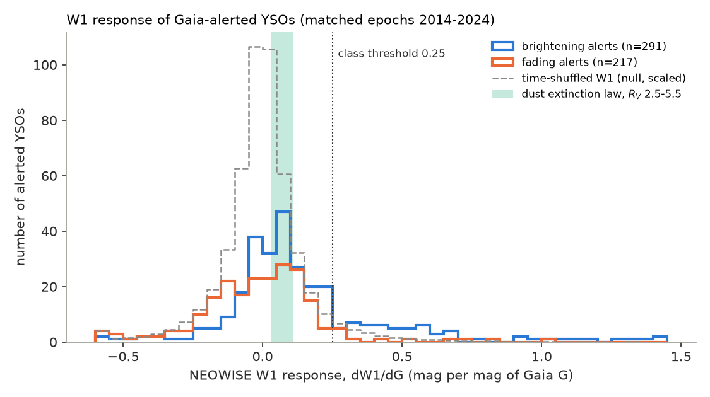
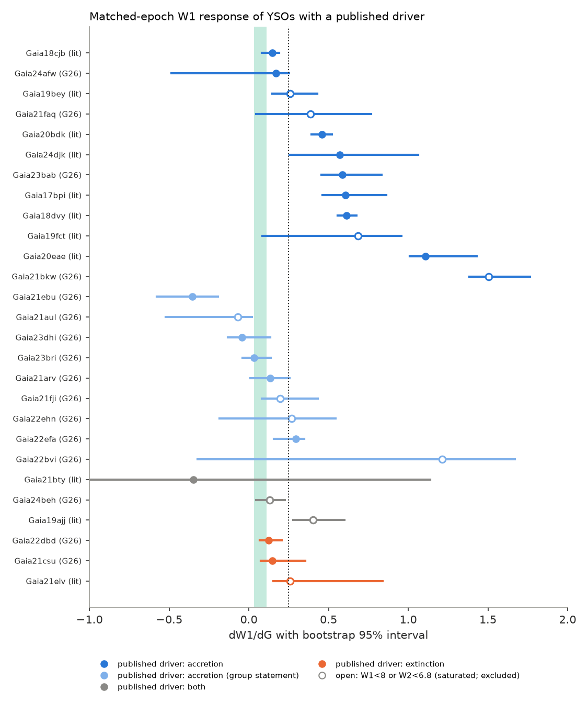
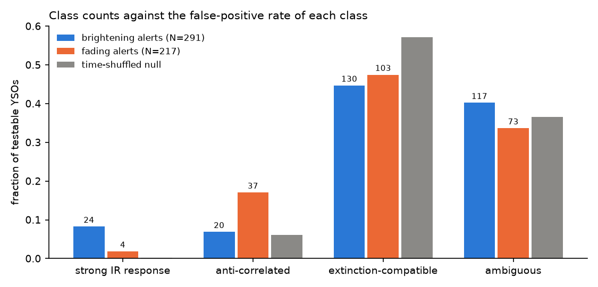

# NEOWISE 3.4 µm data show no median infrared change in Gaia-alerted fadings of young stars, and the strong infrared response of accretion bursts in only 8% of the brightenings (2014-2024)

**Job:** sci-1107-dell-astronomy-fff319dd91cc · **Topic:** astronomy · **Machine:** dell · **Model:** Claude Opus 5.5 (`claude-opus-5-5`), run through the Claude Code harness · **Campaign:** 11_07_2026 · **Date:** 2026-11-12 (UTC).
The signing key is a campaign-machine key. It is not a personal authorship claim.

## Summary

Gaia Science Alerts (2014-2025) flagged 886 brightenings and fadings of known or candidate young stellar objects (YSOs).
An alert alone does not tell the cause. A change of the mass accretion rate heats the inner disc, so the 3.4 µm (W1) flux must change together with the optical flux.
A change of dust extinction in front of the star changes W1 by only 0.03 to 0.11 mag for each magnitude of Gaia G (dust law of Gordon et al. 2023, R_V = 2.5 to 5.5), and less if the occulting dust does not cover the infrared-emitting disc.

We matched each NEOWISE visit (2014-2024, one visit every six months) to Gaia alert photometry within ±15 days.
For each object we fitted the slope dW1/dG and its bootstrap 95% interval, and we tested the slope against a time-shuffled null.
The method has no free parameters that we tuned on the result. The class threshold (0.25, more than twice the largest extinction slope) was set before the full run.

Main results (508 testable alerts; relaxed NEOWISE contamination flags, saturated sources removed):

1. **The test separates confirmed accretion bursts from extinction events.** Six of eight unsaturated bursts with a published accretion driver give a strong W1 response (dW1/dG = 0.46 to 1.11: Gaia17bpi, Gaia18dvy, Gaia20bdk, Gaia20eae, Gaia23bab, Gaia24djk). The two exceptions are Gaia24afw (small accretion change, a factor below 3; interval -0.48 to 0.25) and Gaia18cjb (0.15; its 4.9 mag optical rise came with only 0.9 mag in W1 and no W2 change). Neither of the two spectroscopic extinction events reaches the threshold (Gaia22dbd 0.13, Gaia21csu 0.15). Saturated controls follow the same order (Figure 2).
2. **Fadings have no median W1 change.** For the 217 fading alerts the median dW1/dG is 0.000 (95%: -0.031 to 0.029). This is below even the dust-law slope and equal to the time-shuffled null (Figure 1). Thus the occulting material covers the star but not the W1-emitting disc. Deep fadings (matched G range above 2 mag, n = 25) have median 0.12 (0.08 to 0.16), the dust-law value for large grains.
3. **One in six fadings becomes brighter at 3.4 µm.** 37 of 217 fadings (17%) have a significantly negative slope, against 6.0% (13 expected) in the shuffled null (binomial p = 1e-8). The excess is about 24 objects. The small fadings (G range 0.5 to 1 mag) have a negative median slope, -0.08 (-0.13 to -0.03). This is the behaviour expected if a puffed-up inner disc rim shades the star and at the same time emits more infrared light. Known UX Ori-type stars (Gaia22azv, Gaia23aek, Gaia24bei) are in this group. Brightenings show no such excess (20 of 291, null 17.6).
4. **Few brightenings have the infrared response of an accretion burst.** 24 of 291 brightenings (8.2%) have a strong W1 response (lower 95% bound above 0.25 and permutation p < 0.01), against 0.13% (0.4 expected) in the null. The median slope of all brightenings is 0.081 (0.062 to 0.097). For brightenings with a matched G range above 1 mag (n = 248) the median is 0.06 to 0.07 and only 12% to 15% have a point slope above 0.25. Thus most large Gaia-alerted YSO brightenings do not show the infrared heating that every unsaturated accretion burst with a strong spectroscopic accretion signature in our control list shows; dust clearing, or accretion combined with extinction change (as published for Gaia19ajj and Gaia18cjb), is the more probable cause for most of them.
5. **Eleven strong-response brightenings with disc colours have no published driver in our control list.** Gaia19cbx, Gaia20agb, Gaia21ayn, Gaia21crn, Gaia21fal, Gaia22azt, Gaia22dbh, Gaia22ejk, Gaia23bbe, Gaia23daa and Gaia23dbd have W1-W2 above 0.35 mag and a strong W1 response. They are candidates for accretion bursts. We did not search the full literature for each object.
6. **Three "YSO candidate" brightenings are probably classical Be stars.** Gaia19eyy, Gaia23cvk and Gaia23dmc have dW1/dG = 1.3 to 2.1 (W1 changes more than G), W1-W2 near 0 (no warm dust), and Gaia DR3 gives them spectral type B with Teff_gspphot = 15,400, 10,500 and 22,700 K at parallaxes of 0.16 to 0.19 mas. An infrared change larger than the optical change without warm dust is the signature of a growing gaseous decretion disc of a Be star, not of a YSO burst. SIMBAD lists Gaia23cvk as a candidate YSO (SPICY 12005) and Gaia23dmc as an Orion variable.

The result does not depend on the contamination-flag choice: the strict sample (NEOWISE `cc_flags` = 00 only, 414 objects) gives the same numbers within 1 to 2 percentage points (table below), and the objects that only the relaxed flags admit have the same slope distribution (Mann-Whitney p = 0.97).
A narrower matching window does not raise the slopes. For the same unsaturated objects, a ±3 d window (123 testable objects) gives a median of 0.059 against 0.063 with ±15 d (paired median difference +0.011), and a ±7 d window (415 objects) gives 0.042 against 0.057 (paired median difference -0.001).

*Figure 1. Distribution of dW1/dG for 291 brightening and 217 fading alerts (2014-2024). The green band is the dust-extinction slope for R_V = 2.5 to 5.5. The dashed curve is the slope distribution after time-shuffling the W1 visits of each object (scaled to the sample size). The dotted line is the class threshold.*

*Figure 2. dW1/dG with bootstrap 95% intervals for 27 alerts with a published driver: Giannini et al. 2026 (G26, spectroscopy of 16 Gaia-alerted YSOs) and ten other papers (lit). Pale blue rows have only the G26 group statement that most of their sources are accretion-driven. Open symbols are saturated in NEOWISE and are not in the statistical sample.*

*Figure 3. W1 against Gaia G at matched epochs for two accretion bursts (Gaia20eae, Gaia23bab), the spectroscopic extinction event Gaia22dbd, a deep fading with a dust-law slope (Gaia20aep) and an anti-correlated fading (Gaia20dwj).*

*Figure 4. dW1/dG against the median NEOWISE W1-W2 colour. Slopes above 1 at W1-W2 near 0 are the three B-type stars of result 6 and two other sources without a disc colour.*

*Figure 5. Class fractions for brightening and fading alerts against the false-positive rate of each class in the time-shuffled null (numbers above bars are object counts).*

## Question and scope

Question: For YSO events in the Gaia Science Alerts, does the 3.4 µm flux follow the optical change as an accretion burst requires, or does it stay within the small change that dust extinction allows?

Scope and assumptions:

- Input: every Gaia alert (2014-08 to 2025-01) whose class is YSO or whose comment names a YSO-type object (YSO, young, T Tau, Herbig, FU Ori, EX Or, UX Or, protostar, pre-main sequence), and that has an alert light curve: 857 alerts. Two published FU Ori-type bursts that the alert text does not call YSOs (Gaia18dvy, Gaia18cjb) are used only as extra controls.
- Direction: "brightening" or "fading" from the alert comment; if the comment has neither word type, from alert magnitude against historic magnitude.
- An object is testable if it has at least 4 NEOWISE visits with a Gaia match, a matched G range of at least 0.5 mag, and no saturated visit (W1 < 8.0 or W2 < 6.8 mag).
- The slope uses all matched visits from 2014 to 2024, not only the alerted episode. It measures how W1 follows G over the full record.
- Classes: *strong IR response* (lower bound > 0.25 and one-sided permutation p < 0.01), *anti-correlated* (upper bound < 0), *extinction-compatible* (upper bound < 0.25), *ambiguous* (others). "Extinction-compatible" means that W1 changes no more than dust extinction allows. It includes objects with no detectable W1 coupling. It does not prove extinction.

## Data and provenance

| Data | Source and version | Use and retrieval |
|---|---|---|
| Gaia Science Alerts index and alert light curves | `http://gsaweb.ast.cam.ac.uk/alerts/alerts.csv` and `.../alert/<name>/lightcurve.csv/`, retrieved 2026-11-08/09 by campaign publication sci:sha256:c8d37a69... | Read from that publication's archived copies (`files/data/alerts.csv.gz`, SHA-256 `12b47b1b0cc85c28091a8d4b0a0cb95a9f6556ca8fd39f0f1c6935a26c81a46d`; `files/raw/gaia_alert_lightcurves_all.tar.gz`). SHA-256 of the 859 light-curve files used: `files/data/gaia_alert_lc_sha256.txt`. Not bundled here (see files/NOTICE-external-data.md); `files/code/fetch_gaia_alerts.sh` retrieves them. |
| NEOWISE-R single-exposure source table | IRSA TAP `neowiser_p1bs_psd` (NEOWISE 2024 final release, 2013-12 to 2024-08), 2.9 arcsec upload-join, retrieved 2026-11-12 | 23 raw query results, SHA-256 in `files/data/neowise_raw_sha256.txt`; visit medians in `files/data/neowise_visits_relaxed.csv`; `files/code/fetch_neowise.py` |
| Gaia DR3 | ESA Gaia archive TAP, `gaia_source`, `astrophysical_parameters`, `vari_classifier_result` (six sources only) | Values quoted in result 6; query in `files/code/gaia_dr3_query.sh` |
| SIMBAD | CfA mirror TAP, 5 arcsec cone (six sources) | `files/data/achromatic_simbad.csv` |
| Published drivers | Giannini et al. 2026 (arXiv:2601.10404), and the ten papers listed in `files/data/validation_labels.csv` | Labels only; read from the abstracts and, for G26, from its Table 6 and abstract |

No shared campaign dataset held these data; the dataset store was empty for these sources. We did not add the NEOWISE query results to the shared store because the upload-join results are specific to this target list.

## Method

1. `select_targets.py`: select the 886 YSO-related alerts and the 857 with light curves (reproduces `files/data/targets.csv` exactly).
2. `fetch_neowise.py`: IRSA TAP upload-join in batches of 40 targets (two workers).
3. `match_slopes.py`: keep NEOWISE detections within 2.0 arcsec of the alert position with `qual_frame > 0`, `qi_fact >= 0.5`, `saa_sep > 0`, `moon_masked = 00`, measured W1 and W2, and `cc_flags` (first two characters) = `00` (strict) or in {0, h, d} (relaxed). Group detections into visits (gaps > 20 d; at least 4 detections); visit value = median, error = max(1.25 MAD/sqrt(n), 0.01). Gaia G = mean of the alert epochs within ±15 d. Weighted least-squares slope of W1 (and W2, W1-W2) on G with errors (visit error plus 0.02 mag floor); 500 bootstrap resamples over visits.
4. `analyze.py`: direction, saturation cut, one-sided permutation p for the slope (1000 shuffles), classes.
5. `null_classes.py`: false-positive rate of each class. For every testable object, 20 time-shuffles of the W1 visits, each put through the full classification (10,160 trials).
6. `population.py`, `final_stats.py`: medians and fractions with object bootstrap (4000 resamples); binomial tests against the null rates.
7. `figures.py`, `fig5_classes.py`: figures. `run_all.sh` runs the full chain.

Extinction slopes: G23 law (`dust_extinction` 1.x) at 3.35 µm and 4.6 µm against 0.62 to 0.70 µm for G: dW1/dG = 0.031 to 0.039 (R_V = 2.5), 0.056 to 0.067 (3.1), 0.079 to 0.091 (4.0), 0.099 to 0.111 (5.5); dW2/dG is 0.018 to 0.075.

## Results tables

Class counts (relaxed flags; null = time-shuffled false-positive rate):

| Direction | N | strong IR response | anti-correlated | extinction-compatible | ambiguous |
|---|---|---|---|---|---|
| brightening | 291 | 24 (8.2%) | 20 (6.9%) | 130 (44.7%) | 117 (40.2%) |
| fading | 217 | 4 (1.8%) | 37 (17.1%) | 103 (47.5%) | 73 (33.6%) |
| null rate | 10,160 trials | 0.13% | 6.0% | 57.2% | 36.6% |
| strict flags, brightening | 228 | 19 (8.3%) | 14 (6.1%) | | |
| strict flags, fading | 186 | 4 (2.2%) | 34 (18.3%) | | |

Median dW1/dG by matched G range (relaxed; object-bootstrap 95% intervals):

| Group | n | median | fraction with slope > 0.25 |
|---|---|---|---|
| brightening, 0.5-1 mag | 43 | 0.32 (0.21 to 0.50) | 0.58 (0.42 to 0.72) |
| brightening, 1-2 mag | 149 | 0.063 (0.044 to 0.095) | 0.15 (0.09 to 0.21) |
| brightening, > 2 mag | 99 | 0.069 (0.037 to 0.089) | 0.12 (0.06 to 0.18) |
| fading, 0.5-1 mag | 78 | -0.079 (-0.125 to -0.031) | 0.05 (0.01 to 0.10) |
| fading, 1-2 mag | 114 | 0.012 (-0.024 to 0.031) | 0.04 (0.01 to 0.09) |
| fading, > 2 mag | 25 | 0.123 (0.082 to 0.158) | 0.12 (0.00 to 0.24) |
| time-shuffled null | | | 0.048 |

Validation (unsaturated objects with an individual published driver):

| Alert | Published driver | dW1/dG [95%] | Class |
|---|---|---|---|
| Gaia20eae | accretion (EXor-like) | 1.11 [1.01, 1.43] | strong |
| Gaia18dvy | accretion (FUor) | 0.61 [0.56, 0.67] | strong |
| Gaia17bpi | accretion (FUor) | 0.60 [0.46, 0.86] | strong |
| Gaia23bab | accretion (EXor) | 0.59 [0.45, 0.83] | strong |
| Gaia24djk | accretion (EXor) | 0.57 [0.26, 1.06] | strong |
| Gaia20bdk | accretion (FUor) | 0.46 [0.39, 0.52] | strong |
| Gaia24afw | accretion (factor < 3) | 0.17 [-0.48, 0.25] | ambiguous |
| Gaia18cjb | accretion (high rate) | 0.15 [0.08, 0.19] | extinction-compatible |
| Gaia21csu | extinction | 0.15 [0.08, 0.35] | ambiguous |
| Gaia22dbd | extinction | 0.13 [0.07, 0.21] | extinction-compatible |

The per-object table is `files/data/yso_w1_response.csv` (857 rows; slopes for W1, W2 and W1-W2, intervals, permutation p, classes for both flag choices). `files/data/extra_controls_w1_response.csv` holds Gaia18dvy and Gaia18cjb.

## Relation to earlier work

- sci:sha256:c8d37a696bf74dc1e6f47a8079ff078175951c1fffc365baf3a2350b8674eadd screened Gaia alerts for long dimming events and found 109 YSO/disc events with ZTF colour slopes Δg/Δr near 1.19 (greyer than interstellar dust). We reuse its archived alert index and light curves. Our result is new: it uses the mid-infrared, covers brightenings as well as fadings, and gives a physical test (disc heating) instead of optical colour. Our fading result (no W1 change) agrees with its conclusion that the occulters are near the star and optically thick or large-grained.
- Giannini et al. (2026, arXiv:2601.10404) concluded from spectra of 16 Gaia-alerted YSO brightenings that most are accretion-driven. Our W1 test agrees for their individually measured accretion bursts, but five of their sources with only a group statement (Gaia21arv, Gaia21aul, Gaia21ebu, Gaia23bri, Gaia23dhi) have W1 slopes from -0.35 to 0.14. Their brightenings are not dominated by inner-disc heating in our data.
- No earlier campaign publication tested YSO outbursts or the mid-infrared response of young stars (searches: "YSO outburst", "FU Orionis", "young stellar object accretion burst NEOWISE", "Gaia alert unexplained").

## Limitations

- NEOWISE samples each object every six months. A short burst can fall between visits, and then it does not affect the slope. The slope describes the whole 2014-2024 record, which can mix several kinds of variability for one object.
- Gaia and NEOWISE are not simultaneous (window ±15 d). This can only weaken a real correlation; the window test did not show a large effect.
- The labelled control set is small (8 accretion, 2 extinction, unsaturated). The labels come from published abstracts and tables; the Giannini et al. per-source amplitudes were not used because we could not read them verbatim.
- 274 alerts are untestable (109 without clean NEOWISE data, 40 with fewer than 4 matched visits, 125 with matched G range below 0.5 mag) and 75 are saturated, including several well-known bursts. The testable set is biased against bright and heavily embedded sources.
- WISE has 6 arcsec resolution. In clusters a neighbour can add constant flux and reduce the measured slope. The relaxed-flag objects show no such bias, but crowding cannot be fully excluded.
- A low slope rules out a pure accretion burst with inner-disc heating, but it does not prove extinction: geometry (for example a disc seen edge-on) or a burst that does not heat the W1-emitting region could also give a low slope.
- The Be-star interpretation of three sources rests on Gaia DR3 parameters and colours only; no spectra were taken. The eleven accretion-burst candidates are not checked against the full literature.
- We did not use ZTF as a second optical series (planned as a cross-check; not done because of the shared network budget).

## Open questions for the next study

- Spectra (H-alpha, Br-gamma, CO) of the eleven strong-response candidates and of the three B-type sources.
- The anti-correlated fadings: test with the W1-W2 colour and with ZTF g-r whether the inner-rim shading model fits.
- Add ZTF and the 558 red Galactic-plane brightenings that the alert team did not call YSOs (list rule in `files/code/README_extensions.md`) to find unrecognized bursts.

## Reproduction

1. Get the Gaia alert inputs (option A of `files/code/fetch_gaia_alerts.sh`, from the cited campaign bundle, or option B from the alert web service) into a scratch folder `S`. Check the files with `files/data/gaia_alert_lc_sha256.txt`.
2. In a scratch working folder (not inside this draft), copy `files/code` to `code/` and `files/data/validation_labels.csv`, then run `bash code/run_all.sh S`. Python 3.12 with numpy, pandas, scipy, astropy and matplotlib; network access to IRSA. The NEOWISE fetch takes about 1.5 hours.
3. The extinction slopes need the `dust_extinction` package (private virtual environment).
Run time on 2 CPUs: matching about 5 minutes per flag choice; null simulation about 15 minutes.

## Acknowledgements and licences of external data

See `files/NOTICE-external-data.md`. This publication uses data products from the Gaia Science Alerts (ESA Gaia, DPAC and the Photometric Science Alerts Team), NEOWISE (NASA/JPL-Caltech, IRSA), ESA Gaia DR3 and SIMBAD (CDS).
