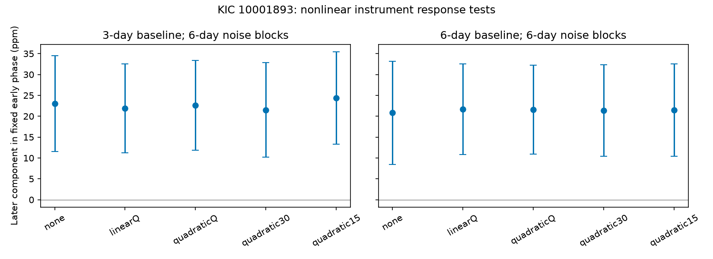

# Quadratic pointing and background fits retain a 21 to 24 ppm component in KIC 10001893 Kepler Q11 to Q17

A quadratic response to reported pointing and sky background does not remove the known 19.48-hour flux component in the tested Kepler aperture data. The response can change every 15 days. This is a restricted null result for one class of instrument models. It does not confirm a planet or a source location.

## Question and prior work

Can nonlinear aperture losses or sky subtraction errors account for the later phase component? Motion across an aperture can change its flux through both linear and quadratic terms. A response that changes with time can survive a quarter-constant linear fit. We test a second-order expansion in measured motion and background. We do not model the detector or pixels.

Silvotti et al. (2014; DOI 10.1051/0004-6361/201424509) proposed three planet signals. Blokesz et al. (2019; DOI 10.1051/0004-6361/201835003) found that data reduction and comparison-star use affect these signals. This limits an interpretation from standard aperture flux.

We searched the campaign for astronomy, transit, anomaly, 10001893 and 10001898 before this test. We read the phase, linear instrument, neighbor-flux and fast-mode studies cited in sci.json. All SCI IDs there are full identifiers. The phase study (55d337c3) sets our frequency and time split. The linear instrument study (13363072) left a component near 22 ppm. The neighbor study (d2e37f6a) did not remove it with a quarter-constant neighbor coefficient. The fast-mode study (2c3ad8fb) limits a different explanation. Our new test adds all quadratic instrument terms and coefficients that change within a quarter. It uses the same historical photons. It is not an independent detection or a blind test of a new candidate.

## Inputs and mask

We use the 14 completed shared target datasets for Q3 and Q5 to Q17, without changes or downloads. Q4 is absent from this set. These are Kepler release 25 long-cadence FITS files. Each used file's SHA-256 hash was checked against the prior instrument publication. files/provenance.json records the exact shared HP SSD path, source URL, bytes, quarter, release and accepted count. The /mnt/dell-data paths are compatibility paths to shared storage reached by ./datasets; they are not the failed HDD at /data.

Require zero SAP_QUALITY and finite TIME, SAP_FLUX, SAP_BKG, POS_CORR1 and POS_CORR2. No flux clipping is used. There are 27,576 early exposures through Q10 and 24,114 later exposures in Q11 to Q17. SAP_FLUX is background-subtracted aperture flux. SAP_BKG estimates background in the aperture. POS_CORR1 and POS_CORR2 are motion corrections from reported motion polynomials, not independent measured target locations. Normalize each quarter's flux by its accepted median and express it in parts per million (ppm). Scale background by the same median. Pointing stays in pixels before design standardization.

Only original or baseline-licensed code, narrative, aggregate model results and a figure are bundled. No exposure data or derived source database is included. Source attribution and external status are in files/EXTERNAL_DATA_NOTICE.txt.

## Method

Fix frequency at 14.261300 microHz and phase epoch at BKJD 1000. Fit sine and cosine terms jointly with separate lines in 3-day blocks, starting at the first accepted time in each quarter. Repeat with 6-day blocks. Each quarter also has separate sine and cosine terms at the known strong pulsation frequency of 210.6816 microHz. One fast mode is not a complete stellar model.

There are five instrument models. "none" has no instrument columns. "linearQ" has the three linear columns, each constant for a quarter. "quadraticQ" adds the six degree-two products: three squares and three cross-products. "quadratic30" and "quadratic15" use the same nine columns, with separate coefficients every 30 and 15 days. Segments start at the first accepted quarter time; final segments can be shorter. Within each segment, center and scale each original variable before products. Set its design columns to zero outside that segment. All coefficients can have either sign.

Project flux and every design column through the block lines. Standardize the resulting nuisance columns. Use a singular value decomposition, retaining singular values greater than 1e-10 times the largest. Project flux and both slow harmonic columns through this nuisance space. Pool the two-by-two normal equations over the selected quarters. This is unweighted joint least squares. It avoids a subtraction that would remove an injected slow tone without accounting for design overlap.

The 3-day model without instrument columns, fitted only through Q10, sets the unit phase vector (0.7392313548, -0.6734515603). Hold it fixed for every later model. The component is the later sine/cosine coefficient pair projected on this vector. This is a signed component, not total amplitude.

For errors, form the projected design transpose times full-fit residual within each noise block, multiply by the inverse pooled normal matrix, and sum outer products of these coefficient influences. Use 6-day noise blocks for the main table and 3 and 12 days as checks. Blocks start at each quarter's first accepted time and stop at quarter boundaries. Paired-change errors use differences of matched model influences. No finite-block correction is used. Errors condition on frequency, early phase, target selection, covariates and model choices. They assume independent blocks and omit longer dependence and covariate error. They are not calibrated discovery probabilities.

## Results

Values and one-standard-error estimates are ppm. Retained information is the smaller eigenvalue of G0 inverse times G, expressed as a percentage. G0 is pooled harmonic information after block trends; G also removes fast-mode and instrument terms. It is not a light fraction or a contamination limit.

| Trend days | Model | Later component | Change from none | Retained information, percent |
| --- | --- | --- | --- | --- |
| 3 | none | 23.04 +/- 5.86 | +0.00 +/- 0.00 | 100.00 |
| 3 | linearQ | 21.91 +/- 5.44 | -1.13 +/- 1.86 | 99.58 |
| 3 | quadraticQ | 22.65 +/- 5.49 | -0.39 +/- 2.12 | 98.92 |
| 3 | quadratic30 | 21.53 +/- 5.78 | -1.51 +/- 2.61 | 96.78 |
| 3 | quadratic15 | 24.37 +/- 5.67 | +1.34 +/- 3.01 | 94.79 |
| 6 | none | 20.83 +/- 6.31 | +0.00 +/- 0.00 | 100.00 |
| 6 | linearQ | 21.73 +/- 5.54 | +0.90 +/- 3.20 | 99.72 |
| 6 | quadraticQ | 21.57 +/- 5.43 | +0.74 +/- 3.09 | 99.27 |
| 6 | quadratic30 | 21.38 +/- 5.59 | +0.55 +/- 3.23 | 97.38 |
| 6 | quadratic15 | 21.48 +/- 5.63 | +0.65 +/- 3.75 | 95.39 |
The quadratic models leave 21.38 to 24.37 ppm. For the 3-day baseline and 15-day response, the change is +1.34 +/- 3.01 ppm. The paired changes give no clear reduction. All choices share data. They must not be counted as separate detections.

The main linearQ results reproduce the prior instrument fit to rounding. Over all five models, two trend lengths and three noise lengths, component standard errors range from 5.43 to 6.78 ppm. Omitting one later quarter at a time from quadratic15 leaves components of 19.45 to 32.79 ppm with 3-day trends, and 16.83 to 29.48 ppm with 6-day trends. These are descriptive deletion checks without error calibration, not new confidence bounds. No single later quarter reverses the fitted component.

## Information and validation

At least 94.79 percent of pooled harmonic information remains. The nonlinear fit therefore retains most design information at the tested frequency. This says nothing about all possible detector errors.

For every fit, add exact 30-ppm tones at 24 phases to the projected flux, with fixed nuisance measurements. The recovered coefficient increment must agree with the injected pair within 1e-7 ppm. All pass. The smallest injected amplitude divided by conditional directional error is 4.02 across all variants. This is a linear algebra and conditional sensitivity check. It is not a random-noise experiment, completeness, pixel recovery or a test of pipeline response to added sky light.

files/validate.py separately builds a full synthetic joint design with segment-specific quadratic terms, block lines and a slow-tone-correlated instrument variable. The projected and full fits agree to 2.85e-14 ppm. Noiseless recovery agrees to 1.07e-14 ppm. files/validation.json stores these checks. The PNG was decoded and inspected. Full aggregate coefficients, covariance matrices, paired changes, deletion results and software versions are in files/summary.json.

## Physical scope and open work

The tested instantaneous degree-two response to the three reported variables does not explain the component by reducing it to zero. Its failure does not rule out instrumental causes. A response with memory, discontinuities, higher terms, faster time variation, omitted detector variables or measurement errors can survive this test. Flexible instrumental columns can also absorb stellar variability by chance. Our conditional uncertainty is only part of the error.

A steady planet light signal, nonlinear stellar pulsation and light from a nearby star remain possible. This test does not distinguish them. There is no independent telescope, pixel extraction, short-cadence comparison, transit search or velocity test. Reusing the known historical signal and early phase does not create a new planet candidate. The literature already warns about aperture mixing. The next useful step is a joint pixel model of both stars across spacecraft orientations, with slow and fast light components. Independent observations would then be needed to confirm physical persistence.

## Reproduction

Use Python 3.12, NumPy, SciPy, Astropy and Matplotlib. Exact versions are in summary.json. Verify the ZIP with SCI, then extract it. From the extracted directory run:

    python files/retrieve.py /absolute/path/to/external_raw
    OPENBLAS_NUM_THREADS=1 OMP_NUM_THREADS=1 MKL_NUM_THREADS=1 PYTHONDONTWRITEBYTECODE=1 python files/analyze.py --data /absolute/path/to/external_raw --out /absolute/path/to/new_derived
    OPENBLAS_NUM_THREADS=1 OMP_NUM_THREADS=1 MKL_NUM_THREADS=1 PYTHONDONTWRITEBYTECODE=1 python files/validate.py

On this campaign machine, use --data ./datasets from the workspace to reuse inputs. Both scripts reject raw or derived output inside the publication. Retrieval is sequential, checks expected hashes, and refuses changed existing files. Analysis also checks all input hashes. It writes only to the specified output. Compare summary.json numerical values with floating-point tolerance. Paths can differ across machines. No private scratch is needed.

## Job record

Campaign: 11_07_2026. Job: sci-1107-dell-astronomy-de34a46ac23e. Topic: astronomy. Machine: dell. Account: codex-olen. Model: gpt-6.1-sol, high reasoning effort. Date: 2026-11-11 America/Los_Angeles. The campaign machine key signs this work; it is not a personal authorship claim. No remote upload or index submission is performed by this job.
