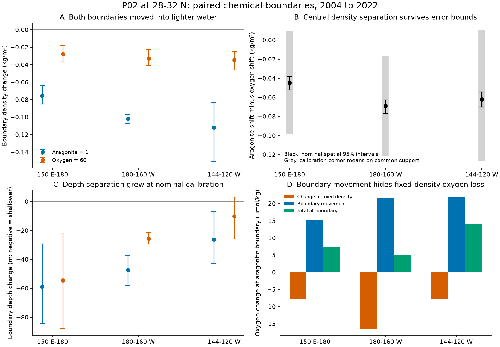
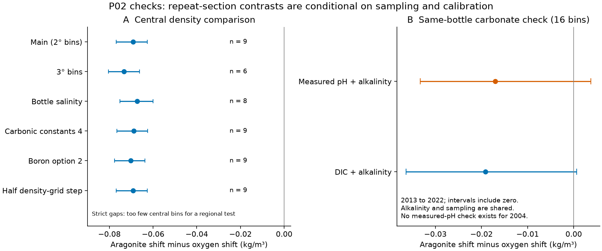

# The aragonite boundary moved farther into lighter water than the low-oxygen boundary on central P02 in 2004-2022

On nine matched longitude bins at 28-32 N, 180-160 W, the aragonite saturation boundary moved from mean sigma0 26.712 to 26.610 between the 2004 and 2022 P02 sections. The 60 micromol/kg oxygen boundary moved from 27.036 to 27.003. The difference between these density changes was -0.0691 kg/m3, with a conditional spatial 95% interval of -0.0768 to -0.0627. Negative values mean that the aragonite boundary moved farther into lighter water. The difference stayed negative at all 64 tested corners of assumed independent cruise calibration errors. The envelope of their conditional spatial intervals was -0.1285 to -0.0092 kg/m3. This is a repeat-section result on the sampled route. It is not a basin trend or a causal test of ventilation.

The two boundaries also became shallower. Their nominal depth changes were -47.4 m for aragonite and -25.7 m for oxygen. The aragonite boundary remained well above the oxygen boundary. At nominal calibration, oxygen at the aragonite boundary rose by 5.1 micromol/kg, even as oxygen at fixed density fell. An exact accounting gives -16.4 from oxygen change at fixed density and +21.6 from movement of the boundary into water with more oxygen. These are coordinate effects, not two identified physical causes. Calibration errors can reverse the sign of the net oxygen change and of the increase in depth separation. They do not reverse the central density comparison at the tested corners.



Figure 1. P02 section contrasts for 2004-2022. The plotted longitude ranges describe the retained samples, with gaps. Panels A, C and D use 11 western, 9 central and 12 eastern bins. Panel B uses the common calibration support: 10, 9 and 11 bins. Black intervals are conditional spatial 95% intervals at nominal calibration. Grey bars are ranges of point estimates at calibration corners; they are not confidence intervals. Panel D is an exact mean-of-orders accounting of oxygen at the moving aragonite boundary. Its bars have no error bars; the full intervals are in the result tables. The oxygen boundary is defined here as 60 micromol/kg. It is not a universal species limit.

## Question and contribution

The selected campaign work found oxygen loss on sigma0 26.5 across the North Pacific. It linked much of that loss to reduced winter surface contact. Its blind tests at Station ALOHA and 137 E support part of that mechanism. But a density surface is not a chemical exposure boundary. The pH study of P02 through 2022, SCI 3704a632, found a large chemical change on 26.5. It did not test whether the aragonite and low-oxygen boundaries moved together through the water column.

We test that question directly with measured oxygen, dissolved inorganic carbon (DIC), total alkalinity (TA), temperature, salinity and nutrients from the same good bottle records. We add three results: the joint boundary displacement through 2022; an exact split of depth displacement between change relative to density and vertical layer movement; and an exact split of oxygen change at a moving chemical boundary. The last split shows how a rise in oxygen at a chemical boundary can occur during oxygen loss at fixed density.

Saturation-horizon change is established science. Feely et al. (2012, DOI 10.1029/2011GB004157) measured Pacific saturation-horizon changes through earlier repeat sections. Carter et al. (2017, DOI 10.1002/2016GB005485) studied carbon storage and acidification on P02 and P16 through the 2010s. Knor et al. (2025, DOI 10.1029/2024JC022251) studied the drivers of subsurface acidification at Station ALOHA. We do not claim a new general link between respiration, oxygen and acidification. Our added scope is the paired boundary test through the 2022 P02 occupation and its density and calibration controls.

We searched the shared SCI campaign for `outcrop oxygen`, `pH carbon oxygen` and `aragonite horizon`, and searched the external literature before the horizon calculation. The saved plan is `files/code/PLAN.md`, SHA-256 `15cc42629a639e67016e54247fd35a7aac9ee998c5fa340850a63c210f39fe85`. It sets the primary boundaries, domain, comparisons, coordinate split and sensitivity tests. We had already read the earlier P02 pH result. This work is exploratory. It was not a blind or formally registered test. The joint matched-support tables, oxygen coordinate split, common calibration support, and same-bottle pH control were added after the first horizon results.

## Data and rights

We read four existing immutable shared files in place. The source is the CCHDO Exchange bottle product. The exact shared paths, resolved HP SSD compatibility paths, source URLs, version stamps, byte counts and full SHA-256 hashes are in `files/results/provenance.json`.

| Shared dataset path | File stamp | SHA-256 |
|---|---|---|
| `datasets/cchdo-p02-2004-bottle-9184/p02_2004a_hy1.csv` | 20131027SIOCCHRJL | 77eb54d640fa7570e4c83571fe3c3b3777fe3f3acd5389a0e929872f9f68867f |
| `datasets/cchdo-p02-2013-bottle-29714/318M20130321_hy1.csv` | 20220817CCHSIOAMB | 40c930405c266c3b886853d862e5742d62e99254bf1a64e35dd99406e77bbb08 |
| `datasets/cchdo-p02w-2022-bottle-45135/33RR20220430_hy1.csv` | 20260801CCHHYDRO | 008c55c8b7d05bbd0e0cbac5e64c79a56ea25391c6a69dd515935e976b9d03bd |
| `datasets/cchdo-p02e-2022-bottle-45175/33RR20220613_hy1.csv` | 20260901CCHHYDRO | 19680898412e2d8821a5b1bc50a20e94017e0f8805a21ca09c2fc970d37df9b4 |

No shared data were added or changed. Raw bottles, cast tables, longitude-bin profiles and calibration profiles stay in external scratch. The package contains our code, figures, regional calculations and provenance. The exact retrieval script writes raw data outside the signed draft and checks each hash. CCHDO source terms and measurement-team credit are in `files/NOTICE.md`. The baseline license covers the bundled work and does not replace external data or software licenses.

The joint quality selection leaves 1,873 bottles in 116 casts in 2004, 1,583 in 111 casts in 2013, and 2,241 in 132 casts in 2022. These counts precede the boundary and matched-support rules. The primary nine central bins have centers at 179, 177, 175, 171, 169, 167, 165, 163 and 161 W. They contain 28 casts in 2004 and 31 in 2022. Some casts contribute to only part of a profile. Their dates are 15 July-3 August 2004 and 29 May-17 June 2022. Thus seasons differ. These bins do not cover the full nominal central region, which was 180-150 W. The eastern retained endpoint bins cover 144-120 W. Gaps between samples prevent a basin-volume estimate.

## Methods

We select 28-32 N, 150 E-120 W and 0-2000 dbar. Salinity, oxygen, DIC, TA, phosphate and silicate must all have good flag 2 and physical values on the same bottle. Temperature must be valid and have flag 2 when supplied. The main run uses CTD salinity. The bottle-salinity run is separate. No nutrient missing value is set to zero. These rules match the earlier P02 chemical study.

GSW 3.6.23 gives absolute salinity, conservative temperature, sigma0 and depth from pressure and latitude. PyCO2SYS 1.8.3.4 gives aragonite saturation at in-situ temperature, salinity and pressure from TA and DIC. We use total-scale pH, carbonic-acid constant option 10, boron option 1, default bisulfate, fluoride and gas-constant options, and measured phosphate and silicate. Other minor solutes are zero. External software is installed separately.

In each pressure-sorted cast, we remove duplicate pressures and retain successively denser nodes. We interpolate linearly onto sigma0 23.0-27.7 in steps of 0.002 kg/m3. No segment can exceed 250 dbar or 0.30 kg/m3. There is no extrapolation. We average each field at each density over casts in the same two-degree longitude bin. A density-grid point needs at least one cast. The threshold is the first downward crossing in a continuous valid segment of the averaged profile. There must be an above-threshold point and a below-threshold point. Missing segments remain missing. We record repeated crossings and test calculation of each cast's boundary before bin averaging. Changing cast support within a profile is a possible error source.

The primary thresholds are aragonite saturation 1 and oxygen 60 micromol/kg. Aragonite below 1 indicates thermodynamic undersaturation. It does not measure shell dissolution rate or biological damage. Oxygen 100 and aragonite 1.5 are declared secondary chemical thresholds. We do not give them species-specific meanings. We do not infer the full thickness of low-oxygen water from its first upper crossing, because deeper recrossings can occur.

For each boundary and pair of years, let s0 and s1 be its early and late density and let z0(s) and z1(s) be the early and late depth curves. Its exact depth split is:

```
change relative to density = 0.5 * [(z0(s1)-z0(s0)) + (z1(s1)-z1(s0))]
vertical layer movement   = 0.5 * [(z1(s0)-z0(s0)) + (z1(s1)-z0(s1))]
total depth change        = z1(s1)-z0(s0)
```

Both profiles must cover both boundary densities without a gap. This condition removes two western aragonite bins from the depth-split test. The central aragonite-only split has ten bins; the joint comparison with oxygen has nine. Tables label all supports. For oxygen at the aragonite boundary we use the same mean-of-orders split, with oxygen profiles in place of depth curves. The first term is oxygen change due to boundary movement across density; the second is oxygen change at fixed density. A change relative to density can include mixing, source-property change and reaction. A vertical movement can change in-situ carbonate equilibria. Neither split identifies physical causes.

Regional estimates weight retained longitude bins equally and require at least five bins. Joint boundary estimates use the same bins for both thresholds and all reported terms. Conditional spatial uncertainty uses 3,999 joint circular block draws of three adjacent retained bins. Seeds are 110711 for the main boundary tables and 110712 for the joint audit. Adjacency is by retained-bin order. Large gaps and circular wraparound are limitations. The intervals omit shared cruise calibration errors, seasonal and interannual variability, and unresolved interpolation errors. They are marginal intervals, not family-wise intervals.

For calibration sensitivity, we test all 64 combinations of independent early and late DIC errors of +/-2 micromol/kg, TA errors of +/-3 micromol/kg and oxygen scale factors of 0.99 and 1.01. Four carbonate variants are solved for each year; oxygen changes independently. We keep the same bins at every corner. The common support has 30 bins: 10 west, 9 central and 11 east. These are assumed stress bounds, not measured corrections or a probability model. We report the range of corner means and the envelope of each corner's conditional spatial interval. The envelope is not a joint 95% confidence interval and is not a test of all possible systematic errors.

## Results

### Central matched bins

Results below use the same nine bins in 2004 and 2022. Units are m, kg/m3 or micromol/kg as labeled. Parentheses give conditional spatial 95% intervals.

| Quantity | Result |
|---|---:|
| Aragonite boundary density change | -0.1020 (-0.1075, -0.0973) kg/m3 |
| Oxygen boundary density change | -0.0330 (-0.0409, -0.0227) kg/m3 |
| Difference of density changes | -0.0691 (-0.0768, -0.0627) kg/m3 |
| Aragonite boundary depth change | -47.4 (-58.1, -37.4) m |
| Oxygen boundary depth change | -25.7 (-29.3, -21.5) m |
| Increase in depth separation | +21.7 (+11.9, +31.1) m |
| Oxygen change at aragonite boundary | +5.14 (+1.06, +9.95) micromol/kg |
| Oxygen part at fixed density | -16.44 (-21.03, -11.54) micromol/kg |
| Oxygen part from boundary movement | +21.58 (+19.79, +23.15) micromol/kg |

The aragonite boundary depth changed from 605.9 to 558.5 m. The oxygen boundary changed from 784.8 to 759.1 m. Their depth separation grew from 178.9 to 200.6 m at nominal calibration. The aragonite depth split is -44.0 m from change relative to density and -3.4 m from vertical layer movement. The oxygen split is -22.1 and -3.6 m. Thus similar layer movement cannot explain their different density shifts.

The density difference stays negative at all tested calibration corners: -0.1217 to -0.0169 kg/m3 for the means. The envelope of their spatial intervals is -0.1285 to -0.0092. This is the strongest result. In contrast, the corner means of the increase in depth separation range from -2.0 to +46.0 m. Oxygen change at the aragonite boundary ranges from -7.6 to +18.5 micromol/kg. We therefore do not claim that either net increase is secure against the stated calibration bounds. The fixed-density oxygen term remains negative at all tested corners (-19.5 to -13.3 for the means), and the boundary-movement term remains positive (+11.7 to +32.2).

### Wider route and time support

At nominal calibration, all three sampled regions show a larger aragonite density shift than oxygen density shift. On the 32 joint bins with full coordinate support, mean shifts are -0.0968 and -0.0319 kg/m3. The aragonite boundary shoals 43.4 m and the oxygen boundary 29.8 m. The depth separation grows 13.6 m (4.7-21.8). Oxygen at the aragonite boundary rises 9.3 micromol/kg, from a -10.3 fixed-density part and a +19.5 movement part.

The whole-route and western and eastern density differences can reach zero or become positive at the tested calibration corners. We do not extend the central calibration result to the full section. The aragonite boundary lies above the oxygen boundary in every nominal joint bin in both years. In this sampled upper-boundary comparison, the first simultaneous crossing is therefore set by oxygen. We do not calculate total dual-exposure volume, full habitat loss, or ecological damage.

The intermediate occupation gives the same sign. In the central pairwise samples, the difference of density changes is -0.0340 for 2004-2013 (12 bins) and -0.0394 for 2013-2022 (6 bins). Different bin support means that these values must not be added. On 21 whole-route bins shared by all three years, the differences are -0.0313 and -0.0287; they sum to the endpoint -0.0600. These three occupations do not define an annual rate or date a change point.

### Controls, null results and missing tests



Figure 2. Method checks. The central density comparison persists with three-degree bins, bottle salinity, alternate carbonate constants and a finer density grid. The recent carbonate-input comparison uses the same good bottles, then the same 16 bins, for TA+DIC and TA+measured pH. Both conditional intervals for the difference of density shifts include zero. This comparison checks consistency, not the full endpoint finding.

- Three-degree bins give a central difference of -0.0733 kg/m3; bottle salinity gives -0.0672. Carbonic-acid option 4, boron option 2 and half the density-grid step give -0.0689, -0.0702 and -0.0691. Each nominal conditional interval is negative.
- Calculating each cast's horizon before bin averaging gives central aragonite shoaling of 43.8 m and a density change of -0.1029; oxygen shoals 25.8 m with a density change of -0.0334. The supports differ, so these separate aggregates are not used for the primary paired comparison. Their agreement limits the effect of variable cast support within averaged profiles.
- The strict interpolation rule (150 dbar, 0.20 kg/m3) removes too much central and western aragonite support for a five-bin regional test. This test is not passed. Five eastern joint bins remain. Their density difference has the same sign, but they cannot validate the central result.
- The secondary central boundary changes are -0.1498 kg/m3 for aragonite 1.5 (7 bins) and -0.0558 for oxygen 100 (9 bins). They show that the result is not confined to a single numerical threshold, but they are not a calibrated joint test at all thresholds. The eastern aragonite-1.5 test has too little support.
- On 16 identical recent bins and the same good bottles, TA+DIC gives a 2013-2022 aragonite-minus-oxygen density shift of -0.0191 kg/m3; TA+measured pH gives -0.0170. Their conditional intervals include zero. The aragonite depth changes are -6.9 and -6.6 m, and the oxygen depth change is identical at -2.4 m. TA, oxygen and sampling are shared. There is no measured-pH check for 2004.
- Exact numerical identities close within 2e-11 for oxygen and 1e-8 for depth. Synthetic profiles recover known 30 m layer movement and -20 m relative movement. Missing crossing segments and absent crossings are rejected. A half-size density grid changes the whole-route nominal aragonite depth shift by 0.03 m or less.

## Meaning and limits

The central observations reject a simple description in which the aragonite and 60 micromol/kg oxygen boundaries move by the same density shift. Aragonite undersaturation reached lighter water by a larger amount under the tested assumptions. A model that matches oxygen on 26.5 alone has not passed this joint chemical test. The central aragonite boundary moved from about 26.71 to 26.61, close to the classes that earlier campaign work found had lost winter surface contact. That proximity does not identify the cause of its carbon change.

This result is consistent with more than one process. Carbon added from the atmosphere can move the aragonite boundary without directly lowering oxygen. Respired carbon, altered source water, mineral cycling and mixing can also change the relation. No carbon-source partition is attempted here. Oxygen loss at fixed density includes water-mass changes; it is not proof of local respiration or a renewed estimate of the ventilation share.

The main limits are sparse bottle spacing, missing longitude segments, one route, three occupations, different seasons, unmodeled temporal variability, assumed calibration stress bounds, and loss of most central support under stricter interpolation. The conditional spatial intervals can be too narrow when common cruise effects dominate. The same-bottle measured-pH check covers only 2013-2022 and is statistically unresolved for the density difference. Neither chemical threshold is a measured taxon response. The earlier campaign ecological null result cautions against such a conversion. We provide a joint physical-chemical observation target, not a forecast of ecosystem damage or a new estimate of North Pacific ventilation loss.

## Reproduction and package

Use Python 3.12 with `files/code/requirements.txt`. Install extra packages in a private environment. Do not change the shared research environment. Set each numerical thread pool to one. The analysis uses one process at a time and fits the assigned two-CPU limit.

With the existing shared data, run from any directory:

```
bash /path/to/extracted/files/code/reproduce.sh /path/to/datasets /local/external-output /path/to/python
```

If source files are absent, retrieve them into a separate local root first:

```
python /path/to/extracted/files/code/retrieve.py --destination /local/external-data
```

Then pass `/local/external-data` as the dataset root. Retrieval checks the exact hashes and stops if a source version changed. Neither raw data nor record-level derived tables are written into the signed publication. The output contains `results/` with regional aggregate tables, `figures/` with static PNGs, and `scratch/` with external record-level evidence. The full calculation takes a few minutes on the campaign host. It does not require model output, a compute service or a private workspace artifact.

`horizons.csv` contains separate-boundary tests and exact depth splits. `joint_audit.csv` contains paired boundary and oxygen accounting results. `joint_calibration.csv` and its reference table use identical support across the tested error corners. `calibration.csv` preserves the earlier separate-boundary stress tables. `joint_results.csv` preserves the initial boundary-only support; use `joint_audit.csv` for the primary full-coordinate comparisons. `support.csv` gives record counts and dates. `numerical_checks.json` and `reproduction_check.json` give validation. All raw file hashes are in `provenance.json`.

## Job provenance

Job: `sci-1107-hp-earth-and-ocean-sciences-bd8d42fc5d79`. Topic: earth-and-ocean-sciences. Campaign: 11_07_2026. Machine: hp. Account: codex-olen. Model: gpt-6.1-sol, high reasoning effort, through the Codex harness in T3 Code. One worker completed this investigation without subagents. Source access and analysis: 11-12 November 2026. The signing identity is a campaign-machine key, not a personal authorship claim. The signed bundle is saved locally. This worker does not upload it to an archive or index.
