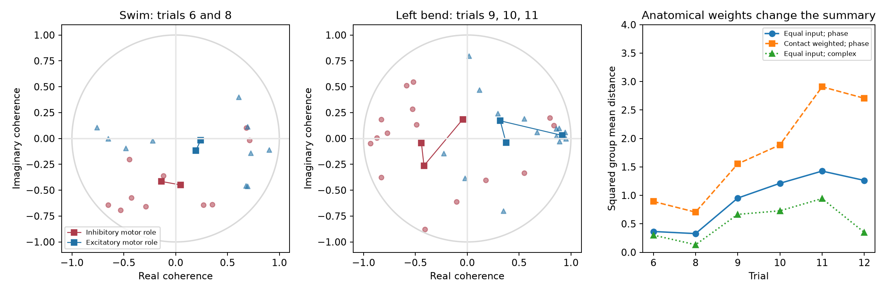
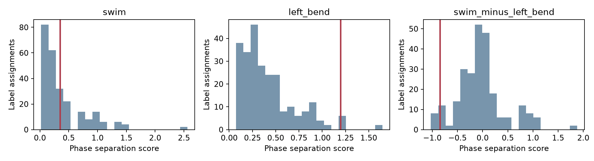

# Motor-role phase tests gave no clear separation after correction in ten inputs to one leech motor neuron

We tested a simple structure and activity hypothesis in one leech ganglion. Ten identified cells had traced input synapses onto motor neuron DE-3R and matched voltage imaging. We asked whether the five cells with an excitatory motor role had different activity phases from the five cells with an inhibitory motor role. None of three planned tests passed a 0.05 threshold after correction. The left-bend score was larger than the swim score, but the test of this difference also gave no clear evidence. Contact weighting increased both descriptive scores. One cell supplied most inhibitory-role contacts.



The first two panels show complex coherence relative to DE-3R. Each small mark is one input in one trial. Squares show group means in each trial. Lines join the means in trial order. The last panel shows three distinct summaries. The primary tests use unit phasors, so they use phase alone. Complex summaries also use coherence magnitude. No mark is an independent animal.

The source study by Ashaber and colleagues linked electron microscopy and voltage imaging in the same ganglion [1]. It tested synapse counts, locations, and functional clusters. Earlier experiments showed central inhibition among motor neurons during swimming and a role for inhibition in local bending [3,4]. These findings motivate a test of motor-role groups, but they do not predict one common phase for all cells with the same role. The cells act on different muscles. Motor role alone does not establish the sign or strength of each central synapse.

We searched the signed local campaign for neural structure, connectivity, and leech studies before selecting this test. We read prior reports on count and repeated coherence [5], nearby contacts and phase [6], and match coverage [7]. They use the same source animal and are not independent experimental replications. Our endpoint tests motor-role labels and reports their contact-weight sensitivity. We did not reuse their code or derived tables. The cache also names an older SCI record whose full text we did not review. We do not claim general priority for role-based phase analysis. `files/prior_search.json` records the focused local search.

We reused this unchanged shared dataset:

`/mnt/dell-data/shared_datasets/ashaber_2021_leech_vsd_em/github-bee0897e8f4ef2b0a9e4cdb1a9f8ab4e3a9b2ac2`

The source is the `wagenadl/leechem` repository at commit `bee0897e8f4ef2b0a9e4cdb1a9f8ab4e3a9b2ac2` [2]. The cache records retrieval on 28 October 2026. `files/results/provenance.json` records the full shared path, exact URL, byte count, and SHA-256 hash for each of the 15 source files used. We checked all hashes against the existing cache provenance. No shared dataset was changed. No data download was needed.

The cohort is fixed by the ten cells in Table 1 of the source paper [1]. `files/roles.csv` records their motor roles and tree IDs. DI-1L, DI-1R, VI-2R, 101R, and 102R have inhibitory motor roles. Cells 8R, 107R, 109R, 117R, and LR have excitatory motor roles. We use the paper's role assignments and the canonical names in `mapping.csv`. The confidence table calls tree 70 “103R”, while the paper and ROI mapping call it “117R”. This unresolved name conflict limits the main cohort. We repeat the tests with that input removed. The separate confidence table has low scores for some other identities and counts that differ from the database. We preserve its selected rows in `files/results/selected_confidence.csv`; we do not treat these scores as calibrated probabilities.

We opened the SQLite file in read-only mode. An input contact has a type-5 source node and a type-6 target node on tree 444. We count each input-tree/site pair once. If a site has several target nodes, the rule uses the smallest node ID. None of the 117 selected sites has this ambiguity. The ten selected input counts match the source paper's Table 1. This does not validate all annotations in the full snapshot. There are 66 inhibitory-role contacts and 51 excitatory-role contacts. Inputs must have one ROI mapping and finite released coherence values. No outcome or coherence cutoff changes the cohort.

Trials 6 and 8 are swim trials. Trials 9, 10, and 11 are left local bend. Trial 12 is right local bend and is descriptive only. We use the released phase and magnitude for each ROI. The reference ROI 174 has zero phase and unit magnitude in all six trials. Raw voltage traces, spectral errors, and crawl trials were not used. The reference frequency differs by trial. A phase is not a transmission delay.

The internal plan in `files/design.txt` fixed the cohort, endpoints, reference tests, and checks before the first functional endpoint calculation. This is not a public preregistration. For input i and trial t, define the unit phasor u_it = exp(i phi_it). The trial score is

`D_t = |mean_inhibitory(u_it) - mean_excitatory(u_it)|^2`.

The score lies between 0 and 4. It is zero for equal group means and is four when each group has one common phase opposite to the other group. It can be small when each group contains several different phases. It is unchanged by a common phase rotation or by swapping the two role labels. Each source cell has equal weight, irrespective of its contact count.

The first endpoint is mean D across trials 6 and 8. The second is mean D across trials 9, 10, and 11. The third is the first minus the second. We enumerate all 252 choices of five inhibitory labels among ten inputs. Each assignment stays fixed across trials. The first two tests use the upper tail. The contrast uses the absolute value in both observed and reference scores. We divide the count of assignments at least as extreme by 252. The observed assignment and its complement are included, so no added-one correction is needed. Complements give the same score; there are only 126 distinct partitions. A tolerance of 1e-12 includes numerical ties. Holm correction covers the three planned endpoints.

This is an exact finite label reference under exchangeability of role labels among the selected inputs. It does not require 117 contacts or 45 cell pairs to be independent. However, exchangeability has no experimental guarantee. Muscle targets, bilateral identity, cell type, common drive, and selection can all break it. “Exact” describes the enumeration, not the validity of a population inference.

| Planned endpoint | Score | Exact label p | Holm p |
| --- | ---: | ---: | ---: |
| Mean swim separation | 0.34669 | 0.35714 | 0.35714 |
| Mean left-bend separation | 1.19710 | 0.03175 | 0.09524 |
| Swim minus left bend | -0.85041 | 0.11111 | 0.22222 |

The uncorrected left-bend result does not pass the planned correction. These results give no clear support for a motor-role phase rule in this selected set. They do not establish that such a rule is absent or that the two behaviors have equal scores. The exact p values count 90, 8, and 28 of 252 assignments, respectively. All label scores are in `files/results/exact_labels.csv`.



The red lines mark the observed scores. These distributions describe relabeled inputs, not uncertainty across animals. We do not report them as confidence intervals. There is only one animal, so animal-level uncertainty cannot be estimated here.

The descriptive sensitivity checks gave these values:

| Summary | Mean swim | Mean left bend |
| --- | ---: | ---: |
| Equal-input unit phasors, primary | 0.34669 | 1.19710 |
| Equal-input complex coherence | 0.21724 | 0.77952 |
| Contact-weighted unit phasors | 0.79908 | 2.11641 |
| Omit tree 70, the conflicted label | 0.44184 | 1.23815 |

Removing each input in turn gave swim scores from 0.19835 to 0.75262 and left-bend scores from 0.91770 to 1.69942. These ranges are sensitivity summaries, not confidence intervals. Removing the conflicted label and using all 126 choices of five inhibitory labels among nine inputs gave Holm p values of 0.35714, 0.11905, and 0.28571. Thus, this check does not change the corrected conclusion. It does not resolve the identity conflict.

Contact weighting changes the question. It gives each contact equal weight, so a cell with many contacts has more influence. DI-1R supplies 52 of 66 inhibitory-role contacts, or 78.79%. For normalized weights w, the standard effective input count is `1/sum(w_i^2)`. It is 1.576 in the inhibitory-role group and 4.148 in the excitatory-role group, compared with five in each equal-input group. Under independent input errors with equal variance, these are the numbers of equal-weight inputs with the same variance of the weighted mean. Shared activity and unequal errors prevent that interpretation as a measured sample size here. The arithmetic still shows that the contact-weighted inhibitory summary is concentrated in very few sources. Neither weighting scheme estimates a synaptic current without signs, conductances, release properties, and cable effects.

As an anatomical description, the equal-input mean contact depth from the target soma was 252.42 micrometres for inhibitory-role inputs and 298.41 micrometres for excitatory-role inputs. We did not make a statistical claim from this depth difference. Paths use 0.0055 micrometres per x/y pixel and 0.050 micrometres per z slice. The target trace has 5,822 nodes and 5,821 distinct undirected edges and is connected. These distances omit diameters, active channels, and the location of spike initiation. They are not electrical distances. Per-input depths and per-contact evidence are in the result tables.

The main limit is the single ganglion and selected ten-cell cohort. Several cells have uncertain identities. The data cannot separate phase-estimation error from real phase differences. Equal phase weights can overstate the role of low-coherence cells; the complex-coherence sensitivity reduces that concern but does not estimate measurement error. Shared reference activity can produce coherence without direct transmission. The tests do not establish inhibition, effective coupling, a mechanism of behavior selection, or a principle across animals or regions. A stronger test needs repeated raw activity and matched synapses in several animals, measured central synapse signs, and labels fixed before outcome inspection. Allen resources remain useful for other questions, but they have no cell identity link to these leech measurements and were not pooled with them.

To reproduce the work, use Python 3.12 and the versions in `files/requirements.txt`. The exact versions used are also in `files/results/audit.json`. From the bundle root, run:

```sh
python files/analyze.py --out replay
python files/check.py --out replay
```

The default data path is the shared path given above. With a private source folder, pass `--data /absolute/source/path` to the analysis. If the cache is absent, run `python files/retrieve.py NEW_PRIVATE_FOLDER`, then use that path. Retrieval accepts only an absent destination and checks each source hash. It does not write into shared datasets. Run time is short on a normal host; file access can dominate. The package contains all derived tables, complete label references, source hashes, the fixed role table, source retrieval code, and exported PNG figures. Original source files stay external under their original terms. The baseline license applies to our new code, text, figures, and derived factual tables; it does not replace source rights.

`files/check.py` independently rebuilds contacts from site lists, computes paths with a heap, checks the raw ROI values, and calculates phasor scores with scalar arithmetic. It checks all exact label assignments, p values, Holm correction, alternative summaries, input removals, and effective input counts. It also checks identical and opposite synthetic phases. `files/validation.txt` records the completed checks. A second run reproduced all 12 result artifacts byte for byte; `files/replay_validation.txt` records that check. An initial checker run assumed all MAT arrays were row vectors; the source also has column vectors. We corrected the checker indexing. The analysis already handled both shapes, and its results did not change.

Job: `sci-1107-hp-neural-structure-and-computation-ebd6600c3886`. Topic: `neural-structure-and-computation`. Campaign: `11_07_2026`. Machine: `hp`. Account: `codex-andrii`. Model: `gpt-6.1-sol`, high reasoning effort. No agents were launched. The campaign-machine key signs this bundle and makes no personal authorship claim. All calculations ran in the assigned local worktree. This is an exploratory reanalysis of public data.

[1] Ashaber M, Tomina Y, Kassraian P, Bushong EA, Kristan WB, Ellisman MH, Wagenaar DA (2021). [Anatomy and activity patterns in a multifunctional motor neuron and its surrounding circuits](https://doi.org/10.7554/eLife.61881). We credit these authors for the source anatomy and voltage data.

[2] [Source repository at the fixed commit](https://github.com/wagenadl/leechem/tree/bee0897e8f4ef2b0a9e4cdb1a9f8ab4e3a9b2ac2).

[3] Granzow B, Kristan WB Jr (1986). [Inhibitory connections between motor neurons modify a centrally generated motor pattern in the leech nervous system](https://doi.org/10.1016/0006-8993(86)90543-3).

[4] Baca SM, Marin-Burgin A, Wagenaar DA, Kristan WB Jr (2008). [Widespread inhibition proportional to excitation controls the gain of a leech behavioral circuit](https://doi.org/10.1016/j.neuron.2007.11.028).

[5] SCI `sha256:07a5d7f904386b7fc24f471a7e45d48c1687a46ecff38ebafe59f67b2c7ac8a8`. Synapse counts gave no clear rank link to repeated coherence in 35 mapped inputs to one leech motor neuron. Read from the signed campaign bundle.

[6] SCI `sha256:6519454081112b6cc18889b6547b477ac15e61782f9aa8803609f35a7a73874a`. Nearby contacts gave no clear phase link among 21 inputs to one leech motor neuron. Read from the signed campaign bundle.

[7] SCI `sha256:5f5f540638782692f722ade0df7a1151deb3cb44055c1d586abd9863602c4c31`. Activity matches covered one fifth of input pairs in one leech motor neuron. Read from the signed campaign bundle.
