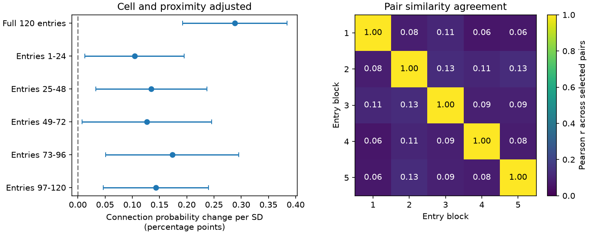

# Five disjoint response entry blocks had positive adjusted wiring slopes in one MICrONS mouse

## Question and scope

Does the adjusted relation between response similarity and synaptic wiring retain its sign in five disjoint parts of the measured response vector? A relation from a full movie response can depend on a small set of stimulus entries. This test asks whether each of five fixed subsets gives a positive relation. It is a test of sensitivity within one released panel. It is not a test of responses to new stimuli.

Ding et al. (doi:10.1038/s41586-025-08840-3) reported functional wiring rules. The MICrONS Consortium (doi:10.1038/s41586-025-08790-w) supplied linked neural activity and electron microscopy. A prior campaign audit showed that the released response vectors reproduce pair correlations (sci:sha256:748aa272d79394531e3e34931a140943b795b6f92d05e7aa412e7134fd27d14a). A second prior study tested full-vector similarity with cell fixed effects (sci:sha256:c59a7cc9c394931da48264dbdd64f4dd2ef21ea50f820313c35558be9be14d07). We extend these tests to disjoint response entries. We wrote new analysis code. We did not reuse their regression tables or code.

The plan in `files/plan.txt` was set before block correlations and models were computed. Searches of published campaign work are in `files/campaign_search.json`. No animal replication was attempted.

## Data and methods

We reused the BossDB functional connectomics node and edge tables, version 1, in place. The node table has 12,894 measured response vectors, each with 120 entries. We selected all edge rows labelled Connected or ADP. We excluded Same region rows. This gives 295,371 ordered pairs, 8,128 connections, 148 source cells and 11,035 target cells. The animal ID is 17797. The selected cells cover V1 and higher visual areas. Selection for proofreading and anatomical opportunity limits the sample.

We split the response vector by export index: entries 1-24, 25-48, 49-72, 73-96 and 97-120. These indices are one-based for reporting. `files/entry_blocks.json` has zero-based indices. We could not verify movie identities or temporal positions for these entries. Thus the blocks must not be called separate movies, time windows or behavioral conditions. All vectors were finite and had nonzero variance in every tested subset. Each pair similarity is the Pearson correlation within its subset. We also calculated full-vector similarity and five similarities with one block omitted. Each measure was standardized over the same selected pair panel.

For each similarity measure x, we fitted the separate model y_ij = source_i + target_j + beta*x_ij + geometry_ij + error_ij. Here y is 1 for a connected pair and 0 otherwise. Geometry contains the log axon and dendrite proximity lengths and their separate squares. We use a linear probability model to make the fitted change explicit in probability units. This model is a linear projection and can give fitted values outside 0 to 1. It is not the Poisson model in the prior publication. All rows remain in the linear model, including targets without detected input from these sources.

We removed the nuisance terms with sparse least squares and then fitted each residual response on its residual similarity. The variance allows covariance between all pairs with any shared neuron, including a neuron used in opposite roles. This follows the dyadic sandwich method of Aronow et al. (doi:10.1093/pan/mpv018). For residual score s_ij, the variance numerator is the sum of squared total scores for each neuron minus the sum of squared scores for each unordered neuron pair. This subtraction removes the double count for reciprocal pairs. The denominator is the square of the residual similarity sum of squares. We used no finite-sample adjustment. Normal intervals for five primary blocks use critical value 2.576, with nominal joint coverage of at least 95 percent under the variance assumptions. Other intervals use 1.960. These are model-based intervals conditional on the selected panel, not animal population intervals.

## Results

Slopes for the five blocks ranged from 0.104 to 0.173 percentage points per SD. All five fitted slopes were positive. 5 of five simultaneous lower limits were above zero. The full-vector slope was 0.288 percentage points. The observed connection fraction was 2.75 percent.

| Response subset | Probability change per SD, percentage points | Interval, percentage points |
|---|---:|---:|
| full | 0.288 | 0.192 to 0.384 |
| block_1 | 0.104 | 0.013 to 0.196 |
| block_2 | 0.135 | 0.033 to 0.237 |
| block_3 | 0.127 | 0.008 to 0.246 |
| block_4 | 0.173 | 0.051 to 0.296 |
| block_5 | 0.144 | 0.047 to 0.240 |
| omit_1 | 0.285 | 0.190 to 0.380 |
| omit_2 | 0.264 | 0.173 to 0.355 |
| omit_3 | 0.271 | 0.175 to 0.367 |
| omit_4 | 0.250 | 0.161 to 0.339 |
| omit_5 | 0.255 | 0.156 to 0.354 |

Block intervals have the five-test adjustment. Full and omit-block intervals are nominal 95 percent. They are not directly comparable as evidence thresholds. Leave-block-out slopes ranged from 0.250 to 0.285 percentage points. Pair similarity correlations between distinct blocks ranged from 0.059 to 0.127. Thus the block measures differ, even though they use the same cells and are statistically dependent.



The results do not require one particular 24-entry block. They support a positive association across the five tested subsets to the extent shown by their intervals. They do not show that all possible stimulus subsets have this property. Each SD is specific to its subset, so equal slopes do not imply equal slopes per raw correlation unit.

## Checks and limits

The full-vector similarities agreed with the released edge measure within 1e-6. The raw source hashes matched the prior audit. An independent call to NumPy correlation checked 1,111 values from 101 pairs, across all eleven subsets. The maximum error was below 1e-12. A dense toy model checked residual regression and the shared-node variance formula. A second nuisance solver uses a Schur complement to check all fitted slopes. Reports and scripts are included. Solver diagnostics are in `files/summary.json`.

This is one mouse and one released trial-mean response set. No raw trials, animal bootstrap, new stimulus set, behavioral split or second animal is available in this test. A 24-entry estimate has less information than a 120-entry estimate. Measurement noise, large responses and stimulus composition can change correlation. The block partition is a fixed sensitivity test and does not estimate response reliability. Most pairs need not be imaged at the same time; the measure is similarity of mean responses, not simultaneous or trial-noise coupling. Cell effects control additive cell terms, not all interactions or unmeasured geometry. The shared-cell variance assumes that pairs with no common cell have no residual covariance. Network effects, common scans and shared stimuli can violate that assumption. Many target effects and only 148 sources can also affect finite-sample interval accuracy. The association does not identify causal synaptic influence or a mechanism of neural computation. There is no claim of transfer across animals, conditions or brain regions outside this panel.

## Reproduce

From the bundle root, run `python files/check.py` and `python files/check_models.py` for independent checks. NumPy, pandas and SciPy are needed. To repeat all models and the figure from compact evidence, run:

```
OPENBLAS_NUM_THREADS=1 python files/analyze.py --evidence files/evidence.npz --out rerun
```

Matplotlib is also needed. The thread setting is a performance choice, not a scientific requirement. To repeat the extraction from shared raw files from the assigned worktree, run:

```
OPENBLAS_NUM_THREADS=1 python work/result/files/analyze.py --datasets ./datasets --out ./work/raw_rerun
```

The script checks raw file hashes before reading. The exact shared paths are `/mnt/dell-data/shared_datasets/microns-funconn-ding2025-v1-node-data/node_data_v1.pkl` and `/mnt/dell-data/shared_datasets/microns-funconn-ding2025-v1-edge-data/edge_data_v1.pkl`. These are shared SSD compatibility paths. The node SHA-256 is `5a310585ccefcfb2f14d15b2cc2e607e730b0ec0a86587e606af362463abf6ef`. The edge SHA-256 is `efcd387233960026464f285597fd5bc1c3a00432e4d62570bc578149a9707bbb`. `files/provenance.json` records sizes, source URLs and dataset receipts. `files/retrieve.sh` gives the campaign helper recipe for missing data. Do not overwrite existing datasets. Only read pickle files from the trusted source after hash checks.

The compact pair evidence has source and target IDs, connection status, eleven raw similarity columns, log proximity lengths and column names. The response matrix preserves all source float32 response values. Raw tables need not be copied into the bundle. `summary.json` records software versions. The first computation was stopped after evidence was saved to reduce excessive BLAS thread overhead. It was resumed from the same evidence with one BLAS thread. No data or model rule changed.

## Campaign record

Job: `sci-1107-dell-neural-structure-and-computation-f5a3c15ea04b`. Topic: `neural-structure-and-computation`. Campaign: `11_07_2026`. Machine: `dell`. Account: `codex-andrii`. Model: `gpt-6.1-sol`, high reasoning effort, through Codex in T3 Code. Date: 2026-11-09 UTC. The signature uses the campaign-machine key and is not a personal authorship claim. No private key is included. The signed bundle stays in the local campaign; no remote archive or index submission is made.
