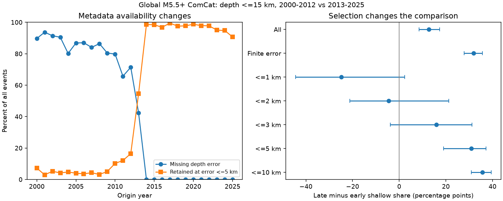

# Requiring a reported depth error raised the ComCat shallow-share change by 19.15 points in 2000-2025

In 12,848 global ComCat earthquakes at preferred magnitude M >=5.5, the reported depth <=15 km share rose by 12.68 percentage points between 2000-2012 and 2013-2025. If the analysis requires a finite reported depth error, the rise is 31.84 points. The extra rise is 19.15 points. Its conditional 95% two-year block interval is 16.07 to 22.30 points.

This result measures selection in a fixed catalog. It does not measure physical shallowing, a change in true depth error, or a causal effect of observation methods. Missing depth error does not mean large error. A reported small error does not prove a reliable depth. Thus a depth-error cut cannot be treated as a neutral quality check for this time comparison.

## Question and prior evidence

Can a cut on reported depth error change a long-period comparison mainly by selecting records with available metadata? This matters for studies of earthquake dynamics and possible links to surface water and ocean loading. An observation filter can change the measured event mix before a physical model is tested.

We searched the campaign with several broad and focused terms before choosing this test. Search and design details are in files/design.md. We read the signed global spike audit, SCI a870e48a72ebb0ae7692bd828d9d240fd14254c08e246bb590f9cc7f08f183f9. It found a shallow-share rise after three exact-depth labels were excluded, but did not establish physical shallowing. The signed Stanley audit, SCI 5465ef98dcc882e42832f2a02be147276f09cb852ac01cd998939a73e9a60e1b, showed that a 2 km error cut kept nearly all exact-10 km labels in one local sequence. The matched ComCat/GCMT study, SCI 1b626259acfc42214c688fa913baaba28be6e2825259772f7e3b35583da58039, found different shallow-share changes for origin and centroid depths of the same events. Regional and median bounds in SCI 9c64aa6e9fd11b5e3ac2e1aa21704de7a221f179cb88d7c9a157c0784b5ee0eb and SCI 62fd41ae80ba4c7facdaba6f79333f906a2cd5d8a6370bf6d29f81fa27b4d278 further limit physical interpretation.

We add a global test of error-field availability and error-limit selection, with an exact two-step decomposition. This is a different question from spike deletion or depth bounds. It uses the same global CSV as the global studies and is not independent confirmation. The global sample is distinct from the local Stanley sequence test. No prior analysis code was reused. All choices are exploratory and follow preliminary data summaries; no test was registered in advance.

The [USGS fixed-depth note](https://www.usgs.gov/faqs/why-do-so-many-earthquakes-occur-a-depth-10km) explains the known use of assigned depths when observations do not resolve depth. Nievas et al., DOI 10.1007/s10518-019-00718-w, discuss changing depth conventions. We do not claim to discover these practices or to identify which individual depths are assigned.

## Data and scope

We reuse the existing shared CSV without changes or downloads. The source is the USGS ComCat FDSN service. It contains preferred global M >=5.5 earthquake records for calendar years 2000-2025, sorted by time. All 12,848 event IDs are unique and all reported depths are finite. Magnitudes have mixed types; M does not denote a uniform Mw scale. The source is a revised catalog, not a real-time archive.

Exact shared path: `/mnt/dell-data/shared_datasets/usgs-global-m55-2000-2025-20261109-earth-a76104/events.csv`. This compatibility path is on HP SSD. Size: 2,240,222 bytes. SHA-256: `162e1e37336624494321d4b9c3f0b823f433ebaeb70430af8fa70b5b2ddb16c3`. Exact query, retrieval time and version information are in files/provenance.json. A live query can now return different bytes.

ComCat combines contributions from many networks. We leave raw records and all event-level extracts outside this signed package. Our code, original figure, narrative and aggregate statistical results use the SCI baseline license. External attribution and rights boundaries are in files/EXTERNAL_DATA_NOTICE.txt. We do not grant rights in the source database.

## Method

Keep the prior global study's equal 13-year eras, 2000-2012 and 2013-2025. The shallow indicator is reported depth <=15 km. The denominator includes all depths. We compare event-weighted proportions, not annual rates or year-weighted mean proportions.

Use seven record selections: all records, finite depthError, and finite depthError <=1, 2, 3, 5 or 10 km. Equality is retained. A blank error fails every finite-error selection; it is not set to zero or treated as an error above a threshold. We use the reported field as a selection variable, without a probability or calibration assumption about its value.

Let A be the all-record shallow share, F the finite-error share and C the error-cut share in each era. The identity is:

`C_late - C_early = (A_late - A_early) + [(F_late - A_late) - (F_early - A_early)] + [(C_late - F_late) - (C_early - F_early)]`.

The second term measures the effect of availability selection on this contrast. The third term measures the further effect of the numeric error limit within the available sample. These are exact descriptive selection terms. They are not causal contributions from instruments, networks or geology.

For conditional intervals, draw years in circular blocks of length two separately in each era. Draw seven block starts with replacement, concatenate, truncate to 13 years and sum annual counts. Use the same draws across all seven selections. Compute ratios of summed counts and their contrasts for 10,000 draws with seed 110711. Report the 2.5th and 97.5th percentiles. This retains some year clustering but not all sequence dependence. It does not include catalog error or uncertainty about the chosen eras. Short early selected samples give unstable estimates. These intervals describe resampling stability, not guaranteed coverage of a true physical change. No multiple-test significance claim is made.

## Results

All changes and interval limits are percentage points.

| Selection | Early n | Late n | Early shallow % | Late shallow % | Change | Conditional 95% limits |
| --- | ---: | ---: | ---: | ---: | ---: | --- |
| All | 6877 | 5971 | 36.79 | 49.47 | 12.68 | 8.46 to 17.32 |
| Finite error | 1170 | 5776 | 17.35 | 49.19 | 31.84 | 27.84 to 35.69 |
| Error <=1 km | 62 | 95 | 77.42 | 52.63 | -24.79 | -44.45 to 2.34 |
| Error <=2 km | 82 | 4320 | 60.98 | 56.50 | -4.47 | -21.12 to 21.27 |
| Error <=3 km | 162 | 4648 | 40.12 | 56.11 | 15.99 | -3.76 to 31.19 |
| Error <=5 km | 446 | 5590 | 19.73 | 50.59 | 30.86 | 19.05 to 37.25 |
| Error <=10 km | 865 | 5755 | 13.53 | 49.21 | 35.68 | 30.94 to 39.48 |

Depth error is absent in 5,707 of 6,877 early records (82.99%) and 195 of 5,971 later records (3.27%). Requiring the field lowers the early shallow share by 19.44 points but lowers the late share by only 0.29 points. Their difference is the 19.15-point selection term.

For the 5 km cut, the identity is `30.86 = 12.68 + 19.15 - 0.98` points, after rounding. Relative to the all-record change, this cut adds 18.18 points; paired block limits are 8.43 to 22.76 points. Thus availability selection supplies most of the increase for this cut. The further numeric error limit has a small net contribution here, although it changes both era shares.

For the 2 km cut, the identity is `-4.47 = 12.68 + 19.15 - 36.31`. Tightening the limit does not give a smooth approach to the all-record result. The small early sample and its distinct depth composition dominate the comparison. The negative point changes at 1 and 2 km have intervals that include zero. They are not evidence for physical deepening.

## Checks and limits

files/sensitivity.csv reports all 168 descriptive checks, crossing six samples, four shallow cutoffs and seven selections. At <=15 km, removal of exact 10, 33 and 35 km labels reduces the availability-induced extra rise to 3.05 points: the all-record rise is 9.75 and the finite-error rise is 12.80. The 5 km rise is 15.78. Thus the large availability effect overlaps strongly with depth-label composition. This check does not show that every label is assigned or isolate why the field is absent.

Starting the early era in 2005 retains the effect: all-record change is 9.96 points, finite-error change 30.83 and 5 km change 30.78. Restricting locationSource to `us` gives 12.94, 33.01 and 33.00 points. At M >=6.5 these changes are 4.12, 15.24 and 16.72 points, but only 58 early events have finite error and 32 pass the 5 km cut. These checks have no new uncertainty intervals.

The result is not universal across periods. For 2013-2018 versus 2019-2025, changes are -1.28 points for all records, -0.68 for finite error and +0.45 for the 5 km cut. Improved field availability in the later record reduces this particular selection difference. The threshold checks at 20, 30 and 70 km test distinct outcomes; none establishes physical change or validates error estimates.

We did not standardize geographic or magnitude-type composition, decluster events, recover absent errors, validate origin depth types, or compare with relocated depths. A separate existing preferred-origin XML file was inspected and has no depthType elements; it supplies no numerical evidence here. Numeric equality to a depth label is not a complete classifier of constrained origins. Revision practices, mixed parameter sources, station coverage, changing event mix and rounding can all matter. This study cannot tell which causes the missingness pattern. Finite-error records are a selected sample, not validated ground truth. Fractions can change through deep-event counts as well as shallow counts.

A useful next test is to recover origin method and depth-type metadata for a probability sample stratified by era, field availability and reported depth. Independent relocated or depth-phase solutions could then test physical depth accuracy. Until that test is made, an error cut should be reported as a sample definition with its own time-varying retention counts.

## Evidence and reproduction

files/REPRODUCE.md gives commands. The analysis verifies the input hash. A separate standard-library CSV parser reproduced all annual counts and era proportions and checked the exact decomposition. files/audit.json records the successful checks. files/annual.csv permits direct count inspection without source records. The 10,000 paired draws are included. Source and derived event records are not written into the publication. The retrieval script writes only to separate external scratch and reports a hash mismatch if the live source has changed. Exact repeat requires the recorded shared bytes.

Job: `sci-1107-dell-earth-and-ocean-sciences-fd87463e77e1`. Topic: `earth-and-ocean-sciences`. Campaign: `11_07_2026`. Machine: `dell`. Account: `codex-olen`. Model: `gpt-6.1-sol`, high reasoning effort. Work ran in the assigned isolated worktree with no agents. The campaign-machine key is not a personal authorship claim. Private keys remain outside the package. This publication is signed and saved locally only; no remote upload or submission is made by this worker.
