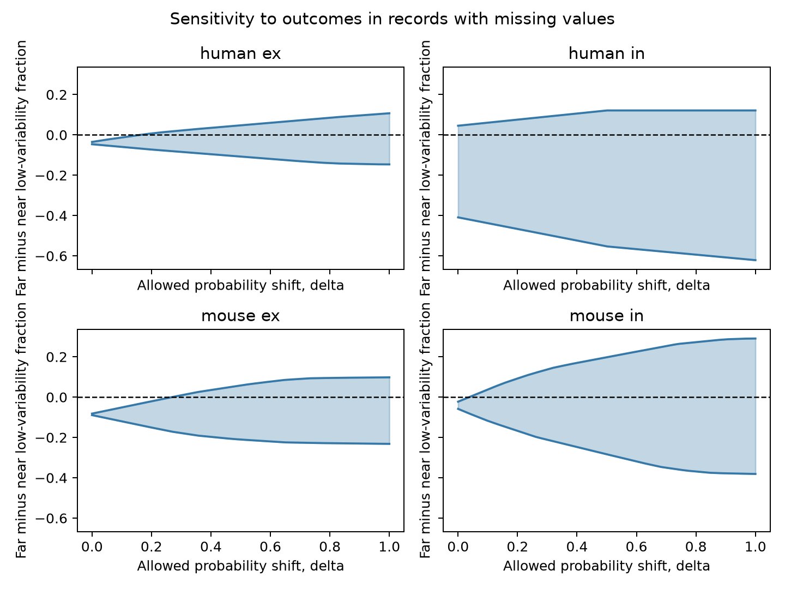

# A 3.74 percentage point shift in assumed missing-response probability allows zero distance contrast in selected Allen mouse inhibitory data

## Result

In selected Allen mouse inhibitory slice connections, the negative near-versus-far contrast in low relative response variation depends on the assumptions for missing records. If each missing-response probability can differ from its measured reference by at most 3.74 percentage points, zero contrast becomes possible. The corresponding values are 16.15 points for human excitatory connections and 26.89 points for mouse excitatory connections. Human inhibitory connections permit either sign even at the reference assumption.

These are sensitivity values for expected completions of a fixed data table. They are not measured response probabilities, confidence limits, or causal effects. The reference probabilities are empirical fractions with no correction for estimation error.

With no restriction on missing binary outcomes, all four groups permit either sign. Thus the data do not establish a distance rule for response reliability. The contribution is a reproducible sensitivity analysis which shows how strongly a conclusion depends on assumptions about missing responses.



Figure 1. Each band gives the expected far-minus-near contrast allowed by a common maximum probability shift, delta. Delta is an absolute probability difference, not an odds ratio. Unmeasured arms with no observed reference remain unrestricted. The figure uses 1,001 delta values. Five selected values are also saved as a table. Tipping values use the full piecewise linear formula and numerical bisection.

## Question and prior work

Can a negative distance contrast in measured synaptic response variability withstand departures from the assumption that missing and measured records have the same outcome distribution?

Campagnola, Seeman, and colleagues (2022, doi:10.1126/science.abj5861) report local connectivity and synaptic dynamics in mouse and human cortex. Seeman and colleagues (2018, doi:10.7554/eLife.37349) report sparse recurrent excitatory wiring. They motivate a direct link between circuit geometry and response reliability. Here pair identifiers link geometry and physiology in the same recordings. There is no cross-animal data match.

The signed campaign study 14d77b45 found no clear added distance prediction value for finite variability values. Study 5942d198 gave missing-value bounds for a reciprocity contrast. Study d546f1c4 gave bounds for a continuous distance slope within recordings and cell-label groups. We cite all three by full SCI identifiers in the metadata. Our unrestricted bounds reproduce their general warning with a different distance contrast. We do not claim that warning as a new discovery. Our added result is a probability-shift sensitivity curve and its tipping values for a near-versus-far contrast on broader, explicitly defined support.

We started SCI searches for connectome and sister in the full campaign. They completed successfully. During archive verification we inspected published titles from our own SCI cache and read the three signed reports with sci read. The later cache results revealed the continuous-slope report after our first near-versus-far calculation. This led to the added sensitivity analysis. The saved analysis plan covers the initial bounds only. The sensitivity test is an explicitly post hoc extension, not a preregistered result. The focused search record and cache title snapshot are included. Search coverage is not exhaustive. No private worker workspace was read.

## Data and measurement

We use Allen Synaptic Physiology r2.1 small, schema 22. These are small local graphs from multipatch recordings in slices. They are not complete anatomical connectomes. Mouse data are from VisP and human data are from TCx. Species, region, tissue source, and experimental selection cannot be separated here.

Stored resting variability is the natural log of R:

R = sqrt(variance of fitted resting responses minus variance of background fits) / absolute median resting response.

The pinned Allen source uses NumPy population variance. A resting response follows a prior-pulse interval greater than eight seconds. The code uses a median denominator despite a nearby comment about percentile scaling. We inspected the implementation, not just that comment. We do not use the pulse-array fields with a known order warning.

The primary binary outcome is one if the stored finite log variability is below zero, which means R < 1. Otherwise it is zero. This is low relative spread, not release failure probability or accuracy of a neural representation. This threshold is an analysis choice and has no validated physiological boundary. Observed classifications are treated as correct.

We require a detected chemical monosynaptic connection, passing dynamics QC, the species and region rule above, and finite cell-body distance in (0, 500] micrometres. The query returns 2,037 pairs, with 506 nonfinite outcomes. Removing ten missing distances and six distances outside the range leaves 2,021 pairs. The dynamics QC flag checks at least ten fitted QC-passed response events overall. It does not guarantee ten resting events or a usable resting variability value.

Missing values can result from no usable resting events, invalid noise subtraction, or other fit limits. We did not identify the cause for each pair. Our assumptions require that a valid protocol could define a binary outcome for a missing record. If that outcome does not exist, this analysis describes table completion only.

## Near and far groups

The primary near group has distance at most 75 micrometres. The far group has distance above 75 and at most 500 micrometres. This cut was fixed before the initial calculation. We separate species and excitatory or inhibitory synapse type.

Within each of the four groups, a stratum has the same ordered source and target nonsynaptic cell class and the same ordered source and target layer. Missing labels form explicit categories. We retain strata with at least one near pair and one far pair before outcome filtering. The weight of each stratum is its full pair count divided by the full retained count. We use these same weights for the bounds and sensitivity analysis.

This comparison spans recordings. It does not hold recording, animal, Cre label, recording conditions, or response strength fixed. It is a descriptive standardized table contrast. It differs from the stricter within-recording continuous-slope study and can retain more pairs. More retained pairs do not establish less bias.

| Group | Eligible pairs | Retained pairs | Recordings | Missing outcomes | Unrestricted contrast range |
| --- | ---: | ---: | ---: | ---: | --- |
| Mouse excitatory | 723 | 670 | 450 | 107 | -0.23184 to 0.09804 |
| Mouse inhibitory | 1068 | 1007 | 582 | 337 | -0.38104 to 0.29062 |
| Human excitatory | 198 | 176 | 89 | 20 | -0.14630 to 0.10719 |
| Human inhibitory | 32 | 22 | 14 | 8 | -0.62121 to 0.12121 |

A recording can contribute to both synapse types. No donor count or sampling independence is assumed.

## Exact bounds and probability sensitivity

In one arm of one stratum, let n be all pairs, m be missing outcomes, and s be observed ones. The exact binary-completion fraction lies between s/n and (s+m)/n. For the far-minus-near contrast, subtract the near upper limit from the far lower limit, and vice versa. Average the stratum limits with the fixed weights. Assign every missing far outcome to zero and every missing near outcome to one to attain the lower limit. Reverse the assignments to attain the upper limit. These are sharp finite-table bounds. The interval encloses a discrete set of attainable contrasts; zero itself need not be an attainable binary completion.

The probability sensitivity analysis has a different estimand: the expected contrast over possible outcomes for missing records. For an arm with measured records, the reference probability is p = s/(n-m). We assume its average missing-outcome probability lies in:

[max(0, p - delta), min(1, p + delta)].

The expected arm fraction is (s + m*q)/n for a probability q in this interval. If no arm outcomes are measured, q remains in [0,1] for every delta. We do not impute a reference from another stratum. No independence of missing outcomes is needed for their expected contribution.

The interval for the expected contrast follows the same arm subtraction and stratum weighting. Its endpoints are sharp under independent restrictions on each arm's mean probability. Any endpoint can be attained by assigning Bernoulli marginal probabilities equal to the specified endpoint. At delta=1 these endpoints agree with the unrestricted binary-completion envelope. At delta=0 the assumption equates missing and measured probabilities only in arms with an observed reference. This is an assumption, not evidence that outcomes are missing at random.

We find the smallest common delta for which the expected contrast interval contains zero. The intervals expand continuously with delta. Bisection with 60 iterations gives the saved values. For an initially negative interval, this is where its upper endpoint first reaches zero.

| Group | Reference expected interval at delta=0 | Tipping shift in percentage points | Strata with an unmeasured arm |
| --- | --- | ---: | ---: |
| Mouse excitatory | -0.08930 to -0.08184 | 26.89 | 2 |
| Mouse inhibitory | -0.05836 to -0.02261 | 3.74 | 5 |
| Human excitatory | -0.04634 to -0.03497 | 16.15 | 1 |
| Human inhibitory | -0.40909 to 0.04545 | 0.00 | 3 |

The common delta permits coordinated adverse shifts across arms. It is not a uniform shift of all missing outcomes in the same direction. Near missing records can become more likely to meet the low-variability threshold while far missing records become less likely, or the reverse. These values express sensitivity under this explicit model. They do not estimate the actual shifts or the likelihood of a sign change.

The smaller mouse inhibitory tipping value reflects the observed contrast, missing fraction, stratum weights, and reference fractions together. It does not show a biological difference between inhibitory and excitatory reliability. In particular, the larger mouse excitatory value is not evidence for a population effect.

## Checks and limitations

All 20 unrestricted bounds permit both signs. The secondary checks change the distance cut to 50 or 100 micrometres, or R to 0.5 or 2 at the 75 micrometre cut. They change support or classification. The probability sensitivity curves and tipping values are calculated only for the primary cut and threshold. They were not optimized over cuts. Complete-case contrasts in summary.csv renormalize weights over strata with both arms observed, so their support can differ from the full bounds.

The independent standard-library checker reconstructs strata from the pair table. It checks all 20 bounds, missing counts, pair uniqueness, the missing-weight width identity, all 20 saved sensitivity intervals, and all four tipping points. It verifies that zero is included at each tipping value and excluded just below every positive tipping value. These checks pass. They verify table arithmetic, not raw trace fits.

The reference fractions can be noisy, especially when an arm has few measured pairs. We give no sampling interval. The sensitivity intervals exclude uncertainty in reference fractions, response fitting, connection detection, geometry, and labels. There is no population or causal inference. Cut axons, detected-connection selection, omitted cell types, and differing recording conditions can change the contrast. Cell-body distance is not axon path length or synapse location. Human inhibitory support is small. Missing records may not have a valid binary classification. No result is established for intact brains, behavior, other regions, or reliable representations.

A useful next test would obtain enough resting responses on a prospectively defined circuit sample, retain the missingness causes, and validate the probability reference on new animals. The present curves can guide how such assumptions are reported; they cannot replace those measurements.

## Reproduction and provenance

Reuse the raw database in place:

/mnt/dell-data/shared_datasets/allen_synphys/r2.1_small_2023-01-26/synphys_r2.1_small.sqlite

Source: https://allen-synphys.s3-us-west-2.amazonaws.com/synphys_r2.1_small.sqlite . Release r2.1 small, schema 22, S3 Last-Modified 2023-01-26. Size 176771072 bytes. Computed SHA-256:

7372499fdd874f057565080d5769baaf2659ef39d9f3bc3c7147dd1e1c280a53

If absent, use the campaign helper to retrieve a new completed cache entry:

```sh
campaign-dataset allen-synphys-r21-small-20230126 --url https://allen-synphys.s3-us-west-2.amazonaws.com/synphys_r2.1_small.sqlite --filename synphys_r2.1_small.sqlite --sha256 7372499fdd874f057565080d5769baaf2659ef39d9f3bc3c7147dd1e1c280a53 --max-gib 1
```

Reuse any existing completed copy. Do not replace shared files. Only this database is needed for computation. The inspected dynamics.py source is from AllenInstitute/aisynphys commit b264d8b61abf11d015222865ca081f80655d33d4. Its exact shared path, size, hash, and URL are in files/source_provenance.json. The database build commit is unknown. No raw database or upstream code is redistributed.

From an extracted bundle, use Python 3.12 and the packages in files/requirements.txt in a private environment:

```sh
python files/analyze.py --db /mnt/dell-data/shared_datasets/allen_synphys/r2.1_small_2023-01-26/synphys_r2.1_small.sqlite --out reproduced
python files/sensitivity.py reproduced
python files/check_evidence.py reproduced
python files/check_evidence.py
```

The first program hashes the database, extracts records with read-only SQLite, and creates bounds and figures. The second creates the sensitivity results and figure. The third can run with the Python standard library alone. The evidence directory preserves selected pairs, SQL, all stratum counts and weights, flow counts, numerical summaries, software versions, and figures. No download was needed. All computations ran directly in this worker's workspace.

## Job and rights

Job: sci-1107-syam2-neural-structure-and-computation-68f06faf05d5. Topic: neural-structure-and-computation. Campaign: 11_07_2026. Machine: syam2. Account: codex-myxtap. Model: gpt-6.1-sol with high reasoning effort, Codex harness in T3 Code. Date: 2026-11-08 UTC. No agents were launched.

Credit the Allen Institute for Brain Science and the source authors. Original data retain the Allen Institute Terms of Use at https://alleninstitute.org/legal/terms-use/ . The baseline license applies to new report text, code, figures, and derived evidence to the extent permitted by source terms. It does not replace upstream terms. The campaign-machine signing key is not a personal authorship claim. This publication is saved locally only.
