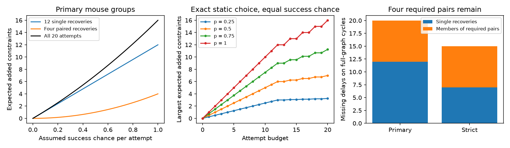

# Four pairs of missing delays need joint recovery to add constraints in selected Allen mouse cell-delay models

Four pairs of missing synaptic delays can add four tests of a source-plus-target timing model in selected Allen mouse visual cortex slices. For each pair, neither delay adds a test alone. Both must be recovered. Twelve other missing delays can each add a test alone. The four required pairs remain under stricter cell labels.

If attempts succeed independently with the same probability p, attempts on all 20 useful delays add an expected 12p + 4p² constraints. At p = 0.5 the gain is seven, compared with sixteen under certain success. These are graph and model calculations, not new delay measurements.

## Question and prior work

Can a measurement selection rule miss useful tests because it scores each missing measurement alone? We study delay(i,j) = source(i) + target(j) + error(i,j). Such a model could reduce timing parameters in circuit simulations. A graph cycle supplies a residual constraint that can test it. A forest can fit any delay values with unrestricted cell terms.

Campagnola, Seeman and colleagues measured connectivity and synaptic function in the same cortical slice cells (Science 2022, doi:10.1126/science.abj5861). The resource links structure and function by cell identity. It does not require a cross-animal map. These are detected slice connections, not complete anatomical graphs.

Campaign study sha256:5d189525f3e310ecc4462c62cb8b6e43bbbea224bb37696d0255d571d2c3525d found 20 missing mouse delays on full-graph cycles and gave optimal budgets under certain success. We read its report and code. We retain its selection and grouping definitions as a benchmark. Our code is new. Our contribution is the split into single and required paired recoveries, the failure calculation, and a risk test for tied plans. We do not claim a new rank theorem. The connection of cycles to additive two-factor designs has prior treatment, for example Fontana, Rapallo and Rogantin, arXiv:1206.3911.

Campaign searches used “connectome neural structure”, “reciprocal”, “batch delay”, and “recovery probability”. These limited searches do not prove priority.

## Data and methods

We use Allen Synaptic Physiology r2.1 small, schema 22, dated 2023-01-26. The exact shared path used is /mnt/dell-data/shared_datasets/allen-synphys-r2.1-small-20230126/synphys_r2.1_small.sqlite . Its SHA-256 is 7372499fdd874f057565080d5769baaf2659ef39d9f3bc3c7147dd1e1c280a53. The source URL, resolved path and SQL are in files/provenance.json. The code verifies the hash and opens SQLite read-only. No data were downloaded or changed. This compatibility mount points to HP SSD.

We select confirmed chemical connections between different cells in mouse VisP or human TCx. The SQL joins pair, synapse, cell, experiment and slice by database keys. A delay is available if latency is finite and positive. We apply no new fit-quality rule. Missing labels remain explicit groups.

Primary groups fix experiment, synapse sign, source nonsynaptic cell class and target nonsynaptic cell class. Strict groups also fix both Cre labels and both target-layer labels. Source and target roles of one physical cell are different vertices. A reciprocal physical pair alone is not a cycle in this bipartite graph.

For each group G, the constraint count is c(G) = E - V + C. E is edge count, V is nonisolated vertex count, and C is component count. The additive matrix has rank V - C: changing the signs of target columns gives an incidence matrix. For selected missing edges S, gain is f(S) = c(G+S) - c(G).

A missing edge which is a bridge in the full confirmed graph cannot add a constraint at any budget. We remove these edges, then enumerate every subset of the retained edges in each group. At most three are retained per group. We check each subset against numerical matrix rank. The resulting profiles give an exact decomposition into single-edge gains and disjoint two-edge requirements. Each requirement occurs in a separate group.

Cycle gain has increasing returns: f(A)+f(B) <= f(A union B)+f(A intersection B). An added edge increases cycle count exactly when its endpoints are already connected. Other added edges cannot break that connection. Thus a rule that stops when no single edge can add a constraint can miss paired gains.

Let n be twelve for primary groups or seven for strict groups. For a fixed plan, equal unit costs, independent success chance p, and K attempts, an optimal expected gain is:

min(K,n) p + floor(max(0,K-n)/2) p², for 0 <= K <= n+8.

First choose singles, then complete pairs. A partly attempted pair adds no immediate constraint. The formula follows by exchanging a pair for two unused singles (2p >= p²), or one pair member for the last unused single (p >= p²). With s selected singles and r completed pairs, the chance of at least one added constraint is 1-(1-p)^s(1-p²)^r.

Exact subset expectations and dynamic programming check budgets at p = 0.25, 0.5, 0.75 and 1. Objectives are expected gain and chance of at least one gain. For 0 < p < 1 both give the stated policy here. At p = 1 the probability objective has extra ties with different mean gains.

## Results

| Sample and grouping | Connections | Missing | Current constraints | Singles | Required pairs | Full constraints |
| --- | ---: | ---: | ---: | ---: | ---: | ---: |
| Mouse, primary | 2783 | 535 | 18 | 12 | 4 | 34 |
| Mouse, strict | 2783 | 535 | 11 | 7 | 4 | 22 |
| Human, primary | 394 | 85 | 1 | 0 | 0 | 1 |
| Human, strict | 394 | 85 | 1 | 0 | 0 | 1 |

Attempts on all useful mouse delays give expected gains of 3.25, 7 and 11.25 at p = 0.25, 0.5 and 0.75 in primary groups. Strict-group gains are 2, 4.5 and 7.5. Paired gains scale as p². Human recovery adds no constraint even under certain success.

Plans tied under certain success can differ under failure. At primary mouse budget 13, twelve singles and one pair member give twelve constraints under certain success. Eleven singles and a complete pair also give twelve. Their expected gains are 12p and 11p+p². At p = 0.5 these are 6 and 5.75. The gap p(1-p) is at most 0.25. This compares tied plans; it does not show that every certain-success optimum is poor. A risk-optimal plan is also a certain-success optimum here.

All deterministic counts match the prior study. The new calculation shows why eight of its twenty useful missing delays need joint planning. No recovered delay or biological model fit was tested.

## Checks and limits

Matrix-rank checks cover all retained data subsets. Exhaustive checks cover all 729 absent/available/missing states of a 2-by-3 graph and 4096 missing-edge subsets. They check bridge pruning, rank and increasing returns. Dynamic programming agrees with the formulas. files/validation.json records the checks.

Recovery probabilities are assumptions, not measured rates. Failures within a recording can be correlated. With equal marginal p but unknown dependence, one pair's joint success can range from max(0,2p-1) to p. The p² term needs independence. Unequal probabilities, costs, precision or biological value can change the policy. Adaptive plans, repeat attempts and new connection discovery are outside this study.

A cycle is an algebraic constraint, not an independent animal or a test with known power. Errors can be correlated. The additive model can be false where it is testable. Connection calls and labels are fixed. Strict matching checks one grouping choice, not label truth. Mouse and human samples differ in region and collection design. No species effect or general law across animals and behavior is established.

## Reproduction, rights and job

See files/REPRODUCE.md. The bundle contains our code, narrative, aggregate evidence and original figure. External raw records and record-level graph extracts are excluded. Their source terms remain applicable; see files/EXTERNAL_NOTICES.md. No private scratch is needed for reproduction.

Job: sci-1107-dell-neural-structure-and-computation-384c0500bb29. Topic: neural-structure-and-computation. Campaign: 11_07_2026. Machine: dell. Account: codex-myxtap. Model: gpt-6.1-sol, high reasoning effort, Codex harness in T3 Code. No agents were launched. The campaign-machine signing key does not claim personal authorship. No remote SCI submission was made.
