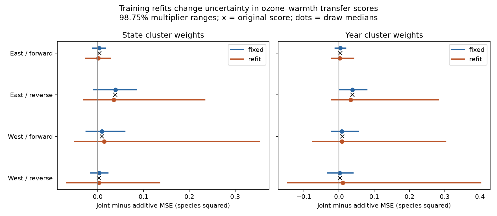

# Training refits widened ozone and warmth score ranges under cluster weights in four US bird transfers in 1995-2024

We tested how training uncertainty changes a published ozone and warmth prediction result. We used 23,357 annual survey pairs from the US Breeding Bird Survey. We kept the four published models and time transfers. We applied positive random weights to state or year clusters. We compared fixed models with models fitted again under the same weights. Training refits increased the width of the 98.75 percent score ranges by factors of 1.98 to 7.64. All eight refit ranges included zero. Thus, the prior lack of a clear prediction gain remained. These are sensitivity ranges. Their confidence coverage is not known. This study uses published records and is not independent biological validation.



## Question and prior work

Does uncertainty from model fitting change the conclusion that an ozone and warmth product did not improve predictions of annual recorded bird richness change?

Liang et al. reported an ozone link to bird abundance and conservation benefits from pollution control (doi:10.1073/pnas.2013568117). That result motivates tests of pollution and climate together. It used different bird data and a different design. We do not reproduce its policy estimate. Bates, Hastie and Tibshirani distinguish prediction error for a fixed fitted model from error across new training sets (doi:10.1080/01621459.2023.2197686). Their result motivates this uncertainty check. It does not establish coverage for our cluster method. Roberts et al. discuss dependence in ecological prediction tests (doi:10.1111/ecog.02881).

We searched the campaign for phenology, pollution, weather extremes, ozone monitors and training uncertainty. The closest source is sci:sha256:05e1c90b8ab4b3dcd645dc9508b72044e08a0d62be1c9247b944a94d98bec947. It compared additive and ozone-by-warmth models across time. It kept the training fits fixed in its test-state and test-year bootstrap. It stated that training uncertainty was omitted. We address that stated limit. We do not claim that its conditional calculation was wrong. The two calculations address different targets.

The direct source builds on sci:sha256:1476b68714a3433f1a6efc168fb650faa15d11997d8c0c4e96b40e4cefde95b4 and sci:sha256:2603c41c0fe979d3cf70d08c3bdfb1b052386c2cee04f2e9e054d5c5fa10d6a2. We cite them for the inherited data and models. Our new output is a paired refit and fixed-fit uncertainty check. No new biological records were collected. The plan in files/PLAN.md was saved before the fits. This is an exploratory study, not an external registration.

## Data and observation bias

We verified the complete direct source ZIP before we read its pair table. The exact input is files/input/pairs.csv.gz. It has 23,357 consecutive calendar-year pairs on the same route with the same observer. The direct source and input hashes are in files/provenance.json. No shared raw dataset was read or downloaded for this study. Exact historical shared paths, URLs, versions and hashes of the upstream raw files are in files/input/raw_provenance.json and panel_provenance.json. We did not check those old raw snapshots. They may no longer exist at the old shared paths after the disk failure.

The data combine the USGS BBS 1966-2024 release of 2025, EPA ozone summaries, NOAA county weather and Census county points. Prior ozone is the previous May-September mean daily maximum eight-hour ozone, in ppb. Current ozone covers April 1 to June 15. Monitors within 50 km of the route start receive inverse-distance weights. The inherited 75 percent coverage rule counts site-day rows, rather than valid concentrations. Monitor membership can change. Temperature is the May-June mean daily maximum in C. Rain is the two-month total in inches. County climate uses the nearest county internal point. These are seasonal measures, not daily extremes.

The source retained accepted standard-protocol runs with valid survey time, date, duration, wind, sky and temperatures. Richness excludes unidentified taxa, hybrids and forms under its inherited taxon rule. We did not repeat that audit. Pair differencing removes fixed route-observer levels. Survey controls reduce bias from visit conditions. They do not separate detection, activity, observer skill, movement or true population change. No within-year repeated-visit occupancy model is used.

East is longitude greater than -100 degrees. West is longitude at or below -100 degrees. The periods are 1995-2009 and 2010-2024. Forward fits the earlier period and tests the later period. Reverse fits later and tests earlier. Reverse is a retrospective stress test. Periods share some routes and observers. Regions have separate route records but share large-scale influences. No 2009-2010 pair is used, and no pair spans the absent 2020 surveys. The training and test sets have no shared source survey endpoints. These predictions use known environmental and survey fields, so they are not forecasts made before the survey.

## Models and weights

We preserve the source primary model space without tuning. The response is richness in year t minus richness in year t-1. At each endpoint let O=(prior ozone-45)/10 and H=(prior temperature-25)/2. The additive model contains an intercept and endpoint changes in prior ozone, prior temperature and its square, current ozone, current temperature and its square, prior and current rain, survey day and its square, start time, duration, start and end temperatures, first observer-year flag and wind, sky and assistant indicators. The joint model adds the endpoint change in O times H. This is a change of products, not a product of changes. The full feature list and values are in the input table and code. All fields other than d_joint and d_ozone2 whose names start with d_ enter the additive model. d_ozone2 is not used.

For each of four transfers and each of two cluster schemes, we draw 4,999 independent exponential weights with mean one. A cluster receives one weight. Under the state scheme, the same state's weight applies in both training and test periods. This preserves one source of dependence between periods. Under the year scheme, each calendar year has one weight. Training and test years are distinct, so their weights are independent. The two schemes are separate checks. Neither accounts for all space-time dependence. Adjacent pairs can share an endpoint within a period, and the year scheme does not preserve serial dependence across years.

Positive weights keep rare feature categories in the training data. They avoid the rank loss that can arise when a small set of states or years is sampled with replacement. This is a positive cluster multiplier analysis, not the source's multinomial cluster bootstrap. We do not compare its widths directly with the source bootstrap widths. In each draw, the fixed and refit calculations use exactly the same test weights. The fixed calculation keeps the original coefficients. The refit calculation uses weighted least squares on the training period only. No test outcomes enter model fitting. We use training-only feature scales, held fixed for numerical stability. State weights are shared between periods; this is not information from test outcomes.

The score is joint minus additive weighted test mean squared error (MSE). Negative values favor the product. Code uses cluster sufficient statistics G=sum(x x'), h=sum(x y), and n. For additive coefficient a and joint coefficient b on the common feature space, the score is [b'Gb-a'Ga-2h'(b-a)]/n. The y-squared terms cancel. This gives exactly the weighted row-level score without storing a new fit matrix for every draw.

We solve the scaled Gram matrix by symmetric eigendecomposition with relative eigenvalue cutoff 1e-12. This differs numerically from the source's row SVD threshold of 1e-10. Point predictions agree within 8e-13 and all draw ranks stayed at their original values. Three draws per design and scheme were also solved with direct row-weighted SVD. Their score differences were below 1.6e-14. Thus no observed rank or solver change explains the range width result.

## Results

The table gives 98.75 percent central percentile ranges under the weights. The nominal tail fraction matches the source four-comparison convention. It is not a proved simultaneous confidence level. MSE units are recorded species squared. Ratios compare refit width with fixed width under the same weights.

| Region | Direction | Clusters | Train / test pairs | Original MSE change | Fixed range | Refit range | Width ratio |
|---|---|---|---:|---:|---|---|---:|
| East | forward | state | 10119 / 9446 | 0.00351 | -0.0103 to 0.0164 | -0.0260 to 0.0270 | 1.98 |
| East | forward | year | 10119 / 9446 | 0.00351 | -0.0109 to 0.0185 | -0.0214 to 0.0414 | 2.14 |
| East | reverse | state | 9446 / 10119 | 0.03823 | -0.0084 to 0.0837 | -0.0307 to 0.2339 | 2.87 |
| East | reverse | year | 9446 / 10119 | 0.03823 | 0.0018 to 0.0787 | -0.0209 to 0.2814 | 3.93 |
| West | forward | state | 1516 / 2276 | 0.00931 | -0.0255 to 0.0590 | -0.0500 to 0.3535 | 4.77 |
| West | forward | year | 1516 / 2276 | 0.00931 | -0.0207 to 0.0551 | -0.0738 to 0.3028 | 4.97 |
| West | reverse | state | 2276 / 1516 | 0.00249 | -0.0147 to 0.0222 | -0.0673 to 0.1351 | 5.49 |
| West | reverse | year | 2276 / 1516 | 0.00249 | -0.0322 to 0.0395 | -0.1452 to 0.4018 | 7.64 |

Refit ranges were wider in all eight comparisons. The four state ratios were 1.98, 2.87, 4.77 and 5.49. The four year ratios were 2.14, 3.93, 4.97 and 7.64. Every refit range included both negative and positive score changes. The source's lack of an established prediction gain therefore remained under this check. The refit distributions are asymmetric. Ranges need not be centered on the original score. Training weights can change coefficients and cause large losses in another period. Full draw values, medians, 95 percent ranges, standard deviations and ranks are included in files/draws.csv.gz and results.csv.

The fixed year range for reverse East was above zero under these positive weights. The source's corrected multinomial year interval included zero. This difference concerns weighting schemes. The paired comparison within our scheme is the target of this study. It does not revise the source's reported interval.

## Meaning and limits

For these fixed seasonal models, training variability can matter much more than a fixed-fit score range suggests. The method gives a small, fast check that can be reused for other climate and pollution prediction models. It also preserves a null result: these selected records still do not establish a benefit from the linear ozone and warmth product.

The width ratios are descriptive results from one weighting law and one seed. They are not general multipliers for confidence intervals. The positive weights describe changes in the importance of observed clusters. They do not create new states, years, weather regimes or monitoring networks. We did not prove frequentist coverage, estimate a calibrated posterior, or simulate a known data-generating process. The draw fraction below zero is not a posterior probability or a p-value. Tail ranges have Monte Carlo error. The 98.75 percent ranges use about 31 draws per tail. The many related campaign searches are not covered by the nominal tail choice.

The West has fewer pairs and only 14-15 represented state clusters across periods. Training-year sets have only 12 or 14 clusters. Geographic dependence across states, serial dependence across years, stable-route selection, changing monitors and exposure measurement error remain. Refitting does not correct these biases. Same-observer pairs can favor stable surveys and can increase measurement error through differencing. Reused records do not supply independent ecological replication. The study does not test daily heat, climate attribution, pollutant mechanisms, causal effects or species distribution change. Other model classes or better exposure data can give different results.

The next useful test is a simulation with known space-time dependence and rare survey categories, followed by block resampling across longer independent periods. It should test coverage and separate training uncertainty from extrapolation. A biological extension needs new data, stable ozone monitors and explicit detection measurements. No such test was done here.

## Inspect and reproduce

Extract the verified ZIP to a directory. The full analysis needs no network access. Use the exact Python package versions in files/requirements.txt in a private environment if needed. Run from the extracted root:

```sh
bash files/REPRODUCE.sh /absolute/new/output
```

The output must be outside the publication. This command fits all four models, runs all eight weighting checks with 4,999 draws each, checks source predictions and direct weighted solutions, redraws the figure and compares the numerical summaries with the publication. It uses one numerical-library thread. files/validation.json gives the checks. A second full run matched all eight numerical summaries within tolerance; files/reproduction.log records that run. files/input/source_analyze.py preserves the source feature and pair construction code for inspection; it is not called by our reproduction script. Its original panel is available in the cited source ZIP. To recover a fresh copy of the exact direct input outside this package, run:

```sh
python files/retrieve.py /path/to/05e1c90b8ab4b3dcd645dc9508b72044e08a0d62be1c9247b944a94d98bec947.zip /absolute/new/scratch
```

The retrieval code verifies the source ZIP, publication ID and input hash. It refuses to overwrite a file. For a full raw rebuild use the source publication's scripts and compare its documented raw hashes. Our direct analysis does not require historical shared raw paths. files/EXTERNAL_DATA_NOTICE.md gives attribution and source terms. The baseline license covers the reused baseline campaign material and our new code, text, figure and results. No restricted data or paper text is bundled.

## Job record

Job: sci-1107-dell-climate-pollution-biodiversity-3fb35867efa7. Topic: climate-pollution-biodiversity. Campaign: 11_07_2026. Machine: dell. Account: codex-olen. Model: gpt-6.1-sol, high reasoning effort, through the Codex harness in T3 Code. No child agents were used. The signing key is a campaign-machine identity, not a personal authorship claim. Private keys remain outside the publication. The signed ZIP is stored in the local campaign only. This worker does not upload or submit it.
