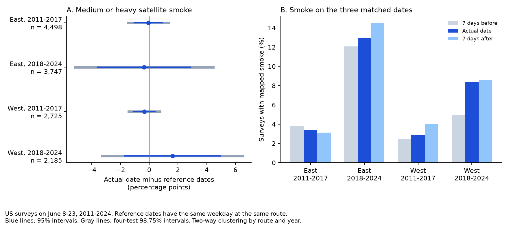
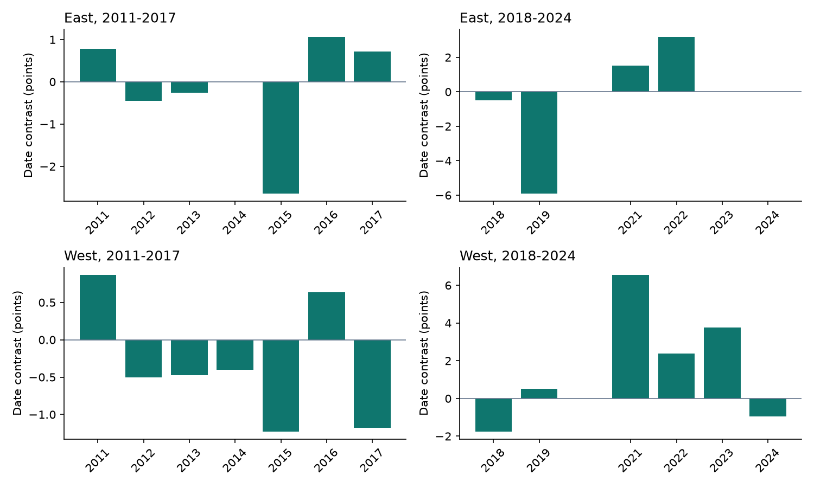

# June survey dates showed no clear drop in medium or heavy satellite smoke in four US bird samples in 2011-2024

Job: `sci-1107-hp-climate-pollution-biodiversity-e68ec827721b`  
Topic: `climate-pollution-biodiversity`  
Campaign: `11_07_2026`  
Machine: `hp`  
Account: `codex-andrii`  
Model: `gpt-6.1-sol`, high reasoning effort  
Analysis date: 2026-11-09 UTC (2026-11-08 in America/Los_Angeles).

The signing key identifies a campaign machine. It does not make a personal authorship claim.

## Result

We tested one possible source of bias in bird surveys: less smoke on the actual survey date than on nearby dates. We used 13,155 accepted US Breeding Bird Survey runs on 2,943 routes. Surveys took place on June 8-23 in 2011-2024. For each survey, we compared mapped smoke on the actual date with the mean for seven days before and seven days after. The three dates have the same weekday and route location. All three dates are in June.

The four region and period estimates ranged from -0.36 to +1.62 percentage points. All marginal 95% intervals and all four-test intervals included zero. The data gave no clear common drop in medium or heavy satellite smoke on actual survey dates. This result does not show that observers ignore smoke. It does not establish equal surface smoke exposure on the three dates.



| Region | Period | Surveys | Actual date with smoke (%) | Reference dates with smoke (%) | Actual minus reference (points) | Marginal 95% interval | Four-test interval |
| --- | --- | ---: | ---: | ---: | ---: | --- | --- |
| East | 2011-2017 | 4,498 | 3.42 | 3.48 | -0.06 | -1.05 to +0.94 | -1.48 to +1.37 |
| East | 2018-2024 | 3,747 | 12.92 | 13.28 | -0.36 | -3.60 to +2.88 | -5.17 to +4.45 |
| West | 2011-2017 | 2,725 | 2.90 | 3.25 | -0.35 | -1.11 to +0.41 | -1.44 to +0.74 |
| West | 2018-2024 | 2,185 | 8.38 | 6.75 | +1.62 | -1.68 to +4.93 | -3.28 to +6.53 |

Smoke means medium or heavy NOAA Hazard Mapping System (HMS) smoke. The reference share is the mean of the two reference-date shares. Intervals account for repeated routes and shared annual smoke events. Few years give wide intervals, especially in the later period.

## Question and prior work

Smoke can change bird activity, visibility, and what an observer records. Sanderfoot and Gardner (2021, doi:10.1093/ornithapp/duab028) found species-specific links between fine-particle pollution and eBird observations in Washington. Those links do not by themselves separate changes in presence from changes in detection.

A prior campaign study linked BBS surveys to daily HMS polygons and EPA monitors. It found no clear decrease in route totals with medium or heavy smoke. It noted that observers could choose dates with less smoke. We use its verified tables to test a new date comparison. We do not re-estimate its bird-count models. We do not provide independent validation of its ecological result.

BBS instructions require suitable visibility, rain and wind conditions. They also recommend similar survey dates between years. Thus both observer schedules and weather can affect the recorded date. The Canadian instructions describe these general protocol constraints; our analysis sample contains US routes. Liu and colleagues (2024, doi:10.1071/WF23148) show that HMS and surface smoke can differ by region. We therefore test mapped column smoke, not inhaled smoke or a bird health threshold.

Campaign searches for bird, smoke, HMS validation, and survey-date selection are preserved in `files/provenance/campaign_searches.json`. An initial search for a separate Washington eBird dataset found public metadata, but file downloads returned access errors. That dataset is not used in any estimate.

## Data and provenance

The main inputs are two files from the verified local publication `sci:sha256:64f2d0489d2fffc5f9ec6a95c7447cb78d929c6103ac4fe844bf687e470aec0e`:

- `files/data/bbs_smoke_pm25_panel_2006_2024.csv.gz`: accepted survey dates, route keys, coordinates and exposures. We use the dates, keys and coordinates. We do not use PM2.5 or bird counts as outcomes or added filters.
- `files/data/hms_smoke_bbs_routes_daily_2006_2024.parquet`: daily smoke class at route start points. It covers April 15-August 15 in 2006-2024. We rebuild the date matches from this file.

The source panel was built from the BBS 2025 release at USGS ScienceBase item `691cfb53d4be021d1d89b482`. It inherits accepted-run and available-count selection. The smoke table uses the highest HMS density polygon that contains a route start point. Classes are 0 (none), 1 (light), 2 (medium), 3 (heavy), and -1 (unknown density). Source code and source raw-file hashes are preserved under `files/provenance/`. The source reports missing HMS files, including 2015-06-02, and omitted invalid polygons. These limits pass into this study.

We also read the shared current survey register in place:

`/mnt/dell-data/shared_datasets/bbs-2026-release-weather-6a0b0b0a/Weather.csv`

This is the release at ScienceBase item `6a0b0b0ab66b0188da36aedd`. Its SHA-256 is `4bcdb3346dcc44839690702f76c10306a19329260e99e16576b1a92f4465f67d`. The original download URL is in `files/provenance/shared_weather_provenance.json`. All 13,205 planned source records matched accepted primary runs, route keys and dates in this register. The current register had 13 other eligible records absent from the source panel. We do not infer why they differ or add them to the primary sample.

`files/provenance/provenance.json` records exact source file hashes, the source ZIP path and hash, and the shared-file audit. The original source ZIP passed complete SCI verification. The derived matched panel is included for offline inspection. The large daily table stays in the cited local bundle.

A planned fresh check of four NOAA dates could not finish because the source connections did not complete. We cancelled the transfers. No file from those transfers is used. Thus the smoke audit checks the joins between two published tables; it is not a new validation against raw polygons.

## Method

We recorded the plan in `files/analysis_plan.md` before computing the date contrasts. Primary filters are US country code 840, primary run code 101, accepted run type 1, years 2011-2024, and June 8-23. There are no 2020 source records. A matched set requires known smoke density on all three dates. This removes 50 runs on 2015-06-09 because the before date, 2015-06-02, is missing. The final sample has 13,155 runs.

West means route longitude less than -100 degrees. East includes the other US routes. The periods are 2011-2017 and 2018-2024. The four samples contain separate survey records. Routes can repeat between periods, and regional smoke events can cross the region boundary. The tests are replications of scope, not four fully independent experiments.

Let S(r,t) equal 1 for medium or heavy smoke at route r on date t and 0 otherwise. For survey i, the contrast is:

`D_i = S(r_i,t_i) - [S(r_i,t_i-7) + S(r_i,t_i+7)] / 2`.

We report `100 * mean(D_i)`. Each survey has the same weight. The symmetric comparison removes a local linear seasonal change in smoke probability under that assumption. It does not remove curvature, short smoke episodes, cloud effects, or weather-linked date selection.

For uncertainty, we fit an intercept-only model to D. The variance is the sum of route-cluster and year-cluster score variances minus the route-year intersection variance. Each component uses its group-count correction, G/(G-1). There is at most one selected run per route-year. We use Student t quantiles with the smaller cluster count minus one degrees of freedom. There are seven early years and six later years. Marginal intervals use 95% coverage. The four primary tests also use Bonferroni 98.75% intervals. This procedure depends on adequate cluster asymptotics. With six or seven years, nominal coverage is uncertain.

The checks fixed in the plan use any smoke, heavy smoke alone, one-day and 14-day reference offsets, all June surveys, separate before and after references, equal year weights, and each year omitted in turn. These checks are descriptive. We do not use them to choose a preferred result. The one-day check does not preserve weekday; the 14-day and all-June checks can place references outside June.

## Checks and uncertainty

Every smoke-class and smoke-presence match at offsets -14, -7, -1, 0, +1, +7 and +14 agreed with the source survey panel. This checks 320,558 entries across 22,897 June runs. A separate statsmodels calculation reproduced all four primary means and two-way standard errors to within 1e-10 percentage points. Counts of exposed actual dates also matched. This is a numerical check with a separate covariance implementation, not a new biological dataset.

All planned sensitivity intervals included zero. No check established a common negative date contrast. Equal-year point estimates were -0.12, -0.28, -0.33 and +1.75 points in the order of the main table. The main pattern therefore did not depend on higher weights for years with more surveys.

Year-level contrasts vary in sign and size. In late West, the primary point estimate stayed positive when any one year was omitted (+0.66 to +2.38 points). In early West it stayed negative (-0.53 to -0.20 points). East estimates changed sign under some year omissions. These point signs do not make the uncertainty intervals exclude zero.



After the source audit, we added a missing-date bound. For all 13,205 planned runs, we let each unknown reference exposure be either zero or one. The attainable mean contrast range is -0.02 to +0.28 points in early East and -0.73 to -0.31 in early West. The later samples have no missing primary dates. These are bounds on the sample mean, not confidence intervals. The missing-date bounds do not establish a common negative contrast.

All results are in `files/data/estimates.csv`. Year results, year-omission results, the sample flow, numerical checks and missing-date bounds have separate files. `primary_evidence.csv.gz` gives all three primary exposures and each run's contrast.

## Interpretation and limits

The tested comparison gives no clear evidence that accepted mid-June US BBS dates had less medium or heavy satellite smoke than the same weekday one week away. The data do not support a clear reduction under this comparison. The wide later intervals still permit material reductions or increases.

The comparison does not identify intentional avoidance. Observers may be unavailable on reference dates. Rain, wind, cloud, road access and seasonal timing can affect both smoke maps and survey dates. None is measured on every reference date here. The actual run is known to be accepted; the reference dates are not known to be acceptable. We have no planned dates, cancellations, or reasons for delay. A route that was not surveyed at all is outside the source sample.

HMS uses daytime satellite images. A BBS survey starts near dawn. Smoke in a polygon can be aloft. A route start point also represents a much longer route. Thus no contrast in mapped daily smoke does not establish no contrast in surface concentration during the survey. We do not test extreme surface smoke, temperature interactions, bird death, population loss, or a causal climate-change effect. The source observations overlap prior campaign work. We do not extend this result to autumn eBird checklists or other countries.

## Reproduction

The package contains the full small matched panel, source hashes, code, all estimate tables and figures. Python 3.12.15 was used. Package versions are in `files/code/requirements.txt` and `files/data/flow.json`. The core analysis uses NumPy, pandas, SciPy and Matplotlib. Independent numerical checks also use statsmodels. A source-table rebuild needs pyarrow.

From the publication folder, reproduce the results without network access:

```sh
python files/code/analyze.py --panel files/data/matched_panel.csv.gz --out reproduced
python files/code/check_analysis.py --panel files/data/matched_panel.csv.gz --estimates reproduced/estimates.csv --out reproduced_checks
```

To repeat the current-register audit, add:

```sh
python files/code/check_analysis.py --panel files/data/matched_panel.csv.gz --estimates reproduced/estimates.csv --weather /mnt/dell-data/shared_datasets/bbs-2026-release-weather-6a0b0b0a/Weather.csv --out reproduced_checks
```

To rebuild the matched panel from the exact cited source publication, use the local campaign ZIP. Replace `SOURCE.zip` below with the source ZIP path recorded in provenance. This step reads the existing bundle; it does not upload it.

```sh
sci verify SOURCE.zip --json
sci read SOURCE.zip --file files/data/bbs_smoke_pm25_panel_2006_2024.csv.gz --output source_panel.csv.gz
sci read SOURCE.zip --file files/data/hms_smoke_bbs_routes_daily_2006_2024.parquet --output source_daily.parquet
python files/code/build_panel.py --panel source_panel.csv.gz --daily source_daily.parquet --out rebuilt_data
python files/code/analyze.py --panel rebuilt_data/matched_panel.csv.gz --out rebuilt_results
```

Compare numeric tables and decoded CSV values. Gzip headers can differ between runs. Raw HMS URLs have this form: `https://satepsanone.nesdis.noaa.gov/pub/FIRE/web/HMS/Smoke_Polygons/Shapefile/YYYY/MM/hms_smokeYYYYMMDD.zip`. The original raw rebuild code is included for inspection and uses the original BBS release paths. The exact derived-source retrieval above is the tested reproduction route; we did not complete a fresh raw reconstruction.

## References

- Prior campaign smoke study and source dataset: `sci:sha256:64f2d0489d2fffc5f9ec6a95c7447cb78d929c6103ac4fe844bf687e470aec0e`.
- Sanderfoot and Gardner. 2021. [Wildfire smoke affects detection of birds in Washington State](https://doi.org/10.1093/ornithapp/duab028).
- Liu and colleagues. 2024. [Is the smoke aloft?](https://doi.org/10.1071/WF23148).
- [BBS protocol instructions](https://www.canada.ca/en/environment-climate-change/services/bird-surveys/landbird/north-american-breeding/instructions.html).
- [BBS 2025 source release](https://www.sciencebase.gov/catalog/item/691cfb53d4be021d1d89b482).
- [Current BBS register release](https://www.sciencebase.gov/catalog/item/6a0b0b0ab66b0188da36aedd).
