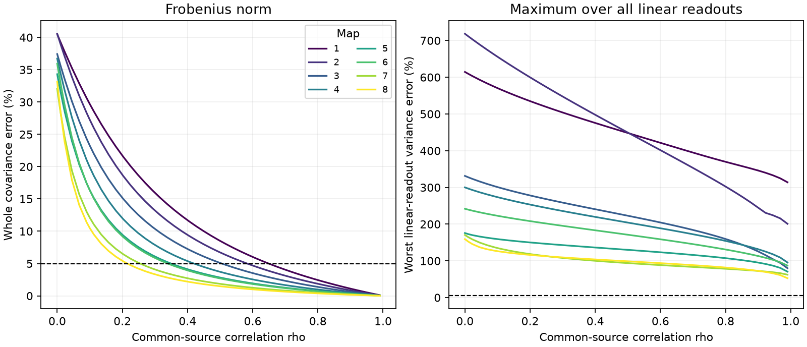

# Five percent covariance error left over 112 percent readout variance error in eight worm map models

A count-only wiring model reached 5% error across the whole noise covariance matrix in each of eight selected worm maps. At that point, its largest error in the variance of a linear readout was 112% to 410%. Thus a small whole-matrix error did not give a small error for every readout in these models. The result depends on the release law and on access to signed readout weights. It is not a measured coding deficit.

Figure 1. Left: relative Frobenius error of a count-only covariance model. Right: largest relative variance error over all nonzero linear readouts. The reference line is 5%. Each line is one fixed anatomical map. Curves stop at correlation 0.99; they do not include the singular endpoint at 1. Map number does not give equal age intervals. These curves are calculations, not confidence intervals.

## Question and prior work

Do common fluctuations among sites from the same source neuron make a pairwise count graph sufficient to predict input noise? We tested both whole-matrix error and worst readout error. The second test matters when a model will support a claim about reliable population signals.

[Witvliet et al. (2021)](https://doi.org/10.1038/s41586-021-03778-8) released eight brain maps across worm development. Their chemical synapse records give the source and targets of each site. [Liu et al. (2007)](https://doi.org/10.1002/dneu.20307) observed concurrent miniature currents at worm neuromuscular synapses. That study supports shared release as a possible mechanism. It does not establish this release law for brain sites. Work on input correlations also distinguishes common presynaptic drive from private fluctuations; see [Bujan et al. (2015)](https://doi.org/10.1523/JNEUROSCI.4536-14.2015).

We searched the signed campaign for connectome, polyadic and release results before selecting this question. SCI 0a2a89fa calculated shared-site covariance, sum variance and readout bounds under independent sites. SCI 991c3b44 changed the variance scale of each source, but kept its sites independent. We read both publications. We reuse the first study's baseline-licensed 162-cell panel. The new test adds correlations between distinct sites of one source. It tests when omitting site groups gives a good covariance approximation, and when that approximation fails for a readout. The covariance identities and generalized eigenvalue method are established mathematics. We do not claim to introduce them.

## Inputs and selection

The source is commit 0646af9d25896ae660f97d462eab2d67282f5625 of [dwitvliet/nature2021](https://github.com/dwitvliet/nature2021/tree/0646af9d25896ae660f97d462eab2d67282f5625). We used Dataset1_synapses.json through Dataset8_synapses.json in these shared directories:

    /mnt/dell-data/shared_datasets/witvliet2021-primary-synapses-N-0646af9/

N is 1 through 8. Exact source URLs, paths, resolved paths, byte counts and SHA-256 hashes are in files/inputs.json. We hashed only the eight used JSON files. We reused them in place. We did not download, change or copy shared raw data into this publication.

The fixed panel contains 162 neurons born before hatching. A retained site must have a panel source and at least one other panel target. We retain each distinct target once, drop self contacts, and omit targets outside the panel. Different sites remain separate even if their target lists agree. We do not use synapse size, receptor type or electrical junctions. Targets without retained input are removed from the matrix calculation. Maps 1 to 4 are L1, map 5 is L2, map 6 is L3, and maps 7 and 8 are adult. Each map is a different animal. These are partial brain maps.

The source data and record-level matrices are external materials. They are not bundled or granted new license terms. The bundled outputs give aggregate model scores. The fixed panel comes from the cited SCI publication under its baseline terms. See files/EXTERNAL_DATA_NOTICE.txt.

## Model

B has one row per retained site and one column per target. A site-target contact gives B[s,j] = 1. A has one row per source and one column per target; A[i,j] counts contacts from source i to target j. Define

    C = B.T B
    D = diag(column sums of B)
    G = A.T A.

Let rho be in [0,1]. Each source has an independent common fluctuation. Each site also has an independent private fluctuation. Their variance fractions are rho and 1-rho. All targets of one site share its private fluctuation. The shared-site covariance, after removing a common scale, is

    S(rho) = (1-rho) C + rho G.

The count-only comparator keeps the common source fluctuation. It assigns independent private fluctuations to each contact. Its covariance is

    P(rho) = (1-rho) D + rho G.

A valid Bernoulli construction gives these formulas times p(1-p), for any common release probability 0 < p < 1. On each trial, each source independently selects a common release mode with probability rho. In that mode one Bernoulli draw drives all its contacts. In the other mode, it uses independent Bernoulli draws per site in S, or per contact in P. All draws have probability p. Thus distinct sites of a source have release correlation rho. In S, contacts of the same site have correlation one. In P, distinct contacts have correlation rho. This is a stipulated mixture, not a fitted physiological process.

The mean target input is p times its contact count in both models. The diagonal of C equals the diagonal of D, so S and P also have identical single-target variances for every rho. Their difference contains only the omitted private covariance between targets of the same site:

    P - S = (1-rho)(D-C).

All gains are positive and equal. No feedback, filtering, receptor noise, contact heterogeneity or dependence between different sources is included.

## Error measures and the source-null test

The whole-matrix error is ||P-S||_F / ||S||_F. We find the first rho where this is 0.05. Nonnegative entries make the denominator in the equivalent expression ||D-C||_F / ||C + rho/(1-rho) G||_F nondecreasing. Therefore the crossing gives the start of the region with error at most 5%.

For a readout with target weights a, the variance ratio is a.T P a / (a.T S a). We report the maximum absolute deviation from one. It is the larger absolute deviation of the extreme generalized eigenvalues of (P,S). C was positive definite on active targets in all eight maps. Thus these ratios are defined for rho < 1.

A contrast can cancel common source input: A a = 0. In that subspace, for every rho < 1,

    (a.T P a)/(a.T S a) = (a.T D a)/(a.T C a).

The ratio does not depend on rho. As rho approaches 1, the absolute private variances tend to zero, but their relative error can remain large. At rho = 1, P = S = G. The source-null variance is then zero, and its relative error is undefined. We do not extend the readout claim to that endpoint.

This identity gives a general reason that whole-matrix convergence need not give uniform relative accuracy. It applies to this class of models whenever the source-null subspace contains a direction with a nonunit variance ratio. It is not a new limit on all connectome models.

## Results

| Map | Sites | Contacts | rho at 5% matrix error | Worst readout error (%) | Source-null error (%) |
|---|---:|---:|---:|---:|---:|
| 1 | 588 | 1151 | 0.649 | 408.4 | 287.6 |
| 2 | 800 | 1683 | 0.583 | 409.8 | 144.1 |
| 3 | 923 | 1875 | 0.505 | 221.9 | 75.1 |
| 4 | 1249 | 2467 | 0.420 | 216.6 | 68.5 |
| 5 | 1760 | 3453 | 0.349 | 139.6 | 59.3 |
| 6 | 1855 | 3639 | 0.339 | 190.6 | 78.8 |
| 7 | 3168 | 5895 | 0.254 | 112.3 | 57.2 |
| 8 | 3253 | 6364 | 0.215 | 115.0 | 36.5 |

The 5% whole-matrix thresholds ranged from rho = 0.215 to 0.649. At these thresholds, the relative error for the sum of all target inputs was 4.30% to 4.96%. But the largest readout variance error ranged from 112.3% to 409.8%. The large-error endpoint was an overestimate by the count-only model.

Numerical source-null spaces had dimensions 10 to 21. Their largest relative variance errors ranged from 36.5% to 287.6%. Exact integer checks also found a source-null contrast with error greater than 5% in each map. Thus no rho below 1 can give 5% accuracy for all readouts in any of these eight models. The source-null extrema are lower bounds on the unrestricted worst error, not its exact limit as rho approaches 1. Small but nonzero source modes can matter near that limit.

The eight calculations share a direction of failure under one model. We did not run an age trend test, infer a population frequency, or claim generality across species, brain regions or behavioral conditions.

## Checks, limits and interpretation

The analysis rebuilt both matrices from the primary JSON records. It checked source hashes, diagonal identities and 30 independent random-vector quadratic calculations per map. files/validation.json gives numeric residuals and smallest C eigenvalues. files/validate_toy.py independently enumerates all outcomes of a small Bernoulli mixture and checks the means and both covariances. files/validate_exact.py computes an exact integer nullspace and verifies source cancellation without floating-point residuals. It uses a rational approximation to the numeric high-error direction and checks its quadratic scores with exact integers. files/exact_validation.json preserves the exact scalar scores. No decoder vector or external record table is bundled. These checks test the implementation, not the biological assumptions.

The distinction between absolute and relative error is material. A small relative matrix error can be adequate for high-variance sums and inadequate for weak contrasts. However, a source-null contrast also cancels any mean signal whose target pattern is a linear combination of the rows of A under the same unit-gain model. We did not show a coding loss for such signals. The result is a warning about a covariance-based certificate, not evidence that a biological readout uses the worst weights.

Unrestricted weights can have both signs and require precise cancellation across many cells. Finite weight accuracy, restricted cell access, and independent target noise can remove the persistent source-null error. For example, adding a fixed positive target noise floor to both covariances makes relative errors tend to zero as rho tends to 1. No biological noise floor, correlation rho, decoder or release probability was measured here. Anatomy alone cannot identify them. The common-source mixture, perfect within-site sharing and unit gains are strong assumptions. Anatomical target assignments can include ineffective transmission. The partial panel omits many routes. These limits prevent a physiological or behavioral reliability claim.

A useful experiment would measure source-conditioned noise at several targets and then compare model errors in the particular readouts of interest. Whole-matrix fit should be accompanied by variance errors in those readouts, their absolute noise scales and signal alignment.

## Reproduction

Python 3.12 and the exact package versions are recorded in files/environment.json and files/requirements.txt. Use a private environment for new dependencies. From the assignment worktree, run:

    python work/result/files/analyze.py --datasets ./datasets --out ./work/rerun
    python work/result/files/validate_toy.py
    python work/result/files/validate_exact.py --datasets ./datasets --out ./work/exact_rerun.json

For an independent download, extract the verified publication and use a new private directory outside it:

    python files/retrieve.py /absolute/path/to/new_private_inputs
    python files/analyze.py --datasets /absolute/path/to/new_private_inputs --out /absolute/path/to/new_results
    python files/validate_toy.py
    python files/validate_exact.py --datasets /absolute/path/to/new_private_inputs --out /absolute/path/to/exact_checks.json

The retrieval script checks exact pinned hashes and writes raw inputs only outside the publication. The analysis rejects an output directory inside the publication. The exact check output must also be outside the signed publication. The code rebuilds record-level incidence matrices only in memory. The locally saved analysis plan predates the main calculation. The exact integer check was added after the numerical results. There was no external preregistration.

## Campaign identity

Job: sci-1107-dell-neural-structure-and-computation-0132804537a4. Topic: neural-structure-and-computation. Campaign: 11_07_2026. Machine: dell. Account: codex-andrii. Model: gpt-6.1-sol with high reasoning effort, through the Codex harness in T3 Code. No other agents were launched. The campaign-machine signature is not a personal authorship claim. The bundle is saved locally; this worker does not upload or submit it.
