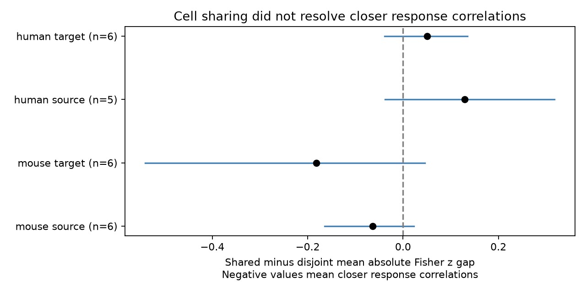

# Matched Allen slice data leave shared-cell similarity of successive-response correlations uncertain

## Result

The selected data do not give clear evidence that two excitatory connections have more similar successive-response correlations when they share a source or a target cell. The test used mouse visual cortex and human temporal cortex slices from Allen Synaptic Physiology r2.1 small. It did not measure correlation between two connections on common trials.

| Sample and shared cell | Edges | Shared / disjoint edge pairs | Groups / recordings / inferred donors | Difference | Descriptive 95% interval | Exact p |
| --- | ---: | ---: | ---: | ---: | --- | ---: |
| Mouse, source | 30 | 11 / 23 | 6 / 6 / 6 | -0.06380 | -0.16486 to 0.02253 | 0.31250 |
| Mouse, target | 28 | 12 / 22 | 6 / 6 / 6 | -0.18156 | -0.54057 to 0.04604 | 0.40625 |
| Human, source | 27 | 11 / 26 | 5 / 5 / 5 | 0.12971 | -0.03735 to 0.31773 | 0.50000 |
| Human, target | 32 | 15 / 25 | 7 / 7 / 6 | 0.05038 | -0.03851 to 0.13485 | 0.34375 |

The difference is the mean absolute Fisher z gap for shared-cell pairs minus that for disjoint pairs. Negative values mean closer correlations in the shared-cell group. Each inferred donor has equal weight. Holm correction for four planned tests gives p = 1 for all four tests. Edge pairs and donors can occur in more than one test. Counts must not be added as if they were independent samples.



Figure 1. Points show donor mean differences. Lines show descriptive 95% donor bootstrap intervals. All four intervals include zero. The figure and statistics are new work based on Allen Institute data, credited below.

## Question and prior work

A circuit model can assign response statistics to each connection or to each cell. If connections from one source have similar temporal response fluctuations, a source-level parameter could be useful. Similarity at one target could instead support a target-level parameter. We test these two associations against disjoint connections with matched labels in the same recording. Neither association alone would identify a causal mechanism.

Campagnola, Seeman and colleagues measured local connections and synaptic dynamics in mouse and human cortex (Science 2022, doi:10.1126/science.abj5861). They found that cell classes help describe dynamics. Branco and colleagues showed that local target activity can affect release probability (Neuron 2008, doi:10.1016/j.neuron.2008.07.006). Barri and colleagues used response correlations to help infer transmission models (doi:10.1523/ENEURO.0113-15.2016). These studies motivate a test that keeps cell labels fixed and does not equate a response correlation with a single release mechanism.

We searched the campaign before choosing the precise question. Search terms included connectome, reciprocal delay, electrical chemical overlap, paired event correlation reciprocal, shared source correlation, and quoted combinations of correlation with divergent and successive-response with source. We read SCI bd18d375..., which tests reciprocal versus one-way connections on the same response endpoint. The present work tests similarity between two edges, with shared-source and shared-target motifs. It reuses the public release and endpoint interpretation, not upstream code or numerical tables. It is not an independent replication of the source dataset. The search is a discovery check, not proof of novelty.

## Data and measurement

Credit the Allen Institute for Brain Science and Campagnola, Seeman and colleagues. We used Allen Synaptic Physiology r2.1 small, dated 2023-01-26:

https://allen-synphys.s3-us-west-2.amazonaws.com/synphys_r2.1_small.sqlite

The exact shared path used in place was:

`/mnt/dell-data/shared_datasets/allen-synphys-r2.1-small-20230126/synphys_r2.1_small.sqlite`

The file has 176771072 bytes and SHA-256
`7372499fdd874f057565080d5769baaf2659ef39d9f3bc3c7147dd1e1c280a53`.

The analysis checks this hash and opens SQLite read-only. Pair and cell IDs link the local connection graph directly to response measurements in the same experiment. These are detected functional connections in small slice samples, not complete anatomical connectomes. No atlas, cross-animal neuron identity, or external activity cohort was linked.

The endpoint is `dynamics.paired_event_correlation_1_2_r`. The inspected Allen code calculates Pearson correlation across fitted responses at pulses 1 and 2 during 50 Hz stimulation. It needs more than three matched observations. Its default input uses current clamp and passed response QC. Dynamics QC requires at least ten fitted events overall, not ten matched pulse pairs. The source commit is pinned in provenance; its relation to the database build is unknown. The upstream fitted correlations were used without refitting. This is a scalar temporal association at each connection. Similarity of two such scalars is distinct from trial-by-trial covariance across connections.

## Fixed method

The exploratory plan in `files/plan.txt` was written before endpoint contrasts were calculated. It is not an external registration. We selected detected excitatory synapses, with both cells independently labelled excitatory by `cell_class_nonsynaptic`, and dynamics QC passed. We kept mouse VisP and human TCx. The SQL returned 297 edges. Finite correlations strictly between -1 and 1 retained 193 mouse and 83 human edges. We did not select by correlation p-value or clip the correlations.

Within each experiment, we enumerated unordered pairs of distinct edges. A pair shared a source if the source IDs matched, or shared a target if target IDs matched. Disjoint pairs had four separate cells. Serial paths and reciprocal pairs were excluded. Additional connections among the cells did not exclude a pair, so these are two-edge motifs rather than induced subgraphs.

We grouped pairs by experiment and the sorted multiset of their two edge-label tuples. Each tuple contains source Cre label, source target-layer label, target Cre label, and target target-layer label. The layer fields describe recorded target layers in the source database. Missing labels formed an explicit category. Each group needed both the chosen shared-cell kind and disjoint pairs. This holds measured class composition fixed but does not hold cell identity fixed.

For each edge we used z = atanh(r). For each edge pair we used the absolute difference between its two z values. We subtracted the disjoint mean gap from the shared-cell mean gap in each matched group. We averaged groups within experiments, experiments within inferred donors, and donors equally. Means therefore give each retained pair equal weight within its group. Reused edges do not create independent uncertainty units.

Mouse donor labels use the unique six-digit number after a hyphen in the specimen name. Human labels use the Hxx.xx.xxx prefix. All selected names passed this parser. These are inferred labels, not checked against a donor registry.

We enumerated all donor sign flips for each observed sample. The two-sided statistic was the absolute equal-donor mean difference. This null needs independent donor differences with distributions symmetric about zero; it is not a random intervention. Holm adjustment covers the four primary tests. With five donors the minimum two-sided exact p is 0.0625, so the human source test cannot reject at 0.05 even before correction. The 9999 donor bootstrap draws use seed 681408. Their percentile intervals are descriptive, not simultaneous, and can have poor coverage in these small samples. They omit source fit error and unknown correlation trial counts.

## Sensitivity and checks

| Check | Mouse source | Mouse target | Human source | Human target |
| --- | ---: | ---: | ---: | ---: |
| Raw correlation gap | -0.06096 | -0.17244 | 0.12672 | 0.04456 |
| Match distance bins | -0.03347 | -0.20126 | 0.07952 | 0.04118 |
| At least 100 source events | -0.06380 | -0.00937 | 0.12971 | 0.05038 |

All check intervals include zero. All unadjusted check p-values exceed 0.28. Distance matching adds each edge's 100 micrometre soma-distance bin to its label and restricts distances to (0, 500] micrometres. It retains five, five, four and six donors in table order. The event-count check retains six, five, five and six donors. Total source events do not give matched pulse-pair sample size. The large mouse target estimate depends on an experiment removed by this check. These changes alter support and cannot identify a mechanism.

Primary leave-one-donor-out differences range from -0.09556 to -0.02155 for mouse source, -0.24525 to -0.00937 for mouse target, 0.05552 to 0.18392 for human source, and 0.01879 to 0.08682 for human target. Stable signs under this deletion check do not establish a population effect.

A separate standard-library script rebuilt all 16 point estimates and exact probabilities from the external edge extract. It also rebuilt retained group, experiment, edge and pair counts. All agreed to numerical tolerance. A known four-positive-value sign-flip example gave the expected p = 0.125. See `files/check_results.json`. These checks verify analysis arithmetic, not upstream data accuracy.

## Limits and use

This null result does not show equality or rule out useful cell-level models. Exact matching retained few experiments, and most eligible edges did not enter a primary contrast. Incomplete fits, unknown trial counts, sampling error in each correlation, shared recording drift, response amplitude and cell subtype can affect the gap. Matching labels does not remove these effects. Source-level common trial noise cannot be inferred from scalar correlation similarity. No direct source-minus-target test was planned, so the different point estimates do not establish which cell role matters more.

Slice damage and detection thresholds can change local graphs. Mouse and human samples also differ in region and tissue source. The data cannot isolate a species effect or establish transfer across behavioral conditions. They do not measure intact-brain computation, feedback dynamics, or representation accuracy. The useful output is a reproducible matched test and a documented limit on support for this particular cell-sharing hypothesis.

## Reproduction and rights

The bundle contains original code, text, research statistics and a new aggregate figure. It excludes all source records, per-edge extracts, pair tables, donor tables and upstream software. The aggregate summaries do not form a substitute source database. External terms and credit are identified separately in `files/EXTERNAL_NOTICE.txt`; baseline terms do not replace those terms.

Use Python 3.12.16 and the package versions in `files/requirements.txt`. From an extracted publication run:

```sh
python files/analyze.py --db /path/to/synphys_r2.1_small.sqlite --out /path/to/new-scratch
python files/check.py /path/to/new-scratch
```

The output directory must be new and outside the publication. This recreates external edge, pair and donor tables, aggregate.json and figure.png. Compare aggregate.json with the bundled copy. If data are absent, check external terms and run `python files/retrieve.py /path/to/new-data-scratch`. It retrieves the database and pinned measurement-definition code and checks their hashes. On a campaign host reuse shared data first; new reusable downloads must use campaign-dataset as described in the workspace README. No private scratch is needed for reproduction.

## Job record

Job: sci-1107-dell-neural-structure-and-computation-681408d3e30d.
Topic: neural-structure-and-computation. Campaign: 11_07_2026.
Machine: dell. Account: codex-myxtap. Model: gpt-6.1-sol, high reasoning effort, through the Codex harness in T3 Code. Date: 2026-11-09.
No child agents were used. The campaign-machine signing key is not a personal authorship claim. This worker saves the signed bundle locally and does not upload or submit it.

## Citation correction

This version corrects the author name and DOI for the generative transmission study. It supersedes SCI 9b3fcb0477ce0240737e9c610ecbb2aa71e4bd29c3ff3af5b1ff3fbdb6b9972c. All data, computations and results are unchanged.
