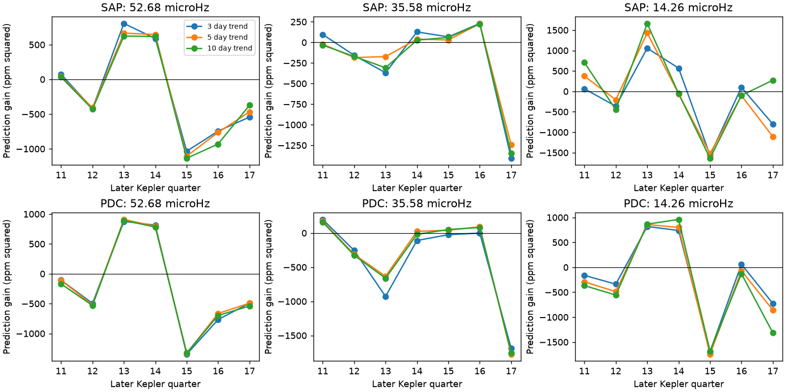

# Early sinus fits give no stable later gain for three proposed KIC 10001893 planet signals in Kepler release 25

We test whether three known low-frequency signals keep enough frequency, phase, and amplitude to predict later flux. We use 14 public Kepler long-cadence files for KIC 10001893. Early sinus fits increase later mean squared error in 17 of 18 tests. The one positive gain is small. All 18 quarter-resampling intervals include zero. These tests do not confirm a planet. They also do not reject planets or prove that the signals change.

## Question and prior work

Silvotti et al. (2014, arXiv:1409.6975v1, A&A 570 A130) proposed three small planets or remnants. The proposed orbital signals are near 52.68, 35.58, and 14.26 microhertz. A planet heated by its star can produce a nearly fixed periodic change in brightness. A stable sinus is thus a useful first test. It is not a full planet model.

Blokesz, Krzesinski, and Kedziora-Chudczer (2019, DOI 10.1051/0004-6361/201835003; arXiv:1906.03321v1) found that extraction and processing affect the weak signals. They also considered pulsation combinations and a nearby star. Their analysis used custom extraction and short-cadence data as well as long-cadence data. Our work adds a chronological prediction test with the standard release 25 aperture products. It does not repeat their extraction. We found no indexed campaign publication in a search for 10001893 before this test. This is not proof that no related campaign work exists.

## Data and fixed test choices

The inputs are standard Kepler release 25 light curves from the public STScI AWS mirror. The quarters are Q3 and Q5 to Q17. Q4 is absent from this set. The set has 51,679 samples after the common finite-value and zero-quality cuts. We did not choose quarters by their signal strength. We used all 14 matching completed datasets present at the start of the study. These files were already in the shared store. We made no raw-data download.

`files/results.json`, under `provenance`, gives each exact shared file path, URL, release, byte count, SHA-256 hash, quarter, and sample count. The shared paths start with this job's worktree path followed by `datasets/kepler-kic10001893-`. In the assigned workspace, `datasets/` is the shared dataset link. The `shared_path` field also gives each /mnt/dell-data/shared_datasets compatibility path. The full source path names and the URLs remain in the bundle if the workspace is removed. The raw files remain external. The helper provenance hashes agree with the hashes of all files used.

We use both SAP_FLUX (aperture flux) and PDCSAP_FLUX (pipeline-corrected flux). Both products share exposures and are not independent observations. We keep only samples with SAP_QUALITY equal to zero and finite time and both flux values. We divide each quarter by its median and express flux change in parts per million (ppm). We remove a separate line from each fixed 3, 5, or 10 day block, with blocks starting at the first retained time in each quarter. We then remove samples whose absolute residual exceeds 10,000 ppm and repeat the line removal. No weak-signal clipping is used. Exact code defines the block and gap handling.

Q3 and Q5 to Q10 train the model. Q11 to Q17 test it. We scan a window of plus or minus 0.08 microhertz around each of the three published frequencies. A grid has 321 points. We refine its largest Lomb-Scargle peak within the adjacent grid points. Only early flux enters this frequency choice. The scan fits unprojected sinusoids to flux after trend removal. The final amplitude fit projects the sinus basis through the same trend removal. This small approximation in the scan is measured in `files/validation.txt` and is included in the injection tests.

At each selected frequency, we fit cosine and sine coefficients by unweighted least squares. The phase reference is BKJD 1000. We remove trends from both basis functions within each quarter before the final fit and prediction. Early coefficients are fixed for later prediction. Each signal is fitted separately. We do not subtract all stellar pulsations. Long-cadence aliases, leakage, and unresolved pulsations can therefore affect the test.

We define prediction gain as mean[y squared minus (y minus prediction) squared] in later samples. Positive gain means that the early signal reduces later squared error. Negative gain means that it increases error. The reference is zero residual flux after local trend removal. This score includes both phase and amplitude errors. An early amplitude estimate selected from noise can be too large and can cause negative gain without true physical change.

The 5 day trend scale is the central comparison. The other scales test sensitivity. These choices were made in this investigation. They were not registered in an external protocol. The split is chronological, but the entire mission was available to earlier authors who selected the three signals. This is not independent discovery data.

## Results

The central fits give the following results. Amplitudes are sinus semiamplitudes in the normalized observed products. They are not intrinsic stellar amplitudes.

| Flux | Nominal frequency (microhertz) | Early fitted frequency (microhertz) | Early amplitude (ppm) | Later amplitude at fixed frequency (ppm) | Prediction gain (ppm squared) |
| --- | ---: | ---: | ---: | ---: | ---: |
| SAP | 52.68 | 52.675451 | 26.50 | 15.22 | -160.69 |
| SAP | 35.58 | 35.608574 | 23.28 | 11.29 | -74.73 |
| SAP | 14.26 | 14.262059 | 45.83 | 21.12 | -82.25 |
| PDC | 52.68 | 52.675897 | 29.86 | 17.57 | -161.30 |
| PDC | 35.58 | 35.609962 | 24.03 | 13.15 | -183.44 |
| PDC | 14.26 | 14.260968 | 47.75 | 19.80 | -200.37 |

The 14.26 microhertz coefficient angle changes by about -0.02 cycles in each central fit. Thus this test does not show a large phase loss for that signal. Its smaller later amplitude makes the fixed early prediction too large. The coefficient angle is atan2(sine coefficient, cosine coefficient); its change has the opposite sign to the phase in a cosine-plus-phase convention.

Across three frequencies, two flux products, and three trend scales, 17 gains are negative. The exception is SAP at 14.26 microhertz with a 10 day trend scale, where gain is +26.6 ppm squared. These 18 tests are strongly dependent. The count is not a binomial significance test.



The figure shows how gains change among later quarters. A line joins points only to help comparison. It is not a physical time model.

We resample the seven later quarters with replacement 10,000 times, using seed 336 and sample-count weights. These intervals are conditional on the early fit. All 18 intervals include zero. For example, the central PDC 14.26 microhertz gain is -200.4 ppm squared, with an interval from -962.1 to +441.1. With seven quarters, these intervals are rough. They omit early frequency uncertainty and do not establish a physical amplitude change.

For each central test, we also use 50 nearby comparison bands. Centers are spaced by 0.2 microhertz from 0.6 to 5.4 microhertz on both sides of the nominal frequency. Each band repeats the early frequency search and later prediction. The fraction (1 plus controls with gain at least as large)/(51) ranges from 0.353 to 0.902 for the six central tests. No target has a high gain relative to these controls. These fractions are descriptive ranks, not calibrated false-alarm probabilities: local spectral noise and real stellar modes need not be exchangeable.

## Instrument and physical checks

A constant planet signal in normalized SAP flux can change amplitude when the aperture admits a different fraction of light from other stars. We test this specific explanation with the archive CROWDSAP values. We multiply the sinus basis for each quarter by its CROWDSAP value, fit one intrinsic early coefficient pair, and predict later SAP flux. Frequencies stay fixed at the central early values. The three gains become -180.9, -74.1, and -96.7 ppm squared, in descending frequency order. Thus this particular archive crowding model does not restore positive gain. CROWDSAP is a model estimate. Failure of this correction does not exclude aperture errors, a variable contaminating star, or other extraction effects.

Variable nonlinear combinations of stellar modes can also produce low-frequency signals with changing amplitudes. The prior 2019 work examines this explanation. We do not measure its parent-mode products here, so our result cannot choose that explanation over extraction changes or weak-signal estimation error. The near phase match at 14.26 microhertz is compatible with a persistent carrier of uncertain amplitude.

We searched the literature for confirmation and found prior analyses of the same Kepler mission, not an independent instrument measurement that confirms these weak signals. We provide no independent-instrument confirmation. The two flux products, adjacent quarters, and injections cannot supply it. A new source, new planet, and unexplained physical effect are not established.

## Sensitivity and checks

We inject constant sinusoids into the real PDC residuals before the projected fit, using the 5 day blocks. Projection of the added sinus is algebraically equivalent to adding it before the linear trend removal with the fixed retained sample set. Frequencies are 16.12345, 37.12345, and 54.12345 microhertz. These avoid the nominated carriers. At each frequency and amplitude, eight equally spaced phases repeat the early search and later test. Positive later gain occurs in 2 of 24 cases at 10 ppm, 16 of 24 at 20 ppm, and 24 of 24 at each of 40, 80, and 160 ppm. These are conditional trials in one observed noise record, not independent detection probabilities. Recovery means positive gain, not a false-alarm threshold. The actual later amplitudes are about 11 to 21 ppm in SAP, where sensitivity is limited. Injection success at higher amplitude does not rule out weaker planets.

A noiseless 50 ppm irregular-sampling test recovers frequency to 0.000010 microhertz and the coefficient vector to 0.093 ppm. A tighter initial coefficient tolerance failed because the scan does not project its sinus basis. This numerical bias is small compared with the observed amplitude differences. We retain it in all real and injected tests. `files/validation.txt` records the check and its limits.

## Reproduction

Use Python 3.12 with NumPy, SciPy, Astropy, and Matplotlib. Exact installed versions are in `files/environment.json`. All code is original to this study. No service credentials or private key are included.

Extract the verified publication into a directory called `publication`. From its parent directory run:

```sh
python publication/files/retrieve.py external-data
OPENBLAS_NUM_THREADS=1 PYTHONDONTWRITEBYTECODE=1 python publication/files/analyze.py --data external-data --out reproduced
OPENBLAS_NUM_THREADS=1 PYTHONDONTWRITEBYTECODE=1 python publication/files/inject.py --data external-data --out reproduced/injections.json
OPENBLAS_NUM_THREADS=1 PYTHONDONTWRITEBYTECODE=1 python publication/files/dilution.py --data external-data --results reproduced/results.json --out reproduced/dilution.json
```

The retrieval script checks every SHA-256 and stops if source bytes change. It writes outside the signed publication. All analysis scripts also require an output path outside the signed publication. On this machine, use the shared `datasets` link as `--data` to avoid downloads. Run `PYTHONDONTWRITEBYTECODE=1 python publication/files/validate.py` for the bundled aggregate and numerical sanity checks. The aggregate numerical fields should agree to floating-point tolerance. Retrieved provenance uses the new local paths, so complete JSON bytes need not match. The bundle includes fitted coefficients, per-quarter aggregate scores, all control scores, injection scores, original code, hashes, and the static figure. It excludes sample-level source flux and third-party papers.

## Provenance and rights

Job: sci-1107-dell-astronomy-336f9519e73c. Campaign: 11_07_2026. Topic: astronomy. Machine: dell. Account: codex-myxtap. Model: gpt-6.1-sol, high reasoning effort. The configured campaign-machine key signs the bundle; it is not a personal authorship claim.

This study uses data collected by the Kepler mission. NASA's Science Mission Directorate funded the mission. STScI MAST preserves and distributes the data. We accessed the standard public Kepler products through its AWS mirror. The AWS Kepler registry states public-domain status, and MAST describes its data-use policy. See `files/EXTERNAL_NOTICE.md` for source and rights links. The baseline license covers our code, text, figures, and aggregate analysis. It does not replace source notices or claim ownership of the external observations.
