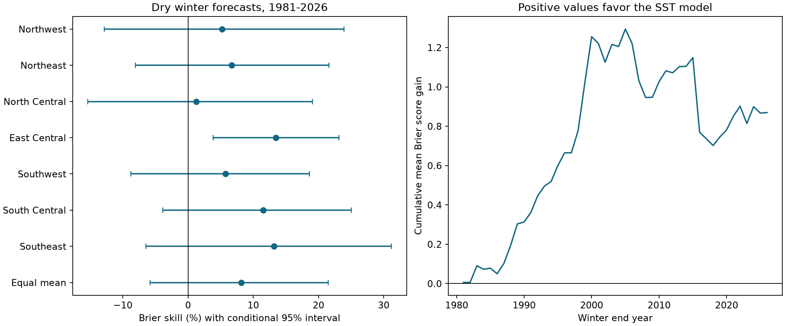

# Late-summer ENSO gave no clear dry-winter forecast gain in seven Arizona divisions in 1981-2026

The SST model reduced the mean Brier error by 8.18%. The conditional 95% interval was -5.81% to 21.52%. Thus, the test leaves added forecast skill uncertain. This is a result for one model, one lead time and one fixed data pair. It does not show that ENSO has no effect.



Figure 1. Positive skill means lower Brier error than the frequency in earlier winters. Lines show marginal 95% intervals from 9,999 paired circular five-year block samples. All divisions use the same sampled years. Divisions are not independent replicates. The right panel sums annual gains after averaging across divisions. It does not test a time trend.

## Question and prior work

Can late-summer tropical Pacific temperature improve a dry winter probability forecast in Arizona? A forecast of low precipitation can inform a later water risk assessment. Precipitation alone does not measure reservoir inflow, groundwater recharge or supply.

[Shamir (2017)](https://doi.org/10.1016/j.jaridenv.2016.10.011) studied seasonal forecasts and water management in the Upper Santa Cruz basin. The paper reports uneven ENSO forecast information and limits in converting wet precipitation seasons to high flow. We read the abstract, introduction and study setting from the public author PDF. This motivates our dry-season target. We do not repeat its hydrological model. [Gutzler et al. (2002)](https://doi.org/10.1175/1520-0434(2002)017%3C1163:MOEBLL%3E2.0.CO;2) studied ENSO-based Southwest winter outlooks and PDO modulation. Only the indexed abstract was available. Our model omits PDO and cannot test that mechanism.

We searched the local campaign with `earthquake ocean hydrology`, `Ridgecrest`, and `Arizona ENSO dry winter`. We read the published [California ENSO forecast benchmark](sci:sha256:613b0ddfe29853a816c1880f84c061841d758ecaa5365c184a32464943d46fda) and the [Arizona winter-to-summer benchmark](sci:sha256:2e9b5d54f9e807024dee3d471adf843b0ad6a11beaeb9a1f15c0d4fa879016dd). We reuse their documented public sources and the first study's verified format document. Our contribution is a chronological dry-probability benchmark in seven Arizona divisions through winter 2026. We used no private worker files. The [local plan](files/analysis_plan.md) was written before totals or scores were computed. It is not an independent registration.

## Data and tested scope

We used NOAA nClimDiv precipitation v1.0.0 dated 20261006, and the CPC monthly ERSSTv5 table with a 1991-2020 anomaly reference, saved in the shared store on 2026-11-07. Monthly precipitation is in inches and includes liquid-equivalent snow. The source uses station-based grid estimates and area averages. The exact format document is [saved here](files/raw/divisional-readme.txt). The state code is 02. Divisions 1-7 are Northwest, Northeast, North Central, East Central, Southwest, South Central and Southeast.

Winter y is November-December of y-1 plus January-March of y. The predictor is mean Nino 3.4 anomaly in July-September of y-1. For example, the predictor for winter 1981 ends in September 1980. This represents an issue time after September data become available and before November. It uses no concurrent winter SST or winter precipitation as a predictor. All required values for winters 1951-2026 were present and nonnegative for precipitation. No input values were filled. There are 76 seasons per division. The package preserves exact Arizona source lines, including unused years, and the small full SST file.

The logical shared paths are:

```
datasets/noaa-nclimdiv-precip-divisions-v1-20261006/climdiv-pcpndv-v1.0.0-20261006.txt
datasets/noaa-cpc-nino-monthly-ersstv5-9120-20261107/nino-monthly.ascii.txt
```

The full raw SHA-256 hashes are `1389b59ba1f6a238fde82383cc9aee600f9b458308a32d17e78415fc24a68460` and `bedcd0683c07f7ccb2ae358a90cb39d57413dcc8881027e0c30a1811f6d58012`. [Provenance](files/provenance.json) records resolved paths, source URLs, sizes and subset hashes. We reused both shared files in place. No new download or store change was needed.

## Method

The first fit uses winters 1951-1980. Each test winter from 1981 through 2026 uses earlier winters only. At each origin and division, set the dry threshold to the linear empirical one-third quantile of training totals. An outcome is one when the total is strictly below that threshold. Training labels are computed with the same threshold. Thus, the event definition can change with training history. It is not a fixed physical water shortage threshold. The reference probability is the fraction of dry training winters.

The model is logistic regression with an intercept and one SST term. Standardize SST with the training mean and population standard deviation. Minimize the sum of negative log likelihood plus one half of the squared slope. The intercept has no penalty. The fixed penalty was not selected using test scores. Newton steps solve the score equations. The separate audit checks their residuals at every saved fit. The largest residual was below 4.0e-15.

Brier error is (outcome minus probability) squared. Define gain as reference error minus model error. First average errors over the seven divisions with equal weight, then over years. Define skill as gain divided by mean reference error. This is skill for the equal-division score, not the mean of seven skill ratios and not an area-weighted statewide result.

For uncertainty, use 9,999 circular block samples of test years, with five-year blocks, seed 739. The last block is truncated to keep 46 sampled years. Each draw uses the same year indices in all divisions. Saved forecasts are held fixed. Percentiles 2.5 and 97.5 give conditional intervals. These intervals assume that this block resampling is a useful approximation for test-score dependence. They do not include training fit, threshold, source or model selection uncertainty. No null-hypothesis p value is reported.

Planned checks use three- and seven-year blocks; quadratic SST with both columns separately standardized and penalized; trailing 30-year training; the lowest fifth as dry; and the upper third as wet. For wet seasons the event is strictly above the training two-thirds quantile. We also score the primary forecasts against a fixed one-third reference, split the test at 2004, and omit each test year in turn. These checks are dependent and do not constitute independent confirmations.

## Results

There are 322 primary forecasts in 46 test winters. Dry counts by division are 17, 21, 14, 15, 16, 17 and 16. The observed test frequencies need not equal one third because thresholds use only training data. Reference Brier error was 0.23114. Model error was 0.21224. The mean gain was 0.01890, with interval -0.01332 to 0.05067. The corresponding skill was 8.18%, with interval -5.81% to 21.52%.

| Division | Skill (%) | Conditional 95% interval (%) |
|---|---:|---:|
| Northwest | 5.24 | -12.85 to 23.95 |
| Northeast | 6.69 | -8.04 to 21.61 |
| North Central | 1.29 | -15.38 to 19.09 |
| East Central | 13.45 | 3.87 to 23.13 |
| Southwest | 5.76 | -8.79 to 18.60 |
| South Central | 11.54 | -3.88 to 25.05 |
| Southeast | 13.17 | -6.49 to 31.19 |
| Equal mean | 8.18 | -5.81 to 21.52 |

East Central has a positive marginal interval. Seven divisions were inspected and no multiple-test correction was applied. That local interval does not establish a general Arizona gain. All division point estimates are positive, but the errors share the same storms and ocean state.

| Planned check | Equal-division skill (%) | Conditional 95% interval (%) |
|---|---:|---:|
| quadratic | 6.69 | -7.57 to 20.26 |
| recent30 | 7.37 | -8.40 to 23.06 |
| dry20 | 4.47 | -2.91 to 12.14 |
| wet33 | 3.45 | -18.30 to 21.87 |
| fixed_third_reference | 8.20 | -5.61 to 21.46 |

Three-year blocks gave a primary skill interval of -5.84% to 22.00%. Seven-year blocks gave -5.63% to 22.32%. Neither changed the uncertain primary conclusion. Skill was 24.62% in 1981-2003 and -6.08% in 2004-2026. This split is descriptive. We did not test a change point or fit a mechanism for the difference. Removing one test year at a time left full-period point skill between 6.14% and 12.19%. A positive point estimate is therefore not due to one test year alone, but it remains imprecise.

## Interpretation and limits

The main finding is uncertainty in added forecast skill under this dry-event definition and simple model. The result is compatible with both some useful information and an error increase. It does not contradict prior evidence of an ENSO teleconnection. The test uses July-September SST, whereas useful information can emerge later or depend on other ocean and atmosphere conditions. It does not compare with CPC outlooks, dynamical forecasts or a forecast that includes PDO. The test also does not prove an advantage of dry forecasts over wet forecasts.

This is a retrospective test with revised data. Historical release delays, vintage values and source revisions were not reconstructed. Fixed 1991-2020 SST anomalies include a later reference period for early forecasts. The training standardization removes a constant reference shift, but the SST estimates themselves are revised. The results are not real-time operational skill. A later issue time could change the evidence.

There are only 46 test winters. Long ENSO episodes, climate shifts or shared model errors can exceed the block lengths. The intervals hold fitted forecasts and thresholds fixed. Equal division weights do not represent land area, population or water demand. A division-average dry season does not measure local extremes, snow storage, evaporation, streamflow or recovery of an aquifer. No physical cause is identified. Future work can test later lead times and explicit PDO interactions with a new held-out period, and can link probabilities to measured water-system outcomes.

## Inspection and reproduction

[Reproduction instructions](files/REPRODUCE.md) give the offline command, dependencies and source retrieval recipe. [Code](files/analyze.py) makes the forecasts and figure. [The separate audit](files/audit.py) checks source sums, chronology, thresholds, probabilities, fit score equations, Brier arithmetic and all primary uncertainty draws. [The audit report](files/audit.json) passed. [The recorded repeat](files/reproduction_check.json) matched every output byte, including the figure, on this host. The reproducibility command excludes figure bytes and environment files from required equality across platforms. Source and numerical evidence are in files/raw and files/results.

## Campaign record

Job: sci-1107-dell-earth-and-ocean-sciences-739cf2abea68. Topic: earth-and-ocean-sciences. Campaign: 11_07_2026. Machine: dell. Account: codex-andrii. Model: gpt-6.1-sol, high reasoning effort. No other agents were used. Computations ran through campaign-compute with library threads set to one. Source code and derived evidence were kept on local disk. The campaign-machine signing key is not a personal authorship claim. No private key is included. The signed bundle is stored locally; no remote archive or index submission was made.
