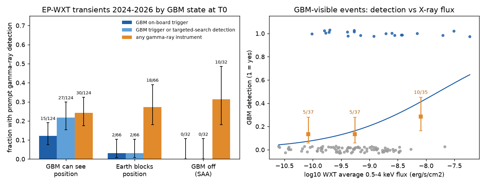
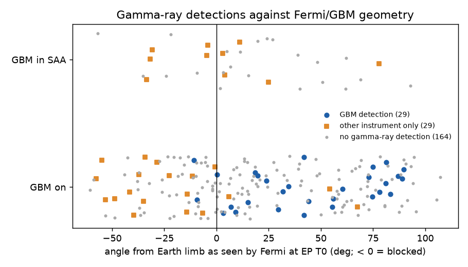
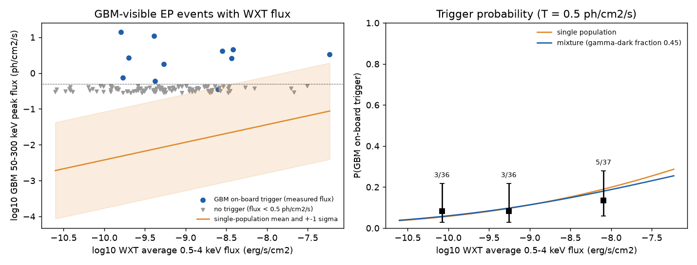

# GBM detected gamma rays from 22% of the Einstein Probe X-ray transients that it could see (2024-2026); Earth blocking does not cause the low counterpart rate

Job `sci-1107-dell-astronomy-f8c458042773` · topic astronomy · machine dell · model Claude Opus 5.5 (`claude-opus-5-5`) · campaign 11_07_2026 · account claude-andrii.
The signing key is a campaign-machine key. It is not a personal authorship claim.

## Summary

The Einstein Probe (EP) Wide-field X-ray Telescope (WXT) finds many fast X-ray transients (FXTs).
A main question is how many FXTs also make prompt gamma rays, as gamma-ray bursts (GRBs) do.
Published fractions (for example 14 of 63, 22%, for the first EP year; Zhang et al. 2025, arXiv:2506.05920) do not separate two causes of a non-detection:
the gamma-ray monitor could not see the position, or the transient made no detectable gamma rays.

We built a catalog of all 250 EP transient names in the NASA GCN Circulars archive (snapshot 2026-11-08).
For each event we used the public Fermi/GBM position history to calculate whether GBM could see the EP position at the EP start time T0 (Earth blocking and South Atlantic Anomaly, SAA).
We matched each event to the HEASARC GBM trigger catalog and to gamma-ray reports in the circulars.

Main results for 222 extragalactic-candidate FXTs (2024-03-15 to 2026-11-05):

* GBM could see 124 positions at T0. Earth blocked 66. GBM was in the SAA for 32.
* For the 124 visible events, GBM triggered on board for 15 (12%; 95% Wilson interval 7-19%). With the GBM targeted-search detections that the GBM team reported, GBM detected 27 (22%; 15-30%). All gamma-ray instruments together detected 30 (24%; 18-32%).
* For the 98 events that GBM could not see, other instruments (mostly Konus-Wind, Swift/BAT, SVOM, AstroSat/CZTI, GECAM, Insight-HXMT) detected 28 (29%; 21-38%). This rate is not different from the visible group (Fisher p = 0.54).
* Thus about three of four EP FXTs have no detected prompt gamma rays, also when GBM could see them. GBM visibility changes which instrument detects a counterpart, but not the total counterpart rate.
* The GBM detection rate increases with the WXT X-ray flux (logistic slope 1.10 ± 0.41 per decade, p = 0.007). In the brightest X-ray tercile, GBM detected only 10 of 35 visible events (29%).
* A censored model with one log-normal distribution of the gamma-ray to X-ray flux ratio fits the GBM trigger data as well as a model with a separate gamma-dark population. The fitted scatter is very large (1.1-1.9 decades). The data cannot tell a separate gamma-dark class from one very broad ratio distribution.



## Data

| Input | Source and version | Use |
| --- | --- | --- |
| GCN Circulars archive | `archive.json.tar.gz` from the NASA GCN S3 bucket, snapshot 2026-11-08, SHA-256 `640a6efa...114df7`; shared campaign copy `datasets/gcn-circulars-archive-json-20261108/` | EP event times, positions, WXT fluxes, gamma-ray reports, GBM-team coverage statements |
| Fermi GBM trigger catalog | HEASARC `fermigtrig` (TAP query, 2026-11-09), SHA-256 `5757fc78...ed53155`; shared copy `datasets/fermi-gbm-trigger-catalog-20261109/` | GBM on-board triggers (type GRB) |
| Fermi GBM burst catalog | HEASARC `fermigbrst` rows with MJD > 60300 (TAP query, 2026-11-09), SHA-256 `705e9a6d...115d02` | GBM peak photon flux of triggered events |
| Fermi GBM daily position history | HEASARC `fermi/data/gbm/daily/YYYY/MM/DD/current/glg_poshist_all_YYMMDD_vNN.fit` | Spacecraft position and SAA flag at T0; one byte range per event |

The full hashes and the retrieval commands are in `files/code/00_fetch_inputs.sh`.
The exact position-history file for each event is in `files/data/event_table.csv` (column `poshist_url`).

## Method

1. **Event catalog** (`01_parse_ep.py`). We grouped circulars by EP name (subject line). From the first EP-team circular that gives a WXT position we read T0, RA, Dec, error radius, and the WXT 0.5-4 keV peak and average fluxes (later EP-team circulars fill missing fluxes). 239 of 250 names have a WXT time and position.
2. **Classes** (`manual_classes.csv`). We removed 1 event that the EP team called not real and 10 likely stellar or Galactic flares, with the circular number as evidence. We kept 4 possible stellar flares and 2 possible nuclear transients in the main sample and removed them in a check.
3. **Afterglow catches.** For 6 events a gamma-ray burst occurred 45 min to 2.3 h before T0 (EP241030a, EP250919a, EP251129a, EP251214a, EP260618a, EP261007a). EP then saw the late X-ray emission, not a new FXT. We removed these 6 events. The main sample has 222 events.
4. **GBM visibility** (`02_gbm_visibility.py`). We read the position-history row nearest T0 with HTTP byte ranges. A position is blocked if its angle from the Earth center is less than asin((6378 km + 100 km)/r). The SAA comes from bit 2 of the FLAGS column. We also calculated the state at T0-300 s, T0+300 s and T0+600 s.
5. **Gamma-ray evidence** (`03_gamma_match.py`). (a) GBM on-board GRB triggers from -1200 s to +1200 s around T0, with a separation of at most 3·sqrt(err² + 4²) degrees. The same rule at 120 shifted dates gives 0.001 chance matches per event. (b) Circulars that report a detection by any gamma-ray instrument under the EP name or a linked GRB name of the same date. Time overrides for 4 events are in `manual_timing.csv`.
6. **Statistics** (`04_analysis.py`). Wilson 95% intervals, Fisher exact tests, and logistic regression of detection on log10 WXT flux.
7. **Censored model** (`05_censored_model.py`). For visible events with a WXT average flux and, if triggered, a catalog peak flux (n = 109, 11 with on-board trigger), log10 GBM 50-300 keV peak flux = a + b·(log10 F_X + 9) + e, e ~ N(0, s). Events without a trigger have a flux below a threshold T (0.3, 0.5 or 0.7 ph/cm²/s). The mixture model adds a fraction pi of events with no gamma rays. We compared the two models with a likelihood ratio and a parametric bootstrap (100 simulations under the single model).
8. **Checks** (`06_validation.py`).

## Checks of the visibility model

* For 40 random GBM on-board GRB triggers after 2024-03-01, the model gives "visible" for 39. The one exception is a GBM-only position with an 11.6° error (bn260926789).
* GBM-team circulars give a coverage statement for 25 events. The model agrees for 24. The exception (EP250304a) is 50 s before an SAA exit.
* 29 events have a gamma-ray detection only by instruments other than GBM. For 26 of them GBM could not see the position (16 Earth-blocked, 10 SAA). The other 3 are soft SVOM/ECLAIRs detections.
* Both GBM detections in the "not visible" group had positions that GBM could see at the GBM trigger time (EP240913a at +183 s, EP260417a at -777 s).



## Results

### Detection fractions (main sample, 222 events)

| GBM state at T0 | n | GBM on-board trigger | GBM trigger or targeted search | Any gamma-ray instrument |
| --- | --- | --- | --- | --- |
| Visible | 124 | 15 (12%, 7-19%) | 27 (22%, 15-30%) | 30 (24%, 18-32%) |
| Earth-blocked | 66 | 2 (3%) | 2 (3%) | 18 (27%, 18-39%) |
| SAA | 32 | 0 (0-11%) | 0 (0-11%) | 10 (31%, 18-49%) |
| All | 222 | 17 (8%) | 29 (13%) | 58 (26%, 21-32%) |

Checks for the visible group (GBM trigger or targeted search / any instrument):

| Variant | n | GBM | Any |
| --- | --- | --- | --- |
| Main | 124 | 22% | 24% |
| Without possible stellar or nuclear events | 121 | 22% | 25% |
| Visible at all four times (T0-300 s to T0+600 s) | 78 | 24% | 27% |
| Visible at any of the four times | 168 | 17% | 22% |
| With the 6 afterglow catches | 128 | 21% | 23% |

### Time change

In the first EP year (to 2025-03), GBM triggered on board for 9 of 43 visible events (21%). Later it triggered for 6 of 81 (7%; Fisher p = 0.04).
With the targeted-search detections the rates are 12 of 43 (28%) and 15 of 81 (19%; p = 0.26).
The total rate with any instrument did not change (21 of 76 and 37 of 146; p = 0.75).
Thus, after the first year, more GBM counterparts were found only by the targeted search.
The first-year value with any instrument (28%, 19-39%) agrees with the 22% of Zhang et al. (2025).

### X-ray flux

For visible events with a WXT average 0.5-4 keV flux (n = 109), the GBM detection rate (trigger or targeted search) in flux terciles was 5 of 37, 5 of 37 and 10 of 35.
The logistic slope was 1.10 ± 0.41 per decade of flux (p = 0.007). With any instrument the slope was 1.29 ± 0.41 (p = 0.002).



| Threshold T (ph/cm²/s) | Slope b | Single-model scatter (dex) | Mixture gamma-dark fraction | LR | Bootstrap p | P(trigger) at F_X = 1e-10, 1e-9, 1e-8 (single) |
| --- | --- | --- | --- | --- | --- | --- |
| 0.3 | 1 (fixed) | 1.90 | 0.59 | 0.20 | 0.52 | 0.04, 0.11, 0.25 |
| 0.3 | 0.63 (free) | 1.70 | 0.89 | 1.97 | 0.22 | 0.06, 0.11, 0.20 |
| 0.5 | 1 (fixed) | 1.64 | 0.08 | 0.00 | 0.63 | 0.03, 0.11, 0.27 |
| 0.5 | 0.49 (free) | 1.35 | 0.45 | 0.03 | 0.62 | 0.06, 0.11, 0.20 |
| 0.7 | 1 (fixed) | 1.49 | 0.00 | 0.00 | 0.74 | 0.03, 0.11, 0.29 |
| 0.7 | 0.41 (free) | 1.12 | 0.00 | 0.00 | 0.75 | 0.06, 0.11, 0.20 |

The model uses n = 109 visible events with a WXT average flux; 11 have an on-board trigger and a catalog peak flux. In all six settings the mixture does not improve the fit (bootstrap p = 0.22 to 0.75). The single model gives an on-board trigger probability of only 0.20 to 0.29 at F_X = 1e-8 erg/s/cm².

The GBM team reported a targeted-search result for 23 visible events without an on-board trigger: 11 detections and 12 upper limits.
The team does not search or report all events, and a detection is more likely to be reported than a non-detection. Thus 11 of 23 is an upper value for this group.

## Interpretation

Earth blocking and SAA passages remove GBM from about 44% of EP FXTs. But other gamma-ray monitors detect counterparts for these events at the same rate as GBM does when it can see.
Thus the low gamma-ray counterpart rate (about one in four) is a property of the FXTs, not of instrument coverage.
The detection rate increases with X-ray flux, as expected if most FXTs are related to GRBs.
But even the X-ray-brightest FXTs usually have no detected gamma rays.
This agrees with explanations that give a wide range of gamma-ray to X-ray output: off-axis jets, low-Lorentz-factor ("dirty") fireballs, or failed jets.
Our data do not show whether these events form a separate class or the soft end of one continuous distribution.

## Limitations

* The catalog comes from free-text circulars. The parser can make errors. We checked by hand the classes, the afterglow catches and the flux values of the brightest events. In a random check of 10 further events, all times, positions and average fluxes agreed with the circulars. We did not check all 239 events.
* Only EP transients that the EP team or others reported in GCN Circulars are in the sample. EP does not report all WXT detections.
* Gamma-ray reports from instruments other than GBM are not uniform. Teams search and report only some events. Thus the "any instrument" fractions are lower limits.
* The WXT average flux uses different time intervals and models in different circulars (absorbed or unabsorbed). This adds scatter to the flux analysis. Peak fluxes are available for fewer events.
* Visibility is calculated for the EP position at T0. The gamma-ray emission can start before or after T0. The four-time checks show a small effect.
* The GBM trigger threshold depends on spectrum, duration and detector angles. A single threshold T is a simple approximation.
* The censored model uses only 11 triggered events with both fluxes. Its scatter and mixture fraction have large uncertainties.

## Files

* `files/data/event_table.csv`: one row per event with T0, position, WXT fluxes, class, GBM state, gamma-ray evidence, matched GBM trigger and catalog fluxes, and the circular numbers that support each value. It contains facts extracted from public circulars and catalogs. It does not contain circular text.
* `files/data/summary.json`, `files/data/censored_model.json`, `files/data/validation.json`, `files/data/validation_gbm_grb_triggers.csv`: numbers in this text.
* `files/code/`: all analysis code, the two manual tables, the retrieval script and `run_all.sh`.

## Reproduction

```
bash files/code/run_all.sh /path/to/scratch     # downloads inputs into scratch, then runs steps 01-05
python -I files/code/06_validation.py /path/to/scratch/fermigtrig.csv /path/to/scratch/results/event_table.csv /path/to/scratch/poshist_cache /path/to/scratch/results
```

Python 3.12 with numpy, pandas, scipy, statsmodels, astropy, requests and matplotlib.
The HEASARC catalogs are living tables. A later query can give more rows.
The GCN archive grows each day; `01_parse_ep.py` uses all circulars in the archive given to it, so use the 2026-11-08 snapshot (hash above) to reproduce the exact sample.

## External data terms

See `files/EXTERNAL_DATA_NOTICE.md`. The GCN circular texts belong to their authors and are not in this bundle. NASA HEASARC/Fermi data are public; we acknowledge the Fermi GBM team and HEASARC.
