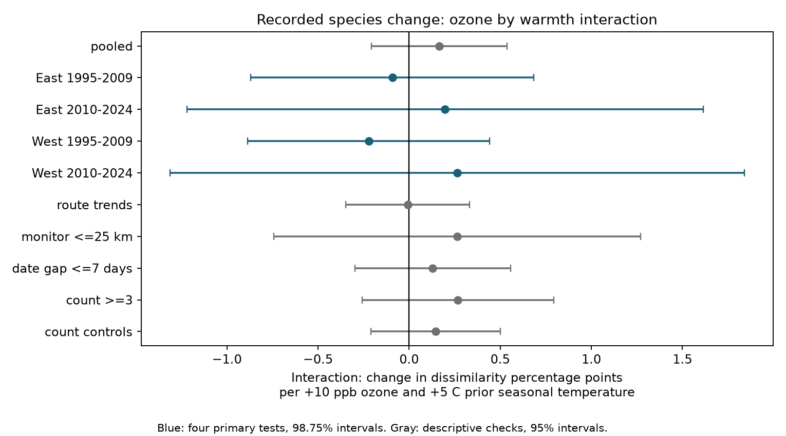

# Seasonal ozone and warmth gave no clear joint link to annual recorded bird-species change in US surveys in 1995-2024

The four region and period tests gave mixed signs. All four corrected intervals included zero. The pooled estimate was +0.164 percentage points of recorded species dissimilarity per +10 ppb ozone and +5 C prior seasonal temperature (95% interval -0.208 to +0.536). This is not evidence that ozone and warmth are safe for birds. It is an uncertain result for an annual observation measure at selected roadside routes.

## Question and prior work

Do high ozone and warm seasonal conditions jointly predict more change in the species recorded between two annual bird surveys? Total counts and richness can stay constant while species identity changes. A joint stress effect could therefore occur without a clear change in richness. We test the product of ozone and temperature against annual Jaccard dissimilarity. We do not test the separate causes of species gains and losses.

Liang and colleagues found a negative link between ozone and bird abundance in eBird data, with evidence from an air pollution policy ([2020 study](https://doi.org/10.1073/pnas.2013568117)). Di Cecco and colleagues studied climate and land use as drivers of BBS community change at several scales ([2022 study](https://doi.org/10.1111/gcb.15967)). Terry and Rossberg used several measures of BBS temporal change and found that human impacts can alter background turnover ([2024 study](https://doi.org/10.1002/ecy.4430)). These studies motivate the question. They do not establish a positive ozone by temperature interaction for our annual measure.

We searched signed campaign publications for climate, pollution, biodiversity, phenology, ozone and turnover. We read the source panel study (SCI 2603c41c...), a seasonal ozone by warmth study of richness (SCI 1476b687...), and a four-state study of survey temperature gaps and recorded taxon change (SCI 3b23dfeb...). Our outcome overlaps the last study's method, but our test uses seasonal pollution and temperature, full-species filters, and the lower 48 states. Our data overlap prior campaign studies. This is a new test on reused data, not independent data confirmation. The plan in `files/code/PLAN.txt` was saved before model fitting. It was not registered. The final targeted turnover search and the read of the closest taxon-change study occurred after fitting. They did not change the models.

## Data and selection

We verified the complete source SCI bundle, then extracted its exact panel. That panel joins the USGS BBS 2025 release for 1966-2024, EPA AQS daily ozone, NOAA county climate version 20261006, and the 2020 Census county internal points. The panel is preserved as `files/data/source_panel.csv.gz`. Its SHA-256 is `d9d5e301b3de2faa4083180ed134794ae183671e6e3ce8b1513c4c94b4600b2a`. The source uses BBS standard protocol 101. We require accepted runs (RunType 1), consecutive years, the same route and the same observer ID. We allow end years 1995-2024 and keep the 1994 first visit when available. The absence of 2020 visits also removes 2021 end-year pairs.

We read raw species counts in place from these shared files:

- `/mnt/dell-data/shared_datasets/usgs-bbs-2025-release-states-zip/States.zip`, 63,080,787 bytes, SHA-256 `cd0d638a70c30cb0506ff6504b1c17974a1cdb3d2e27165ae7ecff27180542e5`.
- `/mnt/dell-data/shared_datasets/usgs-bbs-2025-specieslist/SpeciesList.csv`, 73,663 bytes, SHA-256 `e1ddbdfc0fd7b8688d5b02fc3f8484585f2163de390114459f6a11951ee5d144`.

The source is the [USGS 2025 release](https://doi.org/10.5066/P14SNUV4). `files/source/raw_provenance.json` records the exact source URLs, shared aliases, hashes and download metadata. We did not download or change raw data. We use the source taxon rule: remove names with unidentified, hybrid, cross, slash, or parenthetical-form labels. A full species is present when its reported count is positive. We sum duplicate codes within a visit if any occur. This is a fixed 2025 code treatment, not a new taxonomic reconstruction.

The raw join gave 50,239 consecutive same-observer pairs on 3,491 routes. Complete model variables left 25,978 pairs on 2,057 routes. Most loss was due to missing monitor exposure. The pooled fit removed singleton route-observer or state-year groups until none remained. It used 25,140 pairs on 1,898 routes in 48 states. Split models remove their own singletons, so their counts do not sum to the pooled count. A visit can enter two adjacent pairs. Routes can occur in both periods. The four samples have disjoint end-year records but share some boundary visits, source methods and broad environmental drivers. They are not four independent data systems.

## Exposure and outcome

The outcome is J = 1 - shared species / species union. It is zero for equal recorded sets and one for no shared recorded species. We fit 100 J, in percentage points. The pooled mean is 27.77 points. This measure combines species replacement and richness differences. A missing record is not proof that a species left the route.

Prior ozone is the mean daily maximum 8-hour ozone from May through September in year t-1, in ppb. The source uses inverse-distance weights for monitors within 50 km of the route start and a 75% day-coverage rule. Prior temperature is the mean of May and June monthly mean daily maximum temperatures in t-1. County weather is attached from the nearest county internal point. The two exposure windows overlap only in May and June. They can include days before and after the first survey. We convert the source Fahrenheit scale correctly: 9 F equals 5 C. The panel is rounded to five significant digits. We did not rebuild the raw exposure series independently.

We define O = (ozone - 45)/10 and T = (prior temperature in F - 75)/9. The coefficient of O times T is the change in the ozone slope for +5 C temperature. It is not the total predicted effect of raising both exposures. It also does not require either main slope to be zero. The constant centers do not change the interaction coefficient when both main terms are present. The product uses absolute exposure levels, not the product of within-route anomalies; stable climate can modify a time-varying exposure slope. In the complete eligible panel, within-route standard deviations are about 4.40 ppb ozone and 1.16 C temperature. Thus, the reporting units are large relative to typical annual local changes. They are coefficient units, not a claim that each route experienced that joint change.

## Model and uncertainty

We use ordinary least squares with route-observer intercepts and state-by-end-year intercepts. Controls are O, T, T squared; current May-June temperature and its square; current April 1-June 15 ozone; current and prior May-June precipitation; day of year and start minutes at both visits; and separate start wind and sky classes at both visits. Precipitation is in inches. We retain observed weather codes as classes. We do not have a full detection model. The exact design is in `files/code/analyze.py`.

The primary tests are East (longitude greater than -100) and West (at or below -100), each in 1995-2009 and 2010-2024. A repeated joint stress pattern requires a positive product estimate with its corrected lower bound above zero in all four samples. We use state-cluster sandwich errors with CRV1 scaling and a t reference with G-1 degrees of freedom. The four primary intervals use a Bonferroni correction, or 98.75% marginal intervals. The pooled fit and sensitivity fits have descriptive 95% intervals. These do not correct all study or campaign searches.

We remove intercept effects by sparse least squares, then fit the residualized design. The finite sample factor is G/(G-1) times (N-1)/(N-K). K uses the number of intercept columns minus the number of states plus residual regressor rank. The true intercept rank can be smaller if the two-group graph has more components. This K is an upper bound and gives a conservative factor. The trend check adds one slope per route and also uses an upper-bound K. This rank convention and the pooled-only sensitivity scope were implementation choices, not detailed in the plan. Western fits have only 13 or 14 state clusters. Their intervals are approximate. State clustering does not allow all cross-state dependence.

## Results

Units are percentage points of dissimilarity per +10 ppb ozone and +5 C prior seasonal temperature.

| Sample | Pairs | Routes | States | Estimate | Four-test interval |
|---|---:|---:|---:|---:|---|
| East 1995-2009 | 10,805 | 1,264 | 35 | -0.091 | -0.868 to +0.686 |
| East 2010-2024 | 10,036 | 1,263 | 36 | +0.197 | -1.220 to +1.615 |
| West 1995-2009 | 1,659 | 259 | 13 | -0.221 | -0.885 to +0.443 |
| West 2010-2024 | 2,419 | 354 | 14 | +0.263 | -1.312 to +1.839 |

All four uncorrected 95% intervals also include zero. The signs do not establish regional or temporal differences. We did not test equality of these coefficients. The common positive-pattern rule failed. The intervals allow small or moderate interactions, especially in the later samples. We did not set an equivalence margin.

| Pooled check | Estimate | 95% interval |
|---|---:|---|
| Primary design | +0.164 | -0.208 to +0.536 |
| Route linear trends | -0.008 | -0.347 to +0.331 |
| Current monitor within 25 km | +0.265 | -0.742 to +1.271 |
| Survey dates within 7 days | +0.130 | -0.298 to +0.558 |
| Species count at least 3 per visit | +0.268 | -0.257 to +0.793 |
| Add log total count at both visits | +0.147 | -0.208 to +0.502 |

The near-monitor check uses the source's current pre-survey nearest-monitor distance. It does not require that a prior-season monitor be within 25 km. The count-at-least-three check changes the species set separately at each visit; it is not a detection correction. Count adjustment can control part of a biological response as well as effort. These checks do not establish a repeated positive interaction and do not exclude other effects.

## Checks and limits

An independent set-difference formula rebuilt J for every complete eligible pair from the retained species incidence rows. Maximum error was 1.12e-16. New-visit species counts agreed with inherited richness in all 25,978 complete pairs. A full sparse joint fit gave a pooled interaction within 0.000003 percentage points of the residualized fit. Fixed-effect normal-equation residuals were below 7e-7 in the reported models. These checks support arithmetic and numerical consistency, not causal validity. Repeat-fit results are recorded in `files/results/repeat_check.json`.

Selected roadside routes near monitors need not represent rural habitat or sensitive species. Stable observers and weather controls reduce some bias but cannot separate presence, abundance, activity and detection. Observer skill can change. False absences can increase recorded dissimilarity. There is only one annual visit in this design. Taxonomy and habitat can change. Survey-date selection and missing surveys can depend on environmental conditions. Monitor turnover and spatial measurement error can alter ozone exposure. County weather and route start locations are coarse proxies for conditions along the route. Main effects, nonlinear responses beyond the fitted terms, species-specific effects and lagged effects can exist despite this null interaction. Seasonal means do not measure heat waves, drought or acute ozone doses. The analysis does not estimate a causal effect of climate change or air pollution.

## Reproduce and inspect

The package contains the source panel, new pair table, species incidence rows, final complete panel, all interaction estimates, code, source URLs and hashes, and a figure. No private key is included. The source rebuild code is copied under its source publication's baseline license.

1. Extract the verified SCI ZIP. Use Python 3.12.16 and install `files/code/requirements.txt` into a virtual environment.
2. Set `OPENBLAS_NUM_THREADS=1 OMP_NUM_THREADS=1 MKL_NUM_THREADS=1`. On this host, run `campaign-compute -- /path/to/python files/code/analyze.py /path/to/extracted/publication`. This repeats all models and the independent outcome check from retained data. It writes result files in that extracted copy.
3. To rebuild pair data from raw counts, run `campaign-compute -- /path/to/python files/code/build.py /path/to/publication /mnt/dell-data/shared_datasets`, then repeat step 2. It reads shared raw inputs in place. Compare decompressed CSV content because gzip headers carry build times.
4. `files/source/REBUILD.txt`, the copied source scripts, and `files/source/original_provenance.json` give the upstream raw retrieval and exposure rebuild recipe. Dated NOAA inputs can become unavailable. The exact retained source panel avoids a silent version substitution. This worker verified the source bundle but did not repeat its raw climate and ozone joins.
5. `sci verify BUNDLE.zip --json` verifies the signed publication offline. Only local campaign signing is used.

## Work identity

Job: sci-1107-dell-climate-pollution-biodiversity-a70c06da17d5. Topic: climate-pollution-biodiversity. Campaign: 11_07_2026. Machine: dell. Account: codex-andrii. Model: gpt-6.1-sol, high reasoning effort, in T3 Code through the Codex harness. Date: 2026-11-08. Substantial computations ran through campaign-compute with one library thread. No child agents were used. The signature is a campaign-machine key and is not a personal authorship claim. `files/provenance.json` records this work identity separately from the inherited source identity.
