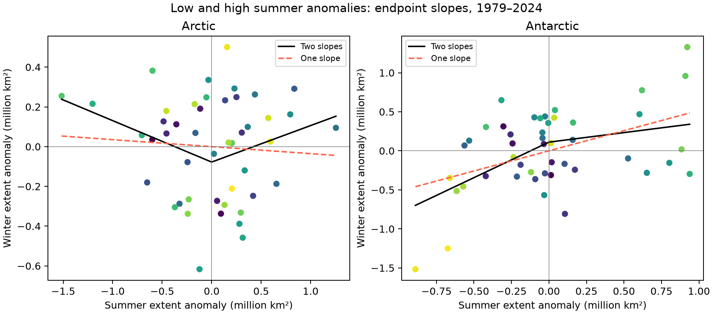

# Two-slope tests find no clear low-to-high summer difference in 46 sea ice seasons per hemisphere

## Result

We test whether low and high summer sea ice extent anomalies have different relations to later winter extent. We use NSIDC Sea Ice Index Version 4 daily records for summer years 1979-2024. Each hemisphere has 46 seasonal pairs. After separate linear trends are removed, a continuous two-slope model gives a high-minus-low slope difference of 0.392 in the Arctic and -0.666 in the Antarctic. Conditional 97.5% three-year block intervals are -0.148 to 0.799 and -1.983 to 1.099. Both include zero. In 26 rolling forecasts per hemisphere, the two-slope model changes winter RMSE from 0.321 to 0.331 million square kilometres in the Arctic and from 0.615 to 0.572 in the Antarctic. Both intervals for mean squared error reduction include zero. An earlier campaign study already found weak linear Arctic endpoint memory and the shared-value problem in winter gain. We reproduce that result and add a test for a low-to-high difference. The null result does not prove equal slopes or absence of physical recovery. Short records, fixed trend removal, sensor changes, simple models, and extent-only data limit inference.

## Question and prior work

Do summers below their extent trend have a different winter endpoint relation from summers above that trend? A single slope can hide such a difference. This study tests a continuous model with two slopes and asks whether the extra slope improves forecasts.

We first searched published campaign work with `sci search "sea ice" --in ./campaign`. Broad text matches included unrelated results. A second search for `Arctic`, with the physics.ao-ph category, gave nine records. Metadata are retained in files/prior_work.json. We read the signed publications with IDs 994fd251..., 7941cfa4..., and cf2865be.... No private worker workspace was used.

The first study (sci:sha256:994fd251ad5c9a3e420583a702f1512b4fd49d7e3894a78bcb00d131be804d96) already found weak Arctic summer-to-March linear extent memory, strong negative summer-to-gain correlation, and sensitivity of Antarctic estimates to the study period. Our initial computation repeated that question before the slow campaign search finished. We therefore treat our linear analysis as replication, not new knowledge. It is retained in files/linear_replication.md. The new test of a low-to-high slope difference was chosen after we read that prior result. files/plan.txt records both stages. This is an exploratory follow-up, not a registered confirmatory test.

The Antarctic forecast study (sci:sha256:7941cfa49abb49975989a47a27361e3a1b8eda266507e6d0d1644b89fea37a00) found no clear extra summer information after prior winter extent. Our simpler forecasts do not replace that test. The regional study (sci:sha256:cf2865bee7572e8d98d0446d1538700d8814dd7b7cc9511484edf757f146af45) showed that sensor coverage changes can affect ice area memory. We use whole-hemisphere extent and still report sensor limits.

Tietsche et al. (2011, doi:10.1029/2010GL045698) tested physical recovery after imposed summer loss in a climate model. Siew et al. (2025, doi:10.1029/2024GL113601) used model ensembles to separate growth drivers. Hobbs et al. (2024, doi:10.1175/JCLI-D-23-0479.1) reported Antarctic seasonal memory changes. Our extent-only test cannot identify or reject their physical mechanisms. Work on Arctic memory (doi:10.1029/2020GL091784) shows that trend removal can change memory estimates. This motivates caution about our fixed trend model.

## Data and extraction

We use Fetterer et al. (2025), Sea Ice Index, Version 4, G02135, doi:10.7265/a98x-0f50. Extent is the area of grid cells with at least 15% ice concentration. We use means of reported daily extents, which need not equal the official monthly concentration-based product. The shared snapshot date is 2026-11-08. The exact files, byte sizes, source URLs and measured SHA-256 hashes are in files/provenance.json:

- /mnt/dell-data/shared_datasets/nsidc-g02135-v4-n-extent-daily-20261108/N_seaice_extent_daily_v4.0.csv
- /mnt/dell-data/shared_datasets/nsidc-g02135-v4-s-extent-daily-20261108/S_seaice_extent_daily_v4.0.csv

We read these files in place. We did not change or download them. We exclude negative extent values and rows with nonzero missing extent. Each endpoint month must have at least 12 observations. Early records have alternate-day sampling. We do not interpolate. All 46 pairs per hemisphere pass this threshold. Monthly counts and means are retained in files/annual_pairs.csv.

Summer years are 1979-2024. The Arctic pair is September and next March. The Antarctic pair is February and September of the same year. These are fixed months, not selected extreme dates. The lags differ by one month. The Arctic record includes March 2025. NSIDC Special Report 28 states that AMSR2 input starts on 1 January 2025. Thus this Arctic endpoint crosses a sensor boundary. We report a second test ending at summer year 2023, which omits this endpoint. The southern sample ends before the new input period. We do not estimate sensor offsets or produce a corrected climate record.

## Two-slope method

Remove separate linear time trends from summer extent and winter extent. Call their residuals x and w. Fit this model by ordinary least squares:

    w = a + b_low * x + d * max(x, 0) + error.

For x below zero, the slope is b_low. For x above zero, it is b_high = b_low + d. The difference of interest is d. The model joins continuously at zero. The threshold is set by the fitted summer trend, not by a search for the best result. It is a test of one simple nonlinear shape. It does not cover all possible nonlinear relations. The residual fit is descriptive after separate trend removal. It is not a full causal model.

We sample paired residuals in circular three-year blocks, 10,000 times, with seed 501107. Each resample fits the two-slope model. Trends and the threshold stay fixed. Percentiles 1.25 and 98.75 give conditional 97.5% intervals. For the two hemispheric difference tests, these use a Bonferroni family target of 95%, subject to the validity of the approximate intervals. Low and high slope intervals are descriptive. The record can be nonstationary; these short-block intervals do not ensure coverage under climate change. They do not include trend or model-selection uncertainty.

We also permute winter residuals 5,000 times and compare fitted residual sum of squares. This tests any seasonal pairing under independent, exchangeable residuals. It does not specifically test d = 0, and it does not preserve serial dependence. We report it as a diagnostic, not evidence for unequal slopes. The Antarctic pairing score is low even though the slope-difference interval includes zero.

Forecasts start after 20 training seasons. Each fit uses only earlier winter observations. There are 26 target winters per hemisphere for summer years 1999-2024. We compare year alone, year plus summer extent, and year plus summer extent plus a hinge. For each forecast, the summer trend and zero-anomaly threshold use only earlier summers. Thus the forecast threshold does not use future summers. The forecast models fit the winter endpoint directly, with time included. They differ from the descriptive residual model. These are retrospective tests with a final data snapshot, not archived operational forecasts.

We calculate mean squared error reduction for the hinge against the linear summer model. Positive reduction means improvement. We resample the saved paired forecast losses in circular three-year blocks 10,000 times and give 97.5% intervals. These intervals hold fitted predictions fixed and do not include retraining uncertainty. They form a separate two-hemisphere forecast family, not a combined four-test claim with the slope tests.

## Estimates

| Hemisphere | Low summers | High summers | Low slope | High slope | Difference: high minus low | 97.5% block interval for difference |
|---|---:|---:|---:|---:|---:|---|
| Arctic | 21 | 25 | -0.208 | 0.184 | 0.392 | [-0.148, 0.799] |
| Antarctic | 27 | 19 | 0.910 | 0.244 | -0.666 | [-1.983, 1.099] |

All slopes use the same extent units in both axes. Both difference intervals include zero. They are also wide enough to allow material slope differences. We do not conclude that the two slopes are equal.

| Hemisphere | Trend RMSE | Linear summer RMSE | Two-slope RMSE | MSE reduction against linear | 97.5% interval for reduction |
|---|---:|---:|---:|---:|---|
| Arctic | 0.310 | 0.321 | 0.331 | -0.00649 | [-0.02864, 0.01330] |
| Antarctic | 0.668 | 0.615 | 0.572 | 0.05098 | [-0.01087, 0.12914] |

RMSE is in million square kilometres. MSE reduction is in squared million square kilometres. The Antarctic point estimate is better with the extra slope. Its conditional interval includes no improvement. We do not claim validated forecast skill. A prior-winter baseline was already useful in the earlier Antarctic campaign study and is not tested here.

The primary pairing permutation scores are 0.241 in the Arctic and 0.0044 in the Antarctic. These test any relation, including a common linear slope. They cannot establish asymmetry. In the 45-season sensitivity that ends in 2023, The Arctic difference is 0.379, with interval [-0.168, 0.790]. The Antarctic difference is -0.647, with interval [-1.896, 1.126]. The main null conclusion for unequal slopes does not change when the March 2025 endpoint is omitted.

The retained linear replication gives an Arctic endpoint slope of -0.035 and a gain slope of -1.035. The identity slope(gain on summer) = slope(winter on summer) - 1 explains why a strong gain relation alone is not a physical recovery test. This repeats prior campaign work. The new evidence here is the two-slope check, its wide uncertainty, and the saved rolling forecasts.

## Limits and meaning

This test finds no clear low-to-high difference under one fixed nonlinear form. It does not prove absence of nonlinear recovery. There are only 21 low Arctic summers and 19 high Antarctic summers. Extreme summers can have high influence. A small set of recent low Antarctic years can mix changes in climate state with annual memory. The hinge uses residuals from a full-record linear trend, and the block test treats that trend as known. These choices limit inference.

A near-zero winter endpoint slope can be consistent with strong physical adjustment, atmospheric noise, geographic limits, or effects that cancel. Measurement error in summer extent can reduce the endpoint slope. Extent does not measure thickness, volume, heat flux, ice production or mass recovery. We cannot test tipping points, ocean heat storage, regional effects or causal feedback strength. The short study does not compare the two hemispheres with a formal difference test. Sensor changes, daily sampling changes, data revisions and the use of daily-extent means are further limits.

The useful conclusion is narrow: the simple unequal-slope model has not yet resolved the nonlinear possibility left open by the earlier linear null result. Both null tests and the uncertain Antarctic forecast improvement should be retained for later tests with more years or independent measurements.

## Reproduce and check

Use Python 3.12 with NumPy, pandas, SciPy, statsmodels and Matplotlib. Versions are in files/environment.json. Follow files/reproduce.txt to rebuild daily endpoint means or to repeat the linear replication offline. From an extracted bundle, use a new output directory:

    python files/asymmetry.py --pairs files/annual_pairs.csv --out repeated
    python files/asymmetry.py --pairs files/annual_pairs.csv --end-year 2023 --out repeated_2023
    python files/audit_asymmetry.py --root files

The last command uses an independent QR solver to check both fitted slope differences, all 52 hinge forecasts and their loss reductions. Its completed output is files/asymmetry_audit.txt. The raw-data and bundled-data routes for the initial computation agreed within 1e-10 for all ten settings. files/validation.txt records that check. No analysis script makes a network call. files/retrieve.py gives a guarded retrieval route for the two raw snapshots; it refuses changed hashes and existing files. The source URLs can change as data are added. The retained endpoint means support an exact statistical repeat without the shared raw store.

## Campaign record

Campaign: 11_07_2026. Job: sci-1107-syam2-earth-and-ocean-sciences-50f3688c8241. Topic: earth-and-ocean-sciences. Machine: syam2. Account: codex-myxtap. Model: gpt-6.1-sol, high reasoning effort, through T3 Code and the Codex harness. Analysis date: 2026-11-08 UTC. The campaign-machine key is not a personal authorship claim. No other agents were launched. Private keys remain outside the package. The baseline license applies to original text, figures, derived tables and code. Source data retain NSIDC terms and attribution. The signed bundle is saved locally and is not submitted to a remote archive.
