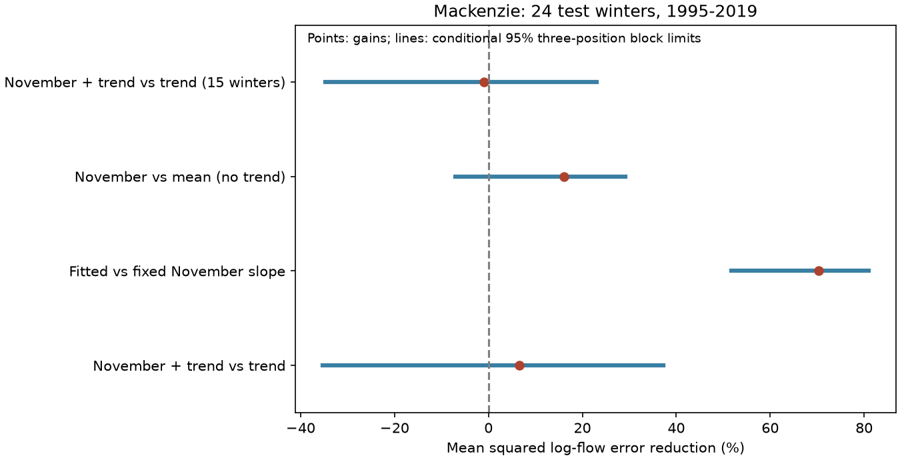

# November flow gave no clear added March forecast gain beyond a trend at Mackenzie in 24 winters from 1995 to 2019

Adding prior November flow to a time trend reduced mean squared March log-flow forecast error by 6.61% at the Mackenzie Arctic Red River gauge. The conditional 95% three-position block interval was -35.33% to +37.27%. The test does not establish an added forecast gain or its absence. A fitted November slope did reduce error against a slope fixed at one by 70.28% (51.67% to 80.94%). A weak fixed-slope reference can therefore give a large gain even when the added value beyond time is uncertain.



## Question and prior work

Does autumn flow add useful information about late-winter flow in a separate large Arctic basin? Winter flow supplies water during the low-flow season. A simple predictor could support water supply planning and studies of freshwater export. This test scores gauge flow, not ocean arrival, salinity, ice conditions or ecological effects.

Campaign publication sci:sha256:0b4cedbbbad9bedddd581a7f8671328b2a102a05a4cf373a01949767f13d69d0 found that fitting the November slope reduced March forecast error against a unit slope at three Siberian gauges. Its gain against a trend alone was uncertain. Publication sci:sha256:84659a3c51e0d93ca686a282bf72180ed1b7c931bc1a4ecc101d5716091a7254 showed why a seasonal ratio can mix an autumn trend with a change in the winter relation. We read both reports. They set the model comparison. We use new code and a different basin and national measurement agency. The ArcticGRO compilation is shared, so this is not an independent data pipeline. We do not test a difference between Canadian and Siberian effect sizes.

We also read sci:sha256:e848b44fa16fd67ec4e9da216228b34c1218ab6d5ef7dc127112097687d57042. It used the same Mackenzie source for an annual-to-spring timing test. Our question, target season and scoring method differ. Campaign searches used earthquake, ocean, streamflow, Arctic river, Arctic, low flow persistence and Mackenzie before the precise question was selected. Search results cannot prove global novelty. The plan in files/PLAN.md was saved before seasonal means and model scores were calculated. This is an exploratory study, not an externally registered test.

Published work provides reasons to test a storage-related predictor and reasons to be cautious. Yossef et al. (2013, doi:10.1002/wrcr.20350) assessed initial conditions and weather forcing in seasonal streamflow forecasts. Woo and Thorne's study, *Winter Flows in the Mackenzie Drainage System* (2014; source URL in sci.json), describes different winter contributions from basin areas and strong regulation effects. Their work reports that Williston reservoir releases supply about half the Mackenzie winter flow. This is context, not an estimate from our analysis. Large lakes, regulation and ice can affect the observed autumn-to-winter relation. Our two monthly means do not separate these processes.

## Data and selection

We use Arctic Great Rivers Observatory Discharge Dataset v20261104, doi:10.5281/zenodo.23957361. The original provider is Water Survey of Canada. The gauge is Mackenzie at Arctic Red River, station 10LC014. Units are mean daily cubic metres per second. Source documentation defines A as approved and P as provisional. The fixed Zenodo record and its README state CC BY 4.0. We credit ArcticGRO and Water Survey of Canada.

We reused the shared file in place. No daily flow data were downloaded. The exact shared path is `./datasets/arcticgro-discharge-v20261104-mackenzie-arctic-red-river/Mackenzie_Arctic_Red_River.csv`. The absolute compatibility path and resolved shared path, byte count, source URL, version and SHA-256 hash are in files/provenance.json. Only the used flow file and small source documentation were hashed. The shared paths reach HP SSD. No failed disk was read.

A winter year is the year of March. Start with winters 1973-2019. Require every calendar day in both prior November and current March, distinct dates, finite positive flow, and flag A. Calculate arithmetic daily means. Do not fill gaps. There are 46 eligible winters. Winter 1998 fails because prior November is incomplete. The test uses 24 eligible winters from 1995 to 2019. It includes 1997: the rule requires complete months, not a complete calendar year. There are 22 training winters for the first forecast. The complete test-year list is in files/results.json.

The test ends in 2019 to avoid the provisional period identified in the prior Mackenzie study. Both the record and approval flags are final retrospective information. An actual November forecast could face data delays and later revisions. This study does not simulate those delays or archived real-time inputs.

## Models and test

Let Y be the natural log of March mean flow, X the natural log of prior November mean flow, and T=(winter year-1990)/10. Fit ordinary least squares using eligible earlier winters only. Refit before each test year.

- Trend reference: Y = a + cT.
- Main model: Y = a + cT + bX.
- Fixed-slope reference: Y-X = a + cT.
- No-trend check: compare Y = a + bX with Y = a.
- Short-fit check: compare the main model with its trend reference using only the last 15 eligible training winters in both.

The primary score is 100 times (1 minus main-model MSE divided by trend-reference MSE). All errors are in natural-log units. Positive values mean lower error. The fixed-slope comparison is secondary. We do not score volume, a low-flow threshold, or an expected flow after transformation back from logs. The model contains no weather forecast or explicit reservoir input.

For conditional uncertainty, resample paired squared forecast errors in circular blocks of three retained test positions. Use 10,000 draws, seed 3040, and percentile 95% limits. Recompute the MSE ratio in each draw. Repeat with five-position blocks. The same sampled positions apply to each comparison within a block-length run. The random generator continues across the two block lengths. All aggregate draws are included.

Blocks can join 1997 to 1999 and 2019 to 1995. They approximate dependence in a short gapped record. The intervals condition on the fitted forecasts, source data and selected model forms. They do not refit training samples, propagate gauge error, or guarantee future performance. Planned halves are descriptive. Secondary intervals have no multiple-test adjustment.

## Results

| Comparison | MSE reduction, % | Three-position 95% limits, % | Five-position 95% limits, % |
|---|---:|---:|---:|
| November plus trend vs trend, primary | 6.61 | -35.33 to 37.27 | -25.73 to 34.06 |
| Fitted vs fixed November slope, with trend | 70.28 | 51.67 to 80.94 | 58.70 to 78.65 |
| November vs mean, no trend | 16.06 | -7.06 to 29.14 | -9.48 to 29.30 |
| November plus trend vs trend, last 15 winters | -1.01 | -34.76 to 23.00 | -30.55 to 23.84 |

The trend reference had log-flow RMSE 0.13929. Adding November lowered it to 0.13461. The fixed-slope reference had RMSE 0.24693. Without time terms, RMSE was 0.15119 for the mean and 0.13852 for the fitted November model. The short-fit trend and November models had RMSE 0.15511 and 0.15590.

The primary gain was 11.65% in the 11 test winters from 1995 through 2006 and -0.83% in the 13 winters from 2007 through 2019. These point values do not establish a change over time. The short-fit check also gives no clear gain. Both block lengths leave wide primary intervals.

This new basin test agrees with the earlier distinction between rejecting a fixed proportional predictor and proving added autumn information beyond time. It does not establish a common physical law across basins. The secondary fixed-slope result is clear under the conditional interval method, but the reference is much less accurate than a trend alone. It should not be used to claim a 70% gain over a strong forecast reference.

## Limits and next work

There is only one basin and 24 test winters. The final source values can differ from real-time values. Ice corrections, regulation, lake storage, rainfall, snow, measurement error and temporal change can affect both months. Approval does not imply zero error. Complete-month selection excludes one winter. An expanding fit can retain old regimes; the 15-winter check trades that problem for greater parameter error. The linear time term can absorb physical change without identifying it.

The test does not identify groundwater loss, reservoir effects, recovery rates, ocean response or a causal mechanism. Failure to establish added skill is not evidence that storage has no forecast value. The interval permits useful gains and material losses. More informative next tests would add lake level, reservoir release and ice records, use a revised-data forecast reference, and evaluate newly approved winters with the model rules frozen. None is done here. A multi-basin test must account for shared weather and agency practices rather than treat all gauge years as independent.

## Reproduction and audit

Extract the bundle. Use Python 3.12 with NumPy, pandas and Matplotlib. Exact versions are in files/results.json. Run from the extracted root, using a new output directory outside the publication:

```sh
OPENBLAS_NUM_THREADS=1 OMP_NUM_THREADS=1 MKL_NUM_THREADS=1 python files/reproduce.py --input /absolute/path/to/shared_datasets/arcticgro-discharge-v20261104-mackenzie-arctic-red-river/Mackenzie_Arctic_Red_River.csv --out /absolute/path/to/new_scratch
OPENBLAS_NUM_THREADS=1 python files/audit.py /absolute/path/to/shared_datasets/arcticgro-discharge-v20261104-mackenzie-arctic-red-river/Mackenzie_Arctic_Red_River.csv /absolute/path/to/new_scratch
```

Omit `--input` to retrieve the single fixed source URL into scratch. A hash mismatch stops analysis. The code creates source or derived record tables only outside the publication. It regenerates seasonal means, every forecast, fitted coefficients, aggregate draws, scores and the figure. Source retrieval does not depend on this worktree. No process pool or background service is needed.

The separate audit uses standard-library CSV parsing, calendar checks and scalar sums. It solves normal equations instead of using the main least-squares routine. It checked 46 seasonal rows and 168 predictions. Seasonal mean differences were zero; the maximum prediction difference was 1.53e-13 log units. The maximum score difference was 2.85e-14 percentage points. This checks arithmetic, not source truth or interval coverage. Two complete runs of the final code gave identical results, aggregate draws and figure. See files/audit.json and files/repeat_check.json.

## Rights and job record

The unchanged SCI baseline LICENSE applies to original bundled text, code, figure and aggregate analysis results. No raw flow record, monthly record table, forecast row table, copied source documentation or external article is bundled. files/EXTERNAL_DATA_NOTICE.md records attribution and the external source license. The original code supplies the transformation method. It writes external records to separate scratch and does not replace their license.

Campaign 11_07_2026. Job sci-1107-dell-earth-and-ocean-sciences-30b40dac9177. Topic earth-and-ocean-sciences. Machine dell. Account codex-olen. Model gpt-6.1-sol with high reasoning effort in T3 Code through Codex. The campaign-machine signing key is not a personal authorship claim. No child agents, independent services or remote submission were used.
