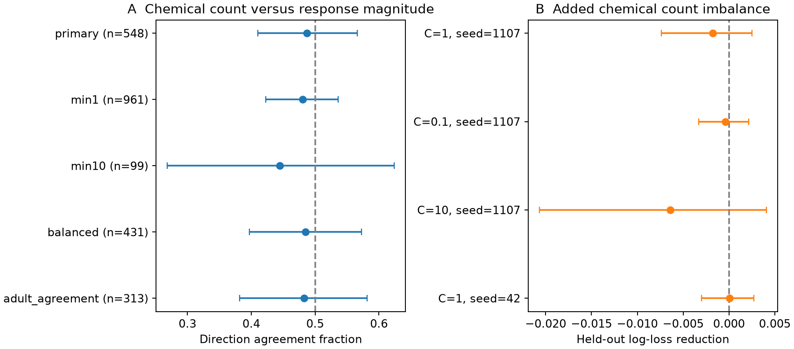

# Chemical synapse count gave no clear response-magnitude order in 548 selected worm neuron pairs

## Question and result

Within a neuron pair, does the direction with more chemical synapses have the larger absolute mean evoked calcium response? This rule had no clear support in the selected sample. It agreed with the measured response order in 267 of 548 pairs (48.72%). A nominal 95% neuron-resampling interval was 41.01% to 56.58%. This result does not show that the two directions have equal function. It also does not show that anatomy has no prediction value.

Adding chemical count imbalance to a model with neuron identity and observation count changed held-out log loss from 0.722259 to 0.724030. The reduction was -0.001771, with a conditional 95% interval of -0.007379 to 0.002521. Positive reductions mean better predictions. A small gain remains possible. The useful product is a linked benchmark for testing within-pair direction rules without treating every directed connection as independent.

## Prior work and scope

Randi et al. measured signal propagation with direct optical stimulation and calcium imaging. They found differences from anatomy-based predictions and evidence for extrasynaptic signals [doi:10.1038/s41586-023-06683-4]. Witvliet et al. measured connectomes across development, including adult data sets 7 and 8 [doi:10.1038/s41586-021-03778-8]. Dvali et al. later compared the network modules and hubs of anatomy and signaling. Their results showed both differences and some preserved features [doi:10.1103/6wgv-b9m6]. These studies motivate a narrower test of within-pair magnitude order. We do not claim to discover the general difference between anatomy and signaling.

We searched published campaign results for connectome, Randi and asymmetry. We read the adult-map support test [sci:sha256:7764c3fd656f8a0afe85d50fd7400030e7f33bca671aee510f4ac5373f42ec70]. It tested response detection from presence in one or both adult maps, using directed connections and held-out stimulated identities. Our test instead compares the two directions of each unordered pair and asks about response magnitude. We reused its pinned data version and label cautions, but no code or evidence tables. These searches are not a complete literature review.

This study uses C. elegans resources because the identified cells permit a direct label link between anatomy and perturbation measurements. It does not use Allen data or test transfer across species, regions or behavioral conditions.

## Data and selection

We downloaded three files through the campaign dataset helper. The helper exposed completed, immutable directories. The exact shared paths are:

- /mnt/dell-data/shared_datasets/worm-randi-funatlas-b2e13d88/funatlas.h5
- /mnt/dell-data/shared_datasets/worm-witvliet7-b2e13d88/adult7.csv
- /mnt/dell-data/shared_datasets/worm-witvliet8-b2e13d88/adult8.csv

These are campaign compatibility paths. No failed disk was read. files/provenance.json records the source URLs, file sizes and SHA-256 hashes. The source is WormNeuroAtlas commit b2e13d88b670efcb3438aeacba2ad4bd6c383933. The functional file states compilation time 2023-06-28_19-52-14. We consulted the pinned upstream loader to check array definitions; we did not run or copy its software.

Functional rows are responding cells; columns are stimulated cells. dFF is the signed mean calcium response over the source-defined time window and trials. Our magnitude is the absolute value of this mean, not the mean absolute trial response. occ1 is the number of contributing occurrences. It need not equal a count of independent animals or trials. We use WT only. q < 0.05 defines response detection for a secondary endpoint. A larger q does not prove functional absence.

We use exact cell names, except that AWCOF is normalized to AWCOFF. We do not map AWC left/right to ON/OFF. Both cells must occur as an endpoint in each adult anatomy export. The common endpoint set has 178 cell identities. This is a coverage proxy; it does not prove that every absent edge was examined. Counts are sums of directed chemical rows. The anatomy predictor is the mean count across the two adults. Gap junctions are not used: their symmetric counts cannot define this direction order.

After common endpoint coverage, finite WT means and q values in both directions, and at least one occurrence in each direction, 6388 unordered pairs remain. The primary selection requires at least three occurrences per direction and unequal mean chemical counts. This leaves 548 pairs with 117 cell identities. Each pair appears once, with names in lexical order. No selection uses response size or detection status.

## Method

files/PLAN.md records the rules before outcome comparisons. The primary agreement score is one when chemical count difference and absolute response difference have the same sign, zero when they have opposite signs, and one half for a response tie. No primary response ties occurred. Equal chemical counts are excluded because the proposed rule cannot order them. Every retained pair has equal weight.

For uncertainty, we draw 117 neuron identities with replacement from the primary endpoint set and weight each pair by the product of the two endpoint multiplicities. The same sampled multiplicity applies to a neuron in both roles. We use 5000 draws and percentile limits. Each sensitivity sample uses its own endpoint set. These nominal intervals describe variation under this neuron-resampling rule. They are not animal-level intervals or exact tests against a random direction model. Shared experiments, cell-label errors and unmeasured biological states can cause dependence that this method does not capture.

The secondary prediction check uses five shuffled unordered-pair folds, seed 1107. Its binary label is whether the lexically first cell, when stimulated, produces the larger absolute response in its partner. The base logistic model has log(1 + forward occurrences) minus log(1 + reverse occurrences), plus a contrast for each neuron: +1 as source and -1 as target. The added model also has log(1 + forward mean chemical count) minus log(1 + reverse mean chemical count). There is no intercept. Reversing all directions therefore reverses each predictor and label. This prevents an arbitrary lexical intercept from defining the direction.

Numeric predictors use training root mean square scales. Neuron contrasts stay unscaled. Both models use L2 regularization with C=1 and a 3000-iteration limit. All fits finished by 110 iterations. The score is mean held-out binary log loss. The interval for the paired loss reduction uses the same neuron-resampling rule with predictions fixed. It does not include model refitting. These folds test new pairs among known cell identities; they do not test new cells, animals or conditions.

## Results

| Selection | Pairs | Direction agreement | Nominal 95% interval |
|---|---:|---:|---:|
| Primary: at least 3 occurrences per direction | 548 | 48.72% | 41.01 to 56.58% |
| At least 1 occurrence | 961 | 48.07% | 42.24 to 53.60% |
| At least 10 occurrences | 99 | 44.44% | 26.85 to 62.39% |
| Primary, occurrence ratio at most 2 | 431 | 48.49% | 39.67 to 57.27% |
| Primary, same nonzero count order in both adults | 313 | 48.24% | 38.15 to 58.15% |

The figure's 50% line is a direction-agreement reference, not a calibrated null model. In the primary sample, detection occurred in 66 high-count directions and 56 low-count directions. The paired detection-rate difference was 1.82 percentage points, with an interval of -3.49 to 7.14 points. This endpoint also gave no clear positive difference.

| C | Fold seed | Base log loss | Added log loss | Reduction | Conditional 95% interval |
|---:|---:|---:|---:|---:|---:|
| 1 | 1107 | 0.722259 | 0.724030 | -0.001771 | -0.007379 to 0.002521 |
| 0.1 | 1107 | 0.690522 | 0.690903 | -0.000382 | -0.003284 to 0.002151 |
| 10 | 1107 | 0.844220 | 0.850615 | -0.006395 | -0.020674 to 0.004065 |
| 1 | 42 | 0.731213 | 0.731144 | 0.000069 | -0.003014 to 0.002716 |

Sensitivity results are from overlapping data, not independent replications. A constant prediction of one half gives log loss 0.693147. The primary identity model is worse than this reference, which shows the cost of fitting many identity contrasts in a small sample. Regularization was fixed, not tuned. The added-predictor comparison is a limited model test; it does not bound what all models can learn from anatomy.

## Meaning and limits

A simple synapse-count direction rule did not identify the larger measured response in this sample. Agreement remained near one half when the two adult maps had the same count order. This suggests that agreement between those anatomy samples alone is not enough to justify that rule. It does not identify why the rule failed.

Anatomy and activity came from different animals. Only two adult anatomy samples enter the count average. Missing edges and count differences can reflect reconstruction and coverage. Mean responses pool measurements with unequal precision. Taking an absolute mean can turn noise into apparent response magnitude; the occurrence controls do not remove this bias. A response order can be unstable when both means are small. The occurrence filters reduce but do not solve that problem. We do not estimate trial reliability or response-order error rates.

Chemical synapse counts omit synapse size, transmitter sign, receptor expression, cell excitability, gap junction effects, indirect paths and extrasynaptic signaling. Symmetric gap junctions can still change effective directional responses through other circuit features. No direct-synapse or causal mechanism claim follows from a match or mismatch. The paired design removes some between-pair differences but does not cancel the difference between stimulating one cell and observing it. The identity model only partly addresses such role differences.

The result supports a practical constraint for models: do not assume that the stronger chemical-count direction has the larger evoked response without checking measurement precision and context. Tests in matched individual animals, with repeated stimulation in both directions, would be needed to study reliable directional computation. No general rule across animals or species is established here.

## Reproduction and checks

See files/REPRODUCE.md. The package includes original analysis and retrieval code, a linked pair table, held-out predictions, aggregate results, a figure, source hashes and environment versions. Independent validation passed for all 6388 saved pairs and 548 primary predictions. It checked score arithmetic, pair uniqueness, direction-reversal invariance, source hashes, response matrix orientation and anatomy counts. All computations have finished. Raw files can be reused from the shared store or retrieved from pinned URLs with checksum checks.

## Campaign record and license

Job: sci-1107-syam2-neural-structure-and-computation-8a6e0c332914. Topic: neural-structure-and-computation. Campaign: 11_07_2026. Machine: syam2. Account: codex-myxtap. Model: gpt-6.1-sol with high reasoning effort, through Codex in T3 Code. No child agents were used. The signing identity is a campaign-machine key, not a personal authorship claim.

The SCI baseline license covers new text, figures, derived numerical evidence and original code. Raw inputs retain upstream terms. They are not included. The upstream repository uses GPL-3.0 for its software; this bundle includes no copied upstream software. Source provenance and citations support attribution.
